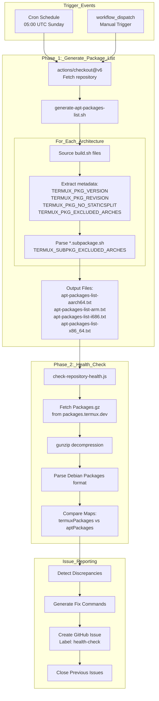
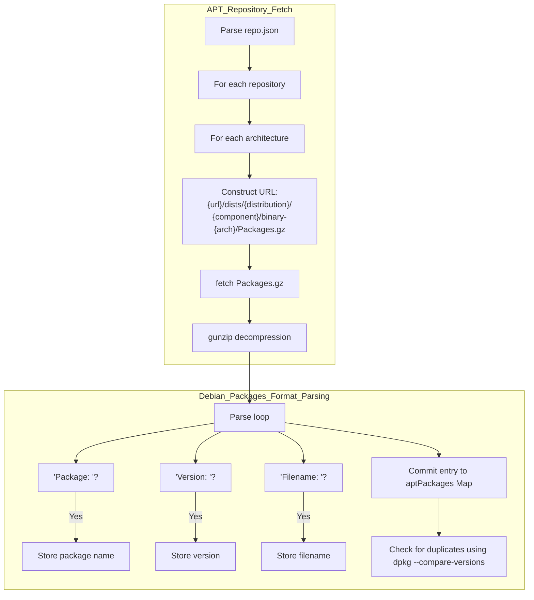
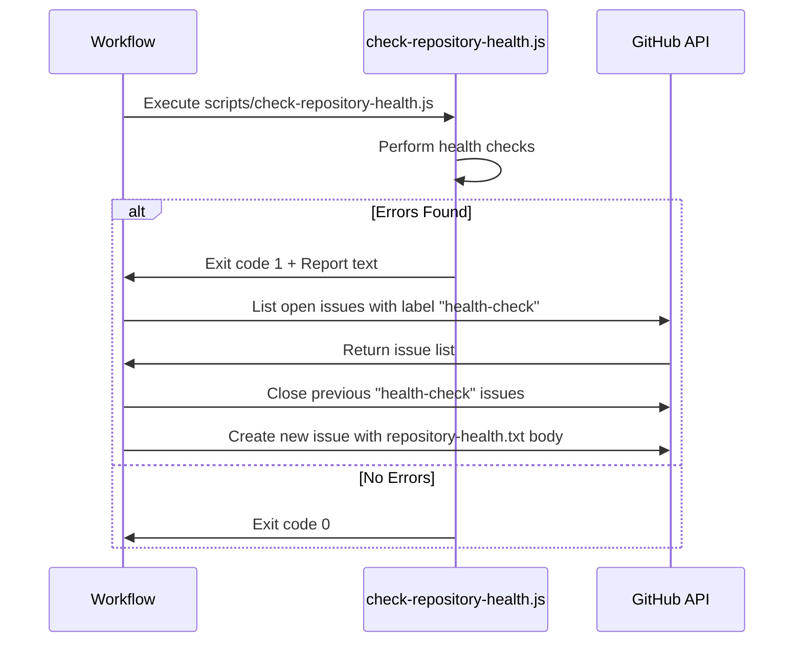

<!-- source: DeepWiki mcp.deepwiki.com · repo termux/termux-packages · page 3.4 Repository Health Checks · fetched 2026-10-26 -->

# Repository Health Checks

Relevant source files

The following files were used as context for generating this wiki page:

- [.github/actions/zram/action.yml](.github/actions/zram/action.yml)
- [.github/workflows/bootstrap_archives.yml](.github/workflows/bootstrap_archives.yml)
- [.github/workflows/check_repository_health.yml](.github/workflows/check_repository_health.yml)
- [.github/workflows/codeql.yml](.github/workflows/codeql.yml)
- [.github/workflows/command_not_found.yml](.github/workflows/command_not_found.yml)
- [.github/workflows/docker_image.yml](.github/workflows/docker_image.yml)
- [.github/workflows/golang_validation.yml](.github/workflows/golang_validation.yml)
- [.github/workflows/package_updates.yml](.github/workflows/package_updates.yml)
- [.github/workflows/packages.yml](.github/workflows/packages.yml)
- [.github/workflows/zig_validation.yml](.github/workflows/zig_validation.yml)
- [scripts/bin/validation](scripts/bin/validation)
- [scripts/free-space.sh](scripts/free-space.sh)
- [scripts/run-docker.sh](scripts/run-docker.sh)

The Repository Health Check system is an automated quality assurance mechanism that validates consistency between package definitions in the `termux-packages` repository and the live APT repository at `packages.termux.dev`. It runs weekly to detect missing packages, version mismatches, orphaned packages, and static subpackage inconsistencies.

This page covers the automated health check workflow and issue detection. For the main build workflow that uploads packages to APT, see [Main Build Workflow](#3.1). For automated package version updates, see [Automated Package Updates](#3.3).

## System Architecture

The health check system operates in two phases: first generating a complete package list from `build.sh` definitions, then comparing against the live APT repository to identify discrepancies.

Sources: [.github/workflows/check_repository_health.yml:1-54](), [scripts/generate-apt-packages-list.sh:1-98](), [scripts/check-repository-health.js:1-363]()

## Workflow Configuration

The health check workflow is defined in `.github/workflows/check_repository_health.yml` and executes weekly or on manual trigger.

| Configuration | Value | Purpose |
|--------------|-------|---------|
| Schedule | `0 5 * * 0` | Runs 05:00 UTC every Sunday [.github/workflows/check_repository_health.yml:5-5]() |
| Runner | `ubuntu-slim` | Lightweight runner for script execution [.github/workflows/check_repository_health.yml:13-13]() |
| Repository | `termux/termux-packages` | Only runs on official repository [.github/workflows/check_repository_health.yml:12-12]() |
| Token | `TERMUXBOT2_TOKEN` | Required for creating GitHub issues [.github/workflows/check_repository_health.yml:34-34]() |

The workflow consists of three primary steps executed sequentially:

1.  **Repository clone** - Standard checkout with depth 1 [.github/workflows/check_repository_health.yml:15-18]().
2.  **Package list generation** - Invokes `generate-apt-packages-list.sh` and stores the output directory in a step output [.github/workflows/check_repository_health.yml:19-24]().
3.  **Health check execution** - Runs `check-repository-health.js` using Node.js, passing the generated directory as an argument [.github/workflows/check_repository_health.yml:25-31]().

Sources: [.github/workflows/check_repository_health.yml:1-54]()

## Package List Generation

The `generate-apt-packages-list.sh` script builds a reference dataset of expected packages by sourcing build definitions across all repository directories defined in `repo.json`.

```mermaid
flowchart LR
    subgraph "Input_Sources"
        REPO_JSON["repo.json<br/>Repository metadata"]
        BUILD_SH["packages/*/build.sh<br/>Package definitions"]
        SUBPKG_SH["packages/*/*.subpackage.sh<br/>Subpackage definitions"]
    end
    
    subgraph "Processing_Logic"
        REPO_JSON --> PARSE_REPOS["Parse repository paths"]
        
        PARSE_REPOS --> LOOP_ARCH["Loop: aarch64, arm, i686, x86_64"]
        
        LOOP_ARCH --> LOOP_REPOS["Loop: each repo_path"]
        
        LOOP_REPOS --> LOOP_PKGS["Loop: each package directory"]
        
        LOOP_PKGS --> SOURCE_BUILD["source build.sh"]
        
        SOURCE_BUILD --> CALC_VER["Calculate APT version"]
        
        CALC_VER --> CHECK_EXCL["Check TERMUX_PKG_EXCLUDED_ARCHES"]
        
        CHECK_EXCL --> OUTPUT_PKG["Output: pkg_name repo_name version may_have_static"]
        
        OUTPUT_PKG --> LOOP_SUBPKGS["Loop: *.subpackage.sh"]
        
        LOOP_SUBPKGS --> SOURCE_SUBPKG["source subpackage.sh"]
        
        SOURCE_SUBPKG --> CHECK_SUBPKG_EXCL["Check:<br/>TERMUX_SUBPKG_PLATFORM_INDEPENDENT<br/>TERMUX_SUBPKG_EXCLUDED_ARCHES"]
        
        CHECK_SUBPKG_EXCL --> OUTPUT_SUBPKG["Output: subpkg_name repo_name version false"]
    end
    
    subgraph "Output_Files"
        OUTPUT_PKG --> OUT_FILES["apt-packages-list-{arch}.txt"]
        OUTPUT_SUBPKG --> OUT_FILES
    end
    
    BUILD_SH --> SOURCE_BUILD
    SUBPKG_SH --> SOURCE_SUBPKG
```

### Metadata Extraction logic
For each package, the script sources `build.sh` to extract:
*   `TERMUX_PKG_VERSION` and `TERMUX_PKG_REVISION` [.scripts/generate-apt-packages-list.sh:40-50]().
*   `TERMUX_PKG_NO_STATICSPLIT` to determine if a `-static` subpackage is expected [.scripts/generate-apt-packages-list.sh:56-56]().
*   `TERMUX_PKG_EXCLUDED_ARCHES` to skip generation for incompatible architectures [.scripts/generate-apt-packages-list.sh:52-54]().

**Output Format:**
Each line in the generated `apt-packages-list-<arch>.txt` follows this format:
`<package_name> <repo_name> <version> <may_have_staticsplit>` [.scripts/generate-apt-packages-list.sh:56-56]().

Sources: [scripts/generate-apt-packages-list.sh:1-98]()

## Health Check Process

The `check-repository-health.js` Node.js script performs the core comparison logic by fetching live APT repository data and comparing against generated package lists.

### Repository Data Fetching
The script iterates through repositories defined in `repo.json` [.scripts/check-repository-health.js:33-53]() and fetches `Packages.gz` for each architecture [.scripts/check-repository-health.js:55-75]().

The parser handles the Debian repository format where package entries are separated by blank lines. Duplicate packages are detected and the script uses `dpkg --compare-versions` to determine which version to keep [.scripts/check-repository-health.js:102-134]().

Sources: [scripts/check-repository-health.js:55-149](), [scripts/check-repository-health.js:152-193]()

## Discrepancy Detection

The health check implements validation checks by comparing the `termuxPackages` (from local files) and `aptPackages` (from remote repo) maps.

### Detection Logic
The script identifies several health issues:
1.  **Wrong Repository**: Package exists in APT but in the wrong repository component [.scripts/check-repository-health.js:219-224]().
2.  **Version Mismatch**: Versions differ between the build script and the live repository [.scripts/check-repository-health.js:235-239]().
3.  **Orphaned Package**: Package exists in APT but has no corresponding directory in `termux-packages` [.scripts/check-repository-health.js:285-289]().
4.  **Missing Package**: Package is defined in the repo but missing from APT [.scripts/check-repository-health.js:299-302]().
5.  **Invalid Static Package**: A `-static` subpackage exists when `TERMUX_PKG_NO_STATICSPLIT=true` is set [.scripts/check-repository-health.js:255-259]().

### Automated Fix Generation
For removable packages (orphaned, wrong repository, invalid static), the script generates `aptly repo remove` commands [.scripts/check-repository-health.js:231-233](), [.scripts/check-repository-health.js:260-262]().

Example generated command:
`aptly repo remove "main" "pkg-name (=1.2.3) {aarch64}"`

Sources: [scripts/check-repository-health.js:208-310]()

## Issue Reporting System

When discrepancies are detected, the workflow creates a GitHub issue with diagnostic information and fix commands.

The workflow automatically closes any previous open issues with the same title before creating a new one [.github/workflows/check_repository_health.yml:40-45](), ensuring only the latest health status is tracked. The issue is assigned to the repository maintainer and labeled with `health-check` [.github/workflows/check_repository_health.yml:53-53]().

Sources: [.github/workflows/check_repository_health.yml:32-54]()

## Execution Environment

The health check runs in a minimal environment on the `ubuntu-slim` runner.

| Component | Implementation |
|-------------|----------------|
| Node.js | System-installed version with specific network options [.github/workflows/check_repository_health.yml:30-30]() |
| Disk Cleanup | Handled by `scripts/free-space.sh` in other workflows, but health check is lightweight [.scripts/free-space.sh:1-57]() |
| Container | Not used for health check; health check runs directly on host to minimize overhead [.github/workflows/check_repository_health.yml:13-13]() |

The workflow sets `NODE_OPTIONS="--network-family-autoselection-attempt-timeout=500"` [.github/workflows/check_repository_health.yml:30-30]() to ensure reliable network connectivity when fetching large `Packages.gz` files from the repository servers.

Sources: [.github/workflows/check_repository_health.yml:1-54](), [scripts/free-space.sh:1-57]()

---

