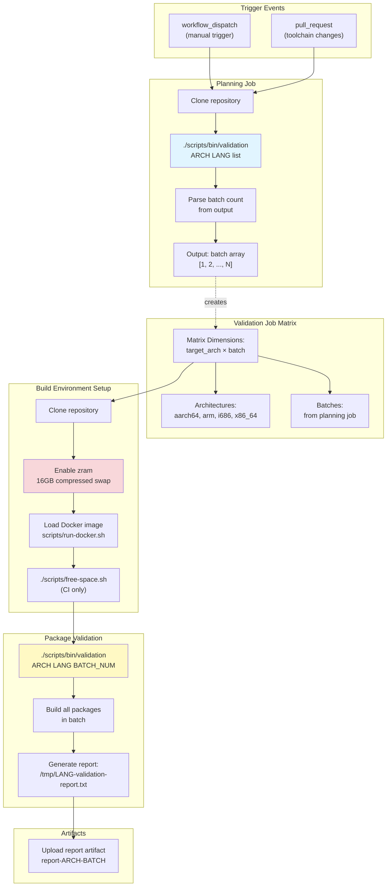
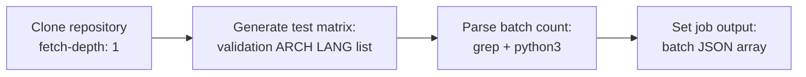
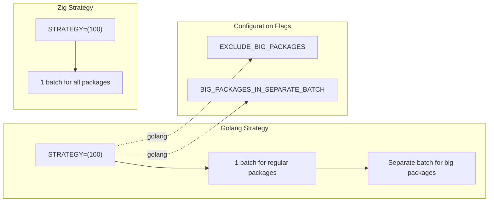
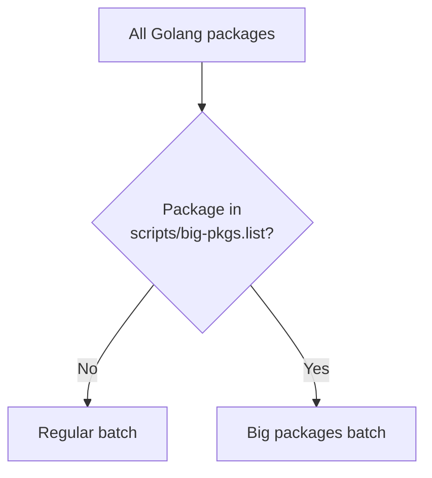
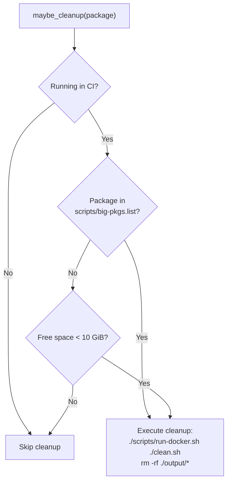
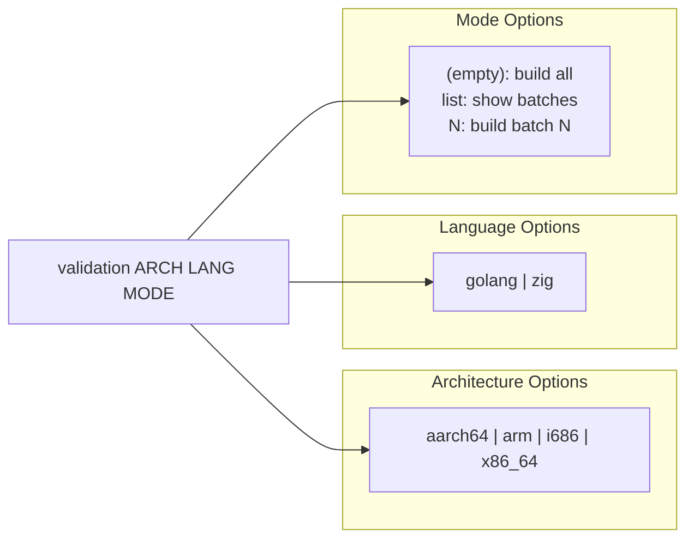
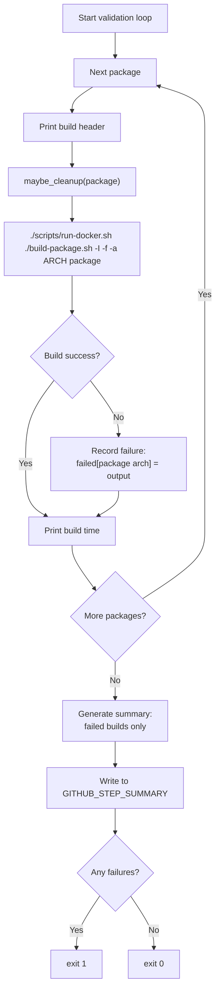

<!-- source: DeepWiki mcp.deepwiki.com · repo termux/termux-packages · page 3.5 Language-Specific Validation · fetched 2026-10-26 -->

# Language-Specific Validation

<details>
<summary>Relevant source files</summary>

The following files were used as context for generating this wiki page:

- [.github/actions/zram/action.yml](.github/actions/zram/action.yml)
- [.github/workflows/bootstrap_archives.yml](.github/workflows/bootstrap_archives.yml)
- [.github/workflows/check_repository_health.yml](.github/workflows/check_repository_health.yml)
- [.github/workflows/codeql.yml](.github/workflows/codeql.yml)
- [.github/workflows/command_not_found.yml](.github/workflows/command_not_found.yml)
- [.github/workflows/docker_image.yml](.github/workflows/docker_image.yml)
- [.github/workflows/golang_validation.yml](.github/workflows/golang_validation.yml)
- [.github/workflows/package_updates.yml](.github/workflows/package_updates.yml)
- [.github/workflows/packages.yml](.github/workflows/packages.yml)
- [.github/workflows/zig_validation.yml](.github/workflows/zig_validation.yml)
- [packages/flyctl/build.sh](packages/flyctl/build.sh)
- [scripts/bin/validation](scripts/bin/validation)
- [scripts/free-space.sh](scripts/free-space.sh)
- [scripts/run-docker.sh](scripts/run-docker.sh)

</details>


## Purpose and Scope

Language-specific validation workflows provide automated testing for all packages built with a particular language toolchain (currently Golang and Zig). These workflows are triggered when the language toolchain itself is updated, ensuring that all dependent packages continue to build successfully. This prevents breaking changes in language toolchains from going undetected.

For information about the general package build workflow, see [Main Build Workflow](#3.1). For details on how language toolchains are integrated into the build system, see [Language Toolchain Integration](#2.3).

## Validation Workflow Overview

The repository currently implements two language-specific validation workflows:

| Workflow | File | Supported Language | Trigger Paths |
|----------|------|-------------------|---------------|
| Golang Validation | `.github/workflows/golang_validation.yml` | Go | `packages/golang/build.sh`<br/>`scripts/build/setup/termux_setup_golang.sh` |
| Zig Validation | `.github/workflows/zig_validation.yml` | Zig | `packages/zig/build.sh`<br/>`scripts/build/setup/termux_setup_zig.sh` |

Both workflows follow identical architecture patterns and share the same validation script implementation at [scripts/bin/validation]().

**Sources:** [.github/workflows/golang_validation.yml:1-12](), [.github/workflows/zig_validation.yml:1-13]()

## Workflow Architecture



**Architecture Overview:** The validation system uses a two-phase approach. The `planning` job runs once per architecture to discover all packages using the target language toolchain and determine the optimal batch divisions. The `golang_validation` or `zig_validation` job then runs in a matrix across all architectures and batches, building each subset of packages independently inside the Termux Docker container.

**Sources:** [.github/workflows/golang_validation.yml:14-67](), [.github/workflows/zig_validation.yml:14-67]()

## The Planning Phase

The planning job executes on `ubuntu-slim` runners and performs package discovery without building anything. It generates the batch matrix that the validation job will use.

### Planning Job Steps



**Sources:** [.github/workflows/golang_validation.yml:15-32](), [.github/workflows/zig_validation.yml:15-32]()

### Batch Count Extraction

The planning job extracts the batch count from the validation script output using a grep pattern and converts it to a JSON range:

```bash
echo "batch=$(grep -Po '^Batches \(actual\):\s*\K(\d+)' list.txt | python3 -c 'import json,sys;num = int(sys.stdin.readline().rstrip());print(json.dumps([i for i in range(1, num+1)]))')" | tee -a "$GITHUB_OUTPUT"
```

This produces a JSON array like `[1, 2, 3]` if there are 3 batches, which GitHub Actions uses to create the matrix for the validation phase.

**Sources:** [.github/workflows/golang_validation.yml:29-32](), [.github/workflows/zig_validation.yml:29-32]()

## The Validation Phase

The validation job matrix executes across 4 architectures (`aarch64`, `arm`, `i686`, `x86_64`) and N batches. Each job builds a subset of packages.

### Environment Preparation

| Step | Purpose | Notes |
|------|---------|-------|
| Clone repository | Fetch package definitions | Shallow clone (fetch-depth: 1) |
| Enable zram | 16GB compressed swap | Uses custom GitHub Action at [.github/actions/zram]() |
| Load Docker image | Initialize build environment | [scripts/run-docker.sh]() |
| Free disk space | Remove unnecessary host files | [scripts/free-space.sh]() |

**Sources:** [.github/workflows/golang_validation.yml:42-58](), [.github/workflows/zig_validation.yml:42-58]()

### Package Building

The validation script is invoked with three arguments:

```bash
./scripts/bin/validation aarch64 golang 2
#                        ^^^^^^^^ ^^^^^^ ^
#                        arch     lang   batch number
```

This command builds all packages in batch 2 for the aarch64 architecture that use the Golang toolchain. The script internally calls `scripts/run-docker.sh` to execute `build-package.sh` inside the container.

**Sources:** [.github/workflows/golang_validation.yml:60](), [.github/workflows/zig_validation.yml:60](), [scripts/bin/validation:218-218]()

## Batching Strategy

The validation script at [scripts/bin/validation]() implements batching to manage disk space constraints and build times. Different languages use different strategies defined by the `STRATEGY` array.

### Language-Specific Strategies



**Sources:** [scripts/bin/validation:29-49]()

### Batching Configuration

| Language | STRATEGY | EXCLUDE_BIG_PACKAGES | BIG_PACKAGES_IN_SEPARATE_BATCH | Resulting Batches |
|----------|----------|----------------------|--------------------------------|-------------------|
| Golang | `(100)` | `true` | `true` | 2 (regular + big) |
| Zig | `(100)` | `false` | `false` | 1 |

The `STRATEGY` array defines percentage splits for regular packages. For example, `(50 50)` would create two batches of equal size.

**Sources:** [scripts/bin/validation:29-49](), [scripts/bin/validation:60-162]()

### Big Package Handling

For Golang validation, packages listed in `scripts/big-pkgs.list` are excluded from the main batch and placed in a separate final batch. This prevents disk space exhaustion when multiple large packages are built sequentially.



**Sources:** [scripts/bin/validation:77-87](), [scripts/bin/validation:151-154]()

## Disk Space Management

The validation script implements multiple strategies to prevent disk space exhaustion during large batch builds.

### Host Space Cleanup

The `scripts/free-space.sh` script is called at the start of the validation job to clear approximately 36GB of space on the GitHub runner by purging large Ubuntu packages like `llvm`, `dotnet`, `powershell`, and `firefox`.

**Sources:** [scripts/free-space.sh:1-56](), [.github/workflows/golang_validation.yml:56-58]()

### Runtime Cleanup Strategy

The `maybe_cleanup()` function in the validation script determines when to clean the build environment between package builds:



**Sources:** [scripts/bin/validation:183-197]()

### Cleanup Triggers

| Condition | Threshold | Action |
|-----------|-----------|--------|
| Big package detected | Package in `scripts/big-pkgs.list` | Unconditional cleanup before build |
| Low disk space | < 10 GiB free on `$HOME` | Cleanup before build |
| Normal package with space | ≥ 10 GiB free | No cleanup |

**Sources:** [scripts/bin/validation:185-196]()

## Validation Script Implementation

The validation script at [scripts/bin/validation]() serves as the core implementation for both workflows.

### Script Arguments and Modes



**Sources:** [scripts/bin/validation:5-16]()

### Package Discovery

The script discovers packages using `grep` to search for toolchain setup function calls within `build.sh` files:

| Language | Search Pattern | Exclusions |
|----------|----------------|------------|
| Golang | `grep -rl termux_setup_golang --include=build.sh` | `--exclude-dir=golang` |
| Zig | `grep -rl termux_setup_zig --include=build.sh` | `--exclude-dir=zig` |

**Sources:** [scripts/bin/validation:34-42]()

### Build Loop and Reporting

The script builds each package sequentially, capturing output and tracking failures:



**Sources:** [scripts/bin/validation:209-245]()

## Reports and Artifacts

### Report Format

Failed builds are captured in GitHub Actions job summaries with collapsible details. The script formats these failures into a Markdown summary:

```markdown
### The packages below failed to build for aarch64.

<details><summary><code>package-name</code></summary><p>

[full build output including error messages]

</p></details>
```

**Sources:** [scripts/bin/validation:229-243]()

### Artifact Upload

Each validation job uploads a report artifact named `report-{arch}-{batch}` containing the file `/tmp/{golang,zig}-validation-report.txt`. These artifacts are available for download from the GitHub Actions run summary.

**Sources:** [.github/workflows/golang_validation.yml:61-66](), [.github/workflows/zig_validation.yml:61-66]()

### Exit Codes

The script counts failures and exits with code 1 if any builds failed, or 0 if all succeeded:

```bash
exit $(( ${#failed[@]} > 0 ))
```

**Sources:** [scripts/bin/validation:245]()

## Integration with Main Build Workflow

Language-specific validation workflows complement the main build workflow.

| Aspect | Language Validation | Main Build Workflow |
|--------|---------------------|---------------------|
| Trigger | Toolchain updates, manual | All package changes |
| Scope | All packages using one toolchain | Only changed packages |
| Purpose | Verify toolchain compatibility | Build and publish packages |
| APT Upload | Never | On master branch only |

**Sources:** [.github/workflows/golang_validation.yml:7-12](), [.github/workflows/packages.yml:1-17]()

---

