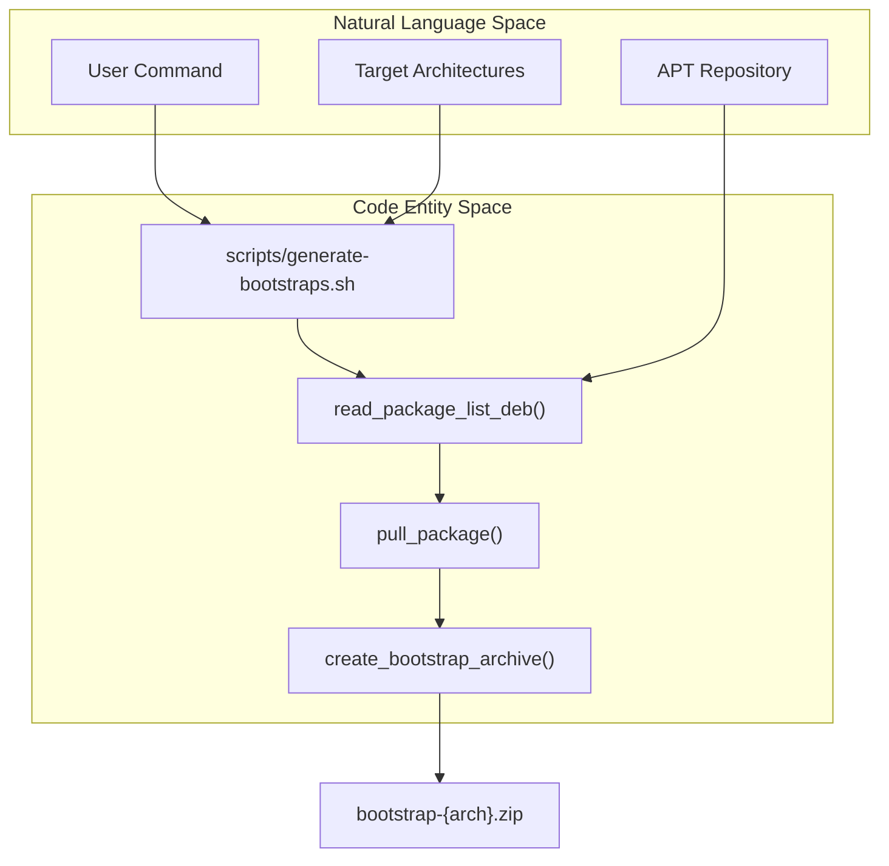
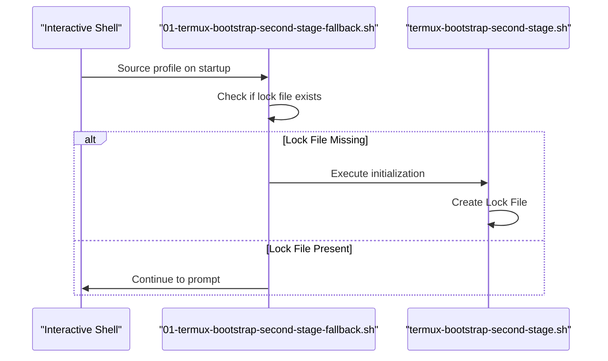

<!-- source: DeepWiki mcp.deepwiki.com · repo termux/termux-packages · page 4 Bootstrap System · fetched 2026-10-26 -->

# Bootstrap System

Relevant source files

The following files were used as context for generating this wiki page:

- [.github/actions/zram/action.yml](.github/actions/zram/action.yml)
- [.github/workflows/bootstrap_archives.yml](.github/workflows/bootstrap_archives.yml)
- [.github/workflows/check_repository_health.yml](.github/workflows/check_repository_health.yml)
- [.github/workflows/codeql.yml](.github/workflows/codeql.yml)
- [.github/workflows/command_not_found.yml](.github/workflows/command_not_found.yml)
- [.github/workflows/docker_image.yml](.github/workflows/docker_image.yml)
- [.github/workflows/golang_validation.yml](.github/workflows/golang_validation.yml)
- [.github/workflows/package_updates.yml](.github/workflows/package_updates.yml)
- [.github/workflows/packages.yml](.github/workflows/packages.yml)
- [.github/workflows/zig_validation.yml](.github/workflows/zig_validation.yml)
- [build-package.sh](build-package.sh)
- [disabled-packages/protobuf-static/build.sh](disabled-packages/protobuf-static/build.sh)
- [packages/libprotobuf/build.sh](packages/libprotobuf/build.sh)
- [packages/libprotobuf/retain-linker-array.patch](packages/libprotobuf/retain-linker-array.patch)
- [scripts/bin/validation](scripts/bin/validation)
- [scripts/build/configure/termux_step_configure_meson.sh](scripts/build/configure/termux_step_configure_meson.sh)
- [scripts/build/setup/python-crossenv-PYTHONPATH.patch](scripts/build/setup/python-crossenv-PYTHONPATH.patch)
- [scripts/build/setup/python-crossenv-fix-shebang.patch](scripts/build/setup/python-crossenv-fix-shebang.patch)
- [scripts/build/setup/python-crossenv-pip-android-api-level.patch](scripts/build/setup/python-crossenv-pip-android-api-level.patch)
- [scripts/build/setup/termux_setup_protobuf.sh](scripts/build/setup/termux_setup_protobuf.sh)
- [scripts/build/setup/termux_setup_python_pip.sh](scripts/build/setup/termux_setup_python_pip.sh)
- [scripts/build/termux_download_deb_pac.sh](scripts/build/termux_download_deb_pac.sh)
- [scripts/build/termux_step_massage.sh](scripts/build/termux_step_massage.sh)
- [scripts/build/termux_step_override_config_scripts.sh](scripts/build/termux_step_override_config_scripts.sh)
- [scripts/free-space.sh](scripts/free-space.sh)
- [scripts/properties.sh](scripts/properties.sh)
- [scripts/run-docker.sh](scripts/run-docker.sh)
- [scripts/setup-termux.sh](scripts/setup-termux.sh)
- [scripts/setup-ubuntu.sh](scripts/setup-ubuntu.sh)

The Bootstrap System is responsible for generating minimal package archives required to initialize a fresh Termux installation. These archives contain the essential toolchain (shell, package manager, and core utilities) needed before a user can interact with the environment or install additional software.

## Automated Generation Pipeline

Termux maintains a fully automated pipeline for creating and distributing bootstrap archives via GitHub Actions. This ensures that new users always receive up-to-date core packages and security patches.

### Weekly Build Workflow
The `bootstrap_archives.yml` workflow automates the creation of these archives on a weekly schedule.

| Component | Implementation |
| :--- | :--- |
| **Schedule** | Every Sunday at 00:00 UTC [.github/workflows/bootstrap_archives.yml:4-5]() |
| **Build Matrix** | Runs for `aarch64`, `arm`, `i686`, and `x86_64` [.github/workflows/bootstrap_archives.yml:20-25]() |
| **Generation Script** | Calls `scripts/generate-bootstraps.sh` [.github/workflows/bootstrap_archives.yml:31-31]() |
| **Artifact Storage** | Uploads ZIP files as workflow artifacts [.github/workflows/bootstrap_archives.yml:33-36]() |

### Release and Versioning
After archives are built for all architectures, the `publish` job creates a formal GitHub release.

1.  **Tag Generation**: Tags follow the format `bootstrap-YYYY.MM.DD-rN+apt.android-7` [.github/workflows/bootstrap_archives.yml:55-62]().
2.  **Revision Logic**: If a tag for the current date already exists, the revision (`-rN`) is incremented [.github/workflows/bootstrap_archives.yml:57-61]().
3.  **Release Creation**: Uses the GitHub CLI (`gh`) to create a release and upload the ZIP archives [.github/workflows/bootstrap_archives.yml:68-71]().

Sources: [.github/workflows/bootstrap_archives.yml:1-72]()

## Bootstrap Archive Generation

There are two primary scripts used to generate bootstrap archives: `scripts/generate-bootstraps.sh` (standard) and `scripts/build-bootstraps.sh` (source-based).

### Method: Generation from APT Repository
The `generate-bootstraps.sh` script is the primary tool used in CI. It creates archives by pulling pre-compiled `.deb` packages from the official Termux repositories.

**Key Data Flow:**

Sources: [scripts/generate-bootstraps.sh:1-503]()

### Method: Source-Based Build
The `build-bootstraps.sh` script (not provided in full but referenced) is used to build the bootstrap set entirely from source. This is used when repository packages are not yet available or when testing core system changes.

## System Initialization (Second Stage)

Once a bootstrap archive is extracted by the Termux Android application, the system must perform a "Second Stage" initialization to configure the packages.

### Second Stage Logic
The script `scripts/bootstrap/termux-bootstrap-second-stage.sh` handles the transition from a set of extracted files to a functioning package management system.

**Core Functions:**
*   **Locking**: Prevents multiple concurrent executions [.scripts/bootstrap/termux-bootstrap-second-stage.sh:94-100]().
*   **Maintainer Scripts**: Executes the `postinst` (post-installation) scripts for all packages found in the bootstrap [.scripts/bootstrap/termux-bootstrap-second-stage.sh:156-380]().
*   **Package Manager Setup**: Configures `apt` or `pacman` databases so they recognize the pre-installed bootstrap packages [.scripts/bootstrap/termux-bootstrap-second-stage.sh:382-460]().

### Fallback Mechanism
If the Termux application does not trigger the second stage automatically, a fallback script `01-termux-bootstrap-second-stage-fallback.sh` is placed in the profile directory.

Sources: [scripts/bootstrap/termux-bootstrap-second-stage.sh:1-467](), [scripts/bootstrap/01-termux-bootstrap-second-stage-fallback.sh:1-29]()

## Build Environment Integration

The bootstrap system relies on the standard Termux Docker environment to ensure build reproducibility.

### Docker Execution
Bootstrap generation is typically performed inside the `package-builder` container. The `scripts/run-docker.sh` script sets up the environment, including:
*   **AppArmor Profiles**: Loads `profile-relaxed.apparmor` to allow the container to perform administrative tasks like mounting [.scripts/run-docker.sh:154-154]().
*   **Resource Optimization**: The CI environment often uses `scripts/free-space.sh` to clear ~36GB of unnecessary files (like .NET, LLVM, and Haskell toolchains) to make room for large bootstrap builds [.scripts/free-space.sh:1-57]().

### Toolchain Dependencies
The bootstrap generation requires several host utilities defined in `scripts/setup-ubuntu.sh`, including:
*   `curl` and `gnupg` for repository interaction [.scripts/setup-ubuntu.sh:13-14]().
*   `jq` for parsing `repo.json` [.scripts/setup-ubuntu.sh:276-276]().
*   `tar`, `unzip`, and `zstd` for archive manipulation [.scripts/setup-ubuntu.sh:21-26]().

Sources: [scripts/run-docker.sh:1-176](), [scripts/setup-ubuntu.sh:1-305](), [scripts/free-space.sh:1-57]()

---

