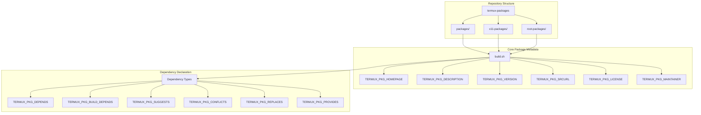
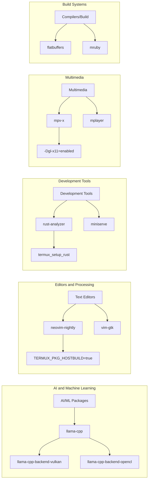
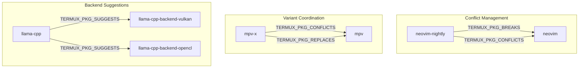

<!-- source: DeepWiki mcp.deepwiki.com · repo termux/termux-packages · page 5 Package Categories · fetched 2026-10-26 -->

# Package Categories

Relevant source files

The following files were used as context for generating this wiki page:

- [packages/findomain/build.sh](packages/findomain/build.sh)
- [packages/findomain/headless-chrome.patch](packages/findomain/headless-chrome.patch)
- [packages/findomain/hickory-resolver.diff](packages/findomain/hickory-resolver.diff)
- [packages/flatbuffers/build.sh](packages/flatbuffers/build.sh)
- [packages/flex/build.sh](packages/flex/build.sh)
- [packages/fm/build.sh](packages/fm/build.sh)
- [packages/llama-cpp/0002-do-not-install-backend-libs.patch](packages/llama-cpp/0002-do-not-install-backend-libs.patch)
- [packages/llama-cpp/build.sh](packages/llama-cpp/build.sh)
- [packages/minidlna/build.sh](packages/minidlna/build.sh)
- [packages/minimodem/build.sh](packages/minimodem/build.sh)
- [packages/miniserve/build.sh](packages/miniserve/build.sh)
- [packages/minisign/build.sh](packages/minisign/build.sh)
- [packages/mplayer/build.sh](packages/mplayer/build.sh)
- [packages/mplayer/mplayer-1.5-ffmpeg-8.patch](packages/mplayer/mplayer-1.5-ffmpeg-8.patch)
- [packages/mplayer/r38454.patch](packages/mplayer/r38454.patch)
- [packages/mplayer/r38455.patch](packages/mplayer/r38455.patch)
- [packages/mpv/build.sh](packages/mpv/build.sh)
- [packages/mruby/build.sh](packages/mruby/build.sh)
- [packages/msitools/build.sh](packages/msitools/build.sh)
- [packages/neovim-nightly/build.sh](packages/neovim-nightly/build.sh)
- [packages/neovim/build.sh](packages/neovim/build.sh)
- [packages/neovim/disable-checkhealth-locale-warning.patch](packages/neovim/disable-checkhealth-locale-warning.patch)
- [packages/neovim/sysinit.vim](packages/neovim/sysinit.vim)
- [packages/rust-analyzer/build.sh](packages/rust-analyzer/build.sh)
- [packages/vim/build.sh](packages/vim/build.sh)
- [packages/vim/fix-writing-archive.patch](packages/vim/fix-writing-archive.patch)
- [packages/vim/revert-1fe0d1e.patch](packages/vim/revert-1fe0d1e.patch)
- [packages/vim/runtime-syntax-sh.vim.patch](packages/vim/runtime-syntax-sh.vim.patch)
- [x11-packages/mogan/build.sh](x11-packages/mogan/build.sh)
- [x11-packages/mogan/lolly.diff](x11-packages/mogan/lolly.diff)
- [x11-packages/mogan/moebius.diff](x11-packages/mogan/moebius.diff)
- [x11-packages/mogan/xmake-packages-l-lolly.patch](x11-packages/mogan/xmake-packages-l-lolly.patch)
- [x11-packages/mogan/xmake-packages-m-moebius.patch](x11-packages/mogan/xmake-packages-m-moebius.patch)
- [x11-packages/mousepad/build.sh](x11-packages/mousepad/build.sh)
- [x11-packages/mpv-x/build.sh](x11-packages/mpv-x/build.sh)
- [x11-packages/mpv-x/default-to-x11.patch](x11-packages/mpv-x/default-to-x11.patch)
- [x11-packages/vim-gtk/build.sh](x11-packages/vim-gtk/build.sh)
- [x11-packages/vim-gtk/revert-1fe0d1e.patch](x11-packages/vim-gtk/revert-1fe0d1e.patch)

This document provides an overview of the major package categories in the Termux packages repository. Packages are organized by their primary functionality and distributed across three main directories: `packages/`, `x11-packages/`, and `root-packages/`. Each category represents a functional domain with common build patterns, dependencies, and integration requirements.

For detailed information about specific categories, see the child pages: [AI and Machine Learning](#5.1), [Editors and Text Processing](#5.2), [Development Tools and Language Support](#5.3), [Multimedia Applications](#5.4), [X11 and Desktop Applications](#5.5), [System Utilities](#5.6), [Web and Network Services](#5.7), [Terminal Enhancements](#5.8), and [Compilers and Build Systems](#5.9).

## Package Organization Structure

Packages in the repository are organized into functional categories based on their purpose. Each package defines metadata through `TERMUX_PKG_*` variables in its `build.sh` script, including homepage, description, license, dependencies, and build configuration.

### Repository Organization Diagram

**Sources:** [packages/llama-cpp/build.sh:1-12](), [packages/rust-analyzer/build.sh:1-11](), [packages/neovim/build.sh:1-12](), [x11-packages/vim-gtk/build.sh:1-12]()

## Package Metadata Variables

All packages define standard metadata through `TERMUX_PKG_*` variables. These variables control package identification, source retrieval, dependency resolution, and build configuration.

| Variable | Purpose | Example |
|----------|---------|---------|
| `TERMUX_PKG_HOMEPAGE` | Project homepage URL | `https://neovim.io/` |
| `TERMUX_PKG_DESCRIPTION` | Brief package description | `"LLM inference in C/C++"` |
| `TERMUX_PKG_LICENSE` | License identifier | `"Apache-2.0, VIM License"` |
| `TERMUX_PKG_MAINTAINER` | Package maintainer | `Joshua Kahn <tom@termux.dev>` |
| `TERMUX_PKG_VERSION` | Package version string | `"0.13.0~dev-499+g6780e78b09"` |
| `TERMUX_PKG_SRCURL` | Source download URL(s) | `https://github.com/neovim/neovim/archive/...` |
| `TERMUX_PKG_SHA256` | Source checksum(s) | `bf3033e31415de719d6ee8193adcce3438b21e1e8d62a0bb48ffc6bf558bfdab` |
| `TERMUX_PKG_DEPENDS` | Runtime dependencies | `"libandroid-support, luajit, tree-sitter"` |
| `TERMUX_PKG_BUILD_DEPENDS` | Build-time dependencies | `"vulkan-headers, opencl-headers"` |
| `TERMUX_PKG_SUGGESTS` | Optional enhancements | `"llama-cpp-backend-vulkan"` |
| `TERMUX_PKG_AUTO_UPDATE` | Enable auto-updates | `true` or `false` |

**Sources:** [packages/llama-cpp/build.sh:1-12](), [packages/rust-analyzer/build.sh:1-14](), [packages/neovim-nightly/build.sh:1-17]()

## Category Distribution Map

The following diagram shows how package categories map to build patterns and directory locations:

### Code Entity Mapping Diagram

**Sources:** [packages/llama-cpp/build.sh:12-21](), [packages/neovim-nightly/build.sh:13-25](), [packages/rust-analyzer/build.sh:55-57](), [x11-packages/mpv-x/build.sh:15-28](), [packages/mplayer/build.sh:1-9]()

## Dependency Management Patterns

Packages declare multiple types of dependencies that affect installation and building. The dependency system supports complex interactions like `TERMUX_PKG_BREAKS` and `TERMUX_PKG_CONFLICTS` to manage versioned incompatibilities.

### Dependency Interaction Diagram

**Sources:** [packages/neovim-nightly/build.sh:11-12](), [x11-packages/mpv-x/build.sh:13-14](), [packages/llama-cpp/build.sh:12]()

## Auto-Update System Integration

Many packages implement custom auto-update logic through the `termux_pkg_auto_update()` function. This system allows for complex logic like version throttling or nightly release tracking.

**Common Auto-Update Patterns:**

| Pattern | Description | Example Package |
|---------|-------------|-----------------|
| GitHub Tag Query | Use `termux_github_api_get_tag()` | `llama-cpp` |
| Nightly Release | Query specific release tags via API | `neovim-nightly` |
| Version Throttling | Limit updates (e.g., every 50th patch) | `vim`, `vim-gtk` |
| Custom API Parsing | Manual `curl` and `jq` for tags | `rust-analyzer` |

**Throttling Implementation Example:**
The `vim` and `vim-gtk` packages floor the patch version to 50 to avoid update spam [x11-packages/vim-gtk/build.sh:65-70](). Similarly, `llama-cpp` uses a 14-day interval check [packages/llama-cpp/build.sh:33-62]().

**Sources:** [packages/llama-cpp/build.sh:31-73](), [packages/neovim-nightly/build.sh:27-54](), [x11-packages/vim-gtk/build.sh:53-78](), [packages/rust-analyzer/build.sh:16-53]()

## Category-Specific Build Configuration

Different package categories utilize distinct build systems and standardized setup functions provided by the Termux build environment.

- **Rust:** Uses `termux_setup_rust` and `cargo` [packages/rust-analyzer/build.sh:55-62]().
- **CMake:** Uses `termux_setup_cmake` with `TERMUX_PKG_EXTRA_CONFIGURE_ARGS` [packages/llama-cpp/build.sh:13-21]().
- **X11:** Packages in `x11-packages/` often enable GUI features like `gtk3` or `x11` backends [x11-packages/vim-gtk/build.sh:47-48]().
- **Multi-Phase:** Packages like `neovim` require `termux_step_host_build` to generate artifacts on the host machine before cross-compiling for Android [packages/neovim/build.sh:25-46]().

## Special Package Attributes

Certain packages require additional metadata flags to control their behavior during building and installation.

| Attribute | Purpose | Example |
|-----------|---------|---------|
| `TERMUX_PKG_HOSTBUILD` | Build tools on host first | `neovim` |
| `TERMUX_PKG_BUILD_IN_SRC` | Build in source directory | `vim`, `mplayer` |
| `TERMUX_PKG_EXCLUDED_ARCHES` | Unsupported architectures | `llama-cpp` (excludes arm, i686) |
| `TERMUX_PKG_CONFFILES` | Preserve config on upgrade | `share/nvim/sysinit.vim` |
| `TERMUX_PKG_RM_AFTER_INSTALL` | Clean up specific files | `bin/xxd` in `vim-gtk` |

**Sources:** [packages/neovim/build.sh:12-13](), [packages/llama-cpp/build.sh:25](), [x11-packages/vim-gtk/build.sh:121-127](), [packages/mplayer/build.sh:10]()

## Navigation to Detailed Category Pages

For comprehensive coverage of each package category, refer to the following child pages:

- [AI and Machine Learning](#5.1) — LLM inference (llama-cpp, ollama) and scientific computing.
- [Editors and Text Processing](#5.2) — Neovim, Vim, and advanced text tools.
- [Development Tools and Language Support](#5.3) — Rust, Go, .NET, and Python tooling.
- [Multimedia Applications](#5.4) — Media players (mpv, mplayer) and FFmpeg integration.
- [X11 and Desktop Applications](#5.5) — Graphical environments and X11-enabled variants.
- [System Utilities](#5.6) — Core utilities and `root-packages/` (Docker, iptables).
- [Web and Network Services](#5.7) — Gitea, browsers, and network services.
- [Terminal Enhancements](#5.8) — Shells (fish), multiplexers, and completions.
- [Compilers and Build Systems](#5.9) — LLVM/Clang, Emscripten, and Rust toolchains.

---

