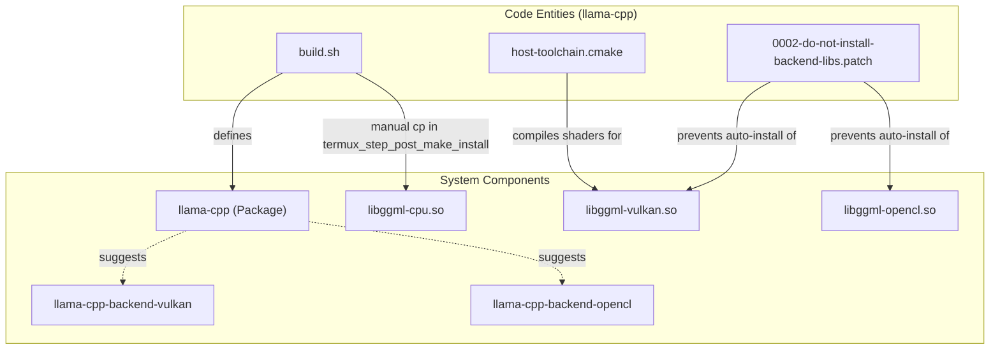
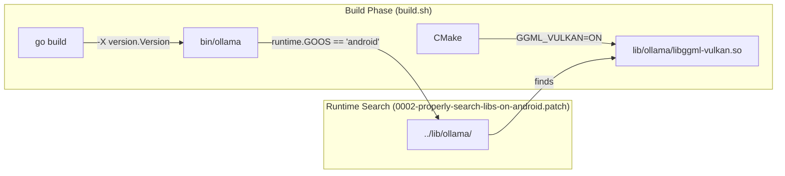

<!-- source: DeepWiki mcp.deepwiki.com · repo termux/termux-packages · page 5.1 AI and Machine Learning · fetched 2026-10-26 -->

# AI and Machine Learning

Relevant source files

The following files were used as context for generating this wiki page:

- [packages/findomain/build.sh](packages/findomain/build.sh)
- [packages/findomain/headless-chrome.patch](packages/findomain/headless-chrome.patch)
- [packages/findomain/hickory-resolver.diff](packages/findomain/hickory-resolver.diff)
- [packages/flatbuffers/build.sh](packages/flatbuffers/build.sh)
- [packages/flex/build.sh](packages/flex/build.sh)
- [packages/fm/build.sh](packages/fm/build.sh)
- [packages/libarrow-cpp/build.sh](packages/libarrow-cpp/build.sh)
- [packages/libarrow-cpp/python-pyarrow.subpackage.sh](packages/libarrow-cpp/python-pyarrow.subpackage.sh)
- [packages/llama-cpp/0002-do-not-install-backend-libs.patch](packages/llama-cpp/0002-do-not-install-backend-libs.patch)
- [packages/llama-cpp/build.sh](packages/llama-cpp/build.sh)
- [packages/manim/build.sh](packages/manim/build.sh)
- [packages/matplotlib/build.sh](packages/matplotlib/build.sh)
- [packages/minidlna/build.sh](packages/minidlna/build.sh)
- [packages/minimodem/build.sh](packages/minimodem/build.sh)
- [packages/miniserve/build.sh](packages/miniserve/build.sh)
- [packages/minisign/build.sh](packages/minisign/build.sh)
- [packages/ollama/0001-do-not-install-runtime-deps.patch](packages/ollama/0001-do-not-install-runtime-deps.patch)
- [packages/ollama/0002-properly-search-libs-on-android.patch](packages/ollama/0002-properly-search-libs-on-android.patch)
- [packages/ollama/0003-do-not-include-sources-for-vulkan-again.patch](packages/ollama/0003-do-not-include-sources-for-vulkan-again.patch)
- [packages/ollama/0004-force-disable-features-on-Andoid.patch](packages/ollama/0004-force-disable-features-on-Andoid.patch)
- [packages/ollama/0006-do-not-search-hip-memory.patch](packages/ollama/0006-do-not-search-hip-memory.patch)
- [packages/ollama/0007-do-not-use-flash-attention-when-using-cpu.patch](packages/ollama/0007-do-not-use-flash-attention-when-using-cpu.patch)
- [packages/ollama/0008-fix-build-with-latest-vulkan-hpp.patch](packages/ollama/0008-fix-build-with-latest-vulkan-hpp.patch)
- [packages/ollama/build.sh](packages/ollama/build.sh)
- [packages/ollama/host-toolchain.cmake](packages/ollama/host-toolchain.cmake)
- [packages/ollama/ollama-backend-vulkan.subpackage.sh](packages/ollama/ollama-backend-vulkan.subpackage.sh)
- [packages/python-brotli/build.sh](packages/python-brotli/build.sh)
- [packages/python-contourpy/build.sh](packages/python-contourpy/build.sh)
- [packages/python-lameenc/build.sh](packages/python-lameenc/build.sh)
- [packages/python-lameenc/setup.py.patch](packages/python-lameenc/setup.py.patch)
- [packages/python-libsass/build.sh](packages/python-libsass/build.sh)
- [packages/python-msgpack/build.sh](packages/python-msgpack/build.sh)
- [packages/python-numpy/build.sh](packages/python-numpy/build.sh)
- [packages/python-scipy/build.sh](packages/python-scipy/build.sh)
- [packages/python-tflite-runtime/build.sh](packages/python-tflite-runtime/build.sh)
- [packages/python-torch/0002-fix-macros.patch](packages/python-torch/0002-fix-macros.patch)
- [packages/python-torch/0004-memalign.patch](packages/python-torch/0004-memalign.patch)
- [packages/python-torch/0006-fix-for-format-string.patch](packages/python-torch/0006-fix-for-format-string.patch)
- [packages/python-torch/0014-disable-mimalloc.patch](packages/python-torch/0014-disable-mimalloc.patch)
- [packages/python-torch/build.sh](packages/python-torch/build.sh)
- [packages/python-torchaudio/0001-disable-cuda-openmp.patch](packages/python-torchaudio/0001-disable-cuda-openmp.patch)
- [packages/python-torchaudio/build.sh](packages/python-torchaudio/build.sh)
- [packages/python-torchcodec/0001-do-not-try-to-import-torch-when-cross-compiling.patch](packages/python-torchcodec/0001-do-not-try-to-import-torch-when-cross-compiling.patch)
- [packages/python-torchcodec/0002-sys-platform-android.patch](packages/python-torchcodec/0002-sys-platform-android.patch)
- [packages/python-torchcodec/build.sh](packages/python-torchcodec/build.sh)
- [packages/python-torchvision/build.sh](packages/python-torchvision/build.sh)
- [packages/python2/build.sh](packages/python2/build.sh)
- [packages/rust-analyzer/build.sh](packages/rust-analyzer/build.sh)
- [x11-packages/libncnn/build.sh](x11-packages/libncnn/build.sh)
- [x11-packages/opencv/build.sh](x11-packages/opencv/build.sh)
- [x11-packages/opencv/opencv-python.subpackage.sh](x11-packages/opencv/opencv-python.subpackage.sh)

This document covers packages that provide machine learning, artificial intelligence, and scientific computing capabilities in Termux. It focuses on Large Language Model (LLM) inference engines (**llama-cpp**, **ollama**), deep learning frameworks (**python-torch**), and the scientific Python stack (**python-scipy**, **matplotlib**, **opencv**).

## Package Overview

The AI/ML ecosystem in Termux is divided into standalone inference engines and high-level programming libraries.

| Package | Description | Primary Language | Backend Strategy |
|---------|-------------|------------------|------------------|
| llama-cpp | Standalone LLM inference in C/C++ | C++ | Shared libraries with dynamic loading |
| ollama | LLM runtime server with model management | Go + C++ | Embedded ggml backends |
| python-torch | Tensors and Dynamic neural networks | Python/C++ | Native libs + Python bindings |
| python-scipy | Algorithms for scientific computing | Python/Fortran | Meson-built Python wheel |

Many of these packages exclude 32-bit architectures (`arm`, `i686`) due to `int64_t` vs `size_t` incompatibilities or memory addressing limits [packages/llama-cpp/build.sh:25](), [packages/ollama/build.sh:11](), [packages/python-scipy/build.sh:16]().

## LLM Inference Engines

### llama-cpp: Modular Backend Architecture

The llama-cpp package uses CMake with `GGML_BACKEND_DL=ON` [packages/llama-cpp/build.sh:16]() to enable dynamic loading of backend libraries. This allows the core package to remain lightweight while offloading GPU acceleration to optional subpackages.

**llama-cpp Entity Mapping**

Sources: [packages/llama-cpp/build.sh:12-20](), [packages/llama-cpp/build.sh:86-91](), [packages/llama-cpp/0002-do-not-install-backend-libs.patch:1-11]()

**Vulkan Shader Compilation:**
To compile Vulkan shaders during cross-compilation, llama-cpp uses a host toolchain [packages/llama-cpp/build.sh:19]() and prepends the NDK shader-tools to the `PATH` [packages/llama-cpp/build.sh:76]().

**Auto-Update Throttling:**
Because upstream releases are extremely frequent, llama-cpp implements a 14-day throttling mechanism in `termux_pkg_auto_update()` [packages/llama-cpp/build.sh:31-73](). It checks the last commit timestamp by the "Termux Github Actions" bot [packages/llama-cpp/build.sh:48]() before proceeding.

### ollama: Go and C++ Integration

Ollama combines a Go-based server with C++ ggml backends. It uses a dual-phase build: CMake for the backends and `go build` for the main binary [packages/ollama/build.sh:32-41]().

**ollama Internal Data Flow**

Sources: [packages/ollama/build.sh:18-40](), [packages/ollama/0002-properly-search-libs-on-android.patch:1-12]()

## Deep Learning Frameworks

### python-torch (PyTorch)

PyTorch is one of the most complex packages in the repository, requiring a host-build phase to generate renaming tools via `third_party/sleef` [packages/python-torch/build.sh:57-61]().

**Key Configuration Patterns:**
- **Vulkan Support:** Enabled via `-DUSE_VULKAN=ON` [packages/python-torch/build.sh:42]().
- **Path Patching:** A `sed` command in `termux_step_pre_configure` replaces `ANDROID` with `ANDROID_NO_TERMUX` in CMake files to bypass standard Android NDK logic that conflicts with the Termux environment [packages/python-torch/build.sh:67-70]().
- **Dependency Linking:** Manually links against `libandroid-execinfo` and `libopenblas` [packages/python-torch/build.sh:8]().

Sources: [packages/python-torch/build.sh:8-48](), [packages/python-torch/build.sh:67-70]()

### python-torchvision and python-torchaudio

These packages extend PyTorch with domain-specific utilities.
- **torchvision:** Requires `BUILD_PREFIX` to be set to `$TERMUX_PREFIX` for proper detection of `libwebp` and `libjpeg` [packages/python-torchvision/build.sh:21](). It patches `setup.py` to hardcode the path to the Termux `ffmpeg` binary [packages/python-torchvision/build.sh:26]().
- **torchcodec:** Requires a specific environment variable `I_CONFIRM_THIS_IS_NOT_A_LICENSE_VIOLATION=1` because Termux's `ffmpeg` is GPL-licensed [packages/python-torchcodec/build.sh:21]().

Sources: [packages/python-torchvision/build.sh:21-26](), [packages/python-torchcodec/build.sh:21]()

## Scientific Computing Stack

### python-scipy

Scipy is built using `meson-python` [packages/python-scipy/build.sh:10](). It requires a complex cross-compilation setup for Fortran.

**Fortran Toolchain Integration:**
1. Calls `termux_setup_flang` [packages/python-scipy/build.sh:36]().
2. Creates a "fake bin" directory containing a `wrapper.py` for the Fortran compiler [packages/python-scipy/build.sh:39-44]().
3. Generates a custom `wheel-cross-file.txt` for Meson [packages/python-scipy/build.sh:51-55]().

Sources: [packages/python-scipy/build.sh:36-55]()

### OpenCV

OpenCV provides computer vision capabilities. It includes the `opencv_contrib` modules by downloading two source URLs [x11-packages/opencv/build.sh:7-10]().

**Build Logic:**
- Uses `-DOPENCV_EXTRA_MODULES_PATH` to point to the contrib modules [x11-packages/opencv/build.sh:30]().
- Similar to PyTorch, it patches CMake files to replace `ANDROID` with `ANDROID_NO_TERMUX` [x11-packages/opencv/build.sh:48-51]().
- Links against the Android `log` library via `-llog` [x11-packages/opencv/build.sh:46]().

Sources: [x11-packages/opencv/build.sh:30-51]()

### Data Processing: libarrow-cpp

Apache Arrow provides a cross-language development platform for in-memory data. The Termux package builds both the C++ libraries and the Python `pyarrow` bindings in a single `build.sh` [packages/libarrow-cpp/build.sh:1-83]().

**Multi-Phase Installation:**
In `termux_step_post_make_install()`, the script switches context from the `cpp` directory to the `python` directory [packages/libarrow-cpp/build.sh:56-57]() and runs `python -m build` to create the Python wheel [packages/libarrow-cpp/build.sh:73-76]().

Sources: [packages/libarrow-cpp/build.sh:54-82]()

---

