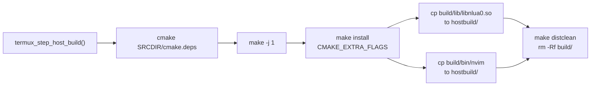
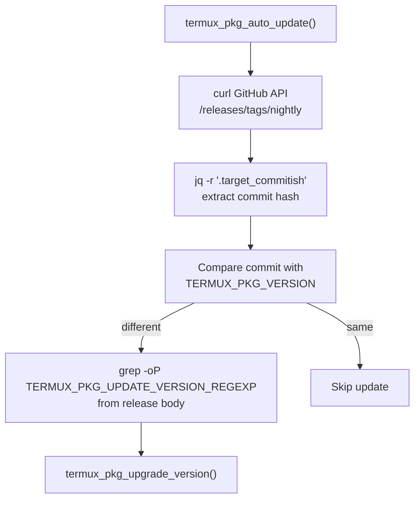
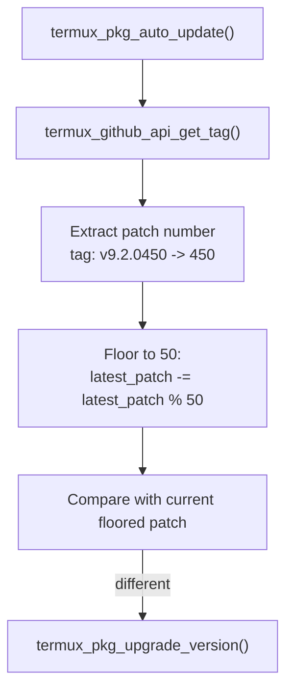
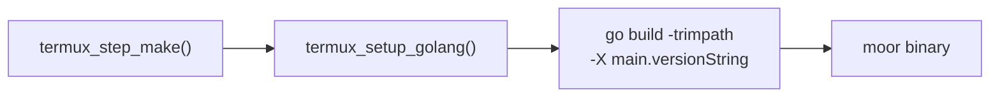

<!-- source: DeepWiki mcp.deepwiki.com · repo termux/termux-packages · page 5.2 Editors and Text Processing · fetched 2026-10-26 -->

# Editors and Text Processing

<details>
<summary>Relevant source files</summary>

The following files were used as context for generating this wiki page:

- [packages/cabal-install/build.sh](packages/cabal-install/build.sh)
- [packages/lua-lpeg/lua54-lpeg.subpackage.sh](packages/lua-lpeg/lua54-lpeg.subpackage.sh)
- [packages/luarocks/build.sh](packages/luarocks/build.sh)
- [packages/moor/build.sh](packages/moor/build.sh)
- [packages/moor/default-editor.patch](packages/moor/default-editor.patch)
- [packages/moor/moor.alternatives](packages/moor/moor.alternatives)
- [packages/mplayer/build.sh](packages/mplayer/build.sh)
- [packages/mplayer/mplayer-1.5-ffmpeg-8.patch](packages/mplayer/mplayer-1.5-ffmpeg-8.patch)
- [packages/mplayer/r38454.patch](packages/mplayer/r38454.patch)
- [packages/mplayer/r38455.patch](packages/mplayer/r38455.patch)
- [packages/mpv/build.sh](packages/mpv/build.sh)
- [packages/mruby/build.sh](packages/mruby/build.sh)
- [packages/msitools/build.sh](packages/msitools/build.sh)
- [packages/mympd/CMakeLists.txt.patch](packages/mympd/CMakeLists.txt.patch)
- [packages/mympd/build.sh](packages/mympd/build.sh)
- [packages/mympd/dist-libmpdclient-include-config.h.patch](packages/mympd/dist-libmpdclient-include-config.h.patch)
- [packages/mympd/src-lib-cacertstore.c.patch](packages/mympd/src-lib-cacertstore.c.patch)
- [packages/mympd/src-lib-http_client.c.patch](packages/mympd/src-lib-http_client.c.patch)
- [packages/neovim-nightly/build.sh](packages/neovim-nightly/build.sh)
- [packages/neovim/build.sh](packages/neovim/build.sh)
- [packages/neovim/disable-checkhealth-locale-warning.patch](packages/neovim/disable-checkhealth-locale-warning.patch)
- [packages/neovim/sysinit.vim](packages/neovim/sysinit.vim)
- [packages/nmap/build.sh](packages/nmap/build.sh)
- [packages/osm2pgsql/build.sh](packages/osm2pgsql/build.sh)
- [packages/pandoc/build.sh](packages/pandoc/build.sh)
- [packages/rnr/build.sh](packages/rnr/build.sh)
- [packages/robotfindskitten/build.sh](packages/robotfindskitten/build.sh)
- [packages/rp-pppoe/build.sh](packages/rp-pppoe/build.sh)
- [packages/rpm/build.sh](packages/rpm/build.sh)
- [packages/sassc/build.sh](packages/sassc/build.sh)
- [packages/sc-im/build.sh](packages/sc-im/build.sh)
- [packages/scc/build.sh](packages/scc/build.sh)
- [packages/sccache/build.sh](packages/sccache/build.sh)
- [packages/vim/build.sh](packages/vim/build.sh)
- [packages/vim/fix-writing-archive.patch](packages/vim/fix-writing-archive.patch)
- [packages/vim/revert-1fe0d1e.patch](packages/vim/revert-1fe0d1e.patch)
- [packages/vim/runtime-syntax-sh.vim.patch](packages/vim/runtime-syntax-sh.vim.patch)
- [packages/vis/build.sh](packages/vis/build.sh)
- [packages/vtm/build.sh](packages/vtm/build.sh)
- [x11-packages/mogan/build.sh](x11-packages/mogan/build.sh)
- [x11-packages/mogan/lolly.diff](x11-packages/mogan/lolly.diff)
- [x11-packages/mogan/moebius.diff](x11-packages/mogan/moebius.diff)
- [x11-packages/mogan/xmake-packages-l-lolly.patch](x11-packages/mogan/xmake-packages-l-lolly.patch)
- [x11-packages/mogan/xmake-packages-m-moebius.patch](x11-packages/mogan/xmake-packages-m-moebius.patch)
- [x11-packages/mousepad/build.sh](x11-packages/mousepad/build.sh)
- [x11-packages/mpv-x/build.sh](x11-packages/mpv-x/build.sh)
- [x11-packages/mpv-x/default-to-x11.patch](x11-packages/mpv-x/default-to-x11.patch)
- [x11-packages/vim-gtk/build.sh](x11-packages/vim-gtk/build.sh)
- [x11-packages/vim-gtk/revert-1fe0d1e.patch](x11-packages/vim-gtk/revert-1fe0d1e.patch)

</details>


## Purpose and Scope

This page documents text editors and pagers in the Termux packages repository, focusing on their complex build processes and packaging strategies. The primary packages covered are:

- **Neovim** (stable and nightly): Two-phase builds with host tooling and `LD_PRELOAD` shims.
- **Vim** (console and GTK variants): Dynamic interpreter integration with cross-compilation patches.
- **Moor**: Go-based pager with `update-alternatives` integration.
- **VTM**: Terminal multiplexer with TUI window manager, utilizing modern C++ and Lua integration.

For multimedia players (mpv/mpv-x) that demonstrate similar variant patterns, see [5.4](). For compiler toolchains (emscripten, llvmlite), see [5.9]().

## Editor Package Overview

The repository provides several text editors and pagers with different build complexities and variant strategies:

| Package | Variants | Build System | Key Complexity | Auto-Update Strategy |
|---------|----------|--------------|----------------|---------------------|
| `neovim` | stable, nightly | CMake + host build | Two-phase build, `libnlua0.so` | GitHub API (nightly only) |
| `vim` | console, gtk | Autotools | Interpreter cross-compilation | Throttled every 50th patch |
| `moor` | single | Go | Simple | GitHub tags |
| `vtm` | single | CMake | Threading and Lua 5.4 integration | GitHub tags |
| `mogan` | single | Xmake | Qmake/Qt6 cross-tools integration | GitHub refs/tags |

**Sources:** [packages/neovim-nightly/build.sh:1-122](), [packages/neovim/build.sh:1-91](), [packages/vim/build.sh:1-139](), [x11-packages/vim-gtk/build.sh:1-145](), [packages/moor/build.sh:1-21](), [packages/vtm/build.sh:1-16](), [x11-packages/mogan/build.sh:1-119]()

## Neovim Build Architecture

Neovim requires a sophisticated two-phase build process due to its use of LuaJIT and code generation requirements.

### Host Build Phase

The host build creates native tools needed for cross-compilation. The `termux_step_host_build()` function performs this phase:



**Diagram: Neovim Host Build Execution Flow**

The critical artifacts from this phase are `libnlua0.so` and the `nvim` binary. These must be built natively for the build host's architecture because they execute during the target build process to generate code and documentation.

**Key configuration:** [packages/neovim/build.sh:36]() sets `CMAKE_EXTRA_FLAGS="-DCMAKE_INSTALL_PREFIX=$TERMUX_PKG_HOSTBUILD_DIR -DUSE_BUNDLED_LUAROCKS=ON"`.

**Preservation step:** [packages/neovim/build.sh:39-42]() copies the host-built `libnlua0.so` and `nvim` to `$TERMUX_PKG_HOSTBUILD_DIR/` before cleaning the build directory.

**Sources:** [packages/neovim/build.sh:25-46](), [packages/neovim-nightly/build.sh:56-77]()

### Target Build Configuration

The target build references the host-built library and binary via `TERMUX_PKG_EXTRA_CONFIGURE_ARGS`:

```bash
-DNLUA0_HOST_PRG=$TERMUX_PKG_HOSTBUILD_DIR/libnlua0.so
-DNVIM_HOST_PRG=$TERMUX_PKG_HOSTBUILD_DIR/nvim
```

This tells CMake to use the host-built tools instead of the cross-compiled ones for generation tasks.

**Sources:** [packages/neovim/build.sh:17-23](), [packages/neovim-nightly/build.sh:19-25]()

### LD_PRELOAD Shim

The installed `nvim` binary is moved to `$PREFIX/libexec/nvim/nvim` and replaced with a shell wrapper that sets `LD_PRELOAD`:

```bash
#!/usr/bin/env sh
LD_PRELOAD="$LD_PRELOAD:@TERMUX_PREFIX@/lib/libluajit.so" exec "@TERMUX_PREFIX@/libexec/nvim/nvim" "$@"
```

**Purpose:** Dynamically linked Lua/LuaJIT plugin modules require access to LuaJIT runtime symbols. Android's dynamic linker doesn't properly expose these symbols from the neovim binary to dynamically loaded modules. The `LD_PRELOAD` workaround ensures `libluajit.so` symbols are available globally.

**Implementation:** [packages/neovim/build.sh:56-64]() moves the binary and installs the shim using `sed` to substitute `@TERMUX_PREFIX@`.

**Sources:** [packages/neovim/build.sh:56-64](), [packages/neovim-nightly/build.sh:87-95]()

### Nightly Auto-Update System

The `neovim-nightly` package queries GitHub's API for the nightly release tag:



**Diagram: Neovim Nightly Auto-Update Logic**

The function [packages/neovim-nightly/build.sh:27-54]():
1. Queries the GitHub API for the `nightly` tag.
2. Extracts the `target_commitish` to compare with the current version suffix.
3. If an update is needed, it parses the release body to find the human-readable version string.

**Sources:** [packages/neovim-nightly/build.sh:27-54]()

## Vim Build Architecture

Vim supports dynamic loading of multiple interpreter languages (Python, Lua, Perl, Ruby, Tcl), enabling scripting without requiring all interpreters to be installed on the user's device.

### Interpreter Cross-Compilation

Vim's `./configure` script doesn't natively support cross-compiling with dynamic interpreters. Termux applies a template-based patch to bypass execution-based checks.

**Version sourcing** [packages/vim/build.sh:92-95]():
```bash
perl_version="$(. "$TERMUX_SCRIPTDIR/packages/perl/build.sh"; echo "${TERMUX_PKG_VERSION[0]}")"
ruby_major_version="$(. "$TERMUX_SCRIPTDIR/packages/ruby/build.sh"; echo "${TERMUX_PKG_VERSION%\.*}")"
tcl_major_version="$(. "$TERMUX_SCRIPTDIR/packages/tcl/build.sh"; echo "${TERMUX_PKG_VERSION%\.*}")"
```

The `termux_step_pre_configure` hook [packages/vim/build.sh:80-107]() uses `sed` to inject these versions into `configure-perl-ruby-tcl-cross-compiling.diff` before applying it.

### Throttled Auto-Update System

Vim releases tags for nearly every commit. To avoid repository noise, Termux only updates Vim every 50th patch.



**Diagram: Vim Throttled Auto-Update Logic**

The algorithm [packages/vim/build.sh:53-78]() uses `10#` prefixes in Bash arithmetic to prevent leading zeros from being interpreted as octal.

**Sources:** [packages/vim/build.sh:53-78](), [x11-packages/vim-gtk/build.sh:53-78]()

### Console vs GTK Variants

Termux provides two Vim variants:
1. **`vim`**: Console-only, minimal dependencies [packages/vim/build.sh:1-139]().
2. **`vim-gtk`**: GTK3 graphical interface, X11 dependencies, and additional GUI binaries like `gvim` [x11-packages/vim-gtk/build.sh:1-145]().

`vim-gtk` explicitly removes `xxd` [x11-packages/vim-gtk/build.sh:122]() to avoid overlapping with the `xxd` subpackage provided by the console `vim`.

**Sources:** [packages/vim/build.sh:1-12](), [x11-packages/vim-gtk/build.sh:1-12]()

## Moor Pager

Moor is a Go-based pager. Its build process is a standard Go build pattern but includes `update-alternatives` registration for the `pager` command.



**Sources:** [packages/moor/build.sh:13-16]()

## Complex X11 Editors: Mogan

Mogan is a structure editor (fork of GNU TeXmacs) using the Xmake build system and Qt6.

**Build Strategy** [x11-packages/mogan/build.sh:76-103]():
- **Host Tools**: Uses `qt6-qtbase-cross-tools` and a custom `qmake` wrapper [x11-packages/mogan/build.sh:67-70]().
- **Xmake Configuration**: Explicitly sets `--sdk`, `--cross`, and flags to ensure the Xmake internal package manager (`xrepo`) respects the Termux environment [x11-packages/mogan/build.sh:86-95]().
- **Backup/Restore**: Mogan's build process can corrupt `libcurl.so` and the `xmake` binary; the script implements a backup/restore mechanism in `termux_step_pre_configure` and `termux_step_post_make_install` [x11-packages/mogan/build.sh:61-64, 116-117]().

**Sources:** [x11-packages/mogan/build.sh:40-74](), [x11-packages/mogan/build.sh:76-118]()

## Media Player Backends (MPlayer)

MPlayer demonstrates a pattern of vendoring and patching FFmpeg for compatibility.

**FFmpeg Integration** [packages/mplayer/build.sh:26-36]():
- Sourced from the main `ffmpeg` package's `build.sh`.
- Downloaded and extracted into the MPlayer source tree.
- Patched with `mplayer-1.5-ffmpeg-8.patch` to support FFmpeg 8.x API changes.

**Sources:** [packages/mplayer/build.sh:26-36](), [packages/mplayer/mplayer-1.5-ffmpeg-8.patch:1-205]()

---

