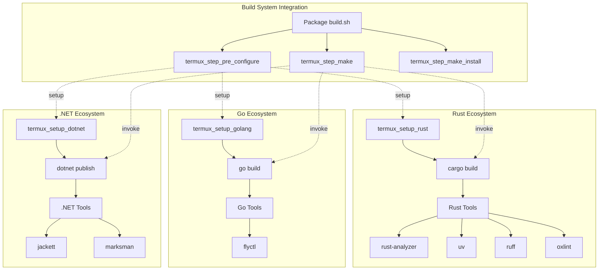
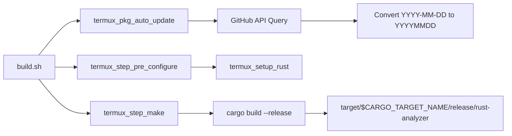
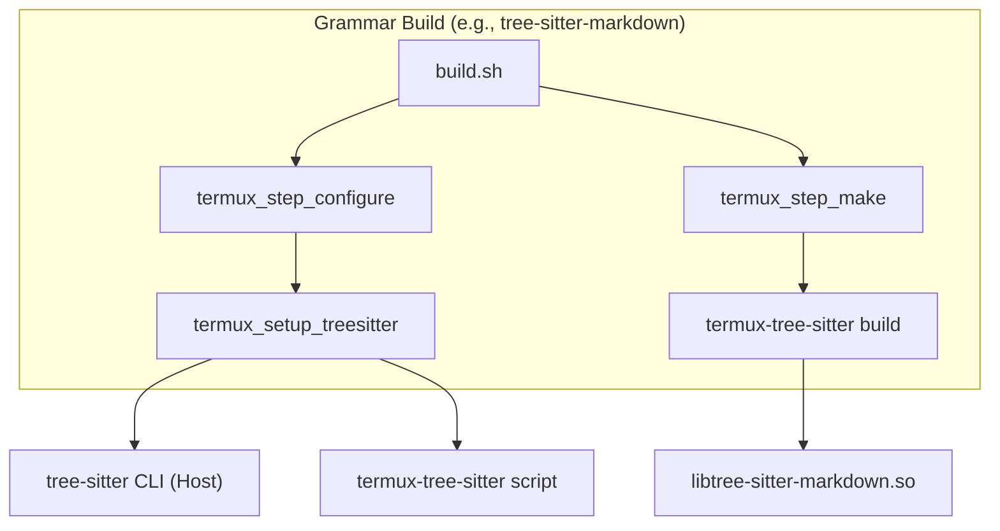

<!-- source: DeepWiki mcp.deepwiki.com · repo termux/termux-packages · page 5.3 Development Tools and Language Support · fetched 2026-10-26 -->

# Development Tools and Language Support

Relevant source files

The following files were used as context for generating this wiki page:

- [packages/findomain/build.sh](packages/findomain/build.sh)
- [packages/findomain/headless-chrome.patch](packages/findomain/headless-chrome.patch)
- [packages/findomain/hickory-resolver.diff](packages/findomain/hickory-resolver.diff)
- [packages/flatbuffers/build.sh](packages/flatbuffers/build.sh)
- [packages/flex/build.sh](packages/flex/build.sh)
- [packages/fm/build.sh](packages/fm/build.sh)
- [packages/jack-example-tools/build.sh](packages/jack-example-tools/build.sh)
- [packages/jack2/build.sh](packages/jack2/build.sh)
- [packages/jackett/build.sh](packages/jackett/build.sh)
- [packages/jcal/build.sh](packages/jcal/build.sh)
- [packages/llama-cpp/0002-do-not-install-backend-libs.patch](packages/llama-cpp/0002-do-not-install-backend-libs.patch)
- [packages/llama-cpp/build.sh](packages/llama-cpp/build.sh)
- [packages/marksman/build.sh](packages/marksman/build.sh)
- [packages/marksman/version.diff](packages/marksman/version.diff)
- [packages/minidlna/build.sh](packages/minidlna/build.sh)
- [packages/minimodem/build.sh](packages/minimodem/build.sh)
- [packages/miniserve/build.sh](packages/miniserve/build.sh)
- [packages/minisign/build.sh](packages/minisign/build.sh)
- [packages/oxlint/build.sh](packages/oxlint/build.sh)
- [packages/oxlint/oxfmt.subpackage.sh](packages/oxlint/oxfmt.subpackage.sh)
- [packages/ruff/build.sh](packages/ruff/build.sh)
- [packages/rust-analyzer/build.sh](packages/rust-analyzer/build.sh)
- [packages/tree-sitter-c/build.sh](packages/tree-sitter-c/build.sh)
- [packages/tree-sitter-lua/build.sh](packages/tree-sitter-lua/build.sh)
- [packages/tree-sitter-markdown/build.sh](packages/tree-sitter-markdown/build.sh)
- [packages/tree-sitter-query/build.sh](packages/tree-sitter-query/build.sh)
- [packages/tree-sitter-vim/build.sh](packages/tree-sitter-vim/build.sh)
- [packages/tree-sitter-vimdoc/build.sh](packages/tree-sitter-vimdoc/build.sh)
- [packages/tree-sitter/build.sh](packages/tree-sitter/build.sh)
- [packages/tree-sitter/termux-tree-sitter](packages/tree-sitter/termux-tree-sitter)
- [packages/trojan-go/build.sh](packages/trojan-go/build.sh)
- [packages/utf8proc/build.sh](packages/utf8proc/build.sh)
- [packages/uv/build.sh](packages/uv/build.sh)
- [scripts/build/setup/termux_setup_treesitter.sh](scripts/build/setup/termux_setup_treesitter.sh)

This page documents language-specific development tools and their integration patterns in the Termux build system. It covers the Rust, Go, .NET, and Python ecosystems, including language servers, package managers, build tools, and platform-specific adaptations required for Android.

## Overview

Termux provides comprehensive support for multiple programming language toolchains, enabling development directly on Android devices. Each language ecosystem has dedicated setup functions (`termux_setup_rust`, `termux_setup_golang`, `termux_setup_dotnet`) that configure the cross-compilation environment.

**Language Toolchain Architecture**

Sources: [packages/rust-analyzer/build.sh:55-56](), [packages/jackett/build.sh:70-73](), [packages/uv/build.sh:13-16](), [packages/oxlint/build.sh:43-46]()

## Language Support Matrix

| Language | Setup Function | Build Command | Example Packages |
|----------|----------------|---------------|------------------|
| Rust | `termux_setup_rust` | `cargo build --target $CARGO_TARGET_NAME` | rust-analyzer, uv, ruff, oxlint |
| Go | `termux_setup_golang` | `go build` | flyctl, fm, trojan-go |
| .NET | `termux_setup_dotnet` | `dotnet publish --runtime $DOTNET_TARGET_NAME` | jackett, marksman |
| Python | Native (via rust) | `maturin build` (for ruff) | ruff, uv package manager |

Sources: [packages/rust-analyzer/build.sh:55-62](), [packages/jackett/build.sh:70-86](), [packages/uv/build.sh:13-22](), [packages/ruff/build.sh:35]()

## Rust Ecosystem

The Rust ecosystem in Termux includes language servers, package managers, and high-performance code quality tools.

### Rust Language Server (rust-analyzer)

`rust-analyzer` provides IDE features for Rust. It uses a custom auto-update function to handle date-based versioning.

**Package Configuration**

Sources: [packages/rust-analyzer/build.sh:1-67]()

The `termux_pkg_auto_update` function queries the GitHub API for tags matching `YYYY-MM-DD` and converts them to `YYYYMMDD` for internal version tracking [packages/rust-analyzer/build.sh:16-53](). It depends on `rust-src` to provide standard library sources for the analyzer [packages/rust-analyzer/build.sh:11]().

### UV - Python Package Manager

`uv` is an extremely fast Python package installer and resolver. Its build process integrates `cmake` and `rust` toolchains [packages/uv/build.sh:13-16]().

**Build Process**:
- **Environment**: Sets `PKG_CONFIG_ALL_DYNAMIC=1` and `ZSTD_SYS_USE_PKG_CONFIG=1` to ensure dynamic linking against system libraries [packages/uv/build.sh:19-21]().
- **Completions**: Generates shell completions in a `postinst` script using the `uv generate-shell-completion` command [packages/uv/build.sh:41-50]().

### Code Quality Tools: Ruff and Oxlint

Termux provides modern, Rust-based linting tools that offer significant performance improvements over traditional Python/JS counterparts.

#### Ruff (Python Linter)
Ruff uses `maturin` for its build process [packages/ruff/build.sh:10]().
- **Platform Adaptation**: It implements a custom `ctermid` library in `termux_step_pre_configure` to provide terminal identification functionality on Android [packages/ruff/build.sh:15-23]().
- **Wheel Handling**: The build process renames generated `.whl` files to match Termux's expected architecture strings (e.g., `arm64_v8a` for `aarch64`) before installing via `pip` [packages/ruff/build.sh:41-60]().

#### Oxlint (JS Linter)
Oxlint integrates Rust, Node.js, and CMake [packages/oxlint/build.sh:44-46]().
- **Architecture Fixes**: For `i686`, it explicitly links against `libgcc` to resolve `__atomic_load_8` symbols [packages/oxlint/build.sh:60-63]().
- **Toolchain Workaround**: It exports a dummy `TARGET_CMAKE_TOOLCHAIN_FILE` to prevent CMake from failing when it cannot find the NDK in specific sub-dependency builds [packages/oxlint/build.sh:52-53]().

## .NET Ecosystem

The .NET ecosystem supports framework-dependent deployments targeting the .NET 9.0 runtime.

### Jackett and Marksman
Both packages utilize `termux_setup_dotnet` [packages/jackett/build.sh:72](), [packages/marksman/build.sh:16]().

**Service and Throttling**:
Jackett implements an update throttle of 14 days to prevent CI spam from frequent upstream tags [packages/jackett/build.sh:26-68](). It also provides a Termux service script for background execution [packages/jackett/build.sh:12]().

**Deployment Pattern**:
1. **Publish**: `dotnet publish` with `--no-self-contained` and `--runtime $DOTNET_TARGET_NAME` [packages/jackett/build.sh:76-86]().
2. **Wrapper**: A shell script is created in `$TERMUX_PREFIX/bin` to invoke the `.dll` via the `dotnet` host [packages/marksman/build.sh:41-45]().

## Tree-sitter Support

Termux provides a robust Tree-sitter ecosystem, including the CLI tool and various language grammars.

**Tree-sitter Toolchain Integration**

Sources: [scripts/build/setup/termux_setup_treesitter.sh:1-64](), [packages/tree-sitter-markdown/build.sh:18-27]()

### Core Tool and Setup
The `termux_setup_treesitter` function downloads a pre-built `tree-sitter` binary for the host to facilitate grammar compilation [scripts/build/setup/termux_setup_treesitter.sh:38-49](). It also exports `TREE_SITTER_ABI_VERSION` (defaulting to 15) to ensure compatibility [scripts/build/setup/termux_setup_treesitter.sh:52]().

### Grammar Packages
Grammars like `tree-sitter-markdown`, `tree-sitter-vim`, and `tree-sitter-lua` follow a standardized pattern:
- **Configure**: Invoke `termux_setup_treesitter` [packages/tree-sitter-markdown/build.sh:19]().
- **Build**: Use the `termux-tree-sitter build` helper script [packages/tree-sitter-markdown/build.sh:25]().
- **Install**: Use `termux-tree-sitter install` to place `.so` files in the correct library paths [packages/tree-sitter-markdown/build.sh:32]().

Sources: [packages/tree-sitter/build.sh:1-91](), [packages/tree-sitter-markdown/build.sh:1-35](), [packages/tree-sitter-vim/build.sh:1-24]()

---

