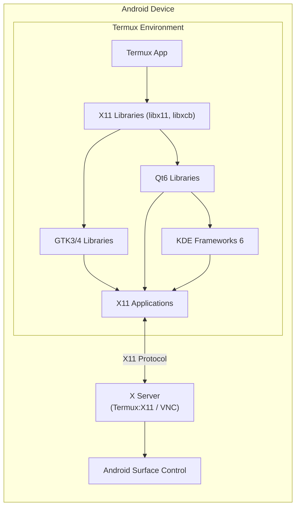
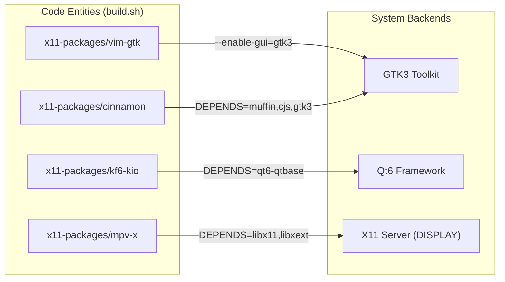
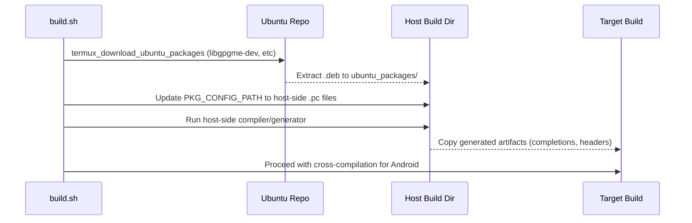

<!-- source: DeepWiki mcp.deepwiki.com · repo termux/termux-packages · page 5.5 X11 and Desktop Applications · fetched 2026-10-26 -->

# X11 and Desktop Applications

Relevant source files

The following files were used as context for generating this wiki page:

- [packages/ansifilter/build.sh](packages/ansifilter/build.sh)
- [packages/antibody/build.sh](packages/antibody/build.sh)
- [packages/antiword/build.sh](packages/antiword/build.sh)
- [packages/aosp-libs/build.sh](packages/aosp-libs/build.sh)
- [packages/gtypist/build.sh](packages/gtypist/build.sh)
- [packages/guile/build.sh](packages/guile/build.sh)
- [packages/gumbo-parser/build.sh](packages/gumbo-parser/build.sh)
- [packages/hashdeep/build.sh](packages/hashdeep/build.sh)
- [packages/lowdown/build.sh](packages/lowdown/build.sh)
- [packages/lux-cli/build.sh](packages/lux-cli/build.sh)
- [packages/mplayer/build.sh](packages/mplayer/build.sh)
- [packages/mplayer/mplayer-1.5-ffmpeg-8.patch](packages/mplayer/mplayer-1.5-ffmpeg-8.patch)
- [packages/mplayer/r38454.patch](packages/mplayer/r38454.patch)
- [packages/mplayer/r38455.patch](packages/mplayer/r38455.patch)
- [packages/mpv/build.sh](packages/mpv/build.sh)
- [packages/mruby/build.sh](packages/mruby/build.sh)
- [packages/msitools/build.sh](packages/msitools/build.sh)
- [packages/neovim-nightly/build.sh](packages/neovim-nightly/build.sh)
- [packages/neovim/build.sh](packages/neovim/build.sh)
- [packages/neovim/disable-checkhealth-locale-warning.patch](packages/neovim/disable-checkhealth-locale-warning.patch)
- [packages/neovim/sysinit.vim](packages/neovim/sysinit.vim)
- [packages/swi-prolog/build.sh](packages/swi-prolog/build.sh)
- [packages/swi-prolog/continue-on-abi-check-failure.patch](packages/swi-prolog/continue-on-abi-check-failure.patch)
- [packages/swi-prolog/disable-installation-of-some-qlfs.patch](packages/swi-prolog/disable-installation-of-some-qlfs.patch)
- [packages/vim/build.sh](packages/vim/build.sh)
- [packages/vim/fix-writing-archive.patch](packages/vim/fix-writing-archive.patch)
- [packages/vim/revert-1fe0d1e.patch](packages/vim/revert-1fe0d1e.patch)
- [packages/vim/runtime-syntax-sh.vim.patch](packages/vim/runtime-syntax-sh.vim.patch)
- [x11-packages/audacity/build.sh](x11-packages/audacity/build.sh)
- [x11-packages/audacity/wxwidgets-3.3.patch](x11-packages/audacity/wxwidgets-3.3.patch)
- [x11-packages/awesome-luajit/build.sh](x11-packages/awesome-luajit/build.sh)
- [x11-packages/awesome/build.sh](x11-packages/awesome/build.sh)
- [x11-packages/cinnamon-control-center/0001-disable-polkit.patch](x11-packages/cinnamon-control-center/0001-disable-polkit.patch)
- [x11-packages/cinnamon-control-center/0002-disable-udev.patch](x11-packages/cinnamon-control-center/0002-disable-udev.patch)
- [x11-packages/cinnamon-control-center/build.sh](x11-packages/cinnamon-control-center/build.sh)
- [x11-packages/cinnamon-desktop/build.sh](x11-packages/cinnamon-desktop/build.sh)
- [x11-packages/cinnamon-menus/build.sh](x11-packages/cinnamon-menus/build.sh)
- [x11-packages/cinnamon-session/0001-remove-screenever-and-nm-applet-from-glib-schemas.patch](x11-packages/cinnamon-session/0001-remove-screenever-and-nm-applet-from-glib-schemas.patch)
- [x11-packages/cinnamon-session/0002-remove-etc-shells-checks.patch](x11-packages/cinnamon-session/0002-remove-etc-shells-checks.patch)
- [x11-packages/cinnamon-session/0003-fake-consolekit.patch](x11-packages/cinnamon-session/0003-fake-consolekit.patch)
- [x11-packages/cinnamon-session/build.sh](x11-packages/cinnamon-session/build.sh)
- [x11-packages/cinnamon-settings-daemon/0001-fix-paths.patch](x11-packages/cinnamon-settings-daemon/0001-fix-paths.patch)
- [x11-packages/cinnamon-settings-daemon/build.sh](x11-packages/cinnamon-settings-daemon/build.sh)
- [x11-packages/cinnamon/0011-disable-virtualkeyboard.patch](x11-packages/cinnamon/0011-disable-virtualkeyboard.patch)
- [x11-packages/cinnamon/build.sh](x11-packages/cinnamon/build.sh)
- [x11-packages/cjs/build.sh](x11-packages/cjs/build.sh)
- [x11-packages/gnome-backgrounds/build.sh](x11-packages/gnome-backgrounds/build.sh)
- [x11-packages/gsound/build.sh](x11-packages/gsound/build.sh)
- [x11-packages/ibus/0001-add-python-path-for-ibus-setup.patch](x11-packages/ibus/0001-add-python-path-for-ibus-setup.patch)
- [x11-packages/ibus/0003-i18n.patch](x11-packages/ibus/0003-i18n.patch)
- [x11-packages/ibus/build.sh](x11-packages/ibus/build.sh)
- [x11-packages/kf6-baloo/build.sh](x11-packages/kf6-baloo/build.sh)
- [x11-packages/kf6-baloo/disable-by-default.patch](x11-packages/kf6-baloo/disable-by-default.patch)
- [x11-packages/kf6-kcmutils/build.sh](x11-packages/kf6-kcmutils/build.sh)
- [x11-packages/kf6-kcmutils/kf6-kcmutils-cross-tools.subpackage.sh](x11-packages/kf6-kcmutils/kf6-kcmutils-cross-tools.subpackage.sh)
- [x11-packages/kf6-kded/build.sh](x11-packages/kf6-kded/build.sh)
- [x11-packages/kf6-kio/0002-faccessat.patch](x11-packages/kf6-kio/0002-faccessat.patch)
- [x11-packages/kf6-kio/0003-revert-kmountpoint-statx.patch](x11-packages/kf6-kio/0003-revert-kmountpoint-statx.patch)
- [x11-packages/kf6-kio/build.sh](x11-packages/kf6-kio/build.sh)
- [x11-packages/kf6-knotifyconfig/build.sh](x11-packages/kf6-knotifyconfig/build.sh)
- [x11-packages/kf6-kparts/build.sh](x11-packages/kf6-kparts/build.sh)
- [x11-packages/kf6-ktexteditor/build.sh](x11-packages/kf6-ktexteditor/build.sh)
- [x11-packages/kf6-purpose/build.sh](x11-packages/kf6-purpose/build.sh)
- [x11-packages/libqtxdg/build.sh](x11-packages/libqtxdg/build.sh)
- [x11-packages/libqtxdg/src-qtxdg-xdgdirs.cpp.patch](x11-packages/libqtxdg/src-qtxdg-xdgdirs.cpp.patch)
- [x11-packages/libqtxdg/src-xdgiconloader-xdgiconloader.cpp.patch](x11-packages/libqtxdg/src-xdgiconloader-xdgiconloader.cpp.patch)
- [x11-packages/lxqt-panel/build.sh](x11-packages/lxqt-panel/build.sh)
- [x11-packages/lxqt-qtplugin/build.sh](x11-packages/lxqt-qtplugin/build.sh)
- [x11-packages/lxqt-runner/build.sh](x11-packages/lxqt-runner/build.sh)
- [x11-packages/lxqt-session/build.sh](x11-packages/lxqt-session/build.sh)
- [x11-packages/mint-themes/build.sh](x11-packages/mint-themes/build.sh)
- [x11-packages/mint-x-icon-theme/build.sh](x11-packages/mint-x-icon-theme/build.sh)
- [x11-packages/mint-y-icon-theme/build.sh](x11-packages/mint-y-icon-theme/build.sh)
- [x11-packages/mogan/build.sh](x11-packages/mogan/build.sh)
- [x11-packages/mogan/lolly.diff](x11-packages/mogan/lolly.diff)
- [x11-packages/mogan/moebius.diff](x11-packages/mogan/moebius.diff)
- [x11-packages/mogan/xmake-packages-l-lolly.patch](x11-packages/mogan/xmake-packages-l-lolly.patch)
- [x11-packages/mogan/xmake-packages-m-moebius.patch](x11-packages/mogan/xmake-packages-m-moebius.patch)
- [x11-packages/mousepad/build.sh](x11-packages/mousepad/build.sh)
- [x11-packages/mpv-x/build.sh](x11-packages/mpv-x/build.sh)
- [x11-packages/mpv-x/default-to-x11.patch](x11-packages/mpv-x/default-to-x11.patch)
- [x11-packages/muffin/build.sh](x11-packages/muffin/build.sh)
- [x11-packages/nemo/0005-null-terminate-splitter.patch](x11-packages/nemo/0005-null-terminate-splitter.patch)
- [x11-packages/nemo/build.sh](x11-packages/nemo/build.sh)
- [x11-packages/python-xapp/build.sh](x11-packages/python-xapp/build.sh)
- [x11-packages/qt5-qtx11extras/build.sh](x11-packages/qt5-qtx11extras/build.sh)
- [x11-packages/qt5-qtxmlpatterns/build.sh](x11-packages/qt5-qtxmlpatterns/build.sh)
- [x11-packages/qt5ct/build.sh](x11-packages/qt5ct/build.sh)
- [x11-packages/qt6ct/build.sh](x11-packages/qt6ct/build.sh)
- [x11-packages/vim-gtk/build.sh](x11-packages/vim-gtk/build.sh)
- [x11-packages/vim-gtk/revert-1fe0d1e.patch](x11-packages/vim-gtk/revert-1fe0d1e.patch)
- [x11-packages/xmoto/build.sh](x11-packages/xmoto/build.sh)
- [x11-packages/xmoto/installation-directories.patch](x11-packages/xmoto/installation-directories.patch)

This page documents the X11 application support in the Termux packages repository, including graphical applications, desktop environments (Cinnamon, LXQt), window managers, and complex variants like `vim-gtk` and `mpv-x`.

## Overview

Termux provides support for running graphical applications through the X Window System (X11). This requires an X server running on the Android device (e.g., Termux:X11, VNC, or XServer XSDL), along with various X11 libraries and dependencies installed from the `x11-packages/` directory.

Sources: [x11-packages/vim-gtk/build.sh:6-7](), [x11-packages/kf6-kio/build.sh:8-9]()

## X11 Architecture and Toolkits

X11 applications in Termux are categorized by their underlying UI toolkits. The repository maintains separate build scripts for terminal-only and X11-enabled variants of the same software to minimize dependency bloat for CLI users.

### Code-to-System Mapping: Toolkit Integration

Sources: [x11-packages/vim-gtk/build.sh:47-48](), [x11-packages/kf6-kio/build.sh:8](), [x11-packages/cinnamon/build.sh:10]()

## Major X11 Application Variants

### Vim-GTK vs. Vim
Termux maintains two distinct Vim packages. `vim-gtk` provides the `gvim` graphical interface and integrates with X11 clipboards, while the standard `vim` is optimized for terminal use.

*   **Build Configuration**: `vim-gtk` uses `--enable-gui=gtk3 --with-x` [x11-packages/vim-gtk/build.sh:47-48]().
*   **Dependency Management**: It depends on `gtk3`, `libx11`, and `pango` [x11-packages/vim-gtk/build.sh:6]().
*   **Conflict Handling**: `vim-gtk` explicitly conflicts with `vim` [x11-packages/vim-gtk/build.sh:9]() and provides `vim-python` [x11-packages/vim-gtk/build.sh:12]().
*   **Shared Maintenance**: The `termux_pkg_auto_update` logic is shared between both variants, featuring a 50-patch floor to prevent update spam [x11-packages/vim-gtk/build.sh:53-78]().

### MPV and Multimedia
The `mpv-x` package enables X11 output drivers and high-quality GL/Vulkan rendering.
*   **Dependencies**: Includes `libx11`, `libxext`, `libxinerama`, and `libxrandr`.
*   **Variants**: Users can choose between the CLI-focused `mpv` and the X11-enabled `mpv-x`.

## Desktop Environments and Window Managers

Termux supports full desktop environments by packaging the necessary session managers and shell components.

### Cinnamon Desktop
Cinnamon is packaged as a collection of modular components in `x11-packages/`.
*   **Core Components**: Depends on `muffin` (window manager), `cjs` (JavaScript bindings), and `nemo` (file manager) [x11-packages/cinnamon/build.sh:10]().
*   **Path Adaptations**: Uses `sed` in `termux_step_post_get_source` to replace `/usr` with `$TERMUX_PREFIX` across the entire source tree [x11-packages/cinnamon/build.sh:26-30]().
*   **Session Management**: `cinnamon-session` is patched to support a "fake" ConsoleKit for Android compatibility [x11-packages/cinnamon-session/build.sh:17]().

### KDE Frameworks 6 (KF6)
The KDE ecosystem is built using Qt6 and CMake.
*   **Cross-Tooling**: KF6 packages use `-DKF6_HOST_TOOLING` to point to host-side CMake files during cross-compilation [x11-packages/kf6-kio/build.sh:20]().
*   **Android Shmem**: Many KF6 components require `libandroid-shmem` and `LDFLAGS+=" -landroid-shmem"` to handle shared memory on Android [x11-packages/kf6-kio/build.sh:18]().
*   **Modularity**: Packages like `kf6-kio` provide network abstraction, while `kf6-purpose` handles developer abstractions [x11-packages/kf6-purpose/build.sh:2]().

## Build Patterns for Desktop Apps

### Host-Build and Ubuntu Integration
Complex X11 applications often require host-side tools or libraries to generate assets during the build process.

Sources: [packages/lux-cli/build.sh:53-70](), [packages/swi-prolog/build.sh:85-90]()

### Key Build Hooks
*   **termux_step_host_build**: Used to compile native tools (like `nvim` or `swipl`) that are needed to generate runtime files for the target [packages/neovim/build.sh:25-46](), [packages/swi-prolog/build.sh:58-136]().
*   **termux_setup_gir**: Configures GObject Introspection, critical for GTK-based apps like Cinnamon [x11-packages/cinnamon/build.sh:33]().
*   **termux_setup_glib_cross_pkg_config_wrapper**: Ensures `pkg-config` correctly identifies GLib paths during cross-compilation [x11-packages/cinnamon-session/build.sh:22]().

## Running Desktop Applications

To execute these applications, a `DISPLAY` environment variable must be exported.

| Application | Launch Command | Required Environment |
| :--- | :--- | :--- |
| **Vim-GTK** | `gvim` | `DISPLAY=:0` |
| **Cinnamon** | `cinnamon-session` | `DISPLAY=:0`, D-Bus session |
| **Awesome** | `awesome` | `DISPLAY=:0` |
| **Qt6 Apps** | `app_name` | `QT_QPA_PLATFORM=xcb` |

Sources: [x11-packages/vim-gtk/build.sh:87](), [x11-packages/cinnamon-session/build.sh:2](), [x11-packages/kf6-kio/build.sh:12]()

## Summary of X11-Specific Variables

| Variable | Description |
| :--- | :--- |
| `TERMUX_PKG_EXTRA_CONFIGURE_ARGS` | Used to pass `--with-x`, `--enable-gui`, or CMake X11 flags [x11-packages/vim-gtk/build.sh:18-49](). |
| `TERMUX_PKG_PYTHON_CROSS_BUILD_DEPS` | Defines Python modules needed on the host to build X11 components (e.g., `pysass`) [x11-packages/cinnamon/build.sh:14](). |
| `TERMUX_MESON_ENABLE_SOVERSION` | Often set for X11/Desktop libraries to ensure correct library versioning [x11-packages/cinnamon/build.sh:36](). |

Sources: [x11-packages/vim-gtk/build.sh:18](), [x11-packages/cinnamon/build.sh:14-36]()

---

