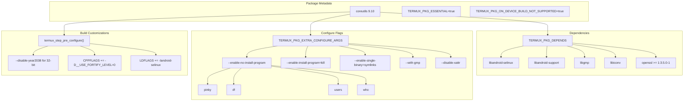
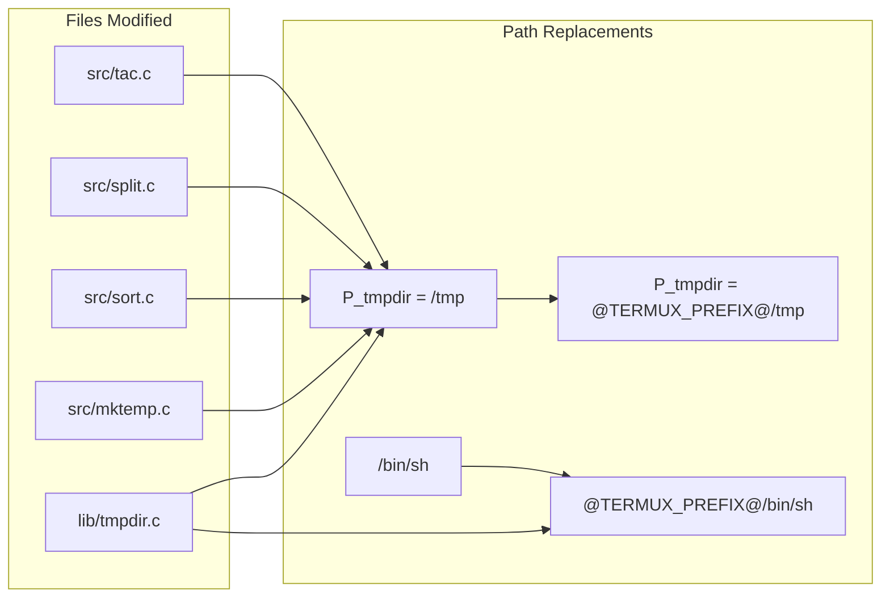
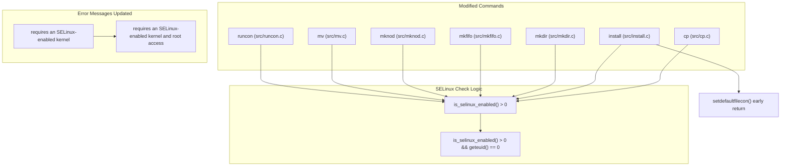
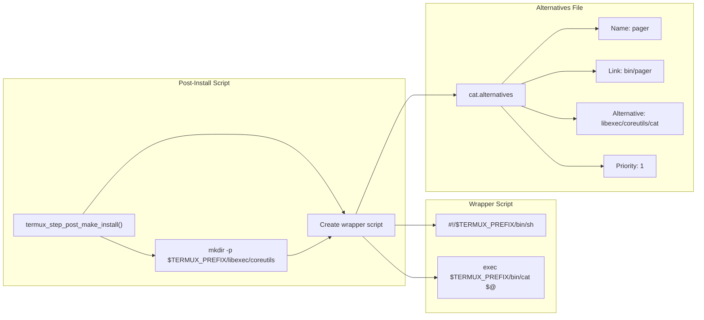
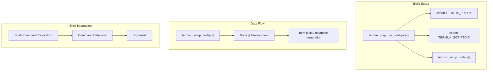
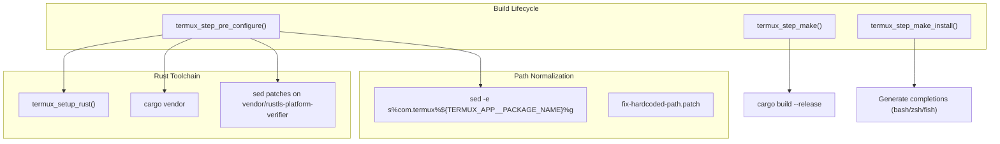
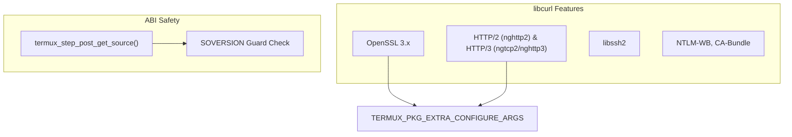
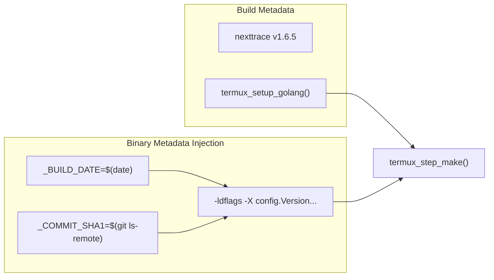

<!-- source: DeepWiki mcp.deepwiki.com · repo termux/termux-packages · page 5.6 System Utilities · fetched 2026-10-26 -->

# System Utilities

<details>
<summary>Relevant source files</summary>

The following files were used as context for generating this wiki page:

- [packages/cargo-c/build.sh](packages/cargo-c/build.sh)
- [packages/command-not-found/build.sh](packages/command-not-found/build.sh)
- [packages/gping/build.sh](packages/gping/build.sh)
- [packages/libcurl/build.sh](packages/libcurl/build.sh)
- [packages/libngtcp2/build.sh](packages/libngtcp2/build.sh)
- [packages/librav1e/build.sh](packages/librav1e/build.sh)
- [packages/libunbound/build.sh](packages/libunbound/build.sh)
- [packages/libvpx/build.sh](packages/libvpx/build.sh)
- [packages/libwebp/build.sh](packages/libwebp/build.sh)
- [packages/lychee/build.sh](packages/lychee/build.sh)
- [packages/mdbook-epub/build.sh](packages/mdbook-epub/build.sh)
- [packages/mdbook-graphviz/build.sh](packages/mdbook-graphviz/build.sh)
- [packages/mdbook-katex/build.sh](packages/mdbook-katex/build.sh)
- [packages/mdbook/build.sh](packages/mdbook/build.sh)
- [packages/oma/build.sh](packages/oma/build.sh)
- [packages/oma/fix-hardcoded-path.patch](packages/oma/fix-hardcoded-path.patch)
- [root-packages/nexttrace/build.sh](root-packages/nexttrace/build.sh)

</details>


This document covers core system utilities that provide essential Unix command-line tools, shell enhancements, and package management interfaces for Termux. It details **coreutils** (GNU core utilities with extensive Android adaptations), **command-not-found** (shell integration for package suggestions), and modern package management tools like **oma**. It also covers **root-packages/** which require elevated privileges for low-level system operations.

## Core System Utilities: coreutils

The **coreutils** package provides fundamental Unix utilities (ls, cp, mv, mkdir, cat, etc.) adapted for the Android/Termux environment. This is an essential package that requires special handling due to Android's non-standard filesystem layout and SELinux constraints.

### Package Configuration

The coreutils build is configured with Android-specific settings and disabled utilities:



**Sources:** [packages/coreutils/build.sh:1-50]()

Key design decisions:
- **Single binary with symlinks** ([packages/coreutils/build.sh:28]()): All utilities compiled into one executable for reduced disk usage.
- **Disabled utilities**: `pinky` (no Android usage), `df` (doesn't work on Android), `users`/`who` (no multiuser context), `uptime` (provided by procps).
- **32-bit year 2038 handling** ([packages/coreutils/build.sh:34-36]()): Disabled on 32-bit architectures per Android's LP32 ABI requirements.
- **On-device build disabled** ([packages/coreutils/build.sh:15]()): The build process removes the `ln` utility during installation, breaking on-device builds.

### Android Platform Adaptations

The coreutils package applies three major patch sets to adapt GNU utilities for Android's environment:

#### Path Modifications Patch

Android uses non-standard paths for temporary directories. The `fix-paths.patch` replaces all hardcoded `/tmp` references with `@TERMUX_PREFIX@/tmp`:



**Sources:** [packages/coreutils/fix-paths.patch:1-115]()

Modified files and their changes:
- `lib/tmpdir.c` ([packages/coreutils/fix-paths.patch:1-24]()): P_tmpdir constant and path_search() fallback logic.
- `src/mktemp.c` ([packages/coreutils/fix-paths.patch:25-64]()): Help text and default directory resolution.
- `src/sort.c` ([packages/coreutils/fix-paths.patch:65-79]()): DEFAULT_TMPDIR definition.
- `src/split.c` ([packages/coreutils/fix-paths.patch:80-101]()): TMPDIR fallback and shell path for filter commands.
- `src/tac.c` ([packages/coreutils/fix-paths.patch:102-115]()): Buffer directory help text.

#### SELinux Integration Patch

Android requires root access for SELinux operations, but standard coreutils assumes kernel support is sufficient. The `selinux.patch` adds `geteuid() == 0` checks:



**Sources:** [packages/coreutils/selinux.patch:1-177]()

The patch modifies:
- `src/cp.c` ([packages/coreutils/selinux.patch:1-31]()): Context preservation with `--preserve-context`.
- `src/install.c` ([packages/coreutils/selinux.patch:32-73]()): File installation with SELinux contexts, including early return workaround.
- `src/mkdir.c`, `src/mkfifo.c`, `src/mknod.c` ([packages/coreutils/selinux.patch:74-139]()): Directory/file creation with `-Z` flag.
- `src/mv.c` ([packages/coreutils/selinux.patch:140-161]()): Move operations with context preservation.
- `src/runcon.c` ([packages/coreutils/selinux.patch:162-177]()): Running commands in specific SELinux contexts (root-only).

The `setdefaultfilecon()` early return ([packages/coreutils/selinux.patch:40-42]()) is a workaround noting "we do not have suitable workaround for it", indicating incomplete SELinux support in non-root Termux.

#### API Compatibility Patch

Android's Bionic libc lacks `gethostid()`, causing compilation failures. The patch stubs it to return 0:

**Sources:** [packages/coreutils/src-hostid.c.patch:1-16]()

```c
#ifdef __ANDROID__
# define gethostid() (0L)
#endif
```

This affects `src/hostid.c` ([packages/coreutils/src-hostid.c.patch:3-16]()), making the `hostid` command non-functional but compilable.

### update-alternatives Integration

The coreutils package integrates with Termux's update-alternatives system to allow selection between different pager implementations:



**Sources:** [packages/coreutils/build.sh:42-49](), [packages/coreutils/cat.alternatives:1-9]()

The wrapper script ([packages/coreutils/build.sh:44-48]()) redirects to the actual `cat` binary, allowing other packages (like `moar`, `less`) to register as alternative pagers with higher priority values.

## Shell Integration: command-not-found

The **command-not-found** package enhances interactive shells by suggesting package installations when users attempt to run unavailable commands.

### Architecture and Build Process

The package relies on Node.js at build time to process command metadata and compile C++ components linked against `libc++`.



**Sources:** [packages/command-not-found/build.sh:1-15]()

Key components:
- `termux_setup_nodejs` ([packages/command-not-found/build.sh:14]()): Configures the Node.js toolchain for build-time operations.
- `TERMUX_PREFIX` ([packages/command-not-found/build.sh:12]()): Injected to ensure the generated database points to the correct Android environment paths.

## Package Management Tools

### oma: Modern APT Interface

**oma** is a Rust-based attempt at reworking the APT interface for a more user-friendly experience in Termux. It features a TUI and improved dependency resolution display.

#### Build Pattern and Path Fixes
The build process for `oma` involves extensive patching of hardcoded Linux paths and Rust dependency vendoring.



**Sources:** [packages/oma/build.sh:18-80](), [packages/oma/fix-hardcoded-path.patch:1-116]()

Technical details:
- **Dependency Patching**: The `rustls-platform-verifier` crate is patched during `termux_step_pre_configure` to disable APK-specific logic and treat Android as a standard target ([packages/oma/build.sh:22-31]()).
- **Dynamic Path Fixes**: It replaces hardcoded `com.termux` references with the actual `TERMUX_APP__PACKAGE_NAME` to support custom Termux builds ([packages/oma/build.sh:41-44]()).
- **Path Patching**: The `fix-hardcoded-path.patch` replaces standard Linux paths like `/run/lock/oma.lock` and `/etc/oma.toml` with `@TERMUX_PREFIX@` equivalents ([packages/oma/fix-hardcoded-path.patch:21, 30, 39]()).
- **Post-Install Generation**: Shell completions and manpages are generated in the `postinst` script using the compiled binary ([packages/oma/build.sh:67-79]()).

### Network and Download Utilities: libcurl

**libcurl** is a critical system utility and library (marked `TERMUX_PKG_ESSENTIAL=true`) used by `apt` and other tools for network operations.



**Sources:** [packages/libcurl/build.sh:1-60]()

Key features:
- **HTTP/3 Support**: Enabled via `ngtcp2` and `nghttp3` ([packages/libcurl/build.sh:20, 29]()).
- **SOVERSION Guard**: The build script includes a guard check in `termux_step_post_get_source` ([packages/libcurl/build.sh:41-55]()) to ensure ABI compatibility is tracked, preventing broken installations for reverse dependencies like `apt`.
- **Bionic Workaround**: Sets `ac_cv_func_getpwuid=yes` to handle Bionic's partial implementation of user ID lookups ([packages/libcurl/build.sh:34]()).

## Root Packages: nexttrace

Packages in `root-packages/` require elevated privileges (root) to perform low-level network or system operations. **nexttrace** is a visual routing tool that uses raw sockets.



**Sources:** [root-packages/nexttrace/build.sh:1-31]()

Implementation:
- **Golang Build**: Uses `termux_setup_golang` ([root-packages/nexttrace/build.sh:14]()) and `go build` with `-trimpath` ([root-packages/nexttrace/build.sh:23]()).
- **Version Injection**: Metadata including build date and commit SHA are injected into the Go binary via `-ldflags` during the make step ([root-packages/nexttrace/build.sh:21-26]()).
- **Privilege Requirement**: Located in `root-packages/` because visual traceroute requires raw socket access (ICMP/UDP), which is restricted on standard Android.

## System Maintenance Utilities

| Utility | Type | Build System | Key Feature |
|---------|------|--------------|-------------|
| **gping** | Network | Rust | Graphical ping interface ([packages/gping/build.sh:1-31]()) |
| **lychee** | Network | Rust | Fast, async link checker ([packages/lychee/build.sh:1-36]()) |
| **mdbook** | Documentation | Rust | Markdown to book converter ([packages/mdbook/build.sh:1-20]()) |
| **libvpx** | Multimedia | Custom | VP8/VP9 Codec SDK with ABI testing ([packages/libvpx/build.sh:1-89]()) |

**Sources:** [packages/gping/build.sh:16-24](), [packages/lychee/build.sh:14-30](), [packages/mdbook/build.sh:12-15](), [packages/libvpx/build.sh:14-32]()

The **libvpx** build is notable for its ABI test ([packages/libvpx/build.sh:21-30]()), which compiles a small C program `abi-test.c` during the build process to verify encoder/decoder ABI versions before proceeding, ensuring compatibility with reverse dependencies like `ffmpeg`.

---

