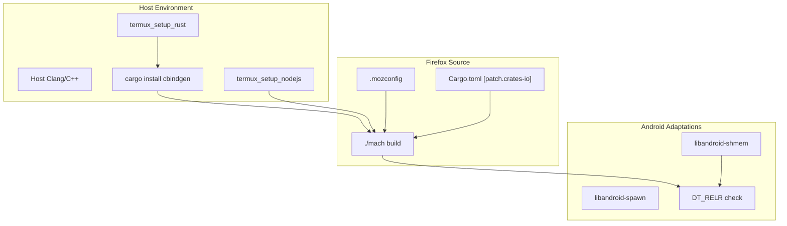
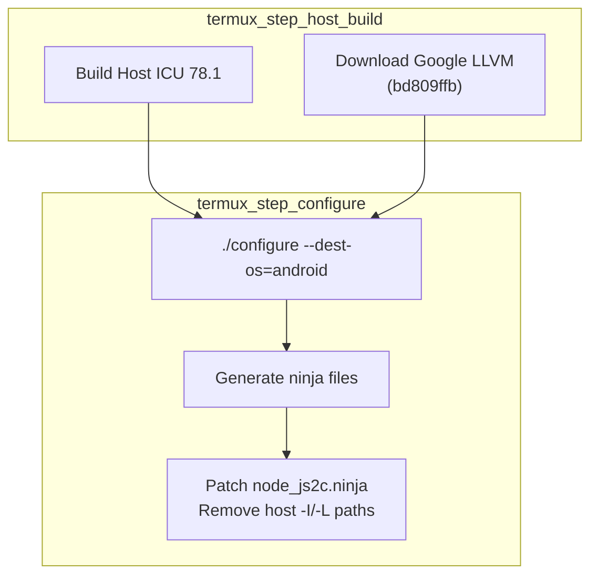
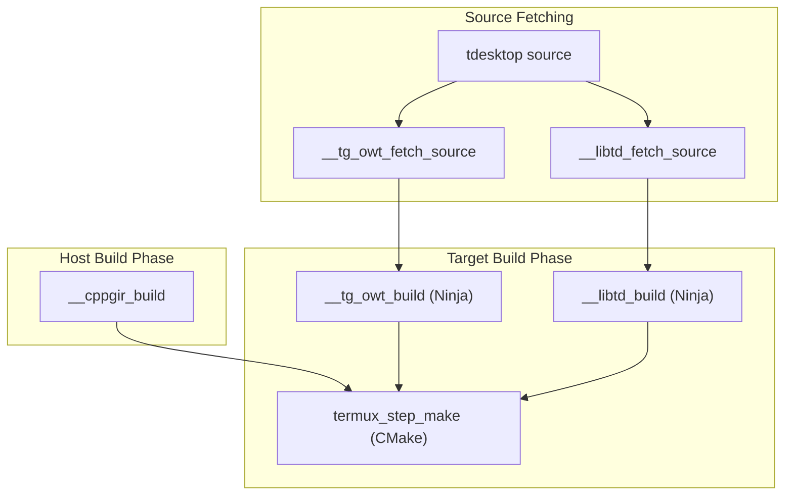

<!-- source: DeepWiki mcp.deepwiki.com · repo termux/termux-packages · page 5.7 Web and Network Services · fetched 2026-10-26 -->

# Web and Network Services

Relevant source files

The following files were used as context for generating this wiki page:

- [packages/emscripten/build.sh](packages/emscripten/build.sh)
- [packages/gitea/build.sh](packages/gitea/build.sh)
- [packages/nodejs-lts/build.sh](packages/nodejs-lts/build.sh)
- [packages/nodejs-lts/common.gypi.patch](packages/nodejs-lts/common.gypi.patch)
- [packages/nodejs-lts/deps-uv-src-unix-process.c.patch](packages/nodejs-lts/deps-uv-src-unix-process.c.patch)
- [packages/nodejs-lts/deps-uv-uv.gyp.patch](packages/nodejs-lts/deps-uv-uv.gyp.patch)
- [packages/nodejs-lts/deps-uvwasi-src-uvwasi.c.patch](packages/nodejs-lts/deps-uvwasi-src-uvwasi.c.patch)
- [packages/nodejs-lts/deps-v8-src-flags-flag-definitions.h.patch](packages/nodejs-lts/deps-v8-src-flags-flag-definitions.h.patch)
- [packages/nodejs-lts/deps-v8-src-trap-handler-trap-handler.h.patch](packages/nodejs-lts/deps-v8-src-trap-handler-trap-handler.h.patch)
- [packages/nodejs-lts/lib-os.js.patch](packages/nodejs-lts/lib-os.js.patch)
- [packages/nodejs-lts/node.gyp.patch](packages/nodejs-lts/node.gyp.patch)
- [packages/nodejs-lts/test-fs-readfile-pipe-large.js.patch](packages/nodejs-lts/test-fs-readfile-pipe-large.js.patch)
- [packages/nodejs/build.sh](packages/nodejs/build.sh)
- [packages/nodejs/deps-v8-src-trap-handler-trap-handler.h.patch](packages/nodejs/deps-v8-src-trap-handler-trap-handler.h.patch)
- [packages/nodejs/node.gyp.patch](packages/nodejs/node.gyp.patch)
- [packages/nodejs/test-fs-readfile-pipe-large.js.patch](packages/nodejs/test-fs-readfile-pipe-large.js.patch)
- [packages/python-llvmlite/build.sh](packages/python-llvmlite/build.sh)
- [packages/python-llvmlite/ffi-build.py.patch](packages/python-llvmlite/ffi-build.py.patch)
- [packages/python-llvmlite/llvm-include-llvm-ADT-SmallVector.h.patch](packages/python-llvmlite/llvm-include-llvm-ADT-SmallVector.h.patch)
- [packages/python-llvmlite/llvm-tools-llvm-rtdyld-llvm-rtdyld.cpp.patch](packages/python-llvmlite/llvm-tools-llvm-rtdyld-llvm-rtdyld.cpp.patch)
- [packages/python-llvmlite/openmp.patch](packages/python-llvmlite/openmp.patch)
- [packages/tinymist/build.sh](packages/tinymist/build.sh)
- [packages/tinymist/crates-tinymist-cli-Cargo.toml.patch](packages/tinymist/crates-tinymist-cli-Cargo.toml.patch)
- [scripts/big-pkgs.list](scripts/big-pkgs.list)
- [scripts/build/setup/termux_setup_nodejs.sh](scripts/build/setup/termux_setup_nodejs.sh)
- [x11-packages/chromium/0002-cxx23-chrome.patch](x11-packages/chromium/0002-cxx23-chrome.patch)
- [x11-packages/chromium/0112-jumbo-chrome.patch](x11-packages/chromium/0112-jumbo-chrome.patch)
- [x11-packages/chromium/build.sh](x11-packages/chromium/build.sh)
- [x11-packages/firefox/0007-fix-link-with-libcxx-18.patch](x11-packages/firefox/0007-fix-link-with-libcxx-18.patch)
- [x11-packages/firefox/0008-fix-marcos.patch](x11-packages/firefox/0008-fix-marcos.patch)
- [x11-packages/firefox/0012-do-not-use-adaptive-mutex.patch](x11-packages/firefox/0012-do-not-use-adaptive-mutex.patch)
- [x11-packages/firefox/0013-fix-rust-compile.patch](x11-packages/firefox/0013-fix-rust-compile.patch)
- [x11-packages/firefox/0024-disable-native-https-dns-resolve.patch](x11-packages/firefox/0024-disable-native-https-dns-resolve.patch)
- [x11-packages/firefox/0029-rust-cc-do-not-concatenates-all-the-CFLAGS.patch](x11-packages/firefox/0029-rust-cc-do-not-concatenates-all-the-CFLAGS.patch)
- [x11-packages/firefox/0030-fix-sigbus-2.patch](x11-packages/firefox/0030-fix-sigbus-2.patch)
- [x11-packages/firefox/0031-tagged-pointer-2.patch](x11-packages/firefox/0031-tagged-pointer-2.patch)
- [x11-packages/firefox/build.sh](x11-packages/firefox/build.sh)
- [x11-packages/firefox/mozconfig.cfg](x11-packages/firefox/mozconfig.cfg)
- [x11-packages/telegram-desktop/0003-cppgir-namespace.patch](x11-packages/telegram-desktop/0003-cppgir-namespace.patch)
- [x11-packages/telegram-desktop/0004-libtd-no-android.patch](x11-packages/telegram-desktop/0004-libtd-no-android.patch)
- [x11-packages/telegram-desktop/0005-libtg_owt-absl-20250814.patch](x11-packages/telegram-desktop/0005-libtg_owt-absl-20250814.patch)
- [x11-packages/telegram-desktop/0006-gir-version.patch](x11-packages/telegram-desktop/0006-gir-version.patch)
- [x11-packages/telegram-desktop/0007-minizip-include.patch](x11-packages/telegram-desktop/0007-minizip-include.patch)
- [x11-packages/telegram-desktop/build.sh](x11-packages/telegram-desktop/build.sh)
- [x11-packages/telegram-desktop/gir/AtSpi-1.0.xml](x11-packages/telegram-desktop/gir/AtSpi-1.0.xml)
- [x11-packages/telegram-desktop/gir/Webview-1.0.xml](x11-packages/telegram-desktop/gir/Webview-1.0.xml)
- [x11-packages/telegram-desktop/gir/XdpOpenURI-1.0.xml](x11-packages/telegram-desktop/gir/XdpOpenURI-1.0.xml)
- [x11-packages/wine-stable/0001-fix-paths.patch](x11-packages/wine-stable/0001-fix-paths.patch)
- [x11-packages/wine-stable/0002-fix-defines.patch](x11-packages/wine-stable/0002-fix-defines.patch)
- [x11-packages/wine-stable/0004-no-pthread_mutexattr_setprotocol.patch](x11-packages/wine-stable/0004-no-pthread_mutexattr_setprotocol.patch)
- [x11-packages/wine-stable/0005-use-__builtin_ffs.patch](x11-packages/wine-stable/0005-use-__builtin_ffs.patch)
- [x11-packages/wine-stable/9998-fix-winegcc-build-target.patch.beforehostbuild](x11-packages/wine-stable/9998-fix-winegcc-build-target.patch.beforehostbuild)
- [x11-packages/wine-stable/9999-fix-winebuild-as-type.patch.beforehostbuild](x11-packages/wine-stable/9999-fix-winebuild-as-type.patch.beforehostbuild)
- [x11-packages/wine-stable/build.sh](x11-packages/wine-stable/build.sh)
- [x11-packages/wlr-randr/build.sh](x11-packages/wlr-randr/build.sh)

This section covers packages that provide web services, network tools, and modern web browsers. These include self-hosted web applications (Gitea), sophisticated web browsers (Firefox, Chromium), JavaScript runtimes (Node.js), and communication platforms (Telegram Desktop).

## Package Categories

Web and network service packages in Termux fall into several categories based on their complexity and technology stack:

| Category | Packages | Primary Language | Build Complexity |
|----------|----------|------------------|------------------|
| Git Hosting | `gitea` | Go + Node.js | High (dual-toolchain) |
| Web Browsers | `firefox`, `chromium` | C++, Rust, JS | Extreme (multi-hour builds) |
| Runtimes | `nodejs`, `nodejs-lts` | C++, JS | Extreme (V8 compilation) |
| Communication | `telegram-desktop` | C++, Qt6 | High (complex deps) |
| Network Tools | `frp`, `findomain` | Go, Rust | Medium |
| Language Services| `tinymist` | Rust | Medium |

Sources: [packages/gitea/build.sh](), [x11-packages/firefox/build.sh](), [x11-packages/chromium/build.sh](), [packages/nodejs/build.sh](), [x11-packages/telegram-desktop/build.sh](), [packages/tinymist/build.sh]()

## Web Browsers

Browsers represent the most complex packages in the repository, often requiring custom host tools and specific LLVM toolchains.

### Firefox Build Architecture
Firefox uses the `mach` build system and requires both Rust and Node.js for compilation.

Sources: [x11-packages/firefox/build.sh:66-88](), [x11-packages/firefox/build.sh:118-124]()

**Key Implementation Details:**
*   **Rust Integration:** Firefox patches the `cc` crate via `[patch.crates-io]` to use the Termux-patched compiler [x11-packages/firefox/build.sh:57-63]().
*   **Android Compatibility:** It explicitly links against `libandroid-shmem` and `libandroid-spawn` to handle Android's lack of native SYSV shm and standard `posix_spawn` [x11-packages/firefox/build.sh:91]().
*   **DT_RELR Guard:** A post-install check ensures the binary does not use `DT_RELR` (packed relative relocations), which is unsupported on Android versions older than 8.x [x11-packages/firefox/build.sh:145-153]().

### Chromium
Chromium requires a massive set of host tools and a specific "lite" source distribution.

*   **Host Tools:** Depends on `chromium-host-tools` and uses `depot_tools` for the build process [x11-packages/chromium/build.sh:10-113]().
*   **Toolchain Sync:** It uses `update_rust.py` and `update.py` (for Clang) from the Chromium source tree to ensure the toolchain matches upstream expectations [x11-packages/chromium/build.sh:143-144]().
*   **Space Management:** Due to its size, it deletes the source tarball immediately after extraction to save disk space [x11-packages/chromium/build.sh:92-93]().

## JavaScript Runtimes (Node.js)

Node.js packages (`nodejs` and `nodejs-lts`) are "Extreme" complexity builds due to the V8 engine.

### Node.js Build Flow
Node.js requires a host-built ICU and a specific LLVM version used by the Google V8 project.

Sources: [packages/nodejs/build.sh:28-100](), [packages/nodejs/build.sh:156-176]()

**Technical Constraints:**
*   **Shared libuv:** Termux explicitly avoids using a shared `libuv` to circumvent Android linker issues where symbols from linked shared libraries are not used during `dlopen()` [packages/nodejs/build.sh:10-12]().
*   **Host Path Leakage:** The build system often leaks host include/library paths into generated ninja files. The `termux_step_configure` uses `sed` to strip `-I$TERMUX_PREFIX/include` and `-L$TERMUX_PREFIX/lib` from `node_js2c.ninja` [packages/nodejs/build.sh:170-176]().

## Web Services (Gitea)

Gitea demonstrates a dual-toolchain build pattern requiring both Go (backend) and Node.js (frontend).

### Gitea Implementation
*   **Dual Toolchain:** Calls `termux_setup_nodejs` and `termux_setup_golang` [packages/gitea/build.sh:12-15]().
*   **Frontend Assets:** Uses `npm install pnpm` to manage frontend dependencies [packages/gitea/build.sh:22]().
*   **Path Injection:** Uses Go `LDFLAGS` to hardcode Termux-specific paths for `app.ini` and data directories [packages/gitea/build.sh:37-40]():
    *   `modules/setting.CustomConf`: `$TERMUX_PREFIX/etc/gitea/app.ini`
    *   `modules/setting.AppWorkPath`: `$TERMUX_PREFIX/var/lib/gitea`

Sources: [packages/gitea/build.sh:12-42]()

## Communication Apps (Telegram Desktop)

Telegram Desktop (`tdesktop`) is one of the most complex X11 packages, involving multiple sub-projects.

### Telegram Sub-Project Integration
The build fetches and compiles specific commits of internal libraries:
1.  **tg_owt:** A fork of WebRTC [x11-packages/telegram-desktop/build.sh:29-49]().
2.  **libtd:** The Telegram Database Library [x11-packages/telegram-desktop/build.sh:51-71]().

**Host Build Requirements:**
It requires a host build of `cppgir` to generate GObject Introspection bindings for C++ [x11-packages/telegram-desktop/build.sh:78-99]().

Sources: [x11-packages/telegram-desktop/build.sh:73-76](), [x11-packages/telegram-desktop/build.sh:124-127](), [x11-packages/telegram-desktop/build.sh:227-233]()

## Language Services (Tinymist)

`tinymist` provides an integrated language service for Typst, built with Rust.

*   **Completions:** It uses `cargo run --bin tinymist -- completion` during the build phase to generate completion scripts for `bash`, `zsh`, `fish`, `elvish`, and `nushell` [packages/tinymist/build.sh:46-50]().
*   **Environment Setup:** Unsets `CFLAGS` to prevent clashes with Rust host builds and sets `OPENSSL_NO_VENDOR=1` to use the system OpenSSL [packages/tinymist/build.sh:21-25]().

Sources: [packages/tinymist/build.sh:17-53]()

## Summary of Big Packages

The following packages in this category are explicitly tracked as "big packages" in `scripts/big-pkgs.list`, indicating they require significant resources or have complex build logic:

*   `chromium` [scripts/big-pkgs.list:6]()
*   `emscripten` [scripts/big-pkgs.list:17]()
*   `firefox` [scripts/big-pkgs.list:18]()
*   `gitea` [scripts/big-pkgs.list:21]()
*   `telegram-desktop` [scripts/big-pkgs.list:36]()

Sources: [scripts/big-pkgs.list:1-46]()

---

