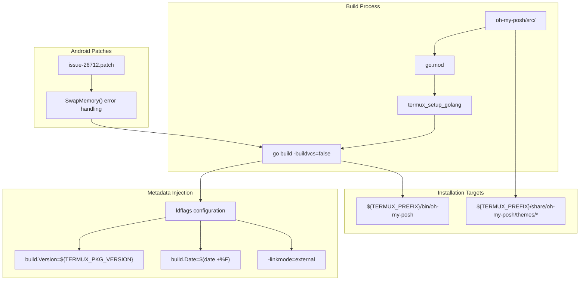
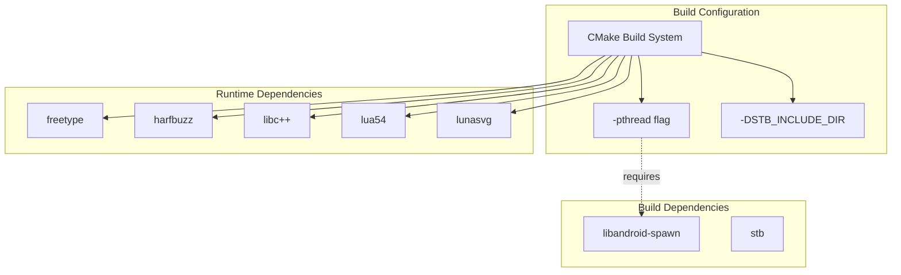
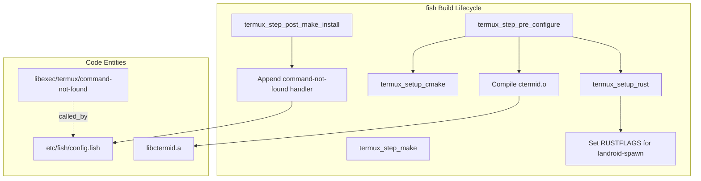

<!-- source: DeepWiki mcp.deepwiki.com · repo termux/termux-packages · page 5.8 Terminal Enhancements · fetched 2026-10-26 -->

# Terminal Enhancements

Relevant source files

The following files were used as context for generating this wiki page:

- [packages/cabal-install/build.sh](packages/cabal-install/build.sh)
- [packages/fish/0001-share-tools-create_manpage_completions.py.patch](packages/fish/0001-share-tools-create_manpage_completions.py.patch)
- [packages/fish/0002-force-d_ino-and-st_mode-types-on-32-bit-android.patch](packages/fish/0002-force-d_ino-and-st_mode-types-on-32-bit-android.patch)
- [packages/fish/0003-revert-5081966.patch](packages/fish/0003-revert-5081966.patch)
- [packages/fish/0004-partial-revert-d68f8bd.patch](packages/fish/0004-partial-revert-d68f8bd.patch)
- [packages/fish/0005-revert-70bd49f.patch](packages/fish/0005-revert-70bd49f.patch)
- [packages/fish/0006-revert-174130f.patch](packages/fish/0006-revert-174130f.patch)
- [packages/fish/0007-revert-c1f3d93.patch](packages/fish/0007-revert-c1f3d93.patch)
- [packages/fish/0008-share-functions-__fish_print_pacman_repos.fish.patch](packages/fish/0008-share-functions-__fish_print_pacman_repos.fish.patch)
- [packages/fish/build.sh](packages/fish/build.sh)
- [packages/lua-lpeg/lua54-lpeg.subpackage.sh](packages/lua-lpeg/lua54-lpeg.subpackage.sh)
- [packages/luarocks/build.sh](packages/luarocks/build.sh)
- [packages/mympd/CMakeLists.txt.patch](packages/mympd/CMakeLists.txt.patch)
- [packages/mympd/build.sh](packages/mympd/build.sh)
- [packages/mympd/dist-libmpdclient-include-config.h.patch](packages/mympd/dist-libmpdclient-include-config.h.patch)
- [packages/mympd/src-lib-cacertstore.c.patch](packages/mympd/src-lib-cacertstore.c.patch)
- [packages/mympd/src-lib-http_client.c.patch](packages/mympd/src-lib-http_client.c.patch)
- [packages/nmap/build.sh](packages/nmap/build.sh)
- [packages/oh-my-posh/build.sh](packages/oh-my-posh/build.sh)
- [packages/oh-my-posh/issue-26712.patch](packages/oh-my-posh/issue-26712.patch)
- [packages/osm2pgsql/build.sh](packages/osm2pgsql/build.sh)
- [packages/pandoc/build.sh](packages/pandoc/build.sh)
- [packages/rnr/build.sh](packages/rnr/build.sh)
- [packages/robotfindskitten/build.sh](packages/robotfindskitten/build.sh)
- [packages/rp-pppoe/build.sh](packages/rp-pppoe/build.sh)
- [packages/rpm/build.sh](packages/rpm/build.sh)
- [packages/sassc/build.sh](packages/sassc/build.sh)
- [packages/sc-im/build.sh](packages/sc-im/build.sh)
- [packages/scc/build.sh](packages/scc/build.sh)
- [packages/sccache/build.sh](packages/sccache/build.sh)
- [packages/vis/build.sh](packages/vis/build.sh)
- [packages/vtm/build.sh](packages/vtm/build.sh)

This document covers packages that enhance terminal and shell functionality, including prompt customization engines, terminal multiplexers, and modern shells. These tools provide improved user interfaces, session management, and scripting capabilities for terminal environments on Android.

For general system utilities and command-line tools, see [System Utilities](#5.6). For text editors that run in the terminal, see [Editors and Text Processing](#5.2).

## Overview

Terminal enhancement packages in this repository fall into three primary categories:

| Category | Package | Description | Build System |
|----------|---------|-------------|--------------|
| Prompt Engines | `oh-my-posh` | Cross-shell prompt theme engine | Go with metadata injection |
| Multiplexers | `vtm` | TUI window manager with multi-party sessions | CMake with threading support |
| Shells | `fish` | User-friendly command line shell | CMake + Rust with Android patches |

These packages require specialized build configurations to address Android platform constraints, particularly around threading models, system path APIs, and shell completion integration.

Sources: [packages/oh-my-posh/build.sh:1-34](), [packages/vtm/build.sh:1-16](), [packages/fish/build.sh:1-47]()

## Shell Prompt Customization

### oh-my-posh Architecture

**oh-my-posh** provides a themeable prompt engine compatible with multiple shells. The build process injects version and build metadata directly into the binary through Go's linker flags.

**Diagram: oh-my-posh Build Flow with Metadata Injection**

Sources: [packages/oh-my-posh/build.sh:10-34](), [packages/oh-my-posh/issue-26712.patch:1-13]()

### Build Metadata Injection

The package uses Go's `-ldflags` parameter to inject build-time metadata into the compiled binary. This pattern is common in Go applications that need to report version information at runtime.

| Metadata Field | Source | Purpose |
|----------------|--------|---------|
| `build.Version` | `${TERMUX_PKG_VERSION}` | Package version from `build.sh` |
| `build.Date` | `$(date +%F)` | Build timestamp in YYYY-MM-DD format |
| Link Mode | `external` | Use external linker for Android compatibility |

The injection occurs in `termux_step_make`: [packages/oh-my-posh/build.sh:20-24](). The `-X` flag sets the value of string variables at link time, allowing the compiled binary to display accurate version information without hardcoding values in source.

Sources: [packages/oh-my-posh/build.sh:17-25]()

### Android Platform Adaptations

Android's memory subsystem differs from standard Linux systems, particularly in swap memory reporting. The patch [packages/oh-my-posh/issue-26712.patch:1-13]() addresses a crash when querying swap memory statistics. The modification adds an early return when `mem.SwapMemory()` fails, preventing nil pointer dereferences.

Sources: [packages/oh-my-posh/issue-26712.patch:1-13]()

## Terminal Multiplexers

### vtm Architecture

**vtm** is a terminal multiplexer with a graphical TUI window manager, supporting multi-party session sharing. Unlike traditional multiplexers that only manage terminal panes, vtm provides a complete windowing system within the terminal.

**Diagram: vtm Dependency Chain**

Sources: [packages/vtm/build.sh:1-16]()

### Threading and Spawning

vtm requires POSIX threading support, configured through `CXXFLAGS` in [packages/vtm/build.sh:14-16](). Additionally, it depends on `libandroid-spawn` [packages/vtm/build.sh:10]() to handle process creation on Android, as standard `posix_spawn` behavior is restricted.

## Advanced Shell: Fish

The **fish shell** (Friendly Interactive Shell) implementation in Termux is complex due to its dual-language (C++/Rust) nature and lack of certain POSIX APIs on older Android versions.

### Path and API Compatibility Patches

Android does not provide `confstr` or `_CS_PATH` in its `libc`. Fish relies on these for path resolution. Termux applies several reverts and shims to handle this:

1.  **Revert 174130f**: Reverts upstream changes that assumed `libc::_CS_PATH` exists [packages/fish/0006-revert-174130f.patch:1-8]().
2.  **C Shims**: Implements a backup `confstr` in C that returns 0 (error) if `_CS_PATH` is undefined, preventing linker errors [packages/fish/0005-revert-70bd49f.patch:44-52]().
3.  **ctermid.c**: Since Android < 8 lacks `ctermid`, a local implementation is compiled and linked as `libctermid.a` during the build [packages/fish/build.sh:30-32]().

### Build Integration and Completion

**Diagram: Fish Shell Build and Integration**

Sources: [packages/fish/build.sh:20-47](), [packages/fish/0005-revert-70bd49f.patch:33-68]()

### Shell Completion Systems

Termux packages often automate the generation or installation of shell completions:

*   **Pandoc**: Creates an empty completion file during build [packages/pandoc/build.sh:60](), then generates the actual content in a `postinst` script by calling `pandoc --bash-completion` [packages/pandoc/build.sh:63-68]().
*   **Fish Handler**: The fish package automatically appends a `fish_command_not_found` event handler to the global `config.fish`, which invokes the Termux `command-not-found` utility [packages/fish/build.sh:41-47]().

Sources: [packages/pandoc/build.sh:54-68](), [packages/fish/build.sh:41-47]()

## Common Build Patterns

### Language-Specific Setup

Terminal tools in this category utilize standardized setup hooks for their respective toolchains:

| Toolchain | Function | Example Package |
|-----------|----------|-----------------|
| Go | `termux_setup_golang` | `oh-my-posh`, `scc` |
| Rust | `termux_setup_rust` | `fish`, `sccache`, `rnr` |
| CMake | `termux_setup_cmake` | `vtm`, `fish`, `mympd` |

Sources: [packages/oh-my-posh/build.sh:13](), [packages/fish/build.sh:23](), [packages/sccache/build.sh:13](), [packages/scc/build.sh:12]()

### Cross-Compilation Flag Management

For packages like `fish` that use CMake to invoke Rust, environment variables must be manually mapped. The build script extracts `CARGO_TARGET_*_RUSTFLAGS` and appends Android-specific link arguments like `-landroid-spawn` [packages/fish/build.sh:34-38]().

Sources: [packages/fish/build.sh:34-39]()

---

