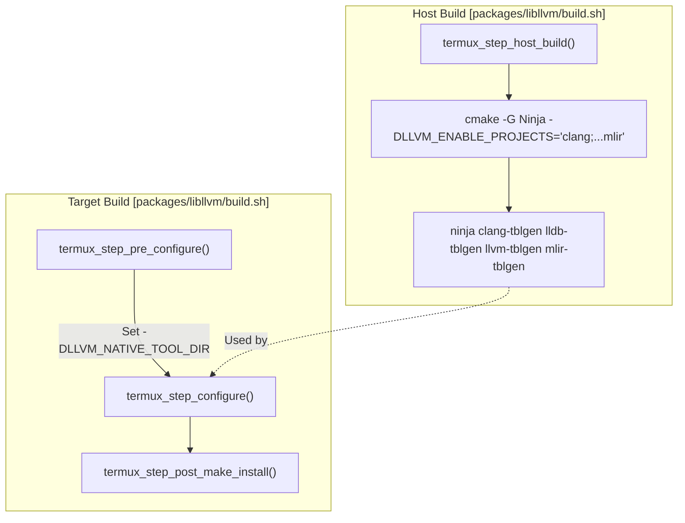
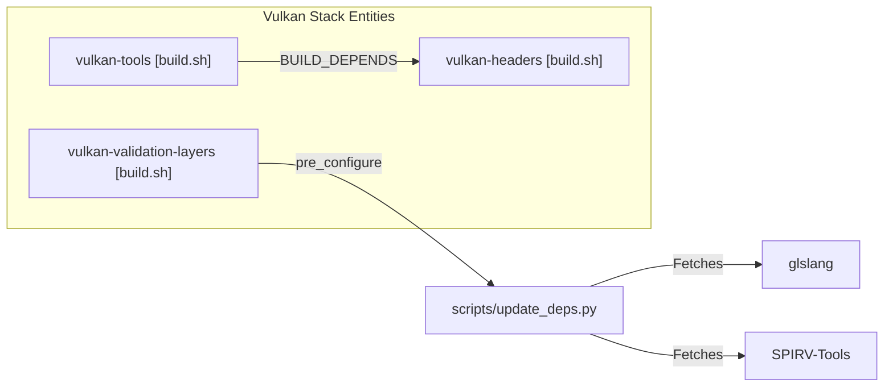

<!-- source: DeepWiki mcp.deepwiki.com · repo termux/termux-packages · page 5.9 Compilers and Build Systems · fetched 2026-10-26 -->

# Compilers and Build Systems

Relevant source files

The following files were used as context for generating this wiki page:

- [packages/emscripten/build.sh](packages/emscripten/build.sh)
- [packages/flang/0002-remove-some-macros-that-breaks-building.patch](packages/flang/0002-remove-some-macros-that-breaks-building.patch)
- [packages/flang/0004-do-not-call-timespec_get.patch](packages/flang/0004-do-not-call-timespec_get.patch)
- [packages/flang/0005-use-libandroid-complex-math.patch](packages/flang/0005-use-libandroid-complex-math.patch)
- [packages/flang/build.sh](packages/flang/build.sh)
- [packages/gitea/build.sh](packages/gitea/build.sh)
- [packages/libllvm/build.sh](packages/libllvm/build.sh)
- [packages/libllvm/clang-lib-Driver-ToolChain.cpp.patch](packages/libllvm/clang-lib-Driver-ToolChain.cpp.patch)
- [packages/libllvm/clang-lib-Driver-ToolChains-Linux.cpp.patch](packages/libllvm/clang-lib-Driver-ToolChains-Linux.cpp.patch)
- [packages/libllvm/clang.subpackage.sh](packages/libllvm/clang.subpackage.sh)
- [packages/libllvm/compiler-rt-lib-builtins-CMakeLists.txt.patch](packages/libllvm/compiler-rt-lib-builtins-CMakeLists.txt.patch)
- [packages/libllvm/libcompiler-rt.subpackage.sh](packages/libllvm/libcompiler-rt.subpackage.sh)
- [packages/libllvm/lldb.subpackage.sh](packages/libllvm/lldb.subpackage.sh)
- [packages/libllvm/llvm-config.in](packages/libllvm/llvm-config.in)
- [packages/libllvm/llvm-include-llvm-Demangle-ItaniumDemangle.h.patch](packages/libllvm/llvm-include-llvm-Demangle-ItaniumDemangle.h.patch)
- [packages/libllvm/llvm-lib-Support-Unix-Path.inc.patch](packages/libllvm/llvm-lib-Support-Unix-Path.inc.patch)
- [packages/libllvm/llvm-tools.subpackage.sh](packages/libllvm/llvm-tools.subpackage.sh)
- [packages/libllvm/llvm.subpackage.sh](packages/libllvm/llvm.subpackage.sh)
- [packages/python-llvmlite/build.sh](packages/python-llvmlite/build.sh)
- [packages/python-llvmlite/ffi-build.py.patch](packages/python-llvmlite/ffi-build.py.patch)
- [packages/python-llvmlite/llvm-include-llvm-ADT-SmallVector.h.patch](packages/python-llvmlite/llvm-include-llvm-ADT-SmallVector.h.patch)
- [packages/python-llvmlite/llvm-tools-llvm-rtdyld-llvm-rtdyld.cpp.patch](packages/python-llvmlite/llvm-tools-llvm-rtdyld-llvm-rtdyld.cpp.patch)
- [packages/python-llvmlite/openmp.patch](packages/python-llvmlite/openmp.patch)
- [packages/rust/0004-set-TMPDIR.patch](packages/rust/0004-set-TMPDIR.patch)
- [packages/rust/0006-suppress-hard-linking-failed-warning.patch](packages/rust/0006-suppress-hard-linking-failed-warning.patch)
- [packages/rust/0007-use-emulated-tls-on-android.patch](packages/rust/0007-use-emulated-tls-on-android.patch)
- [packages/rust/0008-cross-compile-error_index_generator.patch](packages/rust/0008-cross-compile-error_index_generator.patch)
- [packages/rust/0009-always-export-emutls.patch](packages/rust/0009-always-export-emutls.patch)
- [packages/rust/bootstrap.toml](packages/rust/bootstrap.toml)
- [packages/rust/build.sh](packages/rust/build.sh)
- [packages/rust/force-allow-edit-vendor.diff](packages/rust/force-allow-edit-vendor.diff)
- [packages/rust/rust-std-wasm32-wasip3.subpackage.sh](packages/rust/rust-std-wasm32-wasip3.subpackage.sh)
- [packages/rust/tests/0001-cargo-build.sh](packages/rust/tests/0001-cargo-build.sh)
- [packages/rust/tests/0002-issue-25360.sh](packages/rust/tests/0002-issue-25360.sh)
- [packages/rust/tests/0003-issue-27402.sh](packages/rust/tests/0003-issue-27402.sh)
- [packages/tinymist/build.sh](packages/tinymist/build.sh)
- [packages/tinymist/crates-tinymist-cli-Cargo.toml.patch](packages/tinymist/crates-tinymist-cli-Cargo.toml.patch)
- [packages/vulkan-headers/build.sh](packages/vulkan-headers/build.sh)
- [packages/vulkan-tools/0001-no-android.patch](packages/vulkan-tools/0001-no-android.patch)
- [packages/vulkan-tools/0002-do-not-search-KHR_display-automatically-on-Termux.patch](packages/vulkan-tools/0002-do-not-search-KHR_display-automatically-on-Termux.patch)
- [packages/vulkan-tools/0003-revert-vk-khr-display.patch](packages/vulkan-tools/0003-revert-vk-khr-display.patch)
- [packages/vulkan-tools/build.sh](packages/vulkan-tools/build.sh)
- [packages/vulkan-validation-layers/0002-getenv.patch](packages/vulkan-validation-layers/0002-getenv.patch)
- [packages/vulkan-validation-layers/0004-setenv.patch](packages/vulkan-validation-layers/0004-setenv.patch)
- [packages/vulkan-validation-layers/build.sh](packages/vulkan-validation-layers/build.sh)
- [scripts/big-pkgs.list](scripts/big-pkgs.list)
- [scripts/build/setup/termux_setup_rust.sh](scripts/build/setup/termux_setup_rust.sh)
- [x11-packages/wine-stable/0001-fix-paths.patch](x11-packages/wine-stable/0001-fix-paths.patch)
- [x11-packages/wine-stable/0002-fix-defines.patch](x11-packages/wine-stable/0002-fix-defines.patch)
- [x11-packages/wine-stable/0004-no-pthread_mutexattr_setprotocol.patch](x11-packages/wine-stable/0004-no-pthread_mutexattr_setprotocol.patch)
- [x11-packages/wine-stable/0005-use-__builtin_ffs.patch](x11-packages/wine-stable/0005-use-__builtin_ffs.patch)
- [x11-packages/wine-stable/9998-fix-winegcc-build-target.patch.beforehostbuild](x11-packages/wine-stable/9998-fix-winegcc-build-target.patch.beforehostbuild)
- [x11-packages/wine-stable/9999-fix-winebuild-as-type.patch.beforehostbuild](x11-packages/wine-stable/9999-fix-winebuild-as-type.patch.beforehostbuild)
- [x11-packages/wine-stable/build.sh](x11-packages/wine-stable/build.sh)
- [x11-packages/wlr-randr/build.sh](x11-packages/wlr-randr/build.sh)

This page documents complex compiler packages in the Termux repository that build or bundle compiler toolchains. These packages demonstrate advanced build patterns including multi-component coordination, custom auto-update systems, and cross-compiler toolchain integration.

For general language toolchain integration (Rust, Go, .NET), see [Language Toolchain Integration](#2.3). For packages that use compilers (rather than packages that are compilers), see [Development Tools and Language Support](#5.3).

## Overview

The repository contains major compiler package categories, often requiring significant resources as noted in `scripts/big-pkgs.list`:

| Package Category | Example Packages | Build Complexity |
|-----------------|------------------|------------------|
| LLVM Toolchains | `libllvm`, `flang`, `rust` | Large-scale C++/Rust builds with host-side tablegen |
| WebAssembly Toolchains | `emscripten` | Three-component coordination with upstream release tracking |
| Custom LLVM Builds | `python-llvmlite` | Custom LLVM configuration for JIT compiler integration |
| Vulkan Development | `vulkan-validation-layers` | Complex dependency fetching via `update_deps.py` |

**Sources:** [scripts/big-pkgs.list:17-44](), [packages/libllvm/build.sh:12]()

## LLVM and Clang

The `libllvm` package is the foundation for the Termux compiler stack. It is a host-build enabled package that produces the `clang`, `lld`, and `lldb` toolchains.

### Host Build Phase
LLVM requires native "tablegen" tools to generate code during the cross-compilation process. These are built in `termux_step_host_build()` [packages/libllvm/build.sh:83-91]().

### Android-Specific Wrappers
To facilitate easier cross-compilation on-device, `libllvm` creates wrapper scripts in `termux_step_post_make_install()` [packages/libllvm/build.sh:156-169](). These wrappers (e.g., `aarch64-linux-android-clang`) automatically append the `--target` and API level flags.

**Sources:** [packages/libllvm/build.sh:83-91](), [packages/libllvm/build.sh:118-121](), [packages/libllvm/build.sh:151-169]()

## Rust Toolchain

The `rust` package is one of the most complex in the repository, involving bootstrapping and vendored dependency patching.

### Version Coordination
The package uses a `BOOTSTRAP_VERSION` (usually $N-1$) to compile the current version $N$ [packages/rust/build.sh:147-156](). 

### Path Patching for Custom Prefixes
Termux supports custom installation prefixes. To ensure Rust's `openssl-probe` crate finds certificates in non-standard locations, the build script performs an in-place crate replacement using the `[patch.crates-io]` manifest pattern [packages/rust/build.sh:94-113]().

```mermaid
graph TB
    subgraph "Rust Build Logic [packages/rust/build.sh]"
        PRE_CONF["termux_step_pre_configure()"]
        V_PATCH["Check TERMUX_PREFIX != /data/data/com.termux/..."]
        CRATE_REPLACE["Replace 'openssl-probe' source with custom path"]
        CARGO_PATCH["Inject [patch.crates-io] into Cargo.toml"]
        
        PRE_CONF --> V_PATCH
        V_PATCH -->|True| CRATE_REPLACE
        CRATE_REPLACE --> CARGO_PATCH
    end

    subgraph "Toolchain Setup [scripts/build/setup/termux_setup_rust.sh]"
        SR_FUNC["termux_setup_rust()"]
        SR_INSTALL["curl rustup.sh | sh"]
        SR_TARGET["rustup target add $CARGO_TARGET_NAME"]
        
        SR_FUNC --> SR_INSTALL --> SR_TARGET
    end
```

**Sources:** [packages/rust/build.sh:94-113](), [packages/rust/build.sh:147-156](), [scripts/build/setup/termux_setup_rust.sh:2-44]()

## Emscripten: LLVM-to-WebAssembly

Emscripten consists of three separately-versioned components (Emscripten, LLVM, Binaryen) that must be coordinated via specific commit hashes.

### Auto-Update System
The `termux_pkg_auto_update()` function [packages/emscripten/build.sh:113-163]() implements a sophisticated multi-project tracking mechanism:
1. Fetches `emscripten-releases-tags.json` from `emsdk` [packages/emscripten/build.sh:131]().
2. Queries the Chromium `DEPS` file to find the exact `llvm_project_revision` and `binaryen_revision` associated with the new release [packages/emscripten/build.sh:133-136]().
3. Updates `_LLVM_COMMIT` and `_BINARYEN_COMMIT` variables in `build.sh` [packages/emscripten/build.sh:153-158]().

**Sources:** [packages/emscripten/build.sh:60-66](), [packages/emscripten/build.sh:113-163]()

## Custom LLVM Builds: python-llvmlite

The `python-llvmlite` package requires a specific LLVM version and configuration that differs from the system `libllvm`. It uses a dual-version array [packages/python-llvmlite/build.sh:7-10]().

### Build Sequence
It implements a nested build strategy in `termux_step_make()` [packages/python-llvmlite/build.sh:162-169]():
1. `__llvmlite_build_llvm()`: Cross-compiles a private LLVM instance into a temporary directory [packages/python-llvmlite/build.sh:79-129]().
2. `__llvmlite_build_lib()`: Builds the `llvmlite` C++ binding against that private LLVM [packages/python-llvmlite/build.sh:131-156]().
3. `termux_step_make_install()`: Uses `pip` to install the Python package, skipping the internal library build via `LLVMLITE_SKIP_BUILD_LIBRARY=1` [packages/python-llvmlite/build.sh:171-176]().

**Sources:** [packages/python-llvmlite/build.sh:7-10](), [packages/python-llvmlite/build.sh:79-156](), [packages/python-llvmlite/build.sh:171-176]()

## Vulkan Development Stack

The Vulkan stack in Termux involves several coordinated packages: `vulkan-headers`, `vulkan-loader`, `vulkan-tools`, and `vulkan-validation-layers`.

### Validation Layers Dependency Management
The `vulkan-validation-layers` package uses an upstream Python script to manage its internal dependencies during `termux_step_pre_configure()` [packages/vulkan-validation-layers/build.sh:18-23]().

The build script then explicitly points the CMake configuration to these locally built dependency directories to avoid "pollution" from system-wide libraries [packages/vulkan-validation-layers/build.sh:27-43]().

**Sources:** [packages/vulkan-tools/build.sh:9](), [packages/vulkan-validation-layers/build.sh:18-43]()

## Fortran Support: flang

The `flang` package (LLVM Fortran frontend) is tightly coupled with `libllvm`. It includes a version guard in `termux_step_post_get_source()` to ensure the versions and revisions match exactly [packages/flang/build.sh:60-68]().

It also implements a unique `__flang_build_runtime()` function which cross-compiles the Fortran runtime (`flang-rt`) using a host-built `flang-new` compiler [packages/flang/build.sh:93-134]().

**Sources:** [packages/flang/build.sh:6-7](), [packages/flang/build.sh:60-68](), [packages/flang/build.sh:93-134]()

---

