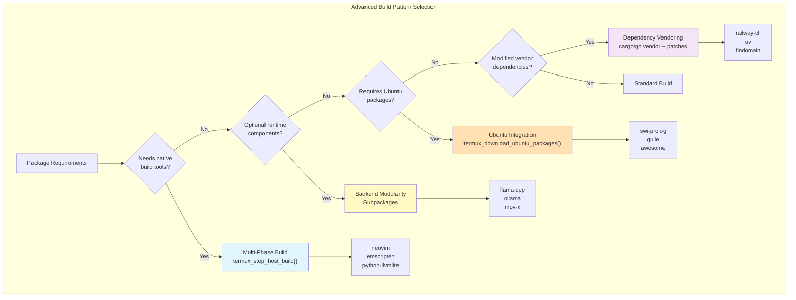
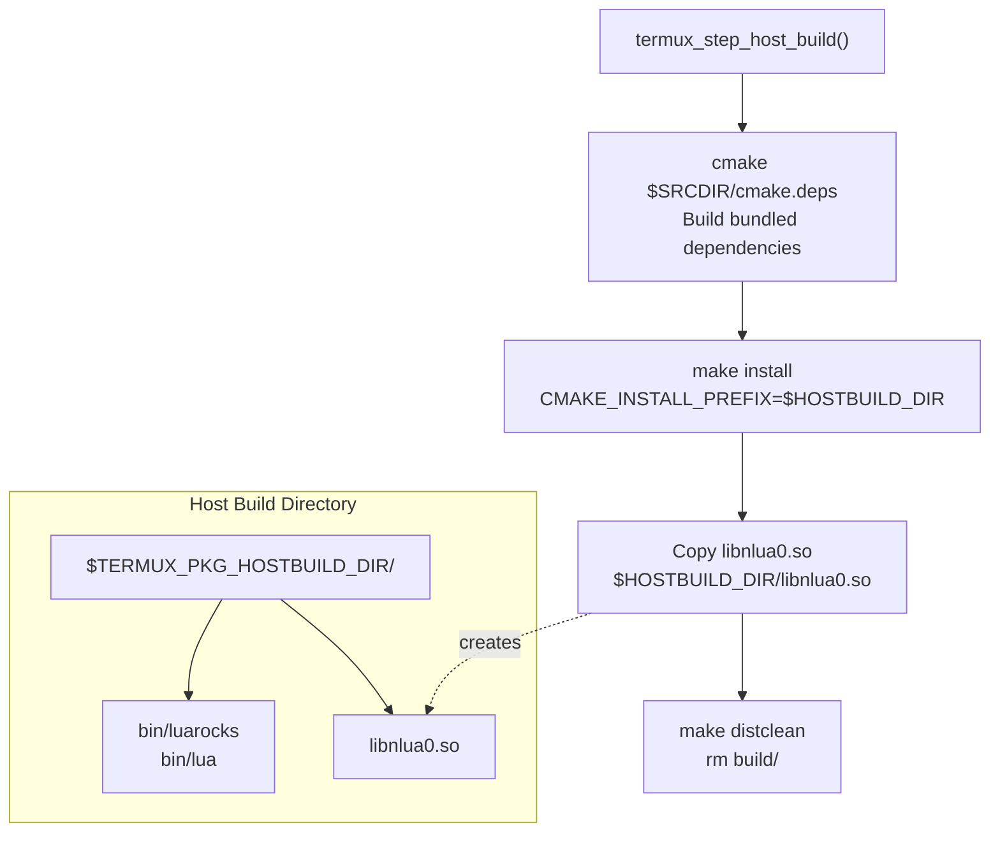
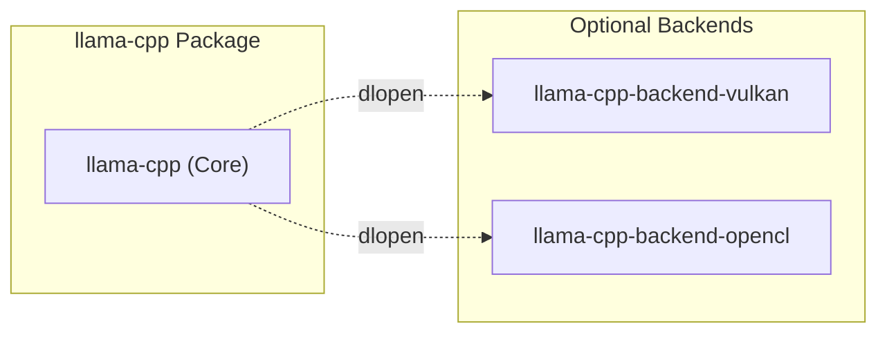
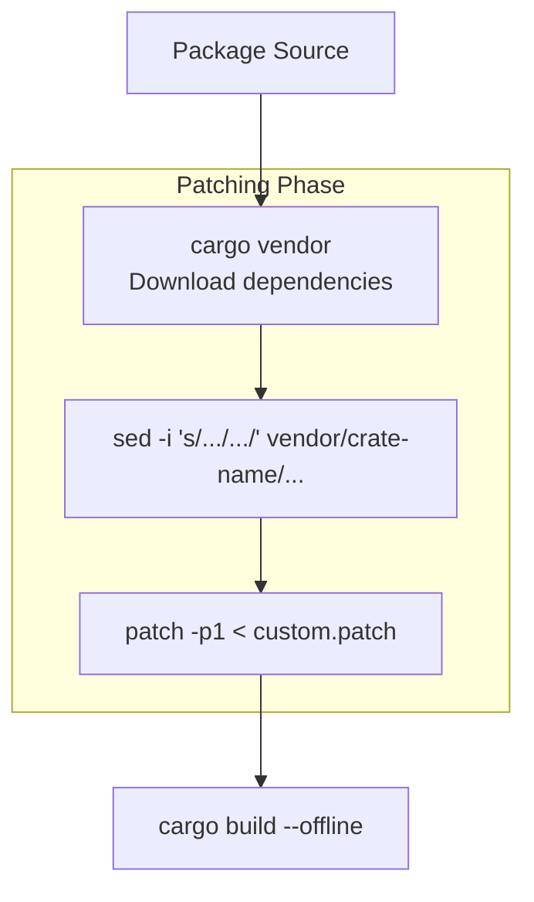

<!-- source: DeepWiki mcp.deepwiki.com · repo termux/termux-packages · page 6 Advanced Build Patterns · fetched 2026-10-26 -->

# Advanced Build Patterns

Relevant source files

The following files were used as context for generating this wiki page:

- [packages/findomain/build.sh](packages/findomain/build.sh)
- [packages/findomain/headless-chrome.patch](packages/findomain/headless-chrome.patch)
- [packages/findomain/hickory-resolver.diff](packages/findomain/hickory-resolver.diff)
- [packages/flatbuffers/build.sh](packages/flatbuffers/build.sh)
- [packages/flex/build.sh](packages/flex/build.sh)
- [packages/fm/build.sh](packages/fm/build.sh)
- [packages/llama-cpp/0002-do-not-install-backend-libs.patch](packages/llama-cpp/0002-do-not-install-backend-libs.patch)
- [packages/llama-cpp/build.sh](packages/llama-cpp/build.sh)
- [packages/minidlna/build.sh](packages/minidlna/build.sh)
- [packages/minimodem/build.sh](packages/minimodem/build.sh)
- [packages/miniserve/build.sh](packages/miniserve/build.sh)
- [packages/minisign/build.sh](packages/minisign/build.sh)
- [packages/mplayer/build.sh](packages/mplayer/build.sh)
- [packages/mplayer/mplayer-1.5-ffmpeg-8.patch](packages/mplayer/mplayer-1.5-ffmpeg-8.patch)
- [packages/mplayer/r38454.patch](packages/mplayer/r38454.patch)
- [packages/mplayer/r38455.patch](packages/mplayer/r38455.patch)
- [packages/mpv/build.sh](packages/mpv/build.sh)
- [packages/mruby/build.sh](packages/mruby/build.sh)
- [packages/msitools/build.sh](packages/msitools/build.sh)
- [packages/neovim-nightly/build.sh](packages/neovim-nightly/build.sh)
- [packages/neovim/build.sh](packages/neovim/build.sh)
- [packages/neovim/disable-checkhealth-locale-warning.patch](packages/neovim/disable-checkhealth-locale-warning.patch)
- [packages/neovim/sysinit.vim](packages/neovim/sysinit.vim)
- [packages/ollama/0001-do-not-install-runtime-deps.patch](packages/ollama/0001-do-not-install-runtime-deps.patch)
- [packages/ollama/0002-properly-search-libs-on-android.patch](packages/ollama/0002-properly-search-libs-on-android.patch)
- [packages/ollama/0003-do-not-include-sources-for-vulkan-again.patch](packages/ollama/0003-do-not-include-sources-for-vulkan-again.patch)
- [packages/ollama/0004-force-disable-features-on-Andoid.patch](packages/ollama/0004-force-disable-features-on-Andoid.patch)
- [packages/ollama/0006-do-not-search-hip-memory.patch](packages/ollama/0006-do-not-search-hip-memory.patch)
- [packages/ollama/0007-do-not-use-flash-attention-when-using-cpu.patch](packages/ollama/0007-do-not-use-flash-attention-when-using-cpu.patch)
- [packages/ollama/0008-fix-build-with-latest-vulkan-hpp.patch](packages/ollama/0008-fix-build-with-latest-vulkan-hpp.patch)
- [packages/ollama/build.sh](packages/ollama/build.sh)
- [packages/ollama/host-toolchain.cmake](packages/ollama/host-toolchain.cmake)
- [packages/ollama/ollama-backend-vulkan.subpackage.sh](packages/ollama/ollama-backend-vulkan.subpackage.sh)
- [packages/rust-analyzer/build.sh](packages/rust-analyzer/build.sh)
- [packages/vim/build.sh](packages/vim/build.sh)
- [packages/vim/fix-writing-archive.patch](packages/vim/fix-writing-archive.patch)
- [packages/vim/revert-1fe0d1e.patch](packages/vim/revert-1fe0d1e.patch)
- [packages/vim/runtime-syntax-sh.vim.patch](packages/vim/runtime-syntax-sh.vim.patch)
- [x11-packages/mogan/build.sh](x11-packages/mogan/build.sh)
- [x11-packages/mogan/lolly.diff](x11-packages/mogan/lolly.diff)
- [x11-packages/mogan/moebius.diff](x11-packages/mogan/moebius.diff)
- [x11-packages/mogan/xmake-packages-l-lolly.patch](x11-packages/mogan/xmake-packages-l-lolly.patch)
- [x11-packages/mogan/xmake-packages-m-moebius.patch](x11-packages/mogan/xmake-packages-m-moebius.patch)
- [x11-packages/mousepad/build.sh](x11-packages/mousepad/build.sh)
- [x11-packages/mpv-x/build.sh](x11-packages/mpv-x/build.sh)
- [x11-packages/mpv-x/default-to-x11.patch](x11-packages/mpv-x/default-to-x11.patch)
- [x11-packages/vim-gtk/build.sh](x11-packages/vim-gtk/build.sh)
- [x11-packages/vim-gtk/revert-1fe0d1e.patch](x11-packages/vim-gtk/revert-1fe0d1e.patch)

This page documents sophisticated build patterns used by the most complex packages in the Termux repository. These patterns serve as reference implementations for advanced packaging scenarios that go beyond standard build configurations. For information about basic build lifecycle and configuration, see [Build System](#2). For language-specific toolchain integration, see [Language Toolchain Integration](#2.3).

## Overview of Advanced Patterns

The Termux build system supports several advanced patterns to handle complex cross-compilation scenarios. The four primary patterns documented here are:

| Pattern | Primary Use Case | Key Indicator |
|---------|-----------------|---------------|
| Multi-Phase Builds | Packages requiring host tools to build target binaries | `termux_step_host_build()` with artifact preservation |
| Backend Modularity | Packages with optional runtime backends | Subpackages with `TERMUX_SUBPKG_DEPENDS` |
| Ubuntu Integration | Native dependencies unavailable in cross-compilation | `termux_download_ubuntu_packages()` |
| Dependency Vendoring | Modified source dependencies | `cargo vendor` with sed patches |

**Sources:** High-level architecture diagrams, [packages/neovim-nightly/build.sh:1-123](), [packages/llama-cpp/build.sh:1-91]()

## Multi-Phase Builds

The multi-phase build pattern enables packages to compile native tools on the build machine that are then used during cross-compilation. This is controlled by the `TERMUX_PKG_HOSTBUILD=true` variable.

### Neovim: Native Library Preservation

Neovim demonstrates a two-phase build where a native Lua library (`libnlua0.so`) is built first and then referenced during cross-compilation to generate Lua code.

[packages/neovim-nightly/build.sh:56-77]() shows the host build phase:

The target build then references these artifacts via `TERMUX_PKG_EXTRA_CONFIGURE_ARGS` [packages/neovim-nightly/build.sh:19-25]():
- `-DNLUA0_HOST_PRG=$TERMUX_PKG_HOSTBUILD_DIR/libnlua0.so`
- `-DNVIM_HOST_PRG=$TERMUX_PKG_HOSTBUILD_DIR/nvim`

For details, see [Multi-Phase Builds](#6.1).

**Sources:** [packages/neovim-nightly/build.sh:19-25](), [packages/neovim-nightly/build.sh:56-77](), [packages/neovim/build.sh:25-46]()

## Backend Modularity Patterns

This pattern is used for packages with optional runtime backends, such as GPU acceleration (Vulkan/OpenCL) or different display servers (X11).

### llama-cpp: Dynamic Backend Loading

llama-cpp uses `GGML_BACKEND_DL=ON` to allow loading backends at runtime [packages/llama-cpp/build.sh:16-21](). This allows the core package to remain small while users can install optional hardware acceleration.

- **Subpackages:** Modularity is achieved via `.subpackage.sh` files. For example, `ollama-backend-vulkan.subpackage.sh` separates Vulkan-specific libraries from the main binary.
- **Vulkan Shaders:** Some packages require a host-side shader generation toolchain during the build [packages/llama-cpp/build.sh:19-19]().

For details, see [Backend Modularity Patterns](#6.2).

**Sources:** [packages/llama-cpp/build.sh:10-21](), [packages/ollama/build.sh:12-20](), [packages/ollama/ollama-backend-vulkan.subpackage.sh:1-6]()

## Host Build Ubuntu Integration

The `termux_download_ubuntu_packages` function is used to download and extract Ubuntu `.deb` packages to provide host-side dependencies that are difficult to build from source.

### SWI-Prolog and Guile

These packages use Ubuntu packages to provide a native environment for the host-build phase. This ensures that tools like `guile` or `swipl` used during the build have access to the same libraries (like `libffi` or `libarchive`) as the target environment.

The pattern involves:
1. Downloading specific Ubuntu packages.
2. Fixing `pkg-config` paths to point to the extracted rootfs.
3. Managing `LD_LIBRARY_PATH` and `C_INCLUDE_PATH` to prioritize the Ubuntu rootfs.

For details, see [Host Build Ubuntu Integration](#6.3).

**Sources:** [packages/guile/build.sh:34-116](), [x11-packages/awesome/build.sh:57-185]()

## Dependency Vendoring and Patching

This pattern handles packages that require modified dependencies or specific versions not available in the standard toolchain.

### Cargo Vendoring

Rust packages like `uv` or `findomain` often use `cargo vendor` to download dependencies into the source tree, followed by `sed` or `patch` to modify the vendored crates.

- **findomain:** Applies patches to the `hickory-resolver` crate within the vendor directory to handle Android-specific DNS constraints [packages/findomain/hickory-resolver.diff:1-20]().
- **[patch.crates-io]:** Some packages use the Cargo manifest's `[patch.crates-io]` section to override dependencies with local, patched versions.

For details, see [Dependency Vendoring and Patching](#6.4).

**Sources:** [packages/findomain/build.sh:1-50](), [packages/rust-analyzer/build.sh:55-66]()

## Summary Matrix

| Feature | Package Example | Implementation Detail |
|---------|-----------------|-----------------------|
| **Host Shim** | `neovim` | `nvim-shim.sh` uses `LD_PRELOAD` [packages/neovim/nvim-shim.sh:1-14]() |
| **Shared Updates** | `vim` / `vim-gtk` | Shared `termux_pkg_auto_update()` logic [packages/vim/build.sh:53-78]() |
| **Version Guard** | `mpv` / `mpv-x` | `termux_step_post_get_source` ensures version parity [packages/mpv/build.sh:36-44]() |
| **Binary Wrappers** | `miniserve` | `termux_step_create_debscripts` generates completions [packages/miniserve/build.sh:27-46]() |

**Sources:** [packages/neovim/nvim-shim.sh:1-14](), [packages/vim/build.sh:53-78](), [packages/mpv/build.sh:36-44](), [packages/miniserve/build.sh:27-46]()

---

