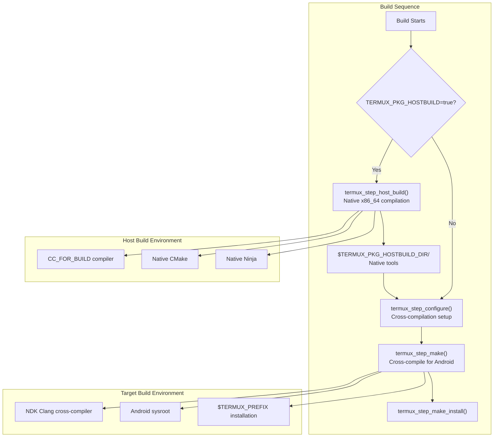
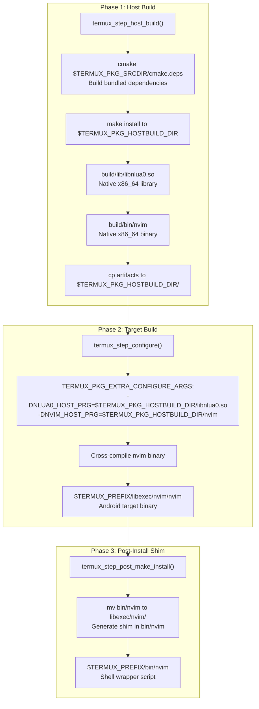
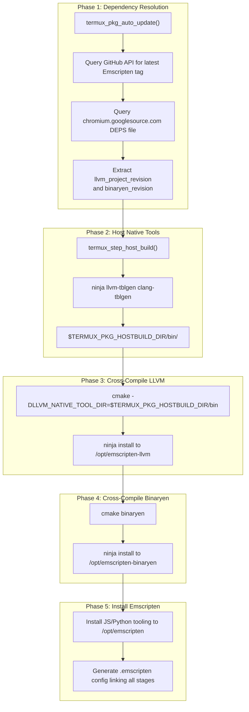
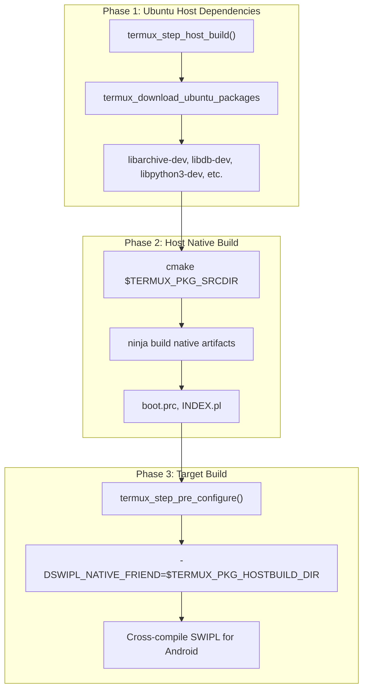

<!-- source: DeepWiki mcp.deepwiki.com · repo termux/termux-packages · page 6.1 Multi-Phase Builds · fetched 2026-10-26 -->

# Multi-Phase Builds

Relevant source files

The following files were used as context for generating this wiki page:

- [packages/ansifilter/build.sh](packages/ansifilter/build.sh)
- [packages/antibody/build.sh](packages/antibody/build.sh)
- [packages/antiword/build.sh](packages/antiword/build.sh)
- [packages/aosp-libs/build.sh](packages/aosp-libs/build.sh)
- [packages/emscripten/build.sh](packages/emscripten/build.sh)
- [packages/gitea/build.sh](packages/gitea/build.sh)
- [packages/gtypist/build.sh](packages/gtypist/build.sh)
- [packages/guile/build.sh](packages/guile/build.sh)
- [packages/gumbo-parser/build.sh](packages/gumbo-parser/build.sh)
- [packages/hashdeep/build.sh](packages/hashdeep/build.sh)
- [packages/lowdown/build.sh](packages/lowdown/build.sh)
- [packages/lux-cli/build.sh](packages/lux-cli/build.sh)
- [packages/mplayer/build.sh](packages/mplayer/build.sh)
- [packages/mplayer/mplayer-1.5-ffmpeg-8.patch](packages/mplayer/mplayer-1.5-ffmpeg-8.patch)
- [packages/mplayer/r38454.patch](packages/mplayer/r38454.patch)
- [packages/mplayer/r38455.patch](packages/mplayer/r38455.patch)
- [packages/mpv/build.sh](packages/mpv/build.sh)
- [packages/mruby/build.sh](packages/mruby/build.sh)
- [packages/msitools/build.sh](packages/msitools/build.sh)
- [packages/neovim-nightly/build.sh](packages/neovim-nightly/build.sh)
- [packages/neovim/build.sh](packages/neovim/build.sh)
- [packages/neovim/disable-checkhealth-locale-warning.patch](packages/neovim/disable-checkhealth-locale-warning.patch)
- [packages/neovim/sysinit.vim](packages/neovim/sysinit.vim)
- [packages/python-llvmlite/build.sh](packages/python-llvmlite/build.sh)
- [packages/python-llvmlite/ffi-build.py.patch](packages/python-llvmlite/ffi-build.py.patch)
- [packages/python-llvmlite/llvm-include-llvm-ADT-SmallVector.h.patch](packages/python-llvmlite/llvm-include-llvm-ADT-SmallVector.h.patch)
- [packages/python-llvmlite/llvm-tools-llvm-rtdyld-llvm-rtdyld.cpp.patch](packages/python-llvmlite/llvm-tools-llvm-rtdyld-llvm-rtdyld.cpp.patch)
- [packages/python-llvmlite/openmp.patch](packages/python-llvmlite/openmp.patch)
- [packages/swi-prolog/build.sh](packages/swi-prolog/build.sh)
- [packages/swi-prolog/continue-on-abi-check-failure.patch](packages/swi-prolog/continue-on-abi-check-failure.patch)
- [packages/swi-prolog/disable-installation-of-some-qlfs.patch](packages/swi-prolog/disable-installation-of-some-qlfs.patch)
- [packages/tinymist/build.sh](packages/tinymist/build.sh)
- [packages/tinymist/crates-tinymist-cli-Cargo.toml.patch](packages/tinymist/crates-tinymist-cli-Cargo.toml.patch)
- [packages/vim/build.sh](packages/vim/build.sh)
- [packages/vim/fix-writing-archive.patch](packages/vim/fix-writing-archive.patch)
- [packages/vim/revert-1fe0d1e.patch](packages/vim/revert-1fe0d1e.patch)
- [packages/vim/runtime-syntax-sh.vim.patch](packages/vim/runtime-syntax-sh.vim.patch)
- [scripts/big-pkgs.list](scripts/big-pkgs.list)
- [x11-packages/audacity/build.sh](x11-packages/audacity/build.sh)
- [x11-packages/audacity/wxwidgets-3.3.patch](x11-packages/audacity/wxwidgets-3.3.patch)
- [x11-packages/awesome-luajit/build.sh](x11-packages/awesome-luajit/build.sh)
- [x11-packages/awesome/build.sh](x11-packages/awesome/build.sh)
- [x11-packages/ibus/0001-add-python-path-for-ibus-setup.patch](x11-packages/ibus/0001-add-python-path-for-ibus-setup.patch)
- [x11-packages/ibus/0003-i18n.patch](x11-packages/ibus/0003-i18n.patch)
- [x11-packages/ibus/build.sh](x11-packages/ibus/build.sh)
- [x11-packages/mogan/build.sh](x11-packages/mogan/build.sh)
- [x11-packages/mogan/lolly.diff](x11-packages/mogan/lolly.diff)
- [x11-packages/mogan/moebius.diff](x11-packages/mogan/moebius.diff)
- [x11-packages/mogan/xmake-packages-l-lolly.patch](x11-packages/mogan/xmake-packages-l-lolly.patch)
- [x11-packages/mogan/xmake-packages-m-moebius.patch](x11-packages/mogan/xmake-packages-m-moebius.patch)
- [x11-packages/mousepad/build.sh](x11-packages/mousepad/build.sh)
- [x11-packages/mpv-x/build.sh](x11-packages/mpv-x/build.sh)
- [x11-packages/mpv-x/default-to-x11.patch](x11-packages/mpv-x/default-to-x11.patch)
- [x11-packages/vim-gtk/build.sh](x11-packages/vim-gtk/build.sh)
- [x11-packages/vim-gtk/revert-1fe0d1e.patch](x11-packages/vim-gtk/revert-1fe0d1e.patch)
- [x11-packages/wine-stable/0001-fix-paths.patch](x11-packages/wine-stable/0001-fix-paths.patch)
- [x11-packages/wine-stable/0002-fix-defines.patch](x11-packages/wine-stable/0002-fix-defines.patch)
- [x11-packages/wine-stable/0004-no-pthread_mutexattr_setprotocol.patch](x11-packages/wine-stable/0004-no-pthread_mutexattr_setprotocol.patch)
- [x11-packages/wine-stable/0005-use-__builtin_ffs.patch](x11-packages/wine-stable/0005-use-__builtin_ffs.patch)
- [x11-packages/wine-stable/9998-fix-winegcc-build-target.patch.beforehostbuild](x11-packages/wine-stable/9998-fix-winegcc-build-target.patch.beforehostbuild)
- [x11-packages/wine-stable/9999-fix-winebuild-as-type.patch.beforehostbuild](x11-packages/wine-stable/9999-fix-winebuild-as-type.patch.beforehostbuild)
- [x11-packages/wine-stable/build.sh](x11-packages/wine-stable/build.sh)
- [x11-packages/wlr-randr/build.sh](x11-packages/wlr-randr/build.sh)
- [x11-packages/xmoto/build.sh](x11-packages/xmoto/build.sh)
- [x11-packages/xmoto/installation-directories.patch](x11-packages/xmoto/installation-directories.patch)

Multi-phase builds are package build processes that require multiple distinct compilation stages, typically involving a combination of host-native builds, cross-compiled target builds, and post-processing steps. These patterns are necessary when packages need native tools during cross-compilation, coordinate multiple interdependent projects, or require runtime adaptations for Android's dynamic linker limitations.

This page documents the implementation patterns for packages requiring sequential build phases. For packages with optional backend subpackages, see [Backend Modularity Patterns](#6.2). For host builds that download Ubuntu packages, see [Host Build Ubuntu Integration](#6.3).

## Host Build Pattern Overview

The host build pattern uses `TERMUX_PKG_HOSTBUILD=true` to compile native tools on the x86_64 Linux build host before cross-compiling the main package for Android. The build system invokes `termux_step_host_build()` which runs on the host architecture, producing tools stored in `$TERMUX_PKG_HOSTBUILD_DIR`.

**Diagram 1: Host Build Lifecycle Pattern**

Sources: [packages/neovim-nightly/build.sh:13](), [packages/neovim-nightly/build.sh:56-77](), [packages/neovim/build.sh:12](), [packages/emscripten/build.sh:10](), [packages/swi-prolog/build.sh:10]()

## Neovim: Host Library and LD_PRELOAD Shim

Neovim requires a two-phase build because its code generation tools load `libnlua0.so` and the `nvim` binary as native host programs to process data during the target build. The solution involves building the project natively first, then passing the host-built artifacts to the target CMake configuration.

**Diagram 2: Neovim Multi-Phase Build with LD_PRELOAD Shim**

The host build produces `libnlua0.so` and a native `nvim` executable that Neovim's build system uses on the build host [packages/neovim-nightly/build.sh:56-77](). The target CMake configuration is informed of these host-built tools via `-DNLUA0_HOST_PRG` and `-DNVIM_HOST_PRG` [packages/neovim-nightly/build.sh:23-24](). After installation, the target `nvim` binary is moved to `$TERMUX_PREFIX/libexec/nvim/` and replaced with a shell wrapper script (`nvim-shim.sh`) [packages/neovim-nightly/build.sh:87-95]().

This shim is necessary to handle environment setup and potential `LD_PRELOAD` requirements for LuaJIT-based plugins on Android. Additionally, the build script creates wrapper scripts for `ex`, `view`, `vimdiff`, and `vimtutor` to point to the main `nvim` binary [packages/neovim-nightly/build.sh:102-121]().

Sources: [packages/neovim-nightly/build.sh:19-25](), [packages/neovim-nightly/build.sh:56-77](), [packages/neovim-nightly/build.sh:79-122](), [packages/neovim/build.sh:17-23](), [packages/neovim/build.sh:25-46](), [packages/neovim/build.sh:48-91]()

## Emscripten: Three-Stage Coordinated Build

Emscripten's build process coordinates three separate projects (LLVM, Binaryen, Emscripten) which must be built in sequence with version-synchronized commits. The auto-update system queries both GitHub releases and Chromium's Emscripten tracking to determine the correct commit hashes for all three components.

**Diagram 3: Emscripten Multi-Stage Build Pipeline**

The auto-update function performs version coordination by querying Chromium's release tracking [packages/emscripten/build.sh:113-163](). It retrieves the `DEPS` file from Chromium's repository to extract the synchronized `llvm_project_revision` and `binaryen_revision` commit hashes [packages/emscripten/build.sh:131-136]().

The host build phase produces native `llvm-tblgen` and `clang-tblgen` tools [packages/emscripten/build.sh:71-103](). These are passed to the target LLVM build via `-DLLVM_NATIVE_TOOL_DIR` [packages/emscripten/build.sh:90](). The build concludes by installing the Emscripten Python/JS tooling and generating a `.emscripten` configuration file that hardcodes the paths to the cross-compiled LLVM and Binaryen installations [packages/emscripten/build.sh:106-110]().

Sources: [packages/emscripten/build.sh:10](), [packages/emscripten/build.sh:71-103](), [packages/emscripten/build.sh:113-163](), [packages/emscripten/build.sh:17-56]()

## SWI-Prolog: Host Artifacts for Bootstrapping

SWI-Prolog requires a native host build to produce platform-independent artifacts like `boot.prc` and `INDEX.pl`, which are then used to build the Android version.

**Diagram 4: SWI-Prolog Host Artifact Pattern**

SWI-Prolog's host build phase downloads Ubuntu packages to ensure the host build environment matches the target build's capabilities (e.g., GMP, Libedit, Archive support) [packages/swi-prolog/build.sh:58-85](). It patches the downloaded `pkg-config` files to point to the hostbuild directory [packages/swi-prolog/build.sh:89-90]().

The target build is then configured with `-DSWIPL_NATIVE_FRIEND=${TERMUX_PKG_HOSTBUILD_DIR}` [packages/swi-prolog/build.sh:18](), which instructs the build system to use the native host build for generating the required Prolog artifacts.

Sources: [packages/swi-prolog/build.sh:10](), [packages/swi-prolog/build.sh:14-23](), [packages/swi-prolog/build.sh:58-136](), [packages/swi-prolog/build.sh:138-147]()

## Rust and Shell Completions

Several Rust packages (e.g., `lux-cli`, `tinymist`) use a multi-phase pattern to generate shell completions. Since the completion generation often requires running the compiled binary, it must be done either on the host (for cross-compiled builds) or after the target build (for on-device builds).

| Package | Host Phase Operation | Target Phase Operation |
|---------|----------------------|------------------------|
| `lux-cli` | `cargo run --package xtask -- dist-completions` [packages/lux-cli/build.sh:84]() | `install -Dm644` completions to `$TERMUX_PREFIX/share/...` [packages/lux-cli/build.sh:132-134]() |
| `tinymist` | N/A (Builds in src) | `cargo run --bin tinymist -- completion` [packages/tinymist/build.sh:46-50]() |

In `lux-cli`, if building on a host, `termux_step_host_build` downloads Ubuntu dependencies (like `libgpgme-dev`) to allow running the Rust `xtask` package to generate bash, zsh, and fish completions [packages/lux-cli/build.sh:53-84]().

Sources: [packages/lux-cli/build.sh:12](), [packages/lux-cli/build.sh:47-91](), [packages/lux-cli/build.sh:125-135](), [packages/tinymist/build.sh:38-53]()

## Key Patterns Summary

| Pattern | Key Variables/Functions | Typical Use Case | Example Packages |
|---------|-------------------------|------------------|------------------|
| **Host Tooling** | `TERMUX_PKG_HOSTBUILD=true`, `termux_step_host_build` | Packages needing native code generators (TableGen, nvim) | `neovim`, `emscripten`, `python-llvmlite` |
| **Artifact Injection** | `-D..._HOST_PRG`, `-DSWIPL_NATIVE_FRIEND` | Passing host binary paths to target CMake/Configure | `neovim`, `swi-prolog` |
| **Shim Wrapping** | `termux_step_post_make_install`, `mv` binary to `libexec` | Setting `LD_PRELOAD` or environment variables | `neovim` |
| **Host-Side Tasks** | `cargo run --package xtask` | Generating completions or assets that require running the binary | `lux-cli` |
| **Ubuntu Integration** | `termux_download_ubuntu_packages` | Providing native libraries for the host build phase | `swi-prolog`, `lux-cli`, `audacity` |

Sources: [packages/neovim-nightly/build.sh:1-123](), [packages/emscripten/build.sh:1-164](), [packages/swi-prolog/build.sh:1-154](), [packages/lux-cli/build.sh:1-136](), [x11-packages/audacity/build.sh:41-78]()

---

