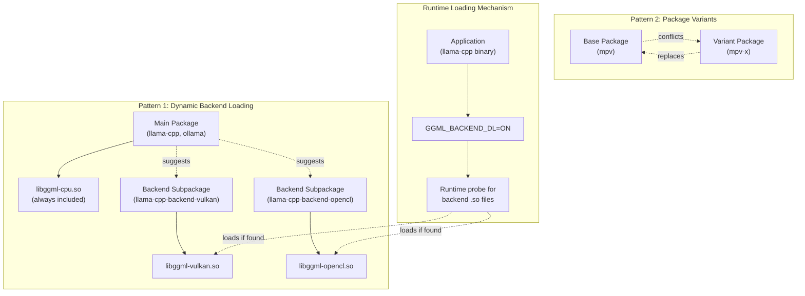
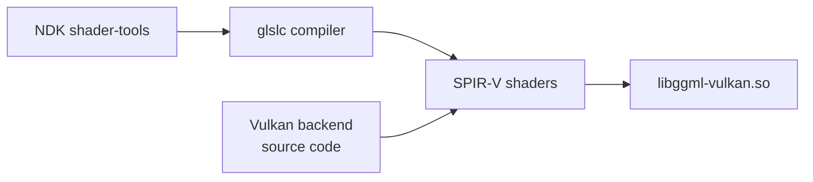
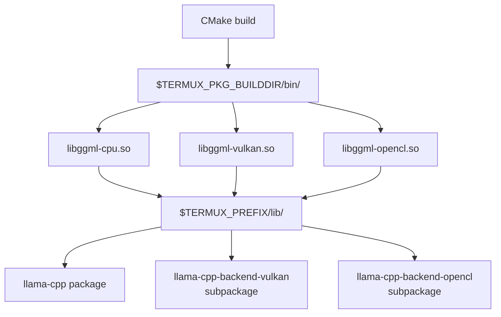
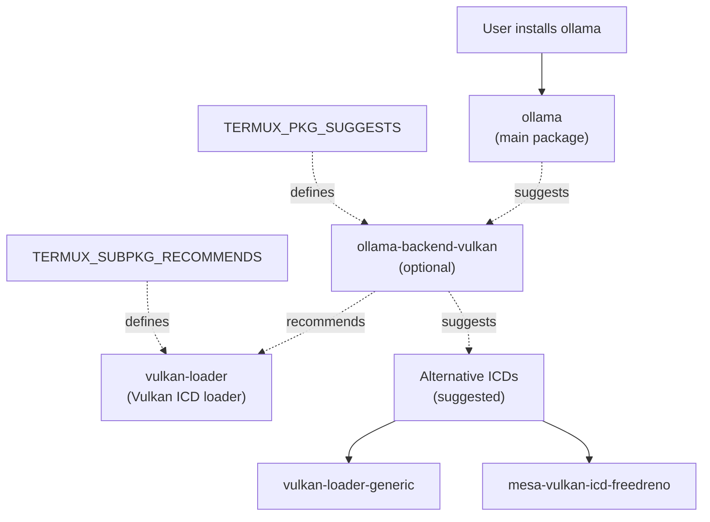
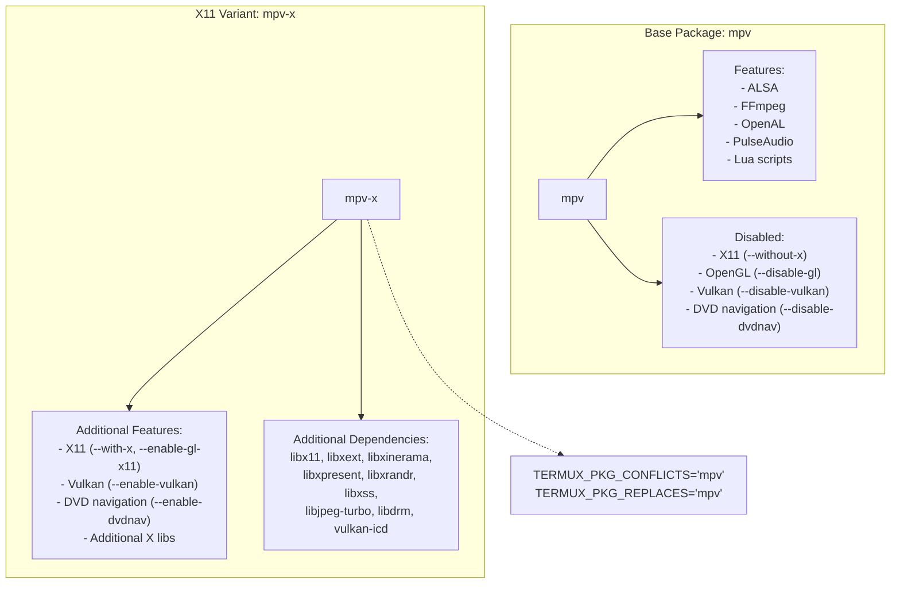
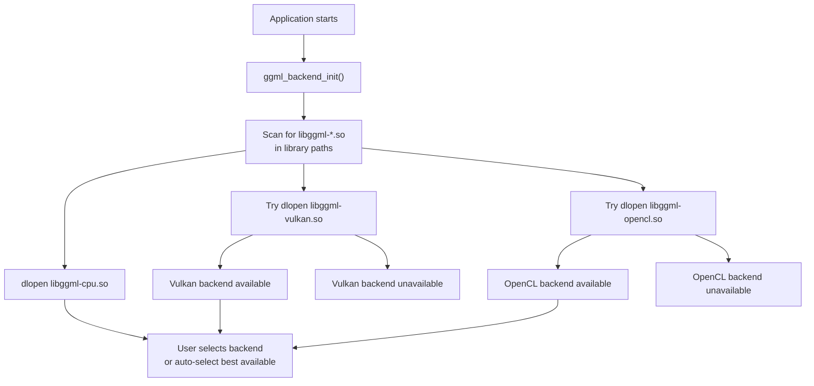

<!-- source: DeepWiki mcp.deepwiki.com · repo termux/termux-packages · page 6.2 Backend Modularity Patterns · fetched 2026-10-26 -->

# Backend Modularity Patterns

<details>
<summary>Relevant source files</summary>

The following files were used as context for generating this wiki page:

- [packages/findomain/build.sh](packages/findomain/build.sh)
- [packages/findomain/headless-chrome.patch](packages/findomain/headless-chrome.patch)
- [packages/findomain/hickory-resolver.diff](packages/findomain/hickory-resolver.diff)
- [packages/flatbuffers/build.sh](packages/flatbuffers/build.sh)
- [packages/flex/build.sh](packages/flex/build.sh)
- [packages/fm/build.sh](packages/fm/build.sh)
- [packages/llama-cpp/0002-do-not-install-backend-libs.patch](packages/llama-cpp/0002-do-not-install-backend-libs.patch)
- [packages/llama-cpp/build.sh](packages/llama-cpp/build.sh)
- [packages/minidlna/build.sh](packages/minidlna/build.sh)
- [packages/minimodem/build.sh](packages/minimodem/build.sh)
- [packages/miniserve/build.sh](packages/miniserve/build.sh)
- [packages/minisign/build.sh](packages/minisign/build.sh)
- [packages/mplayer/build.sh](packages/mplayer/build.sh)
- [packages/mplayer/mplayer-1.5-ffmpeg-8.patch](packages/mplayer/mplayer-1.5-ffmpeg-8.patch)
- [packages/mplayer/r38454.patch](packages/mplayer/r38454.patch)
- [packages/mplayer/r38455.patch](packages/mplayer/r38455.patch)
- [packages/mpv/build.sh](packages/mpv/build.sh)
- [packages/mruby/build.sh](packages/mruby/build.sh)
- [packages/msitools/build.sh](packages/msitools/build.sh)
- [packages/neovim-nightly/build.sh](packages/neovim-nightly/build.sh)
- [packages/neovim/build.sh](packages/neovim/build.sh)
- [packages/neovim/disable-checkhealth-locale-warning.patch](packages/neovim/disable-checkhealth-locale-warning.patch)
- [packages/neovim/sysinit.vim](packages/neovim/sysinit.vim)
- [packages/ollama/0001-do-not-install-runtime-deps.patch](packages/ollama/0001-do-not-install-runtime-deps.patch)
- [packages/ollama/0002-properly-search-libs-on-android.patch](packages/ollama/0002-properly-search-libs-on-android.patch)
- [packages/ollama/0003-do-not-include-sources-for-vulkan-again.patch](packages/ollama/0003-do-not-include-sources-for-vulkan-again.patch)
- [packages/ollama/0004-force-disable-features-on-Andoid.patch](packages/ollama/0004-force-disable-features-on-Andoid.patch)
- [packages/ollama/0006-do-not-search-hip-memory.patch](packages/ollama/0006-do-not-search-hip-memory.patch)
- [packages/ollama/0007-do-not-use-flash-attention-when-using-cpu.patch](packages/ollama/0007-do-not-use-flash-attention-when-using-cpu.patch)
- [packages/ollama/0008-fix-build-with-latest-vulkan-hpp.patch](packages/ollama/0008-fix-build-with-latest-vulkan-hpp.patch)
- [packages/ollama/build.sh](packages/ollama/build.sh)
- [packages/ollama/host-toolchain.cmake](packages/ollama/host-toolchain.cmake)
- [packages/ollama/ollama-backend-vulkan.subpackage.sh](packages/ollama/ollama-backend-vulkan.subpackage.sh)
- [packages/rust-analyzer/build.sh](packages/rust-analyzer/build.sh)
- [packages/vim/build.sh](packages/vim/build.sh)
- [packages/vim/fix-writing-archive.patch](packages/vim/fix-writing-archive.patch)
- [packages/vim/revert-1fe0d1e.patch](packages/vim/revert-1fe0d1e.patch)
- [packages/vim/runtime-syntax-sh.vim.patch](packages/vim/runtime-syntax-sh.vim.patch)
- [x11-packages/mogan/build.sh](x11-packages/mogan/build.sh)
- [x11-packages/mogan/lolly.diff](x11-packages/mogan/lolly.diff)
- [x11-packages/mogan/moebius.diff](x11-packages/mogan/moebius.diff)
- [x11-packages/mogan/xmake-packages-l-lolly.patch](x11-packages/mogan/xmake-packages-l-lolly.patch)
- [x11-packages/mogan/xmake-packages-m-moebius.patch](x11-packages/mogan/xmake-packages-m-moebius.patch)
- [x11-packages/mousepad/build.sh](x11-packages/mousepad/build.sh)
- [x11-packages/mpv-x/build.sh](x11-packages/mpv-x/build.sh)
- [x11-packages/mpv-x/default-to-x11.patch](x11-packages/mpv-x/default-to-x11.patch)
- [x11-packages/vim-gtk/build.sh](x11-packages/vim-gtk/build.sh)
- [x11-packages/vim-gtk/revert-1fe0d1e.patch](x11-packages/vim-gtk/revert-1fe0d1e.patch)

</details>


This page documents build patterns for packages that implement modular backend architectures, where optional functionality (GPU acceleration, display backends, etc.) is packaged as separate subpackages or variant packages. This allows users to install only the backends they need, reducing storage requirements and dependency chains.

For multi-phase builds that compile separate components sequentially, see [Multi-Phase Builds](6.1). For platform-specific adaptations, see [Platform Adaptations and Patches](2.5).

## Architecture Overview

Backend modularity is implemented through three primary patterns:

1.  **Dynamic Backend Loading**: Main package dynamically loads backend libraries at runtime based on availability.
2.  **Optional Subpackages**: Backends distributed as suggested subpackages of the main package.
3.  **Variant Packages**: Completely separate packages with conflicting feature sets.



**Diagram: Backend Modularity Patterns Overview**

Sources: [packages/llama-cpp/build.sh:10-22](), [packages/ollama/build.sh:7-20](), [packages/ollama/ollama-backend-vulkan.subpackage.sh:1-7](), [x11-packages/mpv-x/build.sh:13-14]()

## Dynamic Backend Loading Pattern

The most sophisticated pattern uses CMake's `GGML_BACKEND_DL` flag to enable runtime dynamic loading of backend libraries. This approach is used by LLM inference packages that support multiple GPU acceleration backends.

### Build Configuration

Both `llama-cpp` and `ollama` use identical CMake configuration for backend modularity:

| CMake Variable | Value | Purpose |
| :--- | :--- | :--- |
| `GGML_BACKEND_DL` | `ON` | Enable dynamic loading of backends |
| `BUILD_SHARED_LIBS` | `ON` | Build backends as shared libraries |
| `GGML_VULKAN` | `ON` | Include Vulkan backend |
| `GGML_OPENCL` | `ON` | Include OpenCL backend (llama-cpp only) |
| `GGML_VULKAN_SHADERS_GEN_TOOLCHAIN` | `$TERMUX_PKG_BUILDER_DIR/host-toolchain.cmake` | Host toolchain for shader generation |

Sources: [packages/llama-cpp/build.sh:13-22](), [packages/ollama/build.sh:12-20]()

### Vulkan Shader Generation

Both packages require NDK shader tools in the build path for Vulkan backend compilation:



**Diagram: Vulkan Shader Compilation Pipeline**

The `termux_step_pre_configure()` hook adds the NDK shader tools to `PATH` [packages/llama-cpp/build.sh:76-76]():

```bash
export PATH="$NDK/shader-tools/linux-x86_64:$PATH"
```

For API level < 28, the build explicitly specifies the Vulkan library path [packages/llama-cpp/build.sh:80-83]():

```bash
if [[ "${TERMUX_ON_DEVICE_BUILD}" == "false" && "${TERMUX_PKG_API_LEVEL}" -lt 28 ]]; then
    _libvulkan="${TERMUX_STANDALONE_TOOLCHAIN}/sysroot/usr/lib/${TERMUX_HOST_PLATFORM}/28/libvulkan.so"
fi
TERMUX_PKG_EXTRA_CONFIGURE_ARGS+=" -DVulkan_LIBRARY=${_libvulkan}"
```

Sources: [packages/llama-cpp/build.sh:76-85](), [packages/ollama/build.sh:22-30](), [packages/ollama/host-toolchain.cmake:1-11]()

### Backend Library Installation

The main package installs all compiled backend libraries, but only the CPU backend is included in the main package. GPU backends are extracted into separate subpackages.

#### llama-cpp Installation Strategy



**Diagram: llama-cpp Backend Installation Flow**

The `termux_step_post_make_install()` function copies all backends [packages/llama-cpp/build.sh:86-91]():

```bash
mkdir -p "$TERMUX_PREFIX"/lib
cp -f "$TERMUX_PKG_BUILDDIR"/bin/libggml-cpu.so "$TERMUX_PREFIX"/lib/
cp -f "$TERMUX_PKG_BUILDDIR"/bin/libggml-opencl.so "$TERMUX_PREFIX"/lib/
cp -f "$TERMUX_PKG_BUILDDIR"/bin/libggml-vulkan.so "$TERMUX_PREFIX"/lib/
```

Sources: [packages/llama-cpp/build.sh:87-92]()

#### ollama Installation Strategy

ollama uses a different directory structure, isolating backends under `lib/ollama/` [packages/ollama/build.sh:39-40]():

```bash
mkdir -p $TERMUX_PREFIX/lib/ollama
cp -fv $TERMUX_PKG_BUILDDIR/lib/ollama/* $TERMUX_PREFIX/lib/ollama/
```

This separation simplifies subpackage file selection since all ollama-specific libraries are in a dedicated directory.

Sources: [packages/ollama/build.sh:32-41]()

## Subpackage Architecture

Subpackages are defined in `.subpackage.sh` files that specify which files to include and what dependencies to add.

### Backend Subpackage Definition

The ollama Vulkan backend subpackage demonstrates the minimal subpackage pattern [packages/ollama/ollama-backend-vulkan.subpackage.sh:1-7]():

| Variable | Value | Purpose |
| :--- | :--- | :--- |
| `TERMUX_SUBPKG_DESCRIPTION` | "Vulkan Backend for Ollama" | Package description |
| `TERMUX_SUBPKG_RECOMMENDS` | "vulkan-loader" | Primary Vulkan implementation |
| `TERMUX_SUBPKG_SUGGESTS` | "vulkan-loader-generic, mesa-vulkan-icd-freedreno" | Alternative Vulkan drivers |
| `TERMUX_SUBPKG_INCLUDE` | "lib/ollama/libggml-vulkan.so" | Files to include from main package |

Sources: [packages/ollama/ollama-backend-vulkan.subpackage.sh:1-7]()

### Dependency Chain



**Diagram: Subpackage Dependency Chain**

The `SUGGESTS` relationship means:

*   Package manager does not automatically install suggested packages.
*   User must explicitly choose to install `ollama-backend-vulkan`.
*   This keeps base package size minimal.

The `RECOMMENDS` relationship means:

*   Package manager typically installs recommended packages by default.
*   Can be overridden with `--no-install-recommends` flag.

Sources: [packages/ollama/build.sh:7-9](), [packages/ollama/ollama-backend-vulkan.subpackage.sh:1-7]()

## Platform-Specific Backend Patches

Backend implementations often require Android-specific patches to disable unsupported features or stub out problematic code paths.

### ollama Backend Patches

The ollama package applies several patches to the ggml backend code:

| Patch | Purpose |
| :--- | :--- |
| `0001-do-not-install-runtime-deps.patch` | Remove runtime dependency installation from CMake |
| `0002-properly-search-libs-on-android.patch` | Fix library search paths for Android |
| `0003-do-not-include-sources-for-vulkan-again.patch` | Prevent duplicate Vulkan source inclusion |
| `0004-force-disable-features-on-Andoid.patch` | Disable unsupported Vulkan extensions on Android |
| `0006-do-not-search-hip-memory.patch` | Stub out HIP/ROCm memory management |
| `0007-do-not-use-flash-attention-when-using-cpu.patch` | Disable CPU flash attention (performance overhead) |

Sources: [packages/ollama/0001-do-not-install-runtime-deps.patch:1-22](), [packages/ollama/0002-properly-search-libs-on-android.patch:1-12](), [packages/ollama/0003-do-not-include-sources-for-vulkan-again.patch:1-13](), [packages/ollama/0004-force-disable-features-on-Andoid.patch:1-13](), [packages/ollama/0006-do-not-search-hip-memory.patch:1-24](), [packages/ollama/0007-do-not-use-flash-attention-when-using-cpu.patch:1-15]()

### Android Library Search Path Fix

The patch for library search paths changes the platform detection in Go source [packages/ollama/0002-properly-search-libs-on-android.patch:1-12]():

```go
case "linux":
    libPath = filepath.Join(filepath.Dir(exe), "..", "lib", "ollama")
```

becomes:

```go
case "linux", "android":
    libPath = filepath.Join(filepath.Dir(exe), "..", "lib", "ollama")
```

This ensures the Go code correctly resolves `$TERMUX_PREFIX/lib/ollama/` as the backend directory.

Sources: [packages/ollama/0002-properly-search-libs-on-android.patch:1-12]()

### HIP Memory Management Stub

On Android, HIP (AMD GPU runtime) is not available. The patch stubs out the memory management functions [packages/ollama/0006-do-not-search-hip-memory.patch:1-24]():

```cpp
#elif defined(__ANDROID__)

extern "C" {

int ggml_hip_mgmt_init() {
    return 0;
}
void ggml_hip_mgmt_release() {}
int ggml_hip_get_device_memory(const char *id, size_t *free, size_t *total, bool is_integrated_gpu) {
    return -1;
}

} // extern "C"
```

This prevents link-time errors and allows the code to compile without HIP support.

Sources: [packages/ollama/0006-do-not-search-hip-memory.patch:1-24]()

## Package Variants Pattern

Unlike subpackages which can coexist, package variants use `CONFLICTS` and `REPLACES` to ensure only one variant is installed at a time. This pattern is used when different feature sets are mutually exclusive.

### mpv vs mpv-x

The `mpv` and `mpv-x` packages demonstrate this pattern:



**Diagram: mpv Package Variants**

### Version Synchronization Guard

Both packages implement a version guard in `termux_step_post_get_source` to prevent accidental version drift [packages/mpv/build.sh:36-44](), [x11-packages/mpv-x/build.sh:31-39]():

```bash
termux_step_post_get_source() {
    # Version guard
    local ver_m ver_x
    ver_m="$(. "$TERMUX_SCRIPTDIR/packages/mpv/build.sh"; echo "${TERMUX_PKG_VERSION#*:}")"
    ver_x="${TERMUX_PKG_VERSION#*:}"
    if [[ "${ver_m}" != "${ver_x}" ]]; then
        termux_error_exit "Version mismatch between mpv and mpv-x."
    fi
}
```

This ensures both variants are always updated together in the same commit.

Sources: [packages/mpv/build.sh:36-44](), [x11-packages/mpv-x/build.sh:31-39]()

### Auto-Update Coordination

The `TERMUX_PKG_AUTO_UPDATE` flag is set to `false` for both packages to prevent automated version bumps [packages/mpv/build.sh:10-10](), [x11-packages/mpv-x/build.sh:10-10]():

```bash
TERMUX_PKG_AUTO_UPDATE=false
```

This requires manual updates via pull request, ensuring both packages are updated in the same PR and version guards are validated.

Sources: [packages/mpv/build.sh:5-10](), [x11-packages/mpv-x/build.sh:5-10]()

## Runtime Backend Detection

Packages using dynamic backend loading must probe for available backends at runtime. This is typically done through GGML's backend discovery code, enabled by the `GGML_BACKEND_DL=ON` CMake flag [packages/llama-cpp/build.sh:16-16]().



**Diagram: Runtime Backend Detection Flow**

Sources: [packages/llama-cpp/build.sh:16-22](), [packages/ollama/build.sh:15-20]()

---

