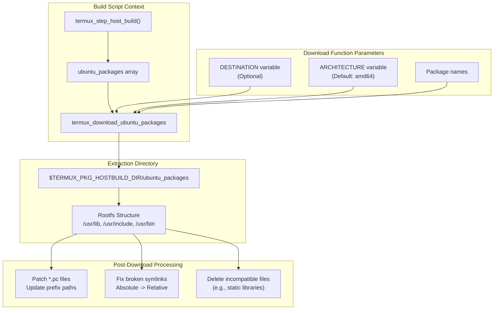
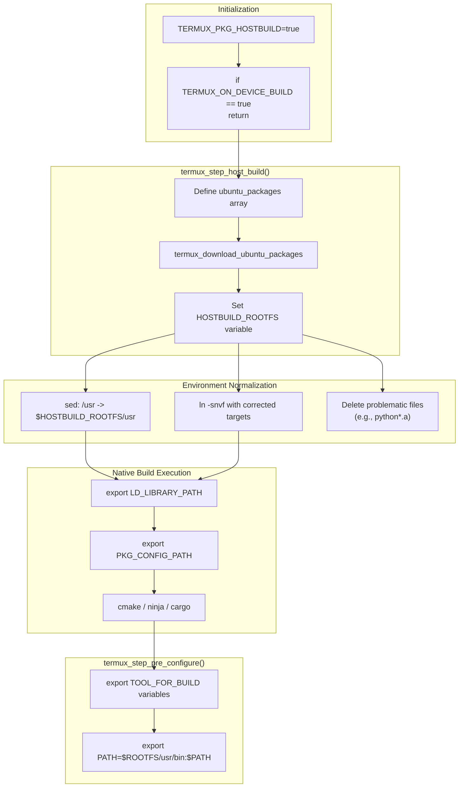
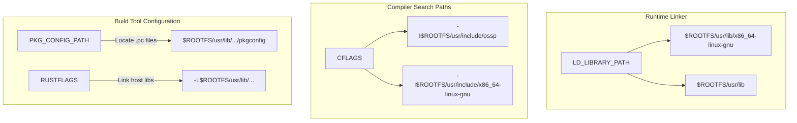

<!-- source: DeepWiki mcp.deepwiki.com · repo termux/termux-packages · page 6.3 Host Build Ubuntu Integration · fetched 2026-10-26 -->

# Host Build Ubuntu Integration

Relevant source files

The following files were used as context for generating this wiki page:

- [packages/ansifilter/build.sh](packages/ansifilter/build.sh)
- [packages/antibody/build.sh](packages/antibody/build.sh)
- [packages/antiword/build.sh](packages/antiword/build.sh)
- [packages/aosp-libs/build.sh](packages/aosp-libs/build.sh)
- [packages/cabal-install/build.sh](packages/cabal-install/build.sh)
- [packages/gtypist/build.sh](packages/gtypist/build.sh)
- [packages/guile/build.sh](packages/guile/build.sh)
- [packages/gumbo-parser/build.sh](packages/gumbo-parser/build.sh)
- [packages/hashdeep/build.sh](packages/hashdeep/build.sh)
- [packages/lowdown/build.sh](packages/lowdown/build.sh)
- [packages/lua-lpeg/lua54-lpeg.subpackage.sh](packages/lua-lpeg/lua54-lpeg.subpackage.sh)
- [packages/luarocks/build.sh](packages/luarocks/build.sh)
- [packages/lux-cli/build.sh](packages/lux-cli/build.sh)
- [packages/mympd/CMakeLists.txt.patch](packages/mympd/CMakeLists.txt.patch)
- [packages/mympd/build.sh](packages/mympd/build.sh)
- [packages/mympd/dist-libmpdclient-include-config.h.patch](packages/mympd/dist-libmpdclient-include-config.h.patch)
- [packages/mympd/src-lib-cacertstore.c.patch](packages/mympd/src-lib-cacertstore.c.patch)
- [packages/mympd/src-lib-http_client.c.patch](packages/mympd/src-lib-http_client.c.patch)
- [packages/nmap/build.sh](packages/nmap/build.sh)
- [packages/osm2pgsql/build.sh](packages/osm2pgsql/build.sh)
- [packages/pandoc/build.sh](packages/pandoc/build.sh)
- [packages/rnr/build.sh](packages/rnr/build.sh)
- [packages/robotfindskitten/build.sh](packages/robotfindskitten/build.sh)
- [packages/rp-pppoe/build.sh](packages/rp-pppoe/build.sh)
- [packages/rpm/build.sh](packages/rpm/build.sh)
- [packages/sassc/build.sh](packages/sassc/build.sh)
- [packages/sc-im/build.sh](packages/sc-im/build.sh)
- [packages/scc/build.sh](packages/scc/build.sh)
- [packages/sccache/build.sh](packages/sccache/build.sh)
- [packages/swi-prolog/build.sh](packages/swi-prolog/build.sh)
- [packages/swi-prolog/continue-on-abi-check-failure.patch](packages/swi-prolog/continue-on-abi-check-failure.patch)
- [packages/swi-prolog/disable-installation-of-some-qlfs.patch](packages/swi-prolog/disable-installation-of-some-qlfs.patch)
- [packages/vis/build.sh](packages/vis/build.sh)
- [packages/vtm/build.sh](packages/vtm/build.sh)
- [x11-packages/audacity/build.sh](x11-packages/audacity/build.sh)
- [x11-packages/audacity/wxwidgets-3.3.patch](x11-packages/audacity/wxwidgets-3.3.patch)
- [x11-packages/awesome-luajit/build.sh](x11-packages/awesome-luajit/build.sh)
- [x11-packages/awesome/build.sh](x11-packages/awesome/build.sh)
- [x11-packages/ibus/0001-add-python-path-for-ibus-setup.patch](x11-packages/ibus/0001-add-python-path-for-ibus-setup.patch)
- [x11-packages/ibus/0003-i18n.patch](x11-packages/ibus/0003-i18n.patch)
- [x11-packages/ibus/build.sh](x11-packages/ibus/build.sh)
- [x11-packages/xmoto/build.sh](x11-packages/xmoto/build.sh)
- [x11-packages/xmoto/installation-directories.patch](x11-packages/xmoto/installation-directories.patch)

This page documents the advanced build pattern of downloading Ubuntu packages to satisfy host-side build dependencies during cross-compilation. This pattern is used when packages require native tools or libraries that must execute on the build host (x86_64 Linux) rather than the target Android device. For general cross-compilation concepts, see [Cross-Compilation and Host Builds](). For simpler multi-phase builds, see [Multi-Phase Builds]().

## Pattern Overview

The host build Ubuntu integration pattern addresses a fundamental cross-compilation challenge: some packages require native executables or libraries during their build process. Rather than building these dependencies from source (which can be complex and time-consuming), the build system downloads pre-compiled Ubuntu packages and creates an isolated environment where host tools can find their dependencies.

This pattern is characterized by:
- Setting `TERMUX_PKG_HOSTBUILD=true` in the package's `build.sh` [packages/swi-prolog/build.sh:10](), [x11-packages/audacity/build.sh:11](), [x11-packages/awesome/build.sh:21]().
- Implementing `termux_step_host_build()` that calls `termux_download_ubuntu_packages` [packages/swi-prolog/build.sh:58-85](), [packages/lux-cli/build.sh:47-70]().
- Patching downloaded files to adjust paths and resolve symlinks [packages/swi-prolog/build.sh:89-98]().
- Configuring environment variables for both host and target builds [packages/guile/build.sh:45-47]().

Sources: [packages/swi-prolog/build.sh:10-85](), [x11-packages/awesome/build.sh:21](), [x11-packages/audacity/build.sh:11](), [packages/lux-cli/build.sh:47-70]()

## Ubuntu Package Download System

### Download and Processing Pipeline

The `termux_download_ubuntu_packages` function downloads `.deb` packages from Ubuntu repositories and extracts them to a specified directory. The function is typically invoked within `termux_step_host_build()`.

Title: Ubuntu Package Integration Flow

Sources: [packages/swi-prolog/build.sh:61-98](), [x11-packages/awesome/build.sh:64-134](), [packages/guile/build.sh:56-79]()

## Integration Workflow

The process ensures that native tools built during `termux_step_host_build()` are available during subsequent target build steps.

Title: Host-Target Lifecycle Bridge

Sources: [packages/swi-prolog/build.sh:58-147](), [packages/guile/build.sh:49-111](), [x11-packages/awesome/build.sh:57-184]()

## Core Implementation Components

### Package Selection
Ubuntu packages are declared as arrays within `termux_step_host_build()` [packages/swi-prolog/build.sh:61-83](), [packages/guile/build.sh:56-72](). These typically include development headers (`-dev`) and runtime libraries required by host-side tools.

### Directory Structure and Variables
| Variable | Purpose |
|----------|---------|
| `TERMUX_PKG_HOSTBUILD_DIR` | Root for all host build artifacts [packages/swi-prolog/build.sh:18](). |
| `HOSTBUILD_ROOTFS` | Path to extracted Ubuntu packages [packages/guile/build.sh:35](). |
| `LD_LIBRARY_PATH` | Path used to find host libraries during the build [packages/swi-prolog/build.sh:99-100](). |

### Pkg-config and Symlink Fixes
Ubuntu packages contain hardcoded `/usr` paths in `.pc` files and absolute symlinks. These must be localized to the `HOSTBUILD_ROOTFS`.

- **PC Patching**: [packages/swi-prolog/build.sh:89-91]() uses `sed` to replace `/usr` with the local path.
- **Symlink Resolution**: [packages/swi-prolog/build.sh:96-98]() fixes broken symlinks by pointing them to the local library directory.

### Environment Variable Configuration

Title: Host Environment Variable Mapping

Sources: [packages/swi-prolog/build.sh:99-110](), [packages/lux-cli/build.sh:72-75](), [x11-packages/audacity/build.sh:70-74]()

## Architecture-Specific Considerations

### 32-bit Target Support
When building for 32-bit targets (i686, arm), the host build must often simulate a 32-bit environment using `-m32` and `i386` Ubuntu packages.

- **Architecture Selection**: [packages/guile/build.sh:36-44]() determines whether to use `amd64` or `i386` based on `TERMUX_ARCH_BITS`.
- **Compiler Flags**: [packages/swi-prolog/build.sh:112-115]() exports `-m32` to `LDFLAGS`, `CFLAGS`, and `CXXFLAGS`.

### Tool Runtime Dependencies
Native tools built during the host phase may need their libraries during the target phase.
- **Path Injection**: [x11-packages/audacity/build.sh:84]() adds the host binary directory to `PATH`.
- **Library Persistence**: [x11-packages/audacity/build.sh:87]() exports `LD_LIBRARY_PATH` pointing to the Ubuntu rootfs during the target's `pre_configure` step.

## Package Implementation Patterns

### Pattern 1: swi-prolog - Comprehensive Native Toolchain
SWI-Prolog requires a complete native build to generate boot artifacts (`.prc` files).
- **Native Friend**: The target build uses `-DSWIPL_NATIVE_FRIEND=${TERMUX_PKG_HOSTBUILD_DIR}` [packages/swi-prolog/build.sh:18]() to locate the host-built binaries.
- **Cleanup**: The host build directory is removed in `termux_step_post_make_install()` [packages/swi-prolog/build.sh:149-153]() to prevent word-size conflicts in subsequent builds.

### Pattern 2: awesome - Complex Dependency Chain
Awesome WM requires a massive list of Ubuntu packages (125+) including ImageMagick and Lua modules.
- **Lua Pathing**: [x11-packages/awesome/build.sh:50-51]() sets `LUA_PATH` and `LUA_CPATH` to find modules in the Ubuntu rootfs.
- **ImageMagick**: [x11-packages/awesome/build.sh:54]() configures `MAGICK_CODER_MODULE_PATH` so host tools can find their plugins.

### Pattern 3: lux-cli - Rust Integration
Lux-cli demonstrates how to use Ubuntu packages with the Rust toolchain.
- **Target-Specific PKG_CONFIG**: [packages/lux-cli/build.sh:72]() sets `PKG_CONFIG_PATH_x86_64_unknown_linux_gnu` to point to the Ubuntu rootfs, allowing Cargo to find host-side `libgpgme`.
- **Artifact Preservation**: Shell completions generated by the host [packages/lux-cli/build.sh:88-90]() are copied to the hostbuild directory to be installed later in the target phase [packages/lux-cli/build.sh:128]().

### Pattern 4: audacity - Specialized Image Compiler
Audacity downloads GTK2 and ALSA [x11-packages/audacity/build.sh:54-58]() specifically to build an `image-compiler` tool.
- **Manual Prefixing**: [x11-packages/audacity/build.sh:63-66]() uses a loop to manually patch the `prefix=` line in pkg-config files.

Sources: [packages/swi-prolog/build.sh:18-153](), [x11-packages/awesome/build.sh:50-54](), [packages/lux-cli/build.sh:72-128](), [x11-packages/audacity/build.sh:54-88]()

---

