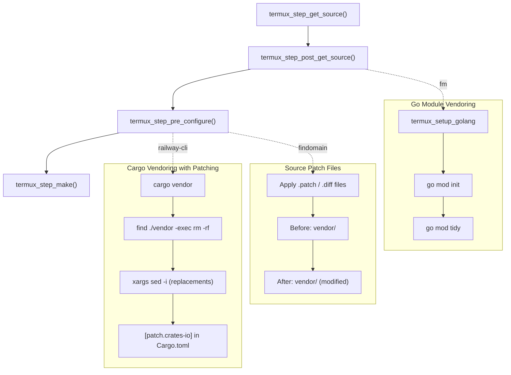
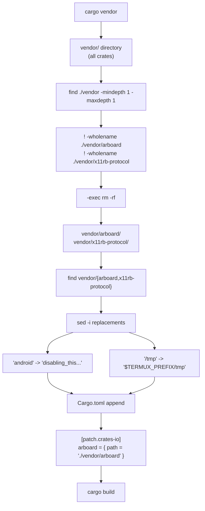

<!-- source: DeepWiki mcp.deepwiki.com · repo termux/termux-packages · page 6.4 Dependency Vendoring and Patching · fetched 2026-10-26 -->

# Dependency Vendoring and Patching

<details>
<summary>Relevant source files</summary>

The following files were used as context for generating this wiki page:

- [packages/findomain/build.sh](packages/findomain/build.sh)
- [packages/findomain/headless-chrome.patch](packages/findomain/headless-chrome.patch)
- [packages/findomain/hickory-resolver.diff](packages/findomain/hickory-resolver.diff)
- [packages/flatbuffers/build.sh](packages/flatbuffers/build.sh)
- [packages/flex/build.sh](packages/flex/build.sh)
- [packages/fm/build.sh](packages/fm/build.sh)
- [packages/llama-cpp/0002-do-not-install-backend-libs.patch](packages/llama-cpp/0002-do-not-install-backend-libs.patch)
- [packages/llama-cpp/build.sh](packages/llama-cpp/build.sh)
- [packages/minidlna/build.sh](packages/minidlna/build.sh)
- [packages/minimodem/build.sh](packages/minimodem/build.sh)
- [packages/miniserve/build.sh](packages/miniserve/build.sh)
- [packages/minisign/build.sh](packages/minisign/build.sh)
- [packages/railway-cli/build.sh](packages/railway-cli/build.sh)
- [packages/rust-analyzer/build.sh](packages/rust-analyzer/build.sh)
- [packages/uv/build.sh](packages/uv/build.sh)

</details>


## Purpose and Scope

This document explains strategies for managing and modifying dependencies within the Termux package build system. Dependency vendoring refers to the practice of downloading and storing dependency source code within the package build tree, allowing modifications before compilation. This is critical for cross-compiling to Android when upstream dependencies assume standard Linux environments (e.g., `/tmp` paths or specific file locking behaviors).

This page covers:
- Go module vendoring and initialization workflows.
- Cargo dependency vendoring with selective patching using `sed` and `[patch.crates-io]`.
- Manual application of `.diff` and `.patch` files to vendored source code.
- Trade-offs between vendoring approaches and implementation patterns.

## Vendoring Workflow Overview

The following diagram illustrates when vendoring occurs in the package build lifecycle and the different approaches used:



**Sources:** [packages/fm/build.sh:11-16](), [packages/railway-cli/build.sh:11-30](), [packages/findomain/build.sh:13-47]()

## Go Module Vendoring

Go packages in Termux often require explicit module initialization and tidying to ensure all dependencies are correctly resolved for the Android environment.

### Workflow

The standard Go vendoring and setup workflow typically executes in `termux_step_pre_configure()`:

| Step | Command | Purpose |
|------|---------|---------|
| 1 | `termux_setup_golang` | Initialize Go toolchain and environment variables |
| 2 | `go mod init` | Initialize module if `go.mod` is missing (often with `|| :` to ignore existing file errors) |
| 3 | `go mod tidy` | Resolve dependencies and update `go.mod`/`go.sum` |

**Example: fm (File Manager)**

[packages/fm/build.sh:11-16]() demonstrates the setup pattern:

```bash
termux_step_pre_configure() {
	termux_setup_golang

	go mod init || :
	go mod tidy
}
```

The build then proceeds using the standard `go build` command in [packages/fm/build.sh:18-20]().

**Sources:** [packages/fm/build.sh:1-25]()

## Cargo Vendoring with Selective Patching

Rust packages frequently require source modifications to dependencies for Android compatibility (e.g., fixing hardcoded `/tmp` paths or disabling APK-specific build logic). The Cargo vendoring workflow supports in-place patching of specific crates.

### Workflow Architecture



**Sources:** [packages/railway-cli/build.sh:11-30]()

### Implementation Pattern: railway-cli

The `railway-cli` package demonstrates the selective patching workflow in [packages/railway-cli/build.sh:11-30]():

#### Step 1: Vendor All Dependencies
```bash
termux_step_pre_configure() {
	termux_setup_rust
	cargo vendor
```

#### Step 2: Selective Deletion
To keep the build environment clean and minimize local storage, Termux maintainers often delete all vendored crates except those requiring patches:
```bash
	find ./vendor \
		-mindepth 1 -maxdepth 1 -type d \
		! -wholename ./vendor/arboard \
		! -wholename ./vendor/x11rb-protocol \
		-exec rm -rf '{}' \;
```

#### Step 3: In-Place Source Patching (sed)
```bash
	find vendor/{arboard,x11rb-protocol} -type f -print0 | \
		xargs -0 sed -i \
		-e 's|android|disabling_this_because_it_is_for_building_an_apk|g' \
		-e "s|/tmp|$TERMUX_PREFIX/tmp|g"
```
This replaces hardcoded `/tmp` with the Termux prefix and disables problematic Android-specific conditional compilation.

#### Step 4: Cargo Manifest Patching
The `Cargo.toml` is modified to point to the local vendored copies for the patched crates:
```bash
	echo "" >> Cargo.toml
	echo '[patch.crates-io]' >> Cargo.toml
	echo "arboard = { path = \"./vendor/arboard\" }" >> Cargo.toml
	echo "x11rb-protocol = { path = \"./vendor/x11rb-protocol\" }" >> Cargo.toml
}
```

**Sources:** [packages/railway-cli/build.sh:11-30]()

## Manual Patching of Vendored Dependencies

For more complex changes that cannot be handled by `sed`, Termux uses standard `.diff` or `.patch` files applied directly to the vendored directory.

### Case Study: findomain

The `findomain` package patches the `hickory-resolver` crate to handle specific DNS resolution issues on Android.

#### Implementation Pattern
In [packages/findomain/build.sh:27-41](), the following steps are performed:
1. `cargo vendor` is called.
2. Unrelated crates are removed via `find`.
3. A local patch file `hickory-resolver.diff` is applied specifically to the vendored directory.
4. The `[patch.crates-io]` section is appended to `Cargo.toml`.

```bash
	cargo vendor
	find ./vendor \
		-mindepth 1 -maxdepth 1 -type d \
		! -wholename ./vendor/hickory-resolver \
		-exec rm -rf '{}' \;

	patch --silent -p1 \
		-d ./vendor/hickory-resolver/ \
		< "$TERMUX_PKG_BUILDER_DIR"/hickory-resolver.diff

	cat <<- EOF >> Cargo.toml
	[patch.crates-io]
	hickory-resolver = { path = "./vendor/hickory-resolver" }
	EOF
```

**Sources:** [packages/findomain/build.sh:27-41]()

## Comparison of Patching Strategies

| Strategy | Use Case | Implementation | Example Package |
|----------|----------|----------------|-----------------|
| **Inline `sed`** | Simple string replacements (paths, flags) | `xargs sed -i` in `build.sh` | [railway-cli:22-24]() |
| **Local `.diff`** | Complex code changes in dependencies | `patch -d ./vendor/... < file.diff` | [findomain:33-35]() |
| **Global `.patch`** | Changes to the main package source | Applied automatically by build system | [llama-cpp:0002-patch]() |

## Best Practices for Vendoring

### Storage Management
When vendoring Rust crates, it is standard practice to delete unmodified crates after `cargo vendor` to avoid bloating the build environment and potentially interfering with the standard Cargo cache. This is seen in both `railway-cli` [packages/railway-cli/build.sh:15-19]() and `findomain` [packages/findomain/build.sh:28-31]().

### Toolchain Setup
Always ensure the appropriate language toolchain is initialized before attempting to vendor or patch dependencies:
- **Rust:** `termux_setup_rust` [packages/railway-cli/build.sh:12]()
- **Go:** `termux_setup_golang` [packages/fm/build.sh:12]()

### Environment Variables
For some Rust packages using OpenSSL, it may be necessary to disable the crate's internal vendoring to use Termux's system `openssl` package:
```bash
export OPENSSL_NO_VENDOR=1
```
**Sources:** [packages/findomain/build.sh:46]()

### Target Architecture Handling
For certain architectures (like `i686`), additional linking arguments might be required during the Rust build phase to resolve atomic symbols:
```bash
if [[ "${TERMUX_ARCH}" == "i686" ]]; then
    export CARGO_TARGET_${env_host}_RUSTFLAGS+=" -C link-arg=$(${CC} -print-libgcc-file-name)"
fi
```
**Sources:** [packages/findomain/build.sh:19-22]()

---

