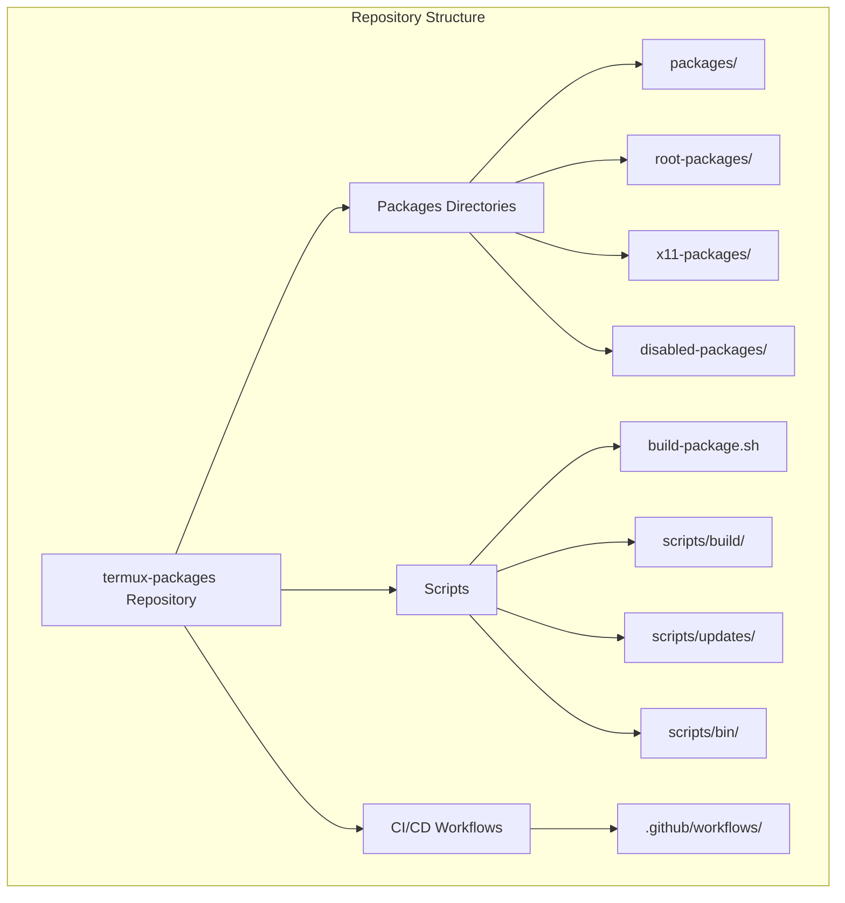
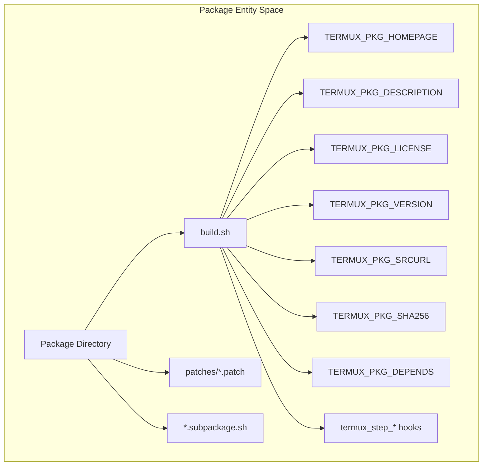
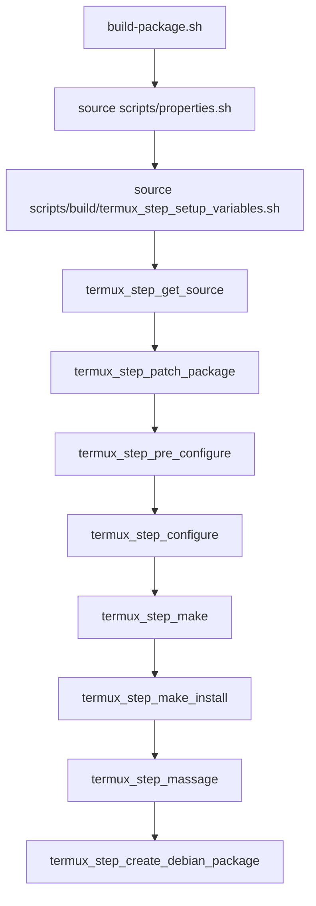
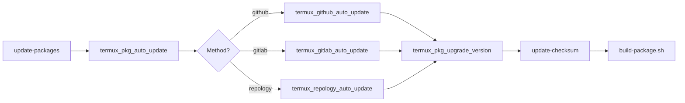

<!-- source: DeepWiki mcp.deepwiki.com · repo termux/termux-packages · page 7 Contributing to Termux Packages · fetched 2026-10-26 -->

# Contributing to Termux Packages

<details>
<summary>Relevant source files</summary>

The following files were used as context for generating this wiki page:

- [build-package.sh](build-package.sh)
- [disabled-packages/protobuf-static/build.sh](disabled-packages/protobuf-static/build.sh)
- [packages/asciinema/build.sh](packages/asciinema/build.sh)
- [packages/asciinema/locale.rs.patch](packages/asciinema/locale.rs.patch)
- [packages/libprotobuf/build.sh](packages/libprotobuf/build.sh)
- [packages/libprotobuf/retain-linker-array.patch](packages/libprotobuf/retain-linker-array.patch)
- [packages/lua-lpeg/lua52-lpeg.subpackage.sh](packages/lua-lpeg/lua52-lpeg.subpackage.sh)
- [packages/tesseract/build.sh](packages/tesseract/build.sh)
- [packages/texinfo/build.sh](packages/texinfo/build.sh)
- [packages/texinfo/update-info-dir.patch](packages/texinfo/update-info-dir.patch)
- [packages/texlab/build.sh](packages/texlab/build.sh)
- [packages/texlive-bin/build.sh](packages/texlive-bin/build.sh)
- [packages/texlive-bin/libandroid-complex-math.patch](packages/texlive-bin/libandroid-complex-math.patch)
- [packages/texlive-bin/texk-xdvipsk-Makefile.in.patch](packages/texlive-bin/texk-xdvipsk-Makefile.in.patch)
- [scripts/bin/check-auto-update](scripts/bin/check-auto-update)
- [scripts/bin/update-packages](scripts/bin/update-packages)
- [scripts/build/configure/termux_step_configure_meson.sh](scripts/build/configure/termux_step_configure_meson.sh)
- [scripts/build/setup/python-crossenv-PYTHONPATH.patch](scripts/build/setup/python-crossenv-PYTHONPATH.patch)
- [scripts/build/setup/python-crossenv-fix-shebang.patch](scripts/build/setup/python-crossenv-fix-shebang.patch)
- [scripts/build/setup/python-crossenv-pip-android-api-level.patch](scripts/build/setup/python-crossenv-pip-android-api-level.patch)
- [scripts/build/setup/termux_setup_protobuf.sh](scripts/build/setup/termux_setup_protobuf.sh)
- [scripts/build/setup/termux_setup_python_pip.sh](scripts/build/setup/termux_setup_python_pip.sh)
- [scripts/build/termux_download_deb_pac.sh](scripts/build/termux_download_deb_pac.sh)
- [scripts/build/termux_error_exit.sh](scripts/build/termux_error_exit.sh)
- [scripts/build/termux_step_install_license.sh](scripts/build/termux_step_install_license.sh)
- [scripts/build/termux_step_massage.sh](scripts/build/termux_step_massage.sh)
- [scripts/build/termux_step_override_config_scripts.sh](scripts/build/termux_step_override_config_scripts.sh)
- [scripts/lint-packages.sh](scripts/lint-packages.sh)
- [scripts/properties.sh](scripts/properties.sh)
- [scripts/setup-termux.sh](scripts/setup-termux.sh)
- [scripts/setup-ubuntu.sh](scripts/setup-ubuntu.sh)
- [scripts/updates/api/dump-repology-data](scripts/updates/api/dump-repology-data)
- [scripts/updates/api/termux_github_api_get_tag.sh](scripts/updates/api/termux_github_api_get_tag.sh)
- [scripts/updates/api/termux_gitlab_api_get_tag.sh](scripts/updates/api/termux_gitlab_api_get_tag.sh)
- [scripts/updates/api/termux_repology_api_get_latest_version.sh](scripts/updates/api/termux_repology_api_get_latest_version.sh)
- [scripts/updates/internal/termux_github_auto_update.sh](scripts/updates/internal/termux_github_auto_update.sh)
- [scripts/updates/internal/termux_gitlab_auto_update.sh](scripts/updates/internal/termux_gitlab_auto_update.sh)
- [scripts/updates/termux_pkg_auto_update.sh](scripts/updates/termux_pkg_auto_update.sh)
- [scripts/updates/utils/termux_pkg_is_update_needed.sh](scripts/updates/utils/termux_pkg_is_update_needed.sh)
- [scripts/updates/utils/termux_pkg_upgrade_version.sh](scripts/updates/utils/termux_pkg_upgrade_version.sh)
- [x11-packages/i3status/build.sh](x11-packages/i3status/build.sh)
- [x11-packages/inkscape/build.sh](x11-packages/inkscape/build.sh)
- [x11-packages/jwm/build.sh](x11-packages/jwm/build.sh)
- [x11-packages/keepassxc/build.sh](x11-packages/keepassxc/build.sh)
- [x11-packages/kermit/build.sh](x11-packages/kermit/build.sh)
- [x11-packages/openimageio/build.sh](x11-packages/openimageio/build.sh)
- [x11-packages/openvdb/build.sh](x11-packages/openvdb/build.sh)
- [x11-packages/poppler-qt/build.sh](x11-packages/poppler-qt/build.sh)
- [x11-packages/wireshark-qt/build.sh](x11-packages/wireshark-qt/build.sh)

</details>


This document provides a comprehensive guide on how to contribute to the Termux packages repository. It covers the process of creating new packages, updating existing ones, understanding the build system, and utilizing the CI/CD infrastructure.

## Repository Overview

The Termux packages repository is structured to facilitate the building and maintenance of packages for the Termux Android application. The repository contains package definitions, build scripts, and CI/CD workflows that enable automated testing and deployment.



Sources: [build-package.sh:23-25](), [scripts/properties.sh:1-7](), [scripts/bin/update-packages:30-31]()

## Package Structure

Each package in the Termux repository is defined by a directory containing a `build.sh` file and, optionally, patches and additional files. The `build.sh` file defines the metadata and build process for the package.



Example of a standard package definition using `openimageio` as a reference:
[x11-packages/openimageio/build.sh:1-11]()

The `disabled-packages/` directory serves as a reference for packages that were removed due to build failures or lack of maintenance, such as `protobuf-static`.
Sources: [disabled-packages/protobuf-static/build.sh:1-5]()

## Build System Architecture

The Termux build system is designed to compile packages for multiple architectures (`aarch64`, `arm`, `i686`, `x86_64`). The main script `build-package.sh` coordinates the process.



The system uses `TERMUX_ON_DEVICE_BUILD` to distinguish between cross-compilation on a Linux host and native building on an Android device.
Sources: [build-package.sh:38-49](), [build-package.sh:72-110](), [scripts/bin/update-packages:113-118]()

## Setting Up the Development Environment

### Docker (Recommended)
The recommended way to build packages is using Docker to ensure a clean, reproducible environment.
```bash
./scripts/run-docker.sh ./build-package.sh -a aarch64 package-name
```
Sources: [scripts/updates/utils/termux_pkg_upgrade_version.sh:140-142]()

### Ubuntu Host Dependencies
If building natively on a Linux host, `scripts/setup-ubuntu.sh` installs the necessary toolchains including `autoconf`, `cmake`, `git`, and various library headers required for host builds.
Sources: [scripts/setup-ubuntu.sh:1-51]()

## Creating and Testing a New Package

1. **Template**: Use the `sample/` directory or an existing package as a template.
2. **Metadata**: Define `TERMUX_PKG_VERSION`, `TERMUX_PKG_SRCURL`, and `TERMUX_PKG_SHA256`.
3. **Linting**: Run `scripts/lint-packages.sh` to check for:
    * Valid license names (e.g., `Apache-2.0`, `GPL-3.0`). [scripts/lint-packages.sh:10-53]()
    * Correct indentation (Tabs are required). [scripts/lint-packages.sh:74-129]()
    * Package name validity via `dpkg --validate-pkgname`. [scripts/lint-packages.sh:55-72]()

### Local Testing
Run the build script locally for your target architecture:
```bash
./build-package.sh -a aarch64 <package-name>
```

## Updating Packages

Termux uses an automated update system centered around `scripts/bin/update-packages`.



### Auto-Update Configuration
In `build.sh`, set `TERMUX_PKG_AUTO_UPDATE=true`. You can refine the version extraction using:
* `TERMUX_PKG_UPDATE_VERSION_REGEXP`: For `grep -oP` extraction.
* `TERMUX_PKG_UPDATE_VERSION_SED_REGEXP`: For `sed` transformations.

Sources: [scripts/bin/update-packages:17-21](), [scripts/updates/termux_pkg_auto_update.sh:22-30](), [scripts/updates/utils/termux_pkg_upgrade_version.sh:38-63]()

## Advanced Build Patterns

### Language Toolchains
The build system provides helpers for different ecosystems:
* **Python**: `termux_setup_python_pip` sets up `crossenv` to handle cross-compilation of Python wheels. [scripts/build/setup/termux_setup_python_pip.sh:6-73]()
* **Rust**: `termux_setup_rust` is used in `termux_step_make` to configure Cargo. [packages/asciinema/build.sh:12-19]()
* **Qt/CMake**: Cross-tools like `qt6-qtbase-cross-tools` are used for UI applications. [x11-packages/wireshark-qt/build.sh:10-15]()

### Subpackages
To split a package into multiple components (e.g., separating a library from its Lua bindings), use `.subpackage.sh` files.
Sources: [packages/lua-lpeg/lua52-lpeg.subpackage.sh:1-5]()

## Submission and CI/CD

When a Pull Request is submitted, the CI pipeline in `.github/workflows/packages.yml` triggers:
1. **Linting**: Validates `build.sh` syntax and metadata.
2. **Build Matrix**: Attempts to build the package for all 4 architectures in Docker.
3. **Checksum Update**: If the version was bumped, `update-checksum` verifies the new source.

Sources: [scripts/lint-packages.sh:1-9](), [scripts/updates/utils/termux_pkg_upgrade_version.sh:108-115]()

### Git Conventions
Automated updates generate commits with the format: `bump(repo/package): version`.
Sources: [scripts/updates/utils/termux_pkg_upgrade_version.sh:150-168]()

---

