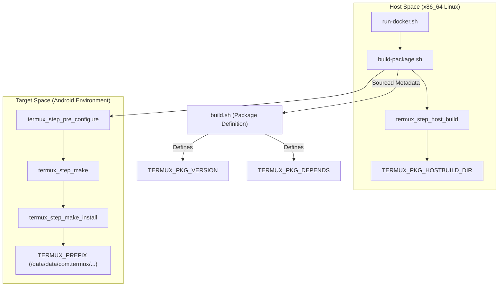
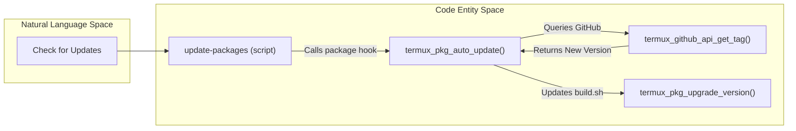

<!-- source: DeepWiki mcp.deepwiki.com · repo termux/termux-packages · page 8 Glossary · fetched 2026-10-26 -->

# Glossary

Relevant source files

The following files were used as context for generating this wiki page:

- [.github/actions/zram/action.yml](.github/actions/zram/action.yml)
- [.github/workflows/bootstrap_archives.yml](.github/workflows/bootstrap_archives.yml)
- [.github/workflows/check_repository_health.yml](.github/workflows/check_repository_health.yml)
- [.github/workflows/codeql.yml](.github/workflows/codeql.yml)
- [.github/workflows/command_not_found.yml](.github/workflows/command_not_found.yml)
- [.github/workflows/docker_image.yml](.github/workflows/docker_image.yml)
- [.github/workflows/golang_validation.yml](.github/workflows/golang_validation.yml)
- [.github/workflows/package_updates.yml](.github/workflows/package_updates.yml)
- [.github/workflows/packages.yml](.github/workflows/packages.yml)
- [.github/workflows/zig_validation.yml](.github/workflows/zig_validation.yml)
- [build-package.sh](build-package.sh)
- [disabled-packages/protobuf-static/build.sh](disabled-packages/protobuf-static/build.sh)
- [packages/findomain/build.sh](packages/findomain/build.sh)
- [packages/findomain/headless-chrome.patch](packages/findomain/headless-chrome.patch)
- [packages/findomain/hickory-resolver.diff](packages/findomain/hickory-resolver.diff)
- [packages/flatbuffers/build.sh](packages/flatbuffers/build.sh)
- [packages/flex/build.sh](packages/flex/build.sh)
- [packages/fm/build.sh](packages/fm/build.sh)
- [packages/jack-example-tools/build.sh](packages/jack-example-tools/build.sh)
- [packages/jack2/build.sh](packages/jack2/build.sh)
- [packages/jackett/build.sh](packages/jackett/build.sh)
- [packages/jcal/build.sh](packages/jcal/build.sh)
- [packages/libprotobuf/build.sh](packages/libprotobuf/build.sh)
- [packages/libprotobuf/retain-linker-array.patch](packages/libprotobuf/retain-linker-array.patch)
- [packages/llama-cpp/0002-do-not-install-backend-libs.patch](packages/llama-cpp/0002-do-not-install-backend-libs.patch)
- [packages/llama-cpp/build.sh](packages/llama-cpp/build.sh)
- [packages/marksman/build.sh](packages/marksman/build.sh)
- [packages/marksman/version.diff](packages/marksman/version.diff)
- [packages/minidlna/build.sh](packages/minidlna/build.sh)
- [packages/minimodem/build.sh](packages/minimodem/build.sh)
- [packages/miniserve/build.sh](packages/miniserve/build.sh)
- [packages/minisign/build.sh](packages/minisign/build.sh)
- [packages/mplayer/build.sh](packages/mplayer/build.sh)
- [packages/mplayer/mplayer-1.5-ffmpeg-8.patch](packages/mplayer/mplayer-1.5-ffmpeg-8.patch)
- [packages/mplayer/r38454.patch](packages/mplayer/r38454.patch)
- [packages/mplayer/r38455.patch](packages/mplayer/r38455.patch)
- [packages/mpv/build.sh](packages/mpv/build.sh)
- [packages/mruby/build.sh](packages/mruby/build.sh)
- [packages/msitools/build.sh](packages/msitools/build.sh)
- [packages/neovim-nightly/build.sh](packages/neovim-nightly/build.sh)
- [packages/neovim/build.sh](packages/neovim/build.sh)
- [packages/neovim/disable-checkhealth-locale-warning.patch](packages/neovim/disable-checkhealth-locale-warning.patch)
- [packages/neovim/sysinit.vim](packages/neovim/sysinit.vim)
- [packages/ollama/0001-do-not-install-runtime-deps.patch](packages/ollama/0001-do-not-install-runtime-deps.patch)
- [packages/ollama/0002-properly-search-libs-on-android.patch](packages/ollama/0002-properly-search-libs-on-android.patch)
- [packages/ollama/0003-do-not-include-sources-for-vulkan-again.patch](packages/ollama/0003-do-not-include-sources-for-vulkan-again.patch)
- [packages/ollama/0004-force-disable-features-on-Andoid.patch](packages/ollama/0004-force-disable-features-on-Andoid.patch)
- [packages/ollama/0006-do-not-search-hip-memory.patch](packages/ollama/0006-do-not-search-hip-memory.patch)
- [packages/ollama/0007-do-not-use-flash-attention-when-using-cpu.patch](packages/ollama/0007-do-not-use-flash-attention-when-using-cpu.patch)
- [packages/ollama/0008-fix-build-with-latest-vulkan-hpp.patch](packages/ollama/0008-fix-build-with-latest-vulkan-hpp.patch)
- [packages/ollama/build.sh](packages/ollama/build.sh)
- [packages/ollama/host-toolchain.cmake](packages/ollama/host-toolchain.cmake)
- [packages/ollama/ollama-backend-vulkan.subpackage.sh](packages/ollama/ollama-backend-vulkan.subpackage.sh)
- [packages/rust-analyzer/build.sh](packages/rust-analyzer/build.sh)
- [packages/vim/build.sh](packages/vim/build.sh)
- [packages/vim/fix-writing-archive.patch](packages/vim/fix-writing-archive.patch)
- [packages/vim/revert-1fe0d1e.patch](packages/vim/revert-1fe0d1e.patch)
- [packages/vim/runtime-syntax-sh.vim.patch](packages/vim/runtime-syntax-sh.vim.patch)
- [scripts/bin/validation](scripts/bin/validation)
- [scripts/build/configure/termux_step_configure_meson.sh](scripts/build/configure/termux_step_configure_meson.sh)
- [scripts/build/setup/python-crossenv-PYTHONPATH.patch](scripts/build/setup/python-crossenv-PYTHONPATH.patch)
- [scripts/build/setup/python-crossenv-fix-shebang.patch](scripts/build/setup/python-crossenv-fix-shebang.patch)
- [scripts/build/setup/python-crossenv-pip-android-api-level.patch](scripts/build/setup/python-crossenv-pip-android-api-level.patch)
- [scripts/build/setup/termux_setup_protobuf.sh](scripts/build/setup/termux_setup_protobuf.sh)
- [scripts/build/setup/termux_setup_python_pip.sh](scripts/build/setup/termux_setup_python_pip.sh)
- [scripts/build/termux_download_deb_pac.sh](scripts/build/termux_download_deb_pac.sh)
- [scripts/build/termux_step_massage.sh](scripts/build/termux_step_massage.sh)
- [scripts/build/termux_step_override_config_scripts.sh](scripts/build/termux_step_override_config_scripts.sh)
- [scripts/free-space.sh](scripts/free-space.sh)
- [scripts/properties.sh](scripts/properties.sh)
- [scripts/run-docker.sh](scripts/run-docker.sh)
- [scripts/setup-termux.sh](scripts/setup-termux.sh)
- [scripts/setup-ubuntu.sh](scripts/setup-ubuntu.sh)
- [x11-packages/mogan/build.sh](x11-packages/mogan/build.sh)
- [x11-packages/mogan/lolly.diff](x11-packages/mogan/lolly.diff)
- [x11-packages/mogan/moebius.diff](x11-packages/mogan/moebius.diff)
- [x11-packages/mogan/xmake-packages-l-lolly.patch](x11-packages/mogan/xmake-packages-l-lolly.patch)
- [x11-packages/mogan/xmake-packages-m-moebius.patch](x11-packages/mogan/xmake-packages-m-moebius.patch)
- [x11-packages/mousepad/build.sh](x11-packages/mousepad/build.sh)
- [x11-packages/mpv-x/build.sh](x11-packages/mpv-x/build.sh)
- [x11-packages/mpv-x/default-to-x11.patch](x11-packages/mpv-x/default-to-x11.patch)
- [x11-packages/vim-gtk/build.sh](x11-packages/vim-gtk/build.sh)
- [x11-packages/vim-gtk/revert-1fe0d1e.patch](x11-packages/vim-gtk/revert-1fe0d1e.patch)

This glossary provides definitions for Termux-specific terminology, build system variables, and Android domain concepts used throughout the `termux-packages` repository.

## Build System Terminology

### Build Lifecycle Hooks
Functions defined in a package's `build.sh` that are executed by the main build engine to perform specific tasks.

*   **`termux_step_pre_configure`**: Executed before the configuration step (e.g., before `cmake` or `./configure`). Used for environment setup, patching, or path exports [packages/llama-cpp/build.sh:75-84]().
*   **`termux_step_host_build`**: Used for packages requiring a native build on the host machine (x86_64 Linux) before cross-compiling for Android. Common in packages that need to run their own tools during the build process, like `neovim` [packages/neovim/build.sh:25-46]().
*   **`termux_step_make`**: Defines the compilation command. For example, in Rust packages, it typically involves `cargo build` [packages/rust-analyzer/build.sh:59-62]().
*   **`termux_step_make_install`**: Defines how the compiled binaries and assets are moved into the `$TERMUX_PREFIX` [packages/jackett/build.sh:89-98]().
*   **`termux_step_post_make_install`**: Final cleanup or adjustment step, such as creating symlinks or moving binaries to `libexec` [packages/neovim/build.sh:48-91]().

### Build Variables
Variables prefixed with `TERMUX_PKG_` that define package metadata and build behavior.

*   **`TERMUX_PKG_SRCDIR`**: The directory where the package source code is extracted [packages/neovim/build.sh:30]().
*   **`TERMUX_PKG_BUILDDIR`**: The directory where the package is built (usually separate from source for out-of-tree builds) [packages/llama-cpp/build.sh:88]().
*   **`TERMUX_PKG_HOSTBUILD`**: A boolean flag. If `true`, the build system will execute `termux_step_host_build` [packages/neovim/build.sh:12]().
*   **`TERMUX_PKG_EXTRA_CONFIGURE_ARGS`**: Arguments passed to the configuration tool (CMake, Autotools, etc.) [packages/llama-cpp/build.sh:13-21]().
*   **`TERMUX_PKG_AUTO_UPDATE`**: When set to `true`, the automated update scripts will attempt to find new upstream versions [packages/jackett/build.sh:11]().

## System Architecture Concepts

### Cross-Compilation Components
*   **NDK (Native Development Kit)**: The toolset provided by Google to build C/C++ code for Android. Termux uses it to target Android's Bionic libc [packages/llama-cpp/build.sh:76]().
*   **Target Architecture**: The CPU architecture for which the package is being built. Termux supports `aarch64`, `arm`, `i686`, and `x86_64` [.github/workflows/packages.yml:43]().
*   **`TERMUX_PREFIX`**: The base directory for all installed files on the target device, typically `/data/data/com.termux/files/usr` [packages/neovim/build.sh:83]().
*   **`TERMUX_ON_DEVICE_BUILD`**: A boolean variable that identifies if the build is happening inside the Termux app on an Android device rather than a Linux host [build-package.sh:46]().

### Diagram: Build Process Data Flow
This diagram maps the natural language steps of a build to the code entities and variables that manage them.

Sources: [build-package.sh:23-34](), [scripts/run-docker.sh:9-10](), [packages/neovim/build.sh:12-25]().

## Domain Specific Jargon

### Package Management
*   **Subpackage**: A secondary package created from the same source build. Defined using `.subpackage.sh` files [packages/ollama/ollama-backend-vulkan.subpackage.sh:1]().
*   **Shim**: A small script or binary that wraps another executable to set environment variables (like `LD_PRELOAD` or `LD_LIBRARY_PATH`) before execution [packages/neovim/build.sh:89]().
*   **Bootstrap**: A minimal set of packages required to initialize a Termux environment from scratch.

### Automation
*   **Throttling**: The practice of limiting how often a package is updated to avoid CI congestion, especially for high-frequency upstreams like `llama-cpp` or `jackett` [packages/llama-cpp/build.sh:27-34]().
*   **Repology**: An external service used by Termux to track package versions across different distributions [packages/llama-cpp/build.sh:8]().

### Diagram: Update Automation Flow
How the system identifies and applies updates to package definitions.

Sources: [packages/jackett/build.sh:26-68](), [packages/llama-cpp/build.sh:31-73](), [scripts/bin/update-packages:92]().

## Language-Specific Integration
Termux provides helper functions to simplify the setup of various toolchains:

| Function | Purpose | Example Usage |
| :--- | :--- | :--- |
| `termux_setup_golang` | Sets up Go compiler and environment | [packages/ollama/build.sh:34]() |
| `termux_setup_rust` | Configures Cargo for cross-compilation | [packages/rust-analyzer/build.sh:56]() |
| `termux_setup_cmake` | Configures CMake with Android toolchain | [packages/neovim/build.sh:26]() |
| `termux_setup_dotnet` | Configures .NET SDK for target arch | [packages/jackett/build.sh:72]() |

Sources: [build-package.sh:107-142](), [packages/ollama/build.sh:34](), [packages/rust-analyzer/build.sh:56]().