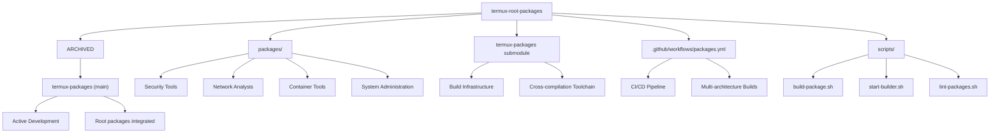
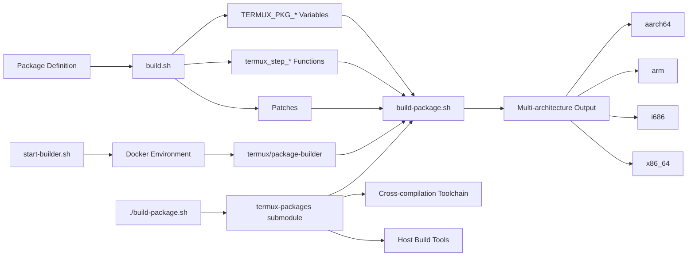
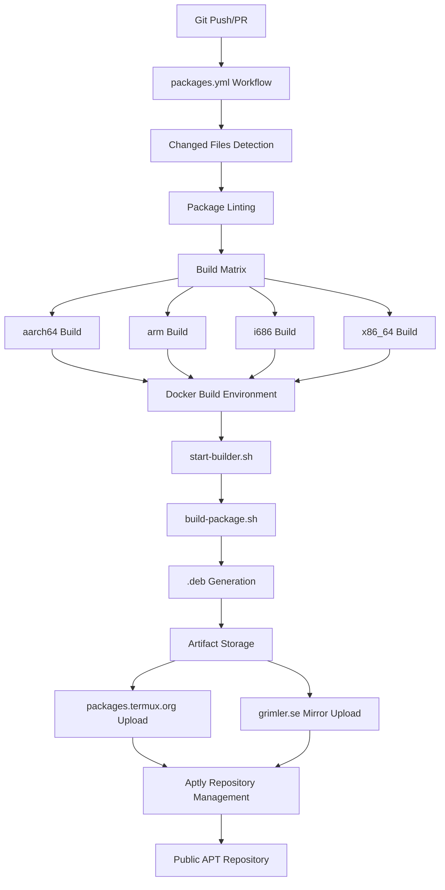
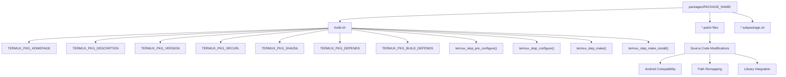
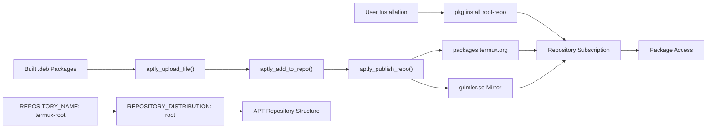

<!-- source: DeepWiki mcp.deepwiki.com · repo termux/termux-root-packages · page 1 Overview · fetched 2026-10-26 -->

# Overview

Relevant source files

The following files were used as context for generating this wiki page:

- [.github/static/powered-by-fosshost.png](.github/static/powered-by-fosshost.png)
- [.github/workflows/packages.yml](.github/workflows/packages.yml)
- [.gitmodules](.gitmodules)
- [CONTRIBUTING.md](CONTRIBUTING.md)
- [README.md](README.md)
- [packages/libnfnetlink/build.sh](packages/libnfnetlink/build.sh)
- [packages/libnfnetlink/fix-libnetfilter-queue.patch](packages/libnfnetlink/fix-libnetfilter-queue.patch)

This document provides an overview of the `termux-root-packages` repository, which serves as a specialized collection of packages requiring root access for the Termux Android terminal environment. The repository implements a sophisticated build system, automated CI/CD pipeline, and package distribution mechanism for security tools, network analysis utilities, and system administration software.

For information about the core build system infrastructure shared with this repository, see [Build System Architecture](#2). For details about specific package categories and their implementations, see [Package Categories](#4).

## Repository Status and Migration

The `termux-root-packages` repository is currently archived, with active development migrated to a monorepo structure within the main `termux-packages` repository. This transition consolidates package management while maintaining the specialized nature of root-level tools.

**Current Repository Architecture**

Sources: [README.md:1-3](), [.gitmodules:1-3](), [.github/workflows/packages.yml:1-40]()

## Package Categories and Scope

The repository contains specialized packages organized into distinct functional categories, each requiring elevated privileges for proper operation on Android systems.

**Package Category Distribution**

```mermaid
graph TD
    A["termux-root-packages"] --> B["Security Tools"]
    A --> C["Network Analysis"]
    A --> D["Container/Virtualization"]
    A --> E["System Administration"]
    A --> F["Network Infrastructure"]
    A --> G["Specialized Libraries"]
    
    B --> B1["aircrack-ng"]
    B --> B2["bettercap"]
    B --> B3["ettercap"]
    B --> B4["cryptsetup"]
    
    C --> C1["tshark"]
    C --> C2["tcpdump"]
    C --> C3["nethogs"]
    C --> C4["termshark"]
    
    D --> D1["docker"]
    D --> D2["lxc"]
    D --> D3["runc"]
    D --> D4["containerd"]
    
    E --> E1["hwinfo"]
    E --> E2["pciutils"]
    E --> E3["openvpn"]
    
    F --> F1["ethtool"]
    F --> F2["iw"]
    F --> F3["dnsmasq"]
    
    G --> G1["libdevmapper"]
    G --> G2["libseccomp"]
    G --> G3["libfuse3"]
    G --> G4["libnfnetlink"]
```

Sources: Based on repository structure analysis and package directory contents

## Build System Integration

The repository leverages the `termux-packages` infrastructure through a git submodule, providing access to cross-compilation toolchains, build utilities, and package management functions.

**Build System Architecture**

Sources: [.gitmodules:1-3](), [README.md:25-36](), [packages/libnfnetlink/build.sh:1-10]()

## CI/CD Pipeline Implementation

The automated build system uses GitHub Actions to detect changes, build packages across architectures, and distribute them to APT repositories.

**GitHub Actions Workflow**

Sources: [.github/workflows/packages.yml:18-142](), [.github/workflows/packages.yml:154-236]()

## Package Definition System

Each package is defined through a `build.sh` script containing metadata, dependencies, and custom build steps using the `termux-packages` infrastructure.

**Package Definition Structure**

Sources: [packages/libnfnetlink/build.sh:1-10](), [packages/libnfnetlink/fix-libnetfilter-queue.patch:1-13]()

## Distribution and Installation

Built packages are distributed through APT repositories, with users accessing them via the `root-repo` package installation mechanism.

**Distribution Flow**

Sources: [.github/workflows/packages.yml:156-196](), [README.md:40-43]()

This overview establishes the foundation for understanding the specialized nature of root-level package management within the Termux ecosystem, the sophisticated build automation, and the integration patterns that enable cross-compilation and distribution of security and system administration tools for Android environments.

---

