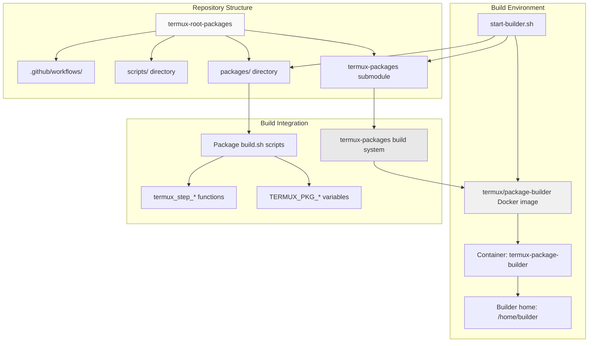
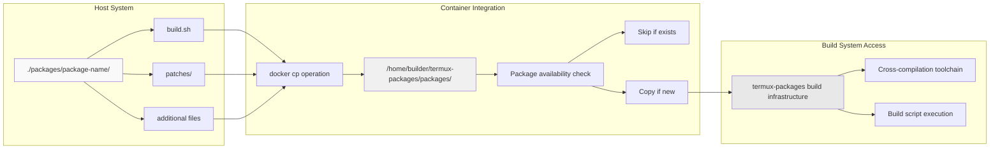
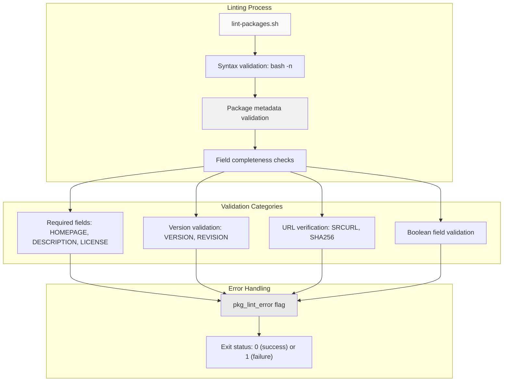

<!-- source: DeepWiki mcp.deepwiki.com · repo termux/termux-root-packages · page 2 Build System Architecture · fetched 2026-10-26 -->

# Build System Architecture

<details>
<summary>Relevant source files</summary>

The following files were used as context for generating this wiki page:

- [.gitmodules](.gitmodules)
- [packages/libnfnetlink/build.sh](packages/libnfnetlink/build.sh)
- [packages/libnfnetlink/fix-libnetfilter-queue.patch](packages/libnfnetlink/fix-libnetfilter-queue.patch)
- [scripts/lint-packages.sh](scripts/lint-packages.sh)
- [start-builder.sh](start-builder.sh)

</details>


This document covers the core build infrastructure of termux-root-packages, including the termux-packages submodule integration, Docker-based build environment, and overall build orchestration process. For information about specific package definition patterns, see [Package Definition System](#2.1). For details about cross-compilation strategies, see [Cross-Compilation and Host Builds](#2.2).

## Overview

The termux-root-packages build system is built on top of the termux-packages infrastructure through Git submodule integration. The system uses a containerized approach with Docker to provide consistent build environments across different host systems, supporting cross-compilation for four Android architectures (aarch64, arm, i686, x86_64).

## Core Architecture Components



**Build Environment Setup Flow**

The build system orchestrates package compilation through a Docker-based environment that isolates build dependencies and provides consistent toolchain access.

Sources: [start-builder.sh:1-99](), [.gitmodules:1-4]()

## Build Environment Initialization

The `start-builder.sh` script serves as the primary entry point for setting up the build environment. It manages Docker container lifecycle, submodule synchronization, and package directory mounting.

```mermaid
graph TD
    subgraph "Environment Setup"
        A["start-builder.sh execution") --> B["Lock file creation: /tmp/.termux-root-builder.lck"]
        B --> C["Git submodule operations"]
        C --> D["Docker container management"]
    end
    
    subgraph "Container Operations"
        D --> E["Stop existing termux-package-builder container"]
        E --> F["Create/start termux/package-builder image"]
        F --> G["UID/GID synchronization"]
    end
    
    subgraph "Volume Mounting"
        G --> H["Mount termux-packages: /home/builder/termux-packages"]
        H --> I["Copy packages from ./packages to container"]
        I --> J["Execute build commands or bash shell"]
    end
    
    style A fill:#f9f9f9
    style F fill:#f0f0f0
    style H fill:#e8e8e8
```

**Container Lifecycle Management**

The system uses file locking (`flock`) to prevent concurrent build operations and ensures proper container state management.

Sources: [start-builder.sh:23-28](), [start-builder.sh:35-58](), [start-builder.sh:63-98]()

## Package Integration Process

The build system copies packages from the host repository into the containerized termux-packages environment, where they integrate with the existing build infrastructure.



**Package Directory Synchronization**

The system performs selective copying to avoid overwriting existing packages in the build environment.

Sources: [start-builder.sh:82-91]()

## Build Orchestration Variables

Package definitions use standardized `TERMUX_PKG_*` variables that interface with the termux-packages build system. These variables control various aspects of the build process.

| Variable Category | Key Variables | Purpose |
|------------------|---------------|---------|
| **Package Metadata** | `TERMUX_PKG_HOMEPAGE`, `TERMUX_PKG_DESCRIPTION`, `TERMUX_PKG_LICENSE` | Package identification and licensing |
| **Source Management** | `TERMUX_PKG_VERSION`, `TERMUX_PKG_SRCURL`, `TERMUX_PKG_SHA256` | Source code retrieval and verification |
| **Build Configuration** | `TERMUX_PKG_BUILD_IN_SRC`, `TERMUX_PKG_HOSTBUILD`, `TERMUX_PKG_FORCE_CMAKE` | Build behavior control |
| **Dependencies** | `TERMUX_PKG_DEPENDS`, `TERMUX_PKG_BUILD_DEPENDS` | Runtime and build-time dependencies |
| **Package Properties** | `TERMUX_PKG_ESSENTIAL`, `TERMUX_PKG_METAPACKAGE` | Package classification |

Sources: [packages/libnfnetlink/build.sh:1-10]()

## Quality Assurance System

The build system includes comprehensive linting capabilities through `lint-packages.sh` that validates package definitions before build execution.



**Package Validation Pipeline**

The linting system sources each package's `build.sh` script in a controlled environment to validate field values and detect common configuration errors.

Sources: [scripts/lint-packages.sh:53-392](), [scripts/lint-packages.sh:394-433]()

## Build System Integration Points

The termux-root-packages system leverages key integration points with the termux-packages infrastructure:

```mermaid
graph LR
    subgraph "termux-root-packages"
        A["Package definitions"] --> B["start-builder.sh"]
        B --> C["Container environment"]
    end
    
    subgraph "termux-packages Integration"
        D["Build scripts infrastructure"] --> E["Cross-compilation toolchain"]
        E --> F["termux_step_* functions"]
        F --> G["Package compilation"]
    end
    
    subgraph "Output Generation"
        G --> H[".deb package files"]
        H --> I["Repository distribution"]
    end
    
    C --> D
    
    style A fill:#f9f9f9
    style D fill:#f0f0f0
    style H fill:#e8e8e8
```



**Submodule-Based Architecture**

The `.gitmodules` configuration establishes termux-packages as the foundation build system, providing proven cross-compilation capabilities and package management infrastructure.

Sources: [.gitmodules:1-4](), [start-builder.sh:29](), [start-builder.sh:69-70]()

---

