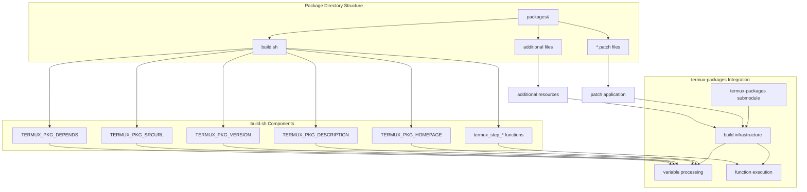
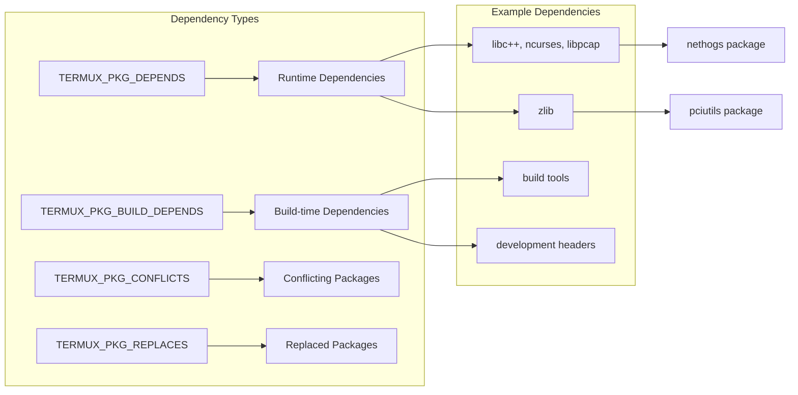
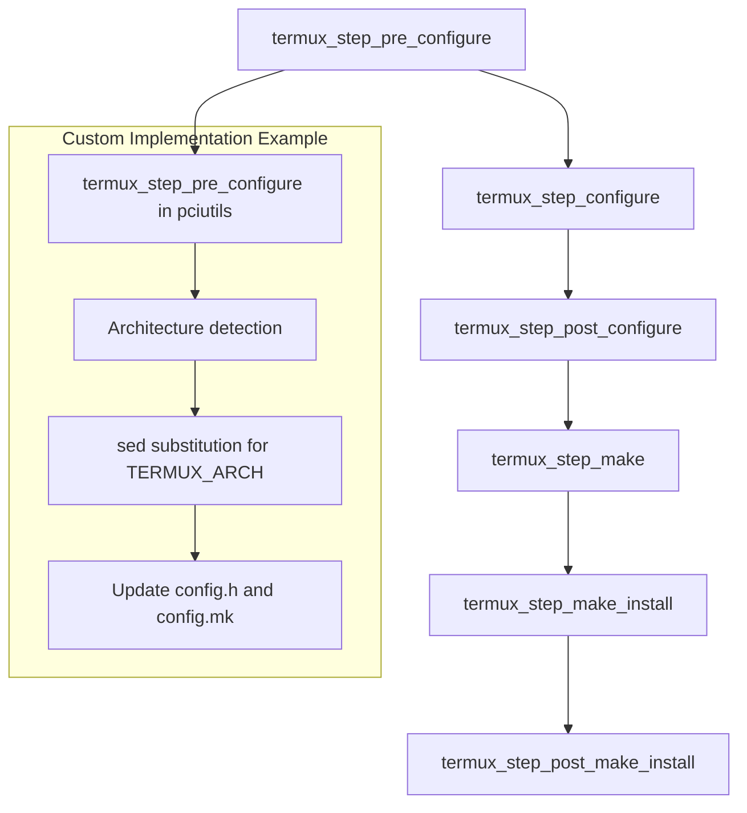
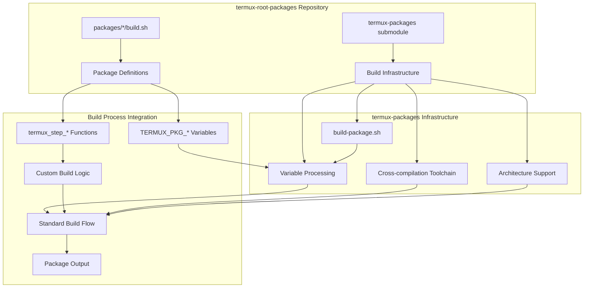
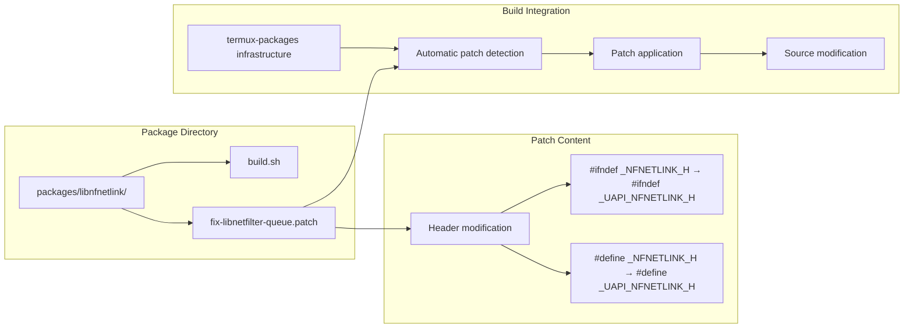

<!-- source: DeepWiki mcp.deepwiki.com · repo termux/termux-root-packages · page 2.1 Package Definition System · fetched 2026-10-26 -->

# Package Definition System

<details>
<summary>Relevant source files</summary>

The following files were used as context for generating this wiki page:

- [.gitmodules](.gitmodules)
- [packages/libnfnetlink/build.sh](packages/libnfnetlink/build.sh)
- [packages/libnfnetlink/fix-libnetfilter-queue.patch](packages/libnfnetlink/fix-libnetfilter-queue.patch)
- [packages/nethogs/build.sh](packages/nethogs/build.sh)
- [packages/pciutils/build.sh](packages/pciutils/build.sh)

</details>


This document covers the package definition system used in termux-root-packages, which defines how individual packages are configured, built, and integrated into the build infrastructure. The system uses `build.sh` scripts with standardized variables and functions to specify package metadata, dependencies, build configuration, and custom build logic.

For information about the broader build system architecture and cross-compilation details, see [Build System Architecture](#2). For specific patching mechanisms, see [Patching System](#2.3).

## Package Definition Structure

Each package in termux-root-packages is defined by a `build.sh` script located in `packages/<package-name>/build.sh`. These scripts declare package metadata through `TERMUX_PKG_*` variables and optionally define custom build logic through `termux_step_*` functions.

### Package Definition Diagram



**Sources:** [packages/nethogs/build.sh:1-12](), [packages/pciutils/build.sh:1-22](), [packages/libnfnetlink/build.sh:1-10]()

## Core Package Variables

The package definition system uses a standardized set of `TERMUX_PKG_*` variables to declare package metadata, dependencies, and build configuration. These variables are processed by the termux-packages build infrastructure.

### Essential Metadata Variables

| Variable | Purpose | Example |
|----------|---------|---------|
| `TERMUX_PKG_HOMEPAGE` | Upstream project URL | `https://github.com/raboof/nethogs` |
| `TERMUX_PKG_DESCRIPTION` | Package description | `"Net top tool grouping bandwidth per process"` |
| `TERMUX_PKG_LICENSE` | License identifier | `"GPL-2.0"` |
| `TERMUX_PKG_MAINTAINER` | Package maintainer | `"@termux"` |
| `TERMUX_PKG_VERSION` | Package version | `0.8.6` |
| `TERMUX_PKG_REVISION` | Termux-specific revision | `1` |

**Sources:** [packages/nethogs/build.sh:1-6](), [packages/pciutils/build.sh:1-6](), [packages/libnfnetlink/build.sh:1-7]()

### Source and Build Configuration

| Variable | Purpose | Example |
|----------|---------|---------|
| `TERMUX_PKG_SRCURL` | Source download URL | `https://github.com/raboof/nethogs/archive/v${TERMUX_PKG_VERSION}.tar.gz` |
| `TERMUX_PKG_SHA256` | Source archive checksum | `317c1d5235d4be677e494e931c41d063a783ac0ac51e35e345e621d261c2e5a0` |
| `TERMUX_PKG_BUILD_IN_SRC` | Build in source directory | `true` |
| `TERMUX_PKG_EXTRA_MAKE_ARGS` | Additional make arguments | `"nethogs"` |

**Sources:** [packages/nethogs/build.sh:7-11](), [packages/pciutils/build.sh:7-10]()

### Dependency Management Variables



**Sources:** [packages/nethogs/build.sh:9](), [packages/pciutils/build.sh:9]()

## Custom Build Steps

The package definition system allows packages to override default build behavior through `termux_step_*` functions. These functions are called at specific points during the build process.

### Build Step Flow



### Custom Build Step Implementation

The `pciutils` package demonstrates custom build logic through `termux_step_pre_configure`:

```bash
termux_step_pre_configure () {
    local ARCH=${TERMUX_ARCH}
    if [[ ${ARCH} == "arm" ]]; then
        ARCH="armv7l"
    fi
    
    sed -i "s%\@TERMUX_ARCH\@%${ARCH^^}%g" ./lib/config.h
    sed -i "s%\@TERMUX_ARCH\@%${ARCH^^}%g" ./lib/config.mk
}
```

This function:
1. Maps `TERMUX_ARCH` to appropriate architecture strings
2. Performs in-place substitution in configuration files
3. Uses bash string manipulation (`${ARCH^^}` for uppercase conversion)

**Sources:** [packages/pciutils/build.sh:12-21]()

### Available Build Step Functions

| Function | Purpose | When Called |
|----------|---------|-------------|
| `termux_step_pre_configure` | Pre-configuration setup | Before configure step |
| `termux_step_configure` | Custom configure logic | Instead of default configure |
| `termux_step_post_configure` | Post-configuration modifications | After configure step |
| `termux_step_make` | Custom build logic | Instead of default make |
| `termux_step_make_install` | Custom install logic | Instead of default install |
| `termux_step_post_make_install` | Post-install modifications | After installation |

**Sources:** [packages/pciutils/build.sh:12-21]()

## Integration with termux-packages Infrastructure

The package definition system is built on top of the termux-packages build infrastructure, accessed through a git submodule. This integration provides the core build system functionality while allowing termux-root-packages to maintain its own package definitions.

### Infrastructure Integration Diagram



### Submodule Configuration

The termux-packages infrastructure is integrated as a git submodule:

```
[submodule "termux-packages"]
    path = termux-packages
    url = https://github.com/termux/termux-packages
```

This allows termux-root-packages to:
- Use the same build system as the main termux-packages repository
- Inherit cross-compilation capabilities
- Maintain compatibility with termux package management tools
- Leverage existing build infrastructure without duplication

**Sources:** [.gitmodules:1-4]()

## Patch Integration

Package definitions can include patch files that modify upstream source code. Patches are automatically applied during the build process when present in the package directory.

### Patch File Structure



The patch system allows packages to:
- Fix compilation issues specific to the Termux environment
- Adapt upstream code for Android compatibility
- Apply security patches or bug fixes
- Modify build systems for cross-compilation

**Sources:** [packages/libnfnetlink/fix-libnetfilter-queue.patch:1-13]()

---

