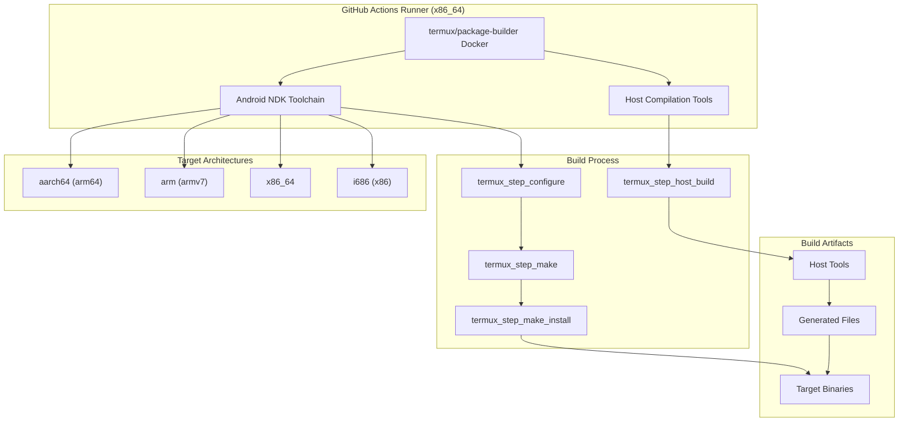
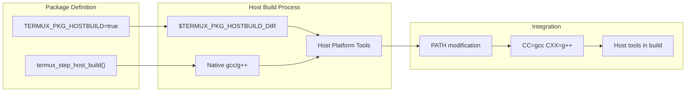
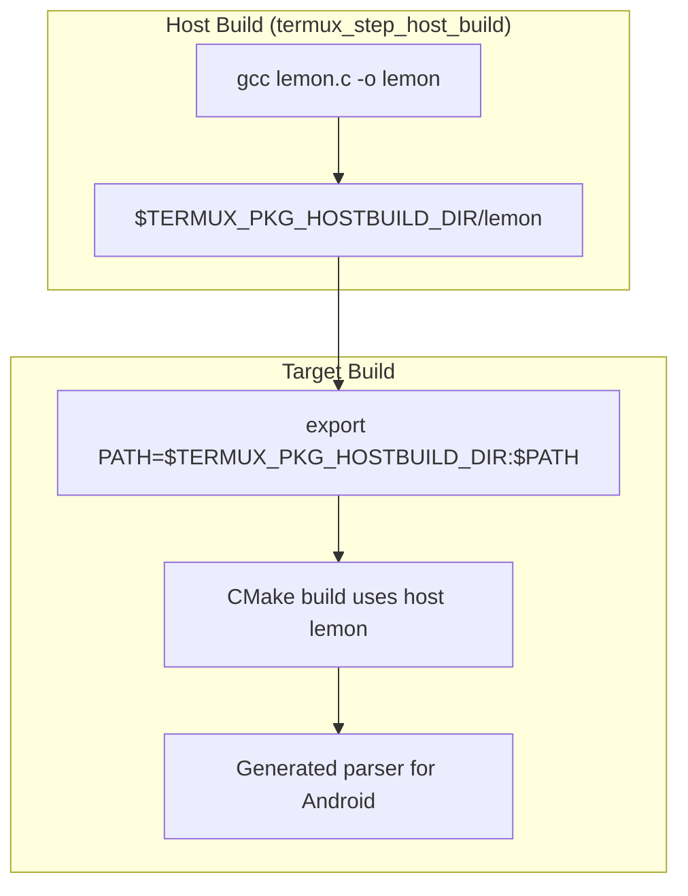
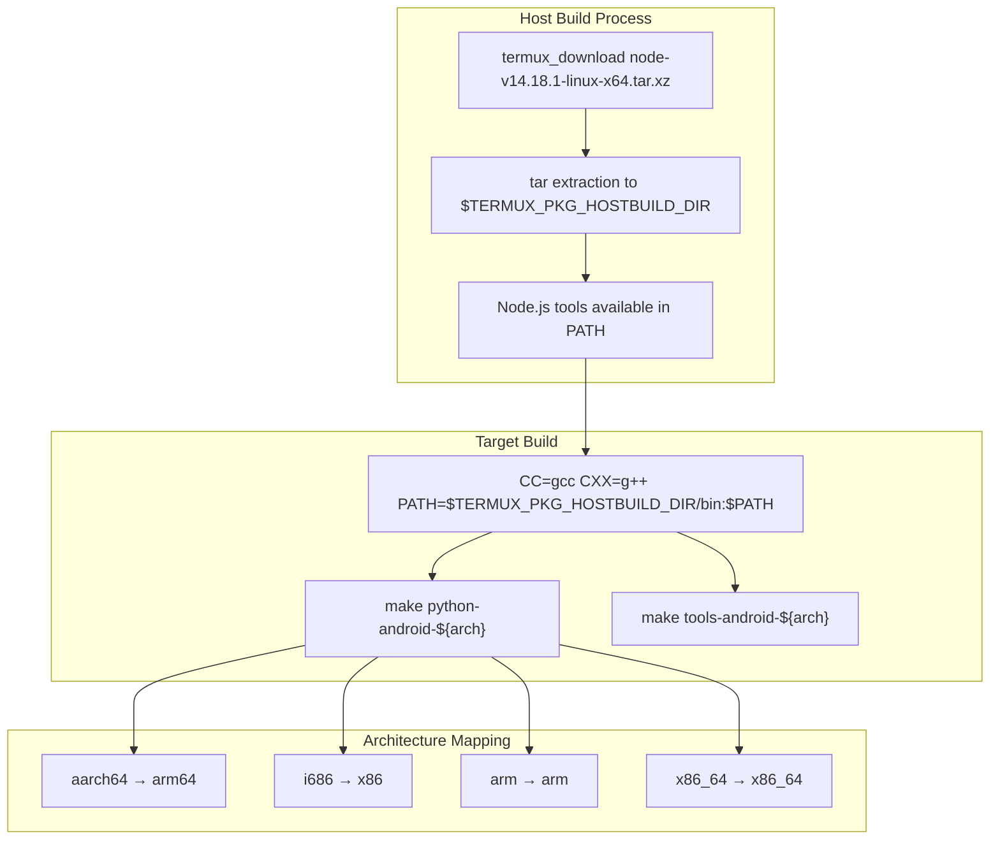
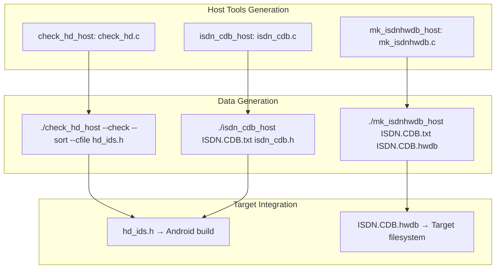
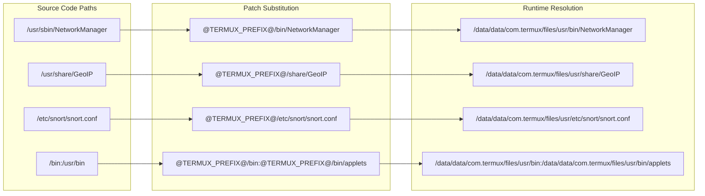
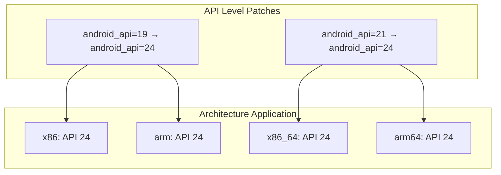
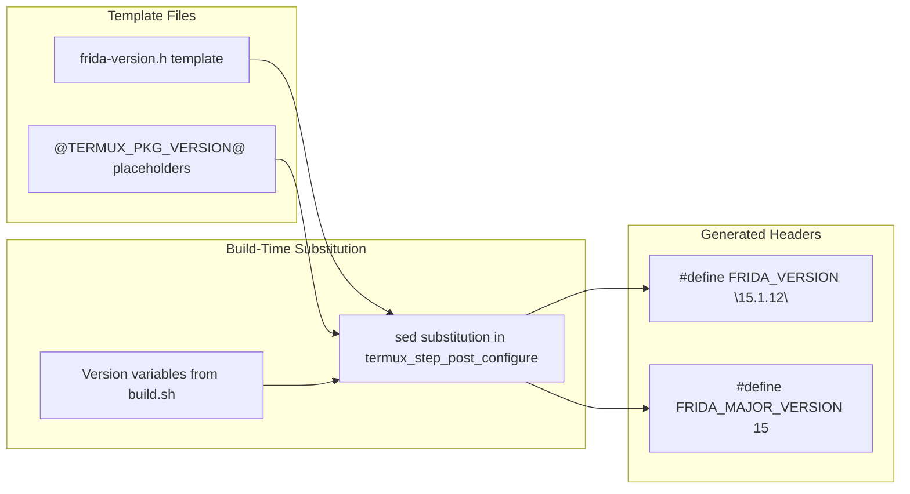

<!-- source: DeepWiki mcp.deepwiki.com · repo termux/termux-root-packages · page 2.2 Cross-Compilation and Host Builds · fetched 2026-10-26 -->

# Cross-Compilation and Host Builds

Relevant source files

The following files were used as context for generating this wiki page:

- [packages/frida-server/Makefile.linux.mk.patch](packages/frida-server/Makefile.linux.mk.patch)
- [packages/frida-server/build.sh](packages/frida-server/build.sh)
- [packages/frida-server/frida-version.patch](packages/frida-server/frida-version.patch)
- [packages/frida-server/ndk_version.patch](packages/frida-server/ndk_version.patch)
- [packages/frida-server/setup-env.sh.patch](packages/frida-server/setup-env.sh.patch)
- [packages/hwinfo/Makefile.patch](packages/hwinfo/Makefile.patch)
- [packages/hwinfo/build.sh](packages/hwinfo/build.sh)
- [packages/hwinfo/src-hd-bios.c.patch](packages/hwinfo/src-hd-bios.c.patch)
- [packages/hwinfo/src-hd-mdt.c.patch](packages/hwinfo/src-hd-mdt.c.patch)
- [packages/hwinfo/src-hd-sys.c.patch](packages/hwinfo/src-hd-sys.c.patch)
- [packages/hwinfo/src-ids-Makefile.patch](packages/hwinfo/src-ids-Makefile.patch)
- [packages/hwinfo/src-isdn-cdb-Makefile.patch](packages/hwinfo/src-isdn-cdb-Makefile.patch)
- [packages/hwinfo/src-isdn-isa-probe.c.patch](packages/hwinfo/src-isdn-isa-probe.c.patch)
- [packages/tshark/build.sh](packages/tshark/build.sh)
- [packages/tshark/caputils-ws80211.c.patch](packages/tshark/caputils-ws80211.c.patch)
- [packages/tshark/paths.patch](packages/tshark/paths.patch)

This document explains the cross-compilation infrastructure and host build system used in termux-root-packages to build Android-compatible packages from x86_64 host systems. It covers the mechanisms for building both host tools and target binaries within the same package build process.

For information about the overall build system architecture, see [Build System Architecture](#2). For details about package definition syntax, see [Package Definition System](#2.1).

## Cross-Compilation Architecture

The termux-root-packages repository employs a sophisticated cross-compilation system that builds packages for Android target architectures from GitHub Actions runners. The system handles both simple cross-compilation scenarios and complex builds requiring host-side tool generation.

### Cross-Compilation Flow

**Sources:** [packages/frida-server/build.sh:1-94](), [packages/tshark/build.sh:1-26](), [packages/hwinfo/build.sh:1-28]()

## Host Build System

The host build system allows packages to compile tools that run on the build host (x86_64 Linux) during the package build process. This is essential for packages that need to generate data files, parse configuration, or build code generators before creating the final Android binaries.

### Host Build Configuration

Packages enable host builds by setting `TERMUX_PKG_HOSTBUILD=true` and implementing the `termux_step_host_build()` function:

**Sources:** [packages/frida-server/build.sh:14](), [packages/tshark/build.sh:17](), [packages/frida-server/build.sh:27-33](), [packages/tshark/build.sh:19-21]()

### Host Build Examples

#### Tshark Lemon Parser

The tshark package demonstrates a simple host build pattern where a parser generator is compiled for the host system:

**Sources:** [packages/tshark/build.sh:19-25]()

#### Frida Node.js Integration

The frida-server package shows a complex host build that downloads and integrates Node.js:

**Sources:** [packages/frida-server/build.sh:27-33](), [packages/frida-server/build.sh:44-55]()

## Hardware Info Data Generation

The hwinfo package demonstrates host-based data generation where specialized tools create platform-specific data files:

**Sources:** [packages/hwinfo/src-ids-Makefile.patch:8-21](), [packages/hwinfo/src-isdn-cdb-Makefile.patch:28-57]()

## Path Remapping and Environment Handling

Cross-compilation requires extensive path remapping to ensure that hardcoded paths in source code point to the correct Termux filesystem locations rather than standard Linux paths.

### Path Substitution System

**Sources:** [packages/tshark/paths.patch:8-76](), [packages/frida-server/build.sh:22-24]()

## Architecture-Specific Build Handling

The cross-compilation system maps Termux architecture names to target-specific build configurations:

### Architecture Mapping

| Termux Architecture | Target Name | Android ABI | NDK Target |
|-------------------|-------------|-------------|------------|
| `aarch64` | `arm64` | `arm64-v8a` | `aarch64-none-linux-android24` |
| `arm` | `arm` | `armeabi-v7a` | `armv7-none-linux-androideabi24` |
| `x86_64` | `x86_64` | `x86_64` | `x86_64-none-linux-android24` |
| `i686` | `x86` | `x86` | `i686-none-linux-android24` |

**Sources:** [packages/frida-server/build.sh:44-50](), [packages/frida-server/setup-env.sh.patch:1-39]()

### Android API Level Management

Cross-compilation patches ensure consistent Android API level targeting across all architectures, typically standardizing on API level 24 for compatibility:

**Sources:** [packages/frida-server/setup-env.sh.patch:7-35]()

## Version and Build Metadata Handling

Complex packages require build-time generation of version headers and metadata files that embed package version information:

**Sources:** [packages/frida-server/build.sh:35-41](), [packages/frida-server/frida-version.patch:1-16]()

---

