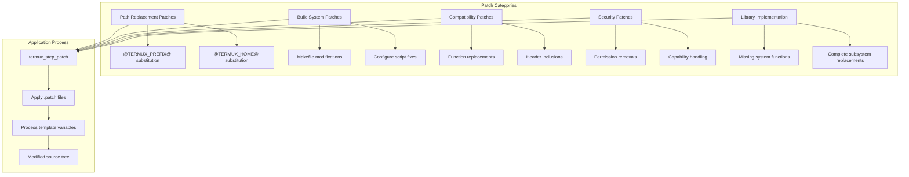
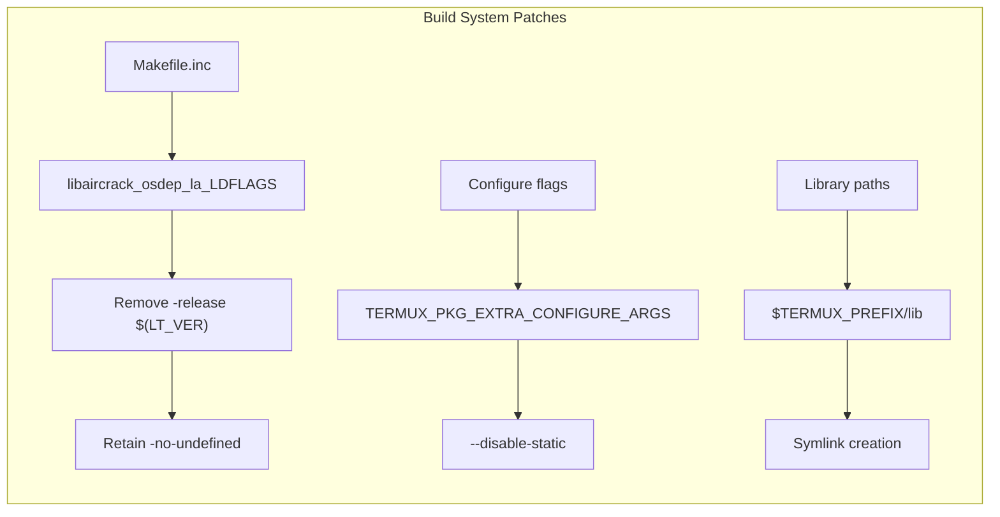
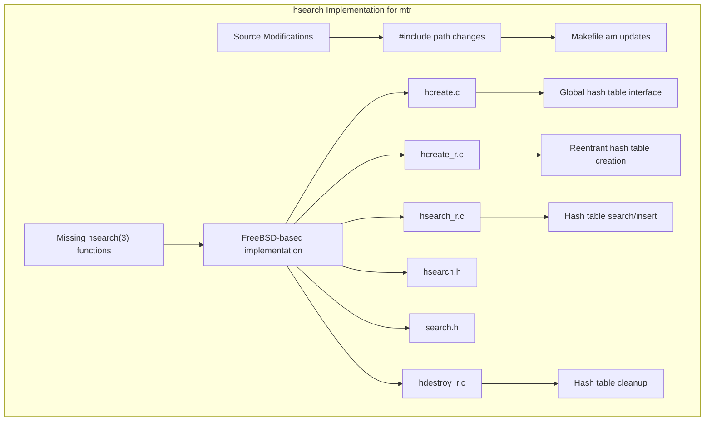
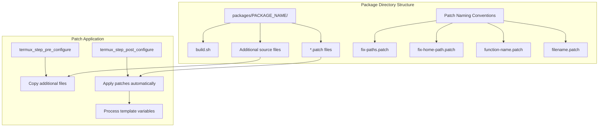

<!-- source: DeepWiki mcp.deepwiki.com · repo termux/termux-root-packages · page 2.3 Patching System · fetched 2026-10-26 -->

# Patching System

<details>
<summary>Relevant source files</summary>

The following files were used as context for generating this wiki page:

- [packages/aircrack-ng/build.sh](packages/aircrack-ng/build.sh)
- [packages/aircrack-ng/osdep-find-lib-fix.patch](packages/aircrack-ng/osdep-find-lib-fix.patch)
- [packages/bettercap/build.sh](packages/bettercap/build.sh)
- [packages/bettercap/fix-home-path.patch](packages/bettercap/fix-home-path.patch)
- [packages/bettercap/fix-paths.patch](packages/bettercap/fix-paths.patch)
- [packages/mtr/build.sh](packages/mtr/build.sh)
- [packages/mtr/hsearch.patch](packages/mtr/hsearch.patch)
- [packages/mtr/hsearch/README.md](packages/mtr/hsearch/README.md)
- [packages/mtr/hsearch/hcreate.c](packages/mtr/hsearch/hcreate.c)
- [packages/mtr/hsearch/hcreate_r.c](packages/mtr/hsearch/hcreate_r.c)
- [packages/mtr/hsearch/hdestroy_r.c](packages/mtr/hsearch/hdestroy_r.c)
- [packages/mtr/hsearch/hsearch.h](packages/mtr/hsearch/hsearch.h)
- [packages/mtr/hsearch/hsearch_r.c](packages/mtr/hsearch/hsearch_r.c)
- [packages/mtr/hsearch/search.h](packages/mtr/hsearch/search.h)
- [packages/mtr/index_to_strchr.patch](packages/mtr/index_to_strchr.patch)
- [packages/mtr/packet.c.patch](packages/mtr/packet.c.patch)

</details>


The Patching System modifies upstream source code to work correctly in the Termux environment. This system handles path adaptations, build system modifications, compatibility fixes, and security adjustments required for packages that need root access on Android.

For information about the overall build process that applies these patches, see [Build System Architecture](#2). For details about package definitions that reference patches, see [Package Definition System](#2.1).

## Patch Types and Application

The patching system supports several categories of modifications to upstream source code:



**Patch Application Workflow**

Sources: [packages/bettercap/fix-paths.patch:1-27](), [packages/mtr/packet.c.patch:1-19](), [packages/aircrack-ng/osdep-find-lib-fix.patch:1-12]()

## Path Templating System

The most common patch type replaces hardcoded Unix paths with Termux-specific template variables that are processed during the build:

| Template Variable | Purpose | Example Replacement |
|------------------|---------|-------------------|
| `@TERMUX_PREFIX@` | System installation prefix | `/data/data/com.termux/files/usr` |
| `@TERMUX_HOME@` | User home directory | `/data/data/com.termux/files/home` |

### Path Replacement Examples

**System Data Directories**
```diff
-	return "/usr/local/share/bettercap/"
+	return "@TERMUX_PREFIX@/share/bettercap/"
```

**User Configuration Files**
```diff
-		"~/.bettercap-ca.cert.pem",
+		"@TERMUX_HOME@/.bettercap-ca.cert.pem",
```

Sources: [packages/bettercap/fix-paths.patch:9-10](), [packages/bettercap/fix-home-path.patch:9-10]()

## Build System Modifications

Build system patches modify compilation flags, library linking, and configuration options to work with the Termux cross-compilation environment:



**Library Linking Modifications**
The `libaircrack-osdep` library linking is modified to remove version-specific flags while maintaining undefined symbol checking:

```diff
-libaircrack_osdep_la_LDFLAGS = -release $(LT_VER) -no-undefined
+libaircrack_osdep_la_LDFLAGS = -no-undefined
```

Sources: [packages/aircrack-ng/osdep-find-lib-fix.patch:7-8](), [packages/aircrack-ng/build.sh:14]()

## Compatibility and Security Patches

### Function Compatibility

Legacy function calls are replaced with modern equivalents for Android compatibility:

```diff
-    if (index(format, 'N')) {
+    if (strchr(format, 'N')) {
```

```diff
-        end_of_reply = index(reply_start, '\n');
+        end_of_reply = strchr(reply_start, '\n');
```

### Security Modifications

Patches remove problematic privilege operations that don't work correctly in the Android environment:

```diff
-    /*  Drop any suid permissions granted  */
-    if (setgid(getgid()) || setuid(getuid())) {
-        return -1;
-    }
-
-    if (geteuid() != getuid() || getegid() != getgid()) {
-        return -1;
-    }
```

Sources: [packages/mtr/index_to_strchr.patch:7-8](), [packages/mtr/packet.c.patch:7-15]()

## Complete Library Implementations

For packages missing required system libraries, the patching system can include complete implementations:



**Integration Process**

The `mtr` package demonstrates complex patching where an entire subsystem is replaced:

1. **Source file integration**: Hash table implementation files are copied from the package's `hsearch/` directory
2. **Header path modification**: `#include <search.h>` becomes `#include "portability/search.h"`
3. **Build system updates**: `Makefile.am` is modified to include the new source files

```diff
+mtr_SOURCES += \
+	portability/hcreate.c \
+	portability/hcreate_r.c \
+	portability/hsearch_r.c \
+	portability/hdestroy_r.c
```

Sources: [packages/mtr/hsearch.patch:7-8](), [packages/mtr/hsearch.patch:18-23](), [packages/mtr/build.sh:13]()

## Patch Organization and Naming

Patches are stored alongside package definitions and follow consistent naming patterns:



**Automatic Patch Detection**

The build system automatically applies all `.patch` files found in the package directory. Complex packages may also copy additional source files during the pre-configure step:

```bash
termux_step_pre_configure() {
    cp ${TERMUX_PKG_BUILDER_DIR}/hsearch/* ${TERMUX_PKG_SRCDIR}/portability
}
```

Sources: [packages/mtr/build.sh:13](), [packages/bettercap/fix-paths.patch:1](), [packages/bettercap/fix-home-path.patch:1]()

---

