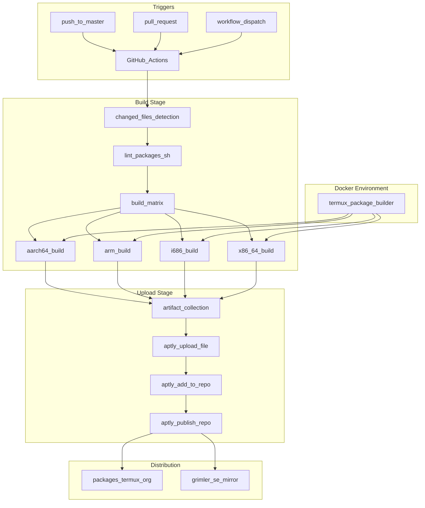
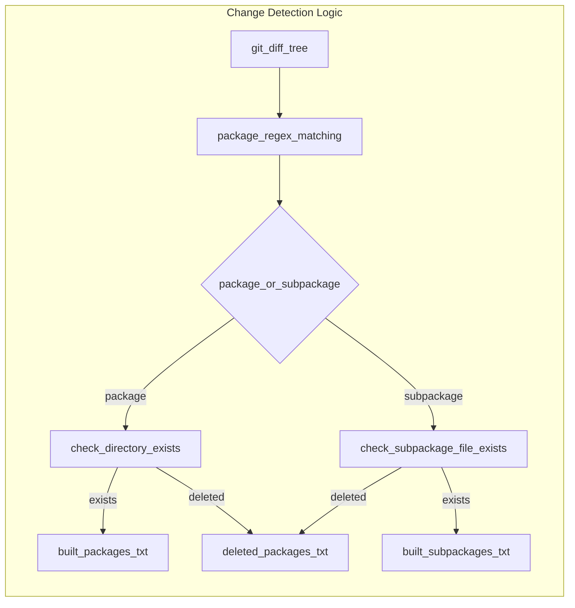
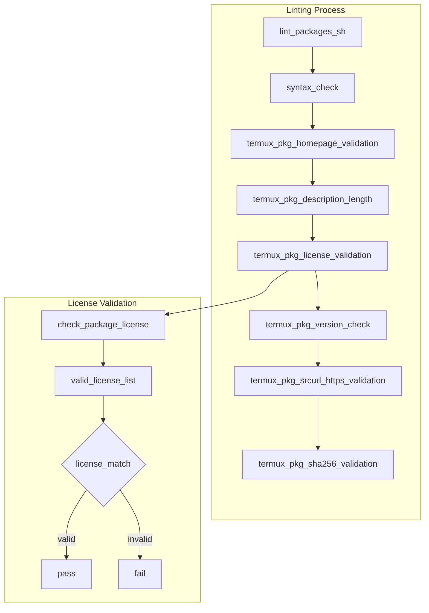
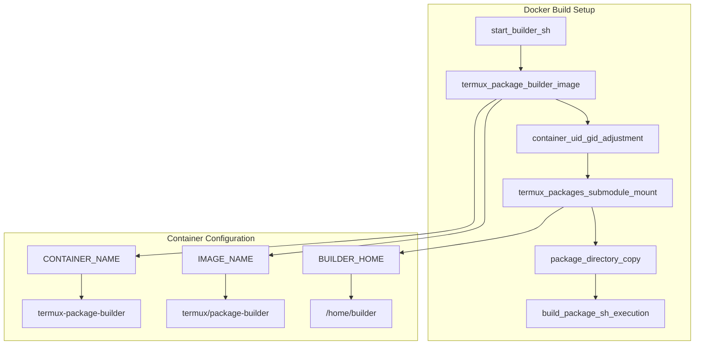
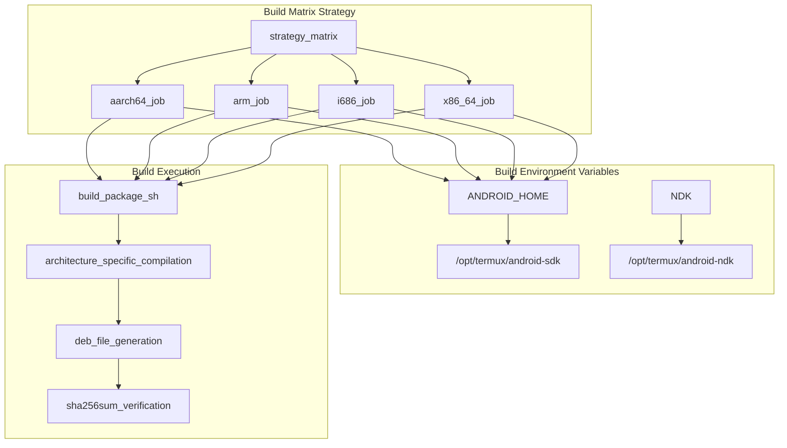
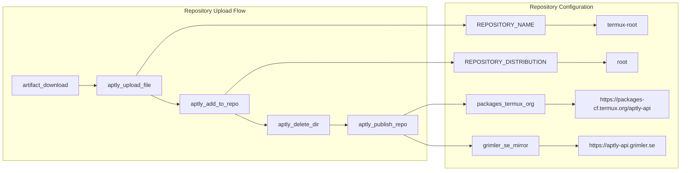
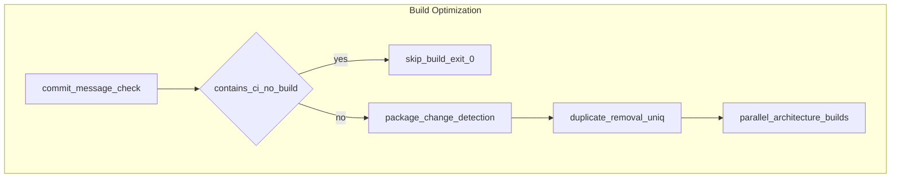

<!-- source: DeepWiki mcp.deepwiki.com · repo termux/termux-root-packages · page 3 CI/CD Pipeline · fetched 2026-10-26 -->

# CI/CD Pipeline

Relevant source files

The following files were used as context for generating this wiki page:

- [.github/static/powered-by-fosshost.png](.github/static/powered-by-fosshost.png)
- [.github/workflows/packages.yml](.github/workflows/packages.yml)
- [CONTRIBUTING.md](CONTRIBUTING.md)
- [README.md](README.md)
- [scripts/lint-packages.sh](scripts/lint-packages.sh)
- [start-builder.sh](start-builder.sh)

This document describes the automated build and distribution system for the termux-root-packages repository. The CI/CD pipeline handles building packages across multiple Android architectures, validates package definitions, and distributes compiled packages to APT repositories.

For information about package definition and build system architecture, see [Build System Architecture](#2). For details about individual package categories, see [Package Categories](#4).

## Pipeline Architecture Overview

The CI/CD system uses GitHub Actions to orchestrate a multi-stage pipeline that detects changes, builds packages, and distributes them to public repositories.

### High-Level Pipeline Flow

Sources: [.github/workflows/packages.yml:1-237]()

### Build Trigger System

The pipeline activates under three conditions with different file change detection strategies:

| Trigger Type | Condition | File Detection |
|--------------|-----------|----------------|
| `push` | Push to master branch with changes in `packages/**` | Git diff-tree analysis |
| `pull_request` | PR with changes in `packages/**` | Base commit to HEAD comparison |
| `workflow_dispatch` | Manual trigger with package list | User-specified packages |

The change detection logic implements sophisticated git analysis to identify modified, added, and deleted packages:

Sources: [.github/workflows/packages.yml:35-103]()

## Build Process Flow

### Package Linting System

Before compilation, all modified packages undergo validation through the `lint-packages.sh` script:

The linting system validates over 20 different package metadata fields including required fields like `TERMUX_PKG_HOMEPAGE`, `TERMUX_PKG_DESCRIPTION`, and `TERMUX_PKG_LICENSE`.

Sources: [scripts/lint-packages.sh:53-433]()

### Docker Build Environment

The build process utilizes a containerized environment managed by `start-builder.sh`:

The container setup includes automatic UID/GID mapping to prevent permission issues and mounts the termux-packages submodule for build infrastructure access.

Sources: [start-builder.sh:20-98]()

## Architecture Matrix Build System

### Multi-Architecture Support

The pipeline builds packages simultaneously across four Android architectures:

Each architecture job runs independently with `fail-fast: false` to ensure all architectures attempt building even if one fails.

Sources: [.github/workflows/packages.yml:24-27](), [.github/workflows/packages.yml:119-122]()

## Package Distribution System

### Aptly Repository Management

The upload process uses the Aptly API to manage package repositories:

The system uploads to two repository endpoints: the primary `packages.termux.org` and the `grimler.se` mirror, with the primary repository supporting automatic GPG signing.

Sources: [.github/workflows/packages.yml:154-236]()

### Upload Process Implementation

The upload job implements robust error handling and artifact processing:

| Step | Function | Purpose |
|------|----------|---------|
| Artifact Download | `actions/download-artifact@v2` | Collect build artifacts from all architectures |
| File Extraction | `tar xf "$archive"` | Extract .deb files from compressed archives |
| Batch Upload | `aptly_upload_file` | Upload files to temporary directory |
| Repository Integration | `aptly_add_to_repo` | Add packages to repository |
| Publication | `aptly_publish_repo` | Make changes visible in web root |

The process handles both regular packages and static variants using glob patterns: `debs/${package}_*.deb` and `debs/${package}-static_*.deb`.

Sources: [.github/workflows/packages.yml:167-195]()

## Build Optimization Features

### Conditional Build Logic

The pipeline includes several optimization mechanisms:

- **No-build tag**: Commits with `%ci:no-build` in the message skip building
- **Duplicate detection**: Package lists are deduplicated using `uniq`
- **Incremental builds**: Only changed packages are rebuilt
- **Parallel execution**: Architecture builds run concurrently

Sources: [.github/workflows/packages.yml:59-65](), [.github/workflows/packages.yml:105-117]()

### Artifact Management

Built packages are archived and stored using GitHub Actions artifacts with architecture-specific naming:

- Artifact name pattern: `termux-root-packages-${arch}-${github.sha}`
- Archive format: `debs-${arch}-${github.sha}.tar`
- Checksum generation: SHA256 verification for all `.deb` files

Sources: [.github/workflows/packages.yml:133-141]()

---

