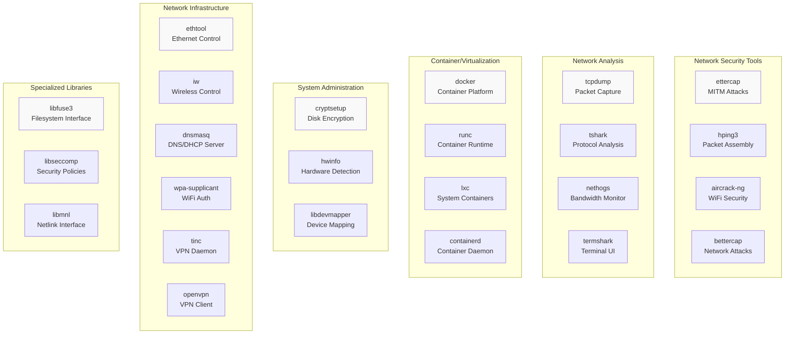
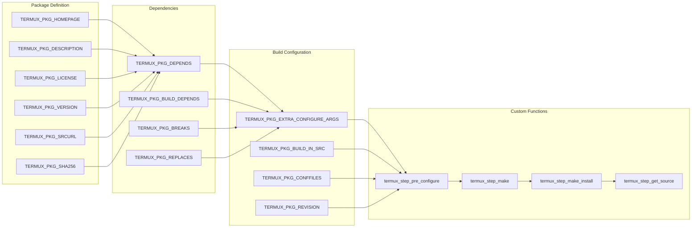

<!-- source: DeepWiki mcp.deepwiki.com · repo termux/termux-root-packages · page 4 Package Categories · fetched 2026-10-26 -->

# Package Categories

Relevant source files

The following files were used as context for generating this wiki page:

- [packages/cryptsetup/build.sh](packages/cryptsetup/build.sh)
- [packages/dnsmasq/Makefile.patch](packages/dnsmasq/Makefile.patch)
- [packages/dnsmasq/build.sh](packages/dnsmasq/build.sh)
- [packages/dnsmasq/dnsmasq.h.patch](packages/dnsmasq/dnsmasq.h.patch)
- [packages/docker/build.sh](packages/docker/build.sh)
- [packages/docker/config.go.patch](packages/docker/config.go.patch)
- [packages/docker/daemon.json](packages/docker/daemon.json)
- [packages/docker/database.go.patch](packages/docker/database.go.patch)
- [packages/docker/generate-man.sh.patch](packages/docker/generate-man.sh.patch)
- [packages/docker/md2man-all.sh.patch](packages/docker/md2man-all.sh.patch)
- [packages/ethtool/build.sh](packages/ethtool/build.sh)
- [packages/ettercap/build.sh](packages/ettercap/build.sh)
- [packages/hping3/build.sh](packages/hping3/build.sh)
- [packages/iw/build.sh](packages/iw/build.sh)
- [packages/libfuse3/build.sh](packages/libfuse3/build.sh)
- [packages/tcpdump/build.sh](packages/tcpdump/build.sh)
- [packages/tcpdump/configure.patch](packages/tcpdump/configure.patch)
- [packages/tinc/build.sh](packages/tinc/build.sh)
- [packages/tinc/fix-tun-device-path.patch](packages/tinc/fix-tun-device-path.patch)
- [packages/wpa-supplicant/build.sh](packages/wpa-supplicant/build.sh)

This document provides an overview of the different types of packages available in the termux-root-packages repository, organized by functional area. These packages require root access to function properly and are designed to provide system-level tools, network security utilities, and container/virtualization capabilities for Android devices running Termux.

For detailed information about building and contributing packages, see [Development and Contribution Guide](#5). For advanced build patterns and custom compilation scenarios, see [Advanced Build Patterns](#6).

## Package Category Overview

The termux-root-packages repository contains specialized packages organized into six main functional categories, each serving distinct system administration and security purposes.

### Category Classification Diagram

Sources: [packages/ettercap/build.sh:1-15](), [packages/hping3/build.sh:1-12](), [packages/tcpdump/build.sh:1-12](), [packages/docker/build.sh:1-18](), [packages/cryptsetup/build.sh:1-15](), [packages/ethtool/build.sh:1-9](), [packages/iw/build.sh:1-10](), [packages/dnsmasq/build.sh:1-9](), [packages/wpa-supplicant/build.sh:1-12](), [packages/tinc/build.sh:1-14](), [packages/libfuse3/build.sh:1-18]()

## Package Dependency Relationships

The packages within termux-root-packages have complex interdependencies, with specialized libraries providing core functionality for higher-level tools.

### Dependency Graph

```mermaid
graph TD
    subgraph "Core Libraries"
        libpcap["libpcap<br/>Packet Capture"]
        libdevmapper["libdevmapper<br/>Device Mapping"]
        libfuse3["libfuse3<br/>Filesystem Interface"]
        libmnl["libmnl<br/>Netlink Library"]
        openssl["openssl<br/>Cryptography"]
    end
    
    subgraph "Network Analysis Tools"
        tcpdump["TERMUX_PKG_DEPENDS<br/>tcpdump"]
        ettercap["TERMUX_PKG_DEPENDS<br/>ettercap"]
        hping3["TERMUX_PKG_DEPENDS<br/>hping3"]
    end
    
    subgraph "Container Tools"
        docker["TERMUX_PKG_DEPENDS<br/>docker"]
        containerd["containerd<br/>Container Runtime"]
    end
    
    subgraph "System Tools"
        cryptsetup["TERMUX_PKG_DEPENDS<br/>cryptsetup"]
        ethtool["TERMUX_PKG_DEPENDS<br/>ethtool"]
        iw["TERMUX_PKG_DEPENDS<br/>iw"]
    end
    
    subgraph "Network Infrastructure"
        tinc["TERMUX_PKG_DEPENDS<br/>tinc"]
        wpasupplicant["TERMUX_PKG_DEPENDS<br/>wpa-supplicant"]
    end
    
    libpcap --> tcpdump
    libpcap --> ettercap
    libpcap --> hping3
    libdevmapper --> docker
    libdevmapper --> cryptsetup
    libmnl --> ethtool
    libmnl --> iw
    openssl --> tcpdump
    openssl --> ettercap
    openssl --> cryptsetup
    openssl --> tinc
    openssl --> wpasupplicant
    containerd --> docker
    
    style libpcap fill:#f0f0f0
    style libdevmapper fill:#f0f0f0
    style openssl fill:#f0f0f0
```

Sources: [packages/tcpdump/build.sh:11](), [packages/ettercap/build.sh:9](), [packages/hping3/build.sh:10](), [packages/docker/build.sh:14](), [packages/cryptsetup/build.sh:9](), [packages/ethtool/build.sh:8](), [packages/iw/build.sh:8](), [packages/tinc/build.sh:9](), [packages/wpa-supplicant/build.sh:8]()

## Build Configuration Patterns

Each package category follows specific build configuration patterns defined through `TERMUX_PKG_*` variables and custom build functions.

### Build Configuration Structure

| Package Category | Common Dependencies | Build Patterns | Configuration Args |
|------------------|-------------------|-----------------|-------------------|
| Network Security | `libpcap`, `openssl`, `ncurses` | Custom patches, complex compilation | Security-focused builds |
| Network Analysis | `libpcap`, `openssl` | Protocol support, cross-compilation | Linux kernel version handling |
| Container/Virtualization | `libdevmapper`, `golang` | Multi-stage builds, path remapping | Android-specific adaptations |
| System Administration | `libdevmapper`, `util-linux` | Hardware detection, encryption | Secure configuration |
| Network Infrastructure | `libnl`, `openssl` | Wireless/ethernet support | Device path adaptations |
| Specialized Libraries | Various system libs | Core functionality | Minimal configuration |

Sources: [packages/ettercap/build.sh:9-14](), [packages/tcpdump/build.sh:9-11](), [packages/docker/build.sh:14-17](), [packages/cryptsetup/build.sh:9-14](), [packages/ethtool/build.sh:8](), [packages/libfuse3/build.sh:10-17]()

### TERMUX_PKG Variables Usage

Sources: [packages/cryptsetup/build.sh:1-18](), [packages/docker/build.sh:1-17](), [packages/ethtool/build.sh:1-9](), [packages/dnsmasq/build.sh:1-9](), [packages/libfuse3/build.sh:1-17]()

## Category-Specific Details

### Network Security Tools

These packages focus on network security testing, penetration testing, and security analysis capabilities.

**Key Packages:**
- `ettercap`: MITM attack suite with content filtering
- `hping3`: TCP/IP packet assembler/analyzer 
- `aircrack-ng`: WiFi security auditing
- `bettercap`: Network reconnaissance and attacks

**Common Dependencies:** `libpcap`, `openssl`, `ncurses`, `libnet`

Sources: [packages/ettercap/build.sh:1-15](), [packages/hping3/build.sh:1-17]()

### Network Analysis and Monitoring

Packages for network traffic analysis, packet capture, and network diagnostics.

**Key Packages:**
- `tcpdump`: Command-line packet analyzer
- `tshark`: Wireshark command-line interface
- `nethogs`: Per-process bandwidth monitoring
- `termshark`: Terminal UI for packet analysis

**Build Characteristics:** Require Linux kernel version detection and protocol support

Sources: [packages/tcpdump/build.sh:1-12]()

### Container and Virtualization

Container runtime and virtualization tools requiring complex build processes.

**Key Packages:**
- `docker`: Complete container platform with daemon and CLI
- `runc`: Container runtime specification implementation
- `lxc`: System container management
- `containerd`: Container runtime daemon

**Build Complexity:** Multi-stage builds, Go compilation, path remapping

Sources: [packages/docker/build.sh:1-145]()

### System Administration Tools

Low-level system administration utilities for hardware and storage management.

**Key Packages:**
- `cryptsetup`: LUKS disk encryption management
- `hwinfo`: Hardware detection and information
- `libdevmapper`: Device mapper library for LVM/RAID

**Configuration Focus:** Secure defaults and Android-specific adaptations

Sources: [packages/cryptsetup/build.sh:1-18]()

### Network Infrastructure

Network interface management and infrastructure services.

**Key Packages:**
- `ethtool`: Ethernet interface control
- `iw`: Wireless interface configuration
- `dnsmasq`: Lightweight DNS/DHCP server
- `wpa-supplicant`: WPA wireless authentication
- `tinc`: Mesh VPN daemon
- `openvpn`: OpenVPN client/server

**Device Adaptations:** Android-specific device paths and interface handling

Sources: [packages/ethtool/build.sh:1-9](), [packages/iw/build.sh:1-10](), [packages/dnsmasq/build.sh:1-9](), [packages/wpa-supplicant/build.sh:1-22](), [packages/tinc/build.sh:1-14]()

### Specialized Libraries

Core system libraries providing fundamental functionality for other packages.

**Key Packages:**
- `libfuse3`: FUSE filesystem interface
- `libseccomp`: Security policy enforcement
- `libmnl`: Netlink socket library
- `libdevmapper`: Device mapping interface

**Role:** Foundation libraries with minimal configuration requirements

Sources: [packages/libfuse3/build.sh:1-18]()

---

