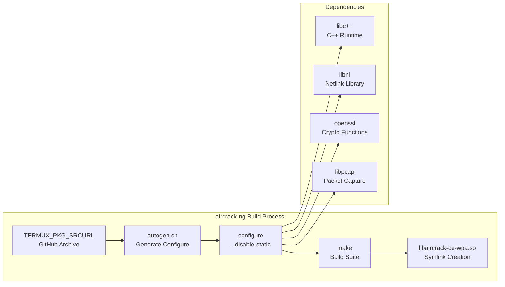
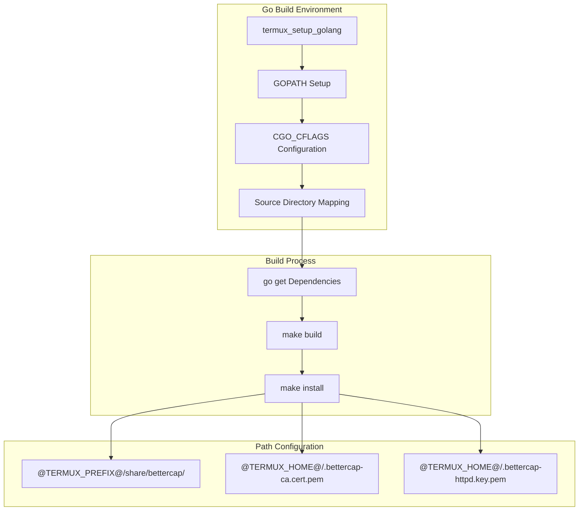
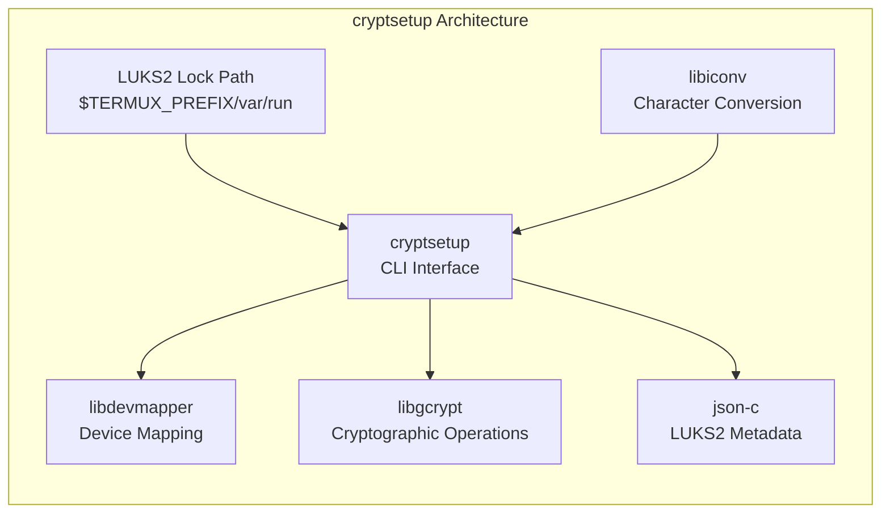
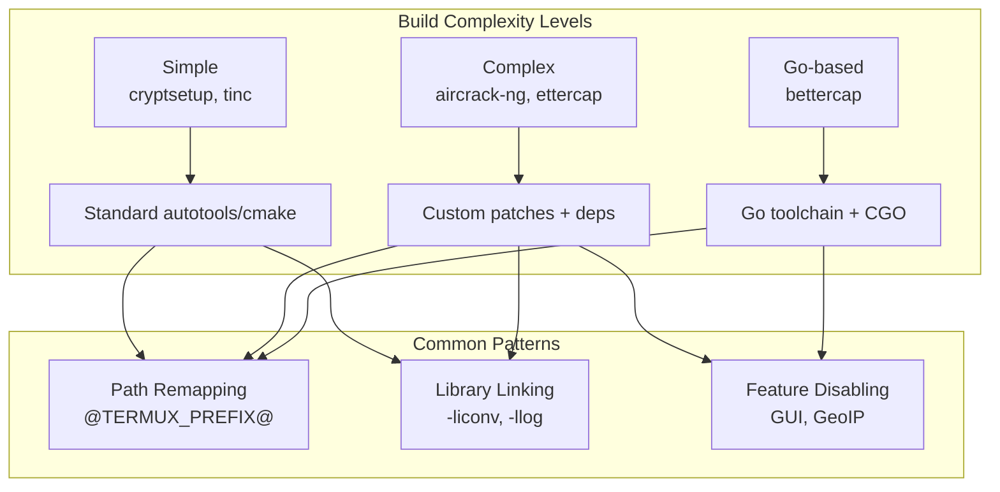

<!-- source: DeepWiki mcp.deepwiki.com · repo termux/termux-root-packages · page 4.1 Network Security Tools · fetched 2026-10-26 -->

# Network Security Tools

Relevant source files

The following files were used as context for generating this wiki page:

- [packages/aircrack-ng/build.sh](packages/aircrack-ng/build.sh)
- [packages/aircrack-ng/osdep-find-lib-fix.patch](packages/aircrack-ng/osdep-find-lib-fix.patch)
- [packages/bettercap/build.sh](packages/bettercap/build.sh)
- [packages/bettercap/fix-home-path.patch](packages/bettercap/fix-home-path.patch)
- [packages/bettercap/fix-paths.patch](packages/bettercap/fix-paths.patch)
- [packages/cryptsetup/build.sh](packages/cryptsetup/build.sh)
- [packages/ettercap/build.sh](packages/ettercap/build.sh)
- [packages/tcpdump/build.sh](packages/tcpdump/build.sh)
- [packages/tcpdump/configure.patch](packages/tcpdump/configure.patch)
- [packages/tinc/build.sh](packages/tinc/build.sh)
- [packages/tinc/fix-tun-device-path.patch](packages/tinc/fix-tun-device-path.patch)
- [packages/wpa-supplicant/build.sh](packages/wpa-supplicant/build.sh)

This document covers network security tools available in the termux-root-packages repository that require root privileges for network interface manipulation, packet injection, and low-level network operations. These tools are primarily focused on wireless security auditing, man-in-the-middle (MITM) attacks, and network reconnaissance.

For network monitoring and analysis tools like packet capture utilities, see [Network Analysis and Monitoring](#4.2). For VPN and network infrastructure tools, see [Network Infrastructure](#4.5).

## Tool Categories and Architecture

The network security tools in this repository fall into several functional categories, each with specific dependency requirements and build patterns:

```mermaid
graph TB
    subgraph "Wireless Security Auditing"
        A["aircrack-ng<br/>WiFi Security Suite"] --> B["libpcap<br/>Packet Capture"]
        A --> C["openssl<br/>Cryptography"]
        A --> D["libnl<br/>Netlink Interface"]
        
        E["wpa-supplicant<br/>WPA Key Negotiation"] --> C
        E --> F["readline<br/>CLI Interface"]
        E --> D
    end
    
    subgraph "MITM Attack Tools"
        G["bettercap<br/>Network Reconnaissance"] --> B
        G --> H["libusb<br/>USB Device Access"]
        G --> I["libnetfilter-queue<br/>Packet Filtering"]
        
        J["ettercap<br/>MITM Attack Suite"] --> B
        J --> C
        J --> K["libnet<br/>Packet Construction"]
        J --> L["pcre<br/>Pattern Matching"]
        J --> M["ethtool<br/>Interface Control"]
    end
    
    subgraph "Encryption and VPN"
        N["cryptsetup<br/>Disk Encryption"] --> O["libdevmapper<br/>Device Mapping"]
        N --> P["libgcrypt<br/>Cryptography"]
        N --> C
        
        Q["tinc<br/>VPN Daemon"] --> C
        Q --> R["liblzo<br/>Compression"]
    end
    
    style A fill:#ffebee
    style G fill:#e8f5e8
    style N fill:#e3f2fd
```

**Tool Dependencies and Build Architecture**

Sources: [packages/aircrack-ng/build.sh:10](), [packages/bettercap/build.sh:9](), [packages/ettercap/build.sh:9](), [packages/cryptsetup/build.sh:9](), [packages/wpa-supplicant/build.sh:8](), [packages/tinc/build.sh:9]()

## Wireless Security Tools

### aircrack-ng

The `aircrack-ng` package provides a comprehensive WiFi security auditing toolkit. The build configuration uses a git snapshot rather than a release version:

The build process includes a custom post-install step that creates a symbolic link for the WPA crypto engine library, addressing library naming compatibility issues in the Termux environment.

Sources: [packages/aircrack-ng/build.sh:1-23](), [packages/aircrack-ng/osdep-find-lib-fix.patch:1-12]()

### wpa-supplicant

The `wpa_supplicant` utility provides WPA/WPA2 key negotiation for wireless networks. The build uses a custom configuration approach:

| Build Parameter | Value | Purpose |
|----------------|-------|---------|
| `TERMUX_PKG_EXTRA_MAKE_ARGS` | `-C wpa_supplicant` | Build only supplicant component |
| `TERMUX_PKG_BUILD_IN_SRC` | true | Build within source directory |
| Configuration File | `defconfig` → `.config` | Use default feature set |

The build process copies the default configuration and sets custom compilation flags through the `EXTRA_CFLAGS` environment variable.

Sources: [packages/wpa-supplicant/build.sh:10-16]()

## MITM Attack and Reconnaissance Tools

### bettercap

The `bettercap` tool is implemented in Go and provides network reconnaissance and MITM attack capabilities. The build process demonstrates complex Go module handling:

Path remapping is critical for `bettercap` functionality, with patches modifying hardcoded paths to use Termux environment variables.

Sources: [packages/bettercap/build.sh:11-29](), [packages/bettercap/fix-paths.patch:9-23](), [packages/bettercap/fix-home-path.patch:9-35]()

### ettercap

The `ettercap` package provides comprehensive MITM attack capabilities with extensive library dependencies:

| Dependency Category | Libraries | Purpose |
|-------------------|-----------|---------|
| Network | `libpcap`, `libnet` | Packet capture and injection |
| Crypto | `openssl` | SSL/TLS operations |
| Pattern Matching | `pcre` | Traffic filtering |
| Interface Control | `ethtool` | Network interface manipulation |
| System | `ncurses`, `zlib`, `curl` | UI and data handling |

The CMake configuration explicitly disables GUI components (`-DENABLE_GTK=off`) and GeoIP functionality for the headless Termux environment.

Sources: [packages/ettercap/build.sh:9-14]()

## Encryption and VPN Security

### cryptsetup

The `cryptsetup` package enables LUKS disk encryption with device mapper integration:

The configuration includes Termux-specific paths for LUKS2 lock files and requires explicit iconv linking for character encoding support.

Sources: [packages/cryptsetup/build.sh:12-18]()

### tinc

The `tinc` VPN daemon provides mesh networking capabilities with minimal dependencies:

| Component | Dependency | Purpose |
|-----------|------------|---------|
| Compression | `liblzo` | Packet compression |
| Cryptography | `openssl` | Tunnel encryption |
| Compression | `zlib` | Additional compression |
| Logging | Android `liblog` | System logging integration |

The build includes Android-specific logging integration through the `LIBS="-llog"` configuration.

Sources: [packages/tinc/build.sh:9-13](), [packages/tinc/fix-tun-device-path.patch:128-129]()

## Build System Integration

Network security tools require specialized build handling due to their complex dependencies and cross-compilation requirements:

All network security tools require path remapping to function correctly in the Termux environment, with many requiring additional patches for Android-specific functionality.

Sources: [packages/bettercap/fix-paths.patch:1-27](), [packages/tcpdump/configure.patch:8-86](), [packages/tinc/fix-tun-device-path.patch:128-129](), [packages/cryptsetup/build.sh:16-18]()

---

