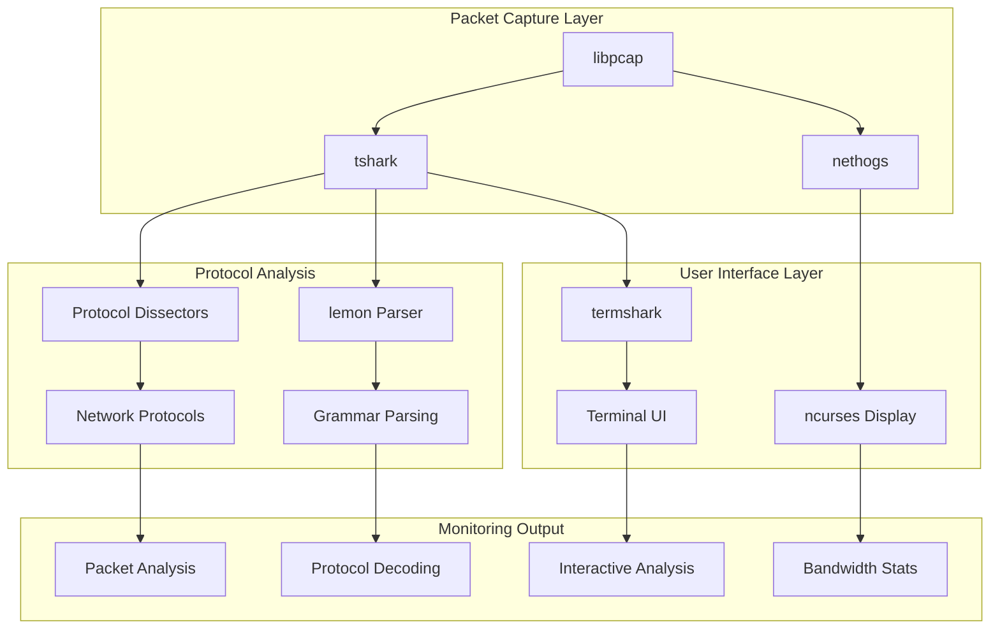
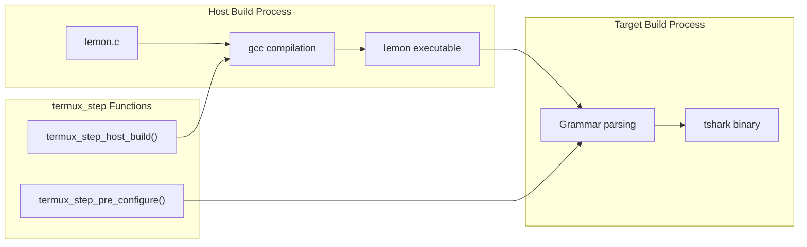
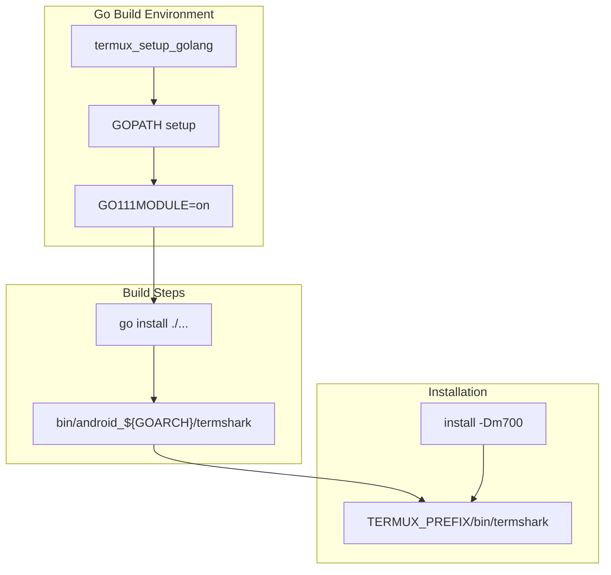
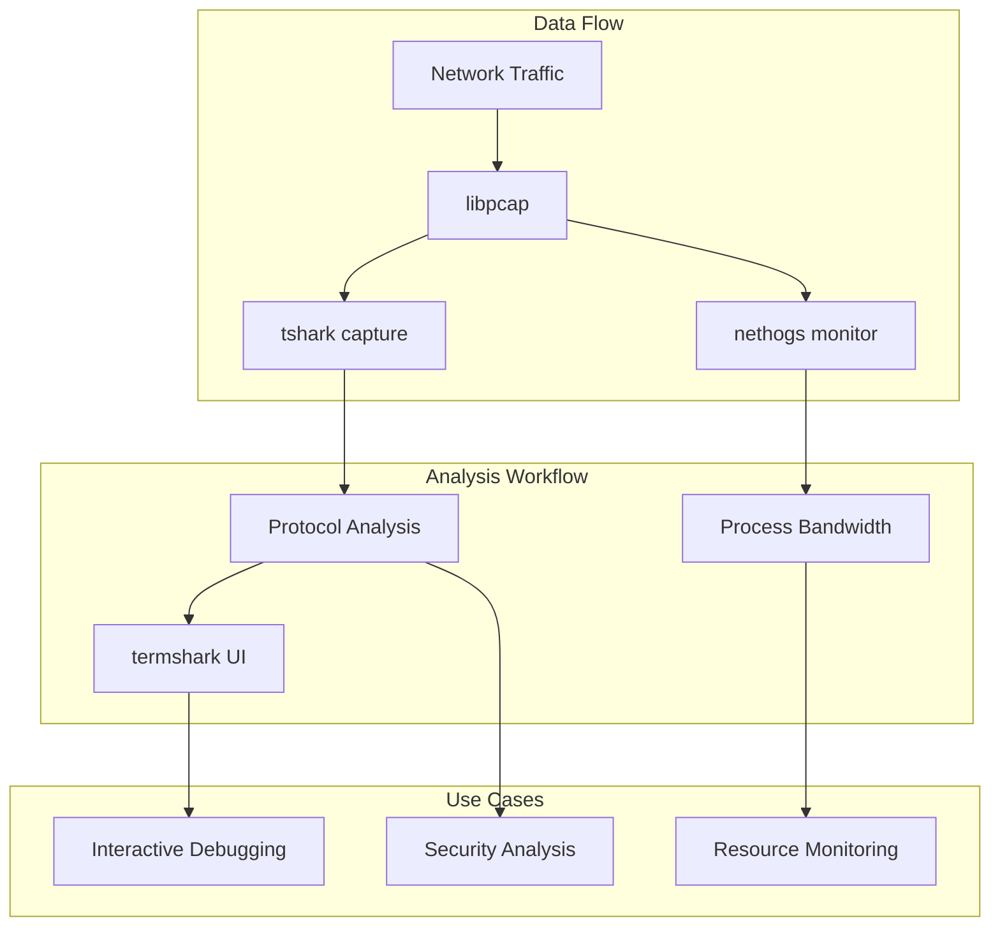

<!-- source: DeepWiki mcp.deepwiki.com · repo termux/termux-root-packages · page 4.2 Network Analysis and Monitoring · fetched 2026-10-26 -->

# Network Analysis and Monitoring

<details>
<summary>Relevant source files</summary>

The following files were used as context for generating this wiki page:

- [packages/nethogs/build.sh](packages/nethogs/build.sh)
- [packages/termshark/build.sh](packages/termshark/build.sh)
- [packages/tshark/build.sh](packages/tshark/build.sh)
- [packages/tshark/caputils-ws80211.c.patch](packages/tshark/caputils-ws80211.c.patch)
- [packages/tshark/paths.patch](packages/tshark/paths.patch)

</details>


This document covers the network analysis and monitoring tools available in the termux-root-packages repository. These tools focus on packet capture, protocol analysis, traffic monitoring, and network diagnostics for security research and system administration.

For network security and penetration testing tools, see [Network Security Tools](#4.1). For network infrastructure management tools like DNS/DHCP services, see [Network Infrastructure](#4.5).

## Tool Overview

The network analysis and monitoring category includes three primary tools that work together to provide comprehensive network visibility:

| Tool | Purpose | Key Dependencies | Build Type |
|------|---------|------------------|------------|
| `tshark` | Protocol analyzer and packet sniffer | libpcap, libgnutls, c-ares | Native with host build |
| `termshark` | Terminal UI for tshark analysis | tshark, Go runtime | Go application |
| `nethogs` | Per-process bandwidth monitoring | libpcap, ncurses | Native C++ |

Sources: [packages/tshark/build.sh:1-26](), [packages/termshark/build.sh:1-23](), [packages/nethogs/build.sh:1-12]()

## Network Analysis Tool Architecture



Sources: [packages/tshark/build.sh:9](), [packages/termshark/build.sh:8](), [packages/nethogs/build.sh:9]()

## Core Packet Analysis: tshark

The `tshark` package provides the command-line version of Wireshark for network protocol analysis. It requires a complex build process due to its extensive protocol support and cross-compilation requirements.

### Build Configuration

The tshark build uses several key configuration parameters:

```
TERMUX_PKG_EXTRA_CONFIGURE_ARGS="
-DBUILD_wireshark=OFF
-DENABLE_LUA=OFF
-DHAVE_LINUX_IF_BONDING_H=1
"
```

Key dependencies include:
- `libpcap` for packet capture
- `libgnutls` and `openssl` for TLS/SSL analysis
- `c-ares` for DNS resolution
- `libnl` for netlink communication

Sources: [packages/tshark/build.sh:12-16](), [packages/tshark/build.sh:9]()

### Host Build Requirements

tshark requires a host build step to compile the `lemon` parser generator:



The host build function compiles the lemon parser tool:
```bash
termux_step_host_build() {
    gcc $TERMUX_PKG_SRCDIR/tools/lemon/lemon.c -o lemon
}
```

Sources: [packages/tshark/build.sh:17-25]()

### Path Remapping for Termux Environment

tshark requires extensive path patches to work in the Termux environment. The patches replace hardcoded Unix paths with Termux-appropriate paths:

| Original Path | Termux Path | Context |
|---------------|-------------|---------|
| `/usr/sbin/NetworkManager` | `@TERMUX_PREFIX@/bin/NetworkManager` | WiFi utilities |
| `/usr/sbin/snort` | `@TERMUX_PREFIX@/sbin/snort` | Snort integration |
| `/etc/snort/snort.conf` | `@TERMUX_PREFIX@/etc/snort/snort.conf` | Snort config |
| `/usr/share/GeoIP` | `@TERMUX_PREFIX@/share/GeoIP` | GeoIP databases |
| `/usr/share/snmp/mibs` | `@TERMUX_PREFIX@/share/snmp/mibs` | SNMP MIBs |

Sources: [packages/tshark/paths.patch:8-73]()

## Terminal User Interface: termshark

The `termshark` package provides an interactive terminal interface for tshark, built using Go. It demonstrates the Go package build pattern used in termux-root-packages.

### Go Build Process



The build process uses Go modules and cross-compilation:
```bash
termux_step_make() {
    termux_setup_golang
    export GOPATH=$TERMUX_PKG_BUILDDIR
    export GO111MODULE=on
    cd $TERMUX_PKG_SRCDIR
    go install ./...
}
```

Sources: [packages/termshark/build.sh:10-22]()

## Process-Level Network Monitoring: nethogs

The `nethogs` package provides bandwidth monitoring grouped by process, essential for identifying network usage patterns on Android devices.

### Build Configuration

nethogs uses a straightforward C++ build with specific make targets:

```
TERMUX_PKG_EXTRA_MAKE_ARGS="nethogs"
TERMUX_PKG_BUILD_IN_SRC=true
```

Dependencies focus on user interface and packet capture:
- `libc++` for C++ standard library
- `ncurses` for terminal display
- `libpcap` for packet capture

Sources: [packages/nethogs/build.sh:9-11]()

## Tool Integration Patterns



The tools complement each other in network analysis workflows:
- `tshark` provides deep packet inspection and protocol analysis
- `termshark` offers interactive browsing of tshark captures
- `nethogs` identifies which processes are consuming bandwidth

Sources: [packages/tshark/build.sh:1-2](), [packages/termshark/build.sh:1-2](), [packages/nethogs/build.sh:1-2]()

## Cross-Platform Compatibility

All network analysis tools must handle Android-specific networking constraints and the Termux environment. Common adaptations include:

- Path remapping for configuration files and helper utilities
- Library compatibility patches for Android's networking stack
- Permission handling for packet capture operations
- Integration with Android's network namespace restrictions

The tools require root access due to their need for raw socket access and network interface monitoring capabilities.

Sources: [packages/tshark/paths.patch:1-77](), [packages/tshark/caputils-ws80211.c.patch:1-12]()

---

