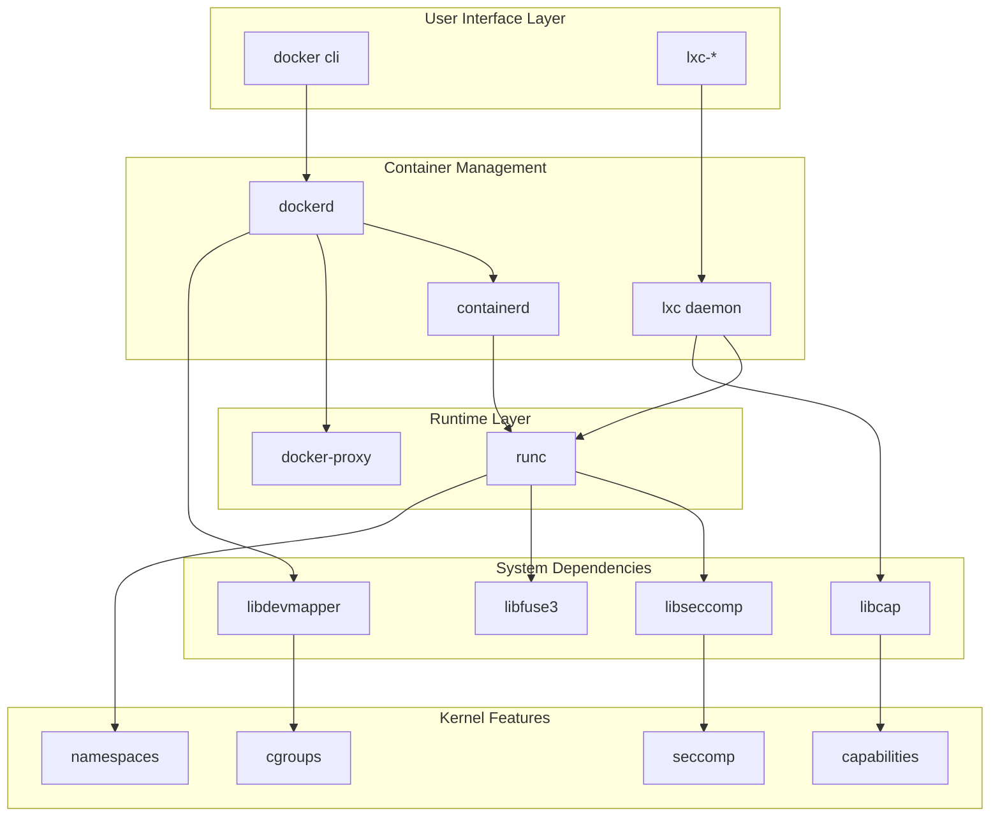
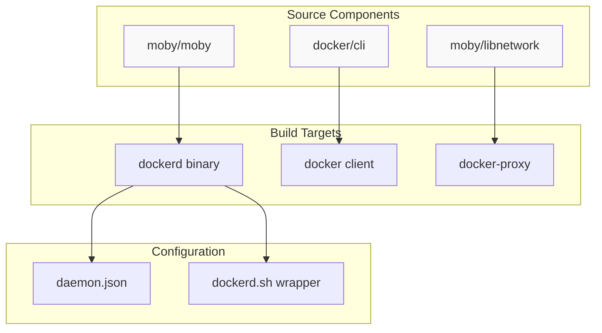
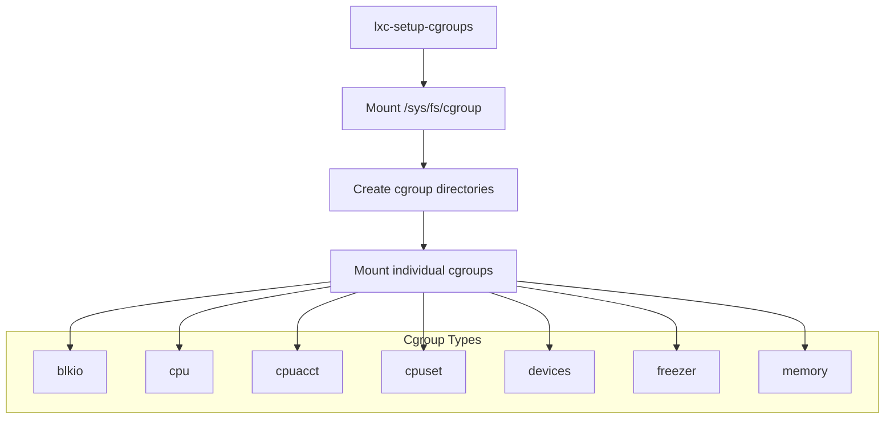
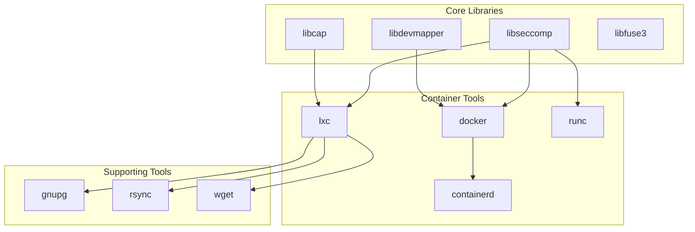

<!-- source: DeepWiki mcp.deepwiki.com · repo termux/termux-root-packages · page 4.3 Container and Virtualization · fetched 2026-10-26 -->

# Container and Virtualization

<details>
<summary>Relevant source files</summary>

The following files were used as context for generating this wiki page:

- [packages/docker/build.sh](packages/docker/build.sh)
- [packages/docker/config.go.patch](packages/docker/config.go.patch)
- [packages/docker/daemon.json](packages/docker/daemon.json)
- [packages/docker/database.go.patch](packages/docker/database.go.patch)
- [packages/docker/generate-man.sh.patch](packages/docker/generate-man.sh.patch)
- [packages/docker/md2man-all.sh.patch](packages/docker/md2man-all.sh.patch)
- [packages/lxc/build.sh](packages/lxc/build.sh)
- [packages/lxc/lxc-setup-cgroups.sh](packages/lxc/lxc-setup-cgroups.sh)
- [packages/lxc/src-lxc-cgroups-cgfsng.c.patch](packages/lxc/src-lxc-cgroups-cgfsng.c.patch)
- [packages/lxc/src-lxc-pam-pam_cgfs.c.patch](packages/lxc/src-lxc-pam-pam_cgfs.c.patch)
- [packages/runc/build.sh](packages/runc/build.sh)
- [packages/runc/cg-cpuset-noprefix-compat.patch](packages/runc/cg-cpuset-noprefix-compat.patch)
- [packages/runc/libcontainer-nsenter-cloned_binary.c.patch](packages/runc/libcontainer-nsenter-cloned_binary.c.patch)
- [packages/runc/root-dir-path.patch](packages/runc/root-dir-path.patch)

</details>


This section documents the container and virtualization tools available in termux-root-packages. These packages provide containerization capabilities, system-level virtualization, and container runtime environments that require root access to function properly on Android systems.

The tools covered include Docker for application containerization, LXC for system containers, and runc as the low-level container runtime. For network infrastructure tools that support containerized environments, see [Network Infrastructure](#4.5).

## Overview

Container and virtualization tools in termux-root-packages enable running isolated environments and containerized applications on rooted Android devices. These tools require extensive kernel support and root privileges to manage cgroups, namespaces, and other kernel-level container features.

### Container Stack Architecture



Sources: [packages/docker/build.sh:14](), [packages/lxc/build.sh:11](), [packages/runc/build.sh:8]()

## Docker

Docker provides a complete containerization platform with application-level containers. The implementation includes the Docker daemon (`dockerd`), command-line interface (`docker`), and networking proxy (`docker-proxy`).

### Docker Components

| Component | Purpose | Location |
|-----------|---------|----------|
| `dockerd` | Container daemon | `$TERMUX_PREFIX/libexec/dockerd` |
| `docker` | CLI client | `$TERMUX_PREFIX/bin/docker` |
| `docker-proxy` | Network proxy | `$TERMUX_PREFIX/bin/docker-proxy` |

### Build Process

The Docker build process involves compiling three separate Go modules:



Sources: [packages/docker/build.sh:8-10](), [packages/docker/build.sh:52-118]()

### Android-Specific Modifications

Docker requires several patches for Android compatibility:

- **Path Remapping**: `/etc/docker` → `$TERMUX_PREFIX/etc/docker`
- **Socket Location**: `/var/run/docker.sock` → `/data/docker/run/docker.sock`
- **Platform Detection**: Adding Android as a Linux variant
- **Home Directory**: Using `@TERMUX_HOME@/.docker` for configuration

Sources: [packages/docker/build.sh:59-61](), [packages/docker/config.go.patch:16](), [packages/docker/database.go.patch:9-14]()

### Configuration

Docker uses a custom configuration file at `$TERMUX_PREFIX/etc/docker/daemon.json`:

```json
{
    "data-root": "/data/docker/lib/docker",
    "exec-root": "/data/docker/run/docker",
    "pidfile": "/data/docker/run/docker.pid",
    "hosts": ["unix:///data/docker/run/docker.sock"],
    "storage-driver": "overlay2"
}
```

Sources: [packages/docker/daemon.json:1-9]()

## LXC (Linux Containers)

LXC provides system-level containerization with full Linux system containers. The package is maintained at version 3.1.0 due to compatibility requirements with Android kernels.

### LXC Configuration

LXC is configured specifically for the Termux environment:

| Setting | Value | Purpose |
|---------|-------|---------|
| `--with-distro` | `termux` | Termux-specific adaptations |
| `--with-runtime-path` | `$TERMUX_PREFIX/var/run` | Runtime directory |
| `--enable-seccomp` | enabled | Security filtering |
| `--enable-capabilities` | enabled | Privilege management |
| `--disable-apparmor` | disabled | Not available on Android |

Sources: [packages/lxc/build.sh:15-24]()

### Cgroups Compatibility

LXC includes patches for Android cgroups compatibility, specifically changing cgroup file names:

- `cpuset.cpus` → `cpus`
- `cpuset.mems` → `mems`

These changes accommodate Android's non-standard cgroup implementation.

Sources: [packages/lxc/src-lxc-cgroups-cgfsng.c.patch:8-9](), [packages/lxc/src-lxc-pam-pam_cgfs.c.patch:8-9]()

### Cgroups Setup Helper

The `lxc-setup-cgroups` script automates cgroup mounting:



Sources: [packages/lxc/lxc-setup-cgroups.sh:6-18](), [packages/lxc/build.sh:26-31]()

## runc

runc is the low-level container runtime that executes containers according to the OCI (Open Container Initiative) specification. It serves as the runtime backend for both Docker and other container platforms.

### Build Configuration

runc uses a simple Go build process with GOPATH setup:


Sources: [packages/runc/build.sh:10-24]()

### Android Compatibility Patches

runc includes several patches for Android compatibility:

#### Cgroups Compatibility
Similar to LXC, runc patches cgroup file references:
- `cpuset.cpus` → `cpus` 
- `cpuset.mems` → `mems`

#### Path Configuration
- Default root directory: `/run/runc` → `@TERMUX_PREFIX@/tmp/runc`

#### fexecve Implementation
Custom `musl_fexecve` implementation for systems without native fexecve support.

Sources: [packages/runc/cg-cpuset-noprefix-compat.patch:7-14](), [packages/runc/root-dir-path.patch:8-9](), [packages/runc/libcontainer-nsenter-cloned_binary.c.patch:8-30]()

## Dependencies and Requirements

### System Dependencies



Sources: [packages/docker/build.sh:14](), [packages/lxc/build.sh:11](), [packages/runc/build.sh:8]()

### Kernel Requirements

All container tools require specific kernel features:

| Feature | Docker | LXC | runc | Purpose |
|---------|--------|-----|------|---------|
| `CONFIG_CGROUP_DEVICE` | ✓ | ✓ | ✓ | Device access control |
| `CONFIG_NAMESPACES` | ✓ | ✓ | ✓ | Process isolation |
| `CONFIG_VETH` | ✓ | ✓ | - | Virtual networking |
| `CONFIG_BRIDGE` | ✓ | ✓ | - | Network bridging |
| `CONFIG_SECCOMP` | ✓ | ✓ | ✓ | System call filtering |

Sources: [packages/docker/build.sh:138-142](), [packages/runc/build.sh:30-41]()

## Usage and Installation Notes

### Post-Installation Setup

Each container tool provides specific setup instructions:

**Docker**: Requires kernel feature verification using the upstream check-config.sh script.

**LXC**: Provides the `lxc-setup-cgroups` helper script for automated cgroup mounting.

**runc**: Requires manual cgroup mounting if `CONFIG_CGROUP_DEVICE` is available.

### Runtime Considerations

- All tools require root access for cgroup and namespace management
- Container data is stored in `/data/docker/` for Docker to persist across reboots
- LXC containers use standard Linux filesystem hierarchy
- runc operates as a low-level runtime, typically managed by higher-level tools

Sources: [packages/docker/build.sh:135-143](), [packages/runc/build.sh:32-38](), [packages/lxc/build.sh:27-29]()

---

