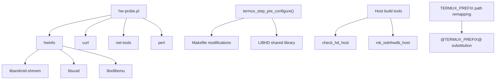
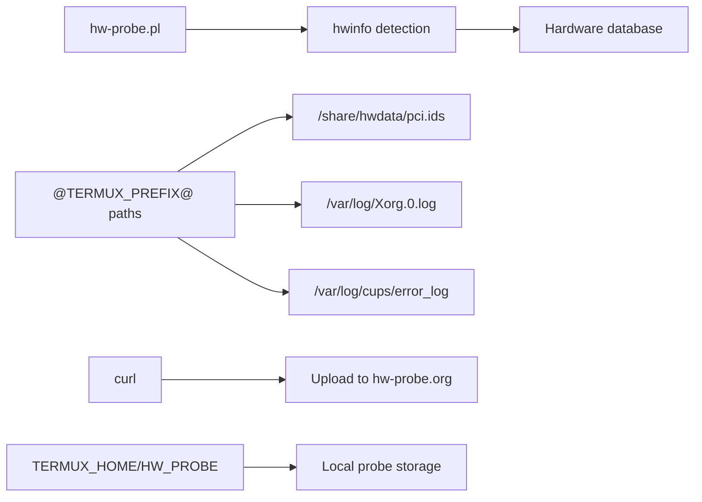
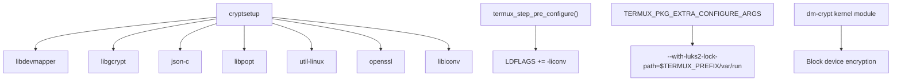
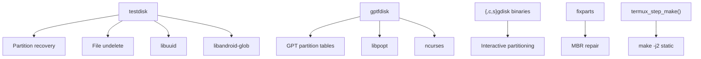
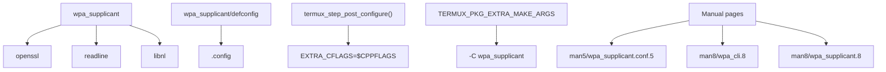
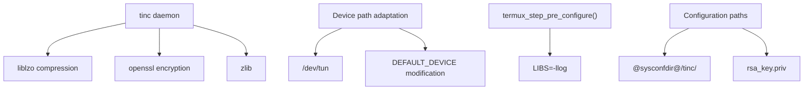
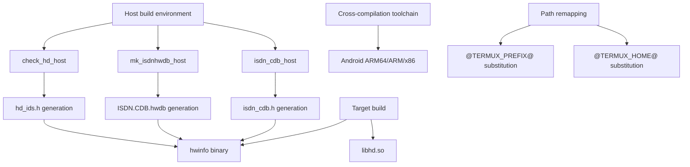
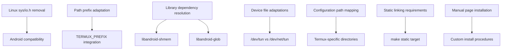

<!-- source: DeepWiki mcp.deepwiki.com · repo termux/termux-root-packages · page 4.4 System Administration Tools · fetched 2026-10-26 -->

# System Administration Tools

Relevant source files

The following files were used as context for generating this wiki page:

- [packages/cryptsetup/build.sh](packages/cryptsetup/build.sh)
- [packages/ettercap/build.sh](packages/ettercap/build.sh)
- [packages/gptfdisk/build.sh](packages/gptfdisk/build.sh)
- [packages/hw-probe/build.sh](packages/hw-probe/build.sh)
- [packages/hw-probe/hw-probe.pl.patch](packages/hw-probe/hw-probe.pl.patch)
- [packages/hwinfo/Makefile.patch](packages/hwinfo/Makefile.patch)
- [packages/hwinfo/build.sh](packages/hwinfo/build.sh)
- [packages/hwinfo/src-hd-bios.c.patch](packages/hwinfo/src-hd-bios.c.patch)
- [packages/hwinfo/src-hd-mdt.c.patch](packages/hwinfo/src-hd-mdt.c.patch)
- [packages/hwinfo/src-hd-sys.c.patch](packages/hwinfo/src-hd-sys.c.patch)
- [packages/hwinfo/src-ids-Makefile.patch](packages/hwinfo/src-ids-Makefile.patch)
- [packages/hwinfo/src-isdn-cdb-Makefile.patch](packages/hwinfo/src-isdn-cdb-Makefile.patch)
- [packages/hwinfo/src-isdn-isa-probe.c.patch](packages/hwinfo/src-isdn-isa-probe.c.patch)
- [packages/tcpdump/build.sh](packages/tcpdump/build.sh)
- [packages/tcpdump/configure.patch](packages/tcpdump/configure.patch)
- [packages/testdisk/build.sh](packages/testdisk/build.sh)
- [packages/tinc/build.sh](packages/tinc/build.sh)
- [packages/tinc/fix-tun-device-path.patch](packages/tinc/fix-tun-device-path.patch)
- [packages/wpa-supplicant/build.sh](packages/wpa-supplicant/build.sh)

This document covers system administration utilities in the termux-root-packages repository that provide low-level system management capabilities requiring root access. These tools enable hardware detection, disk management, network configuration, and system diagnostics on Android devices.

For network security tools like aircrack-ng and bettercap, see [Network Security Tools](#4.1). For network analysis tools like tshark and tcpdump, see [Network Analysis and Monitoring](#4.2). For containerization tools, see [Container and Virtualization](#4.3).

## Hardware Detection and Diagnostics

The repository provides comprehensive hardware detection capabilities through specialized tools that interface directly with system hardware and kernel interfaces.

### Hardware Information Tools

The `hwinfo` package serves as the primary hardware detection tool, providing detailed system hardware enumeration capabilities. The tool originates from openSUSE and has been adapted for the Android environment through extensive patching.

**hwinfo Architecture and Dependencies**

Sources: [packages/hwinfo/build.sh:1-28](), [packages/hw-probe/build.sh:1-19](), [packages/hwinfo/Makefile.patch:1-58]()

The `hwinfo` build process involves complex cross-compilation patterns where host tools must be built to generate data files for the target system. The [packages/hwinfo/src-ids-Makefile.patch:8-21]() demonstrates this pattern by creating separate `check_hd_host` and `mk_isdnhwdb_host` executables.

### Hardware Probing Integration

The `hw-probe` tool provides automated hardware testing and database submission capabilities, building on top of `hwinfo` for core detection functionality.

**Hardware Probing Data Flow**

Sources: [packages/hw-probe/hw-probe.pl.patch:1-80](), [packages/hw-probe/build.sh:8-18]()

The `hw-probe` tool requires extensive path remapping through [packages/hw-probe/hw-probe.pl.patch:8-76]() to adapt hardcoded Linux paths to the Termux environment, replacing `/usr/share/hwdata` with `@TERMUX_PREFIX@/share/hwdata` and similar transformations.

## Disk and Filesystem Management

System administration tools for disk encryption, partition recovery, and filesystem management provide essential low-level storage capabilities.

### Disk Encryption with cryptsetup

The `cryptsetup` package implements LUKS disk encryption through the Linux device mapper infrastructure.

**cryptsetup Dependencies and Configuration**

Sources: [packages/cryptsetup/build.sh:1-19]()

The cryptsetup configuration requires specific adaptations for Termux, including custom lock file paths at `$TERMUX_PREFIX/var/run` as specified in [packages/cryptsetup/build.sh:13]() and additional linker flags for iconv support in [packages/cryptsetup/build.sh:17]().

### Partition Management Tools

Disk partitioning and recovery tools provide essential filesystem maintenance capabilities.

**Disk Management Tool Relationships**

Sources: [packages/testdisk/build.sh:1-28](), [packages/gptfdisk/build.sh:1-17]()

The `gptfdisk` package produces multiple specialized binaries through its install process: `gdisk`, `cgdisk`, `sgdisk`, and `fixparts`, each targeting different partitioning scenarios as shown in [packages/gptfdisk/build.sh:14]().

## Network Administration

Network administration tools provide essential connectivity and VPN capabilities for system management.

### Wireless Network Management

The `wpa-supplicant` package enables WPA/WPA2 wireless authentication and key management.

**wpa-supplicant Build Configuration**

Sources: [packages/wpa-supplicant/build.sh:1-23]()

### VPN Infrastructure

The `tinc` VPN daemon provides mesh networking capabilities with extensive path adaptations for Android.

**tinc VPN Configuration**

Sources: [packages/tinc/build.sh:1-14](), [packages/tinc/fix-tun-device-path.patch:1-133]()

The tinc VPN requires extensive patching to adapt Linux-specific device paths, changing `/dev/net/tun` to `/dev/tun` throughout the codebase as demonstrated in [packages/tinc/fix-tun-device-path.patch:128-129]().

## Cross-Compilation Patterns

System administration tools exhibit complex build patterns requiring both host and target compilation phases.

### Host Tool Generation Pattern

Many system administration packages require host-side tools to generate data files or configuration for the target system.

**Host/Target Build Architecture**

Sources: [packages/hwinfo/src-isdn-cdb-Makefile.patch:1-58](), [packages/hwinfo/src-ids-Makefile.patch:1-22]()

### Platform-Specific Adaptations

System administration tools require extensive patching to work within Android's constrained environment.

**Android Environment Adaptations**

Sources: [packages/hwinfo/src-hd-sys.c.patch:1-14](), [packages/hwinfo/src-hd-bios.c.patch:1-14](), [packages/testdisk/build.sh:26](), [packages/tinc/fix-tun-device-path.patch:128-129]()

The Android environment requires removal of direct hardware access through `sys/io.h` as shown in the hwinfo patches, and adaptation of device paths and library dependencies to work within Android's security model.

---

