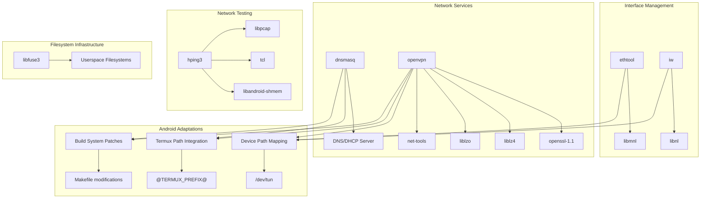
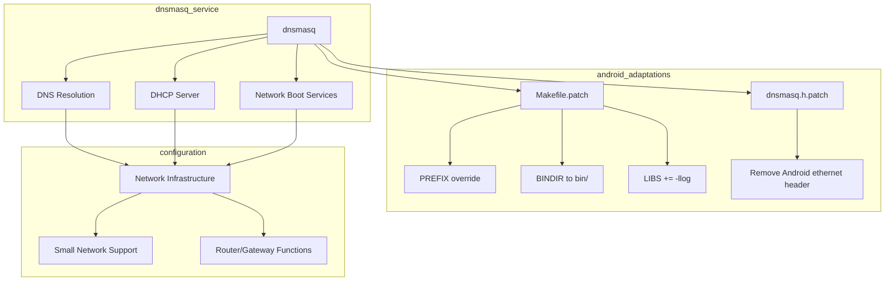
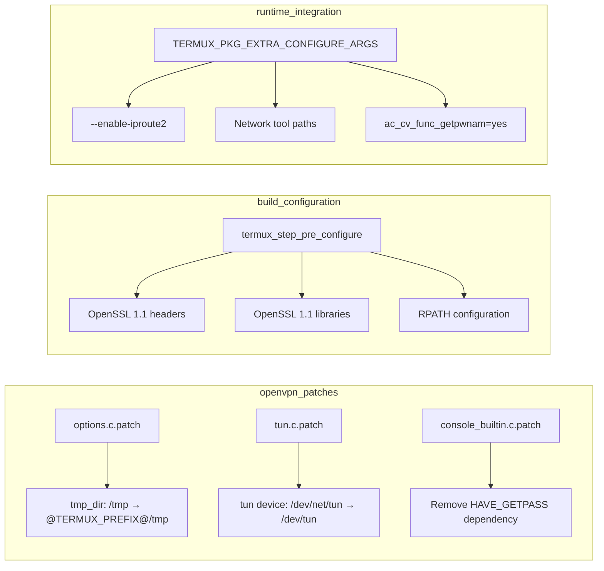
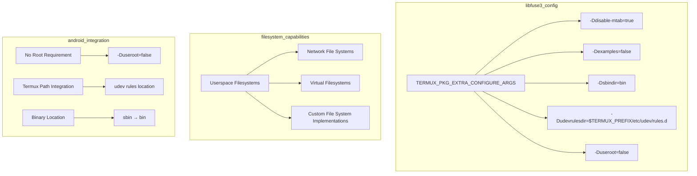
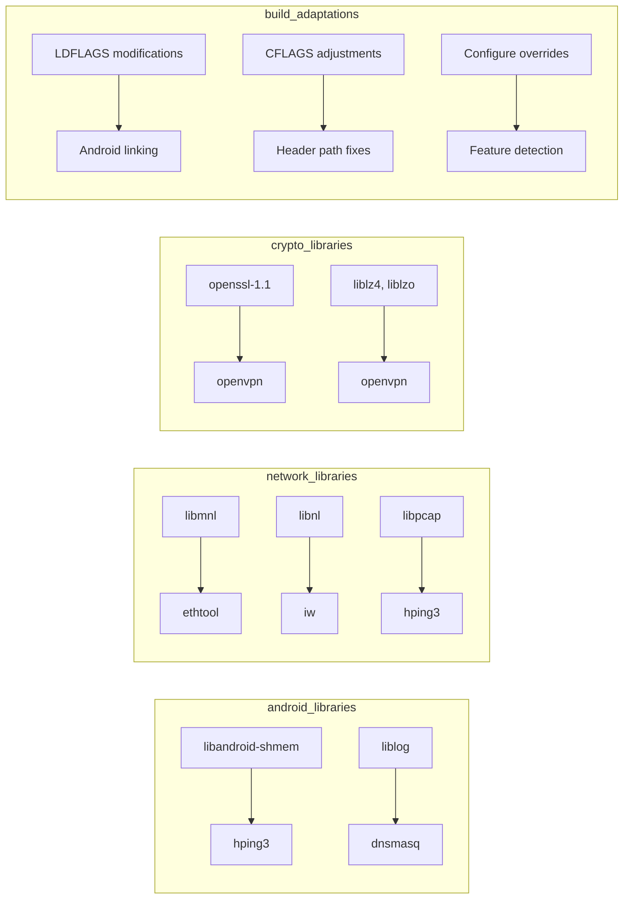

<!-- source: DeepWiki mcp.deepwiki.com · repo termux/termux-root-packages · page 4.5 Network Infrastructure · fetched 2026-10-26 -->

# Network Infrastructure

Relevant source files

The following files were used as context for generating this wiki page:

- [packages/dnsmasq/Makefile.patch](packages/dnsmasq/Makefile.patch)
- [packages/dnsmasq/build.sh](packages/dnsmasq/build.sh)
- [packages/dnsmasq/dnsmasq.h.patch](packages/dnsmasq/dnsmasq.h.patch)
- [packages/ethtool/build.sh](packages/ethtool/build.sh)
- [packages/hping3/build.sh](packages/hping3/build.sh)
- [packages/iw/build.sh](packages/iw/build.sh)
- [packages/libfuse3/build.sh](packages/libfuse3/build.sh)
- [packages/openvpn/build.sh](packages/openvpn/build.sh)
- [packages/openvpn/src-openvpn-console_builtin.c.patch](packages/openvpn/src-openvpn-console_builtin.c.patch)
- [packages/openvpn/src-openvpn-options.c.patch](packages/openvpn/src-openvpn-options.c.patch)
- [packages/openvpn/src-openvpn-tun.c.patch](packages/openvpn/src-openvpn-tun.c.patch)

This page documents the network infrastructure tools available in termux-root-packages. These packages provide low-level network interface management, network services like DNS/DHCP and VPN, and supporting infrastructure for network-based operations. 

For network security and penetration testing tools, see [Network Security Tools](#4.1). For network monitoring and packet analysis tools, see [Network Analysis and Monitoring](#4.2).

## Package Overview

The network infrastructure category includes tools for managing network interfaces, providing network services, and supporting network-based operations that require root privileges.

### Network Infrastructure Tool Architecture

Sources: [packages/ethtool/build.sh:1-9](), [packages/iw/build.sh:1-10](), [packages/dnsmasq/build.sh:1-9](), [packages/openvpn/build.sh:1-37](), [packages/hping3/build.sh:1-18](), [packages/libfuse3/build.sh:1-18]()

## Network Interface Management

### Ethernet Interface Control

The `ethtool` package provides comprehensive control over Ethernet network interfaces and hardware settings.

| Package | Version | Dependencies | Purpose |
|---------|---------|--------------|---------|
| ethtool | 5.16 | libmnl | Control network drivers and hardware |

Key features:
- Network driver configuration and status querying
- Hardware feature control (offloading, checksumming)
- Network interface statistics and diagnostics
- Wake-on-LAN configuration

Sources: [packages/ethtool/build.sh:1-9]()

### Wireless Interface Control

The `iw` package provides command-line configuration for wireless network devices.

| Package | Version | Dependencies | Purpose |
|---------|---------|--------------|---------|
| iw | 5.16 | libnl | CLI configuration utility for wireless devices |

Key capabilities:
- Wireless interface configuration and monitoring
- Access point and station mode management
- Frequency and channel configuration
- Wireless scanning and connection management

Sources: [packages/iw/build.sh:1-10]()

## Network Services

### DNS and DHCP Services

The `dnsmasq` package provides lightweight DNS and DHCP services for small networks.

Sources: [packages/dnsmasq/build.sh:1-9](), [packages/dnsmasq/Makefile.patch:1-26](), [packages/dnsmasq/dnsmasq.h.patch:1-12]()

### VPN Services

The `openvpn` package provides secure VPN connectivity with extensive Android-specific adaptations.

#### OpenVPN Configuration and Dependencies

| Component | Value | Purpose |
|-----------|-------|---------|
| `TERMUX_PKG_VERSION` | 2.4.12 | OpenVPN version |
| `TERMUX_PKG_DEPENDS` | liblz4, liblzo, net-tools, openssl-1.1 | Runtime dependencies |
| `IFCONFIG` | `$TERMUX_PREFIX/bin/ifconfig` | Network interface configuration |
| `ROUTE` | `$TERMUX_PREFIX/bin/route` | Routing table management |
| `IPROUTE` | `$TERMUX_PREFIX/bin/ip` | Advanced routing configuration |

#### Android Path Adaptations

The OpenVPN package includes several patches for Android compatibility:

Sources: [packages/openvpn/build.sh:11-37](), [packages/openvpn/src-openvpn-options.c.patch:1-13](), [packages/openvpn/src-openvpn-tun.c.patch:1-12](), [packages/openvpn/src-openvpn-console_builtin.c.patch:1-51]()

## Network Testing and Analysis

### Packet Assembly and Analysis

The `hping3` package provides low-level packet crafting and network testing capabilities.

| Component | Configuration | Purpose |
|-----------|---------------|---------|
| `TERMUX_PKG_DEPENDS` | libandroid-shmem, libpcap, tcl | Core dependencies |
| `LDFLAGS` | `-Wl,-z,muldefs -landroid-shmem` | Android-specific linking |
| `TERMUX_PKG_BUILD_IN_SRC` | true | In-source build requirement |

The package includes custom post-configuration steps:
- Android shared memory library integration
- Manual page directory creation
- Multiple definition resolution for Android compatibility

Sources: [packages/hping3/build.sh:1-18]()

## Filesystem Infrastructure

### FUSE Support

The `libfuse3` package enables userspace filesystem implementations, often used for network filesystems.

#### FUSE Configuration

Sources: [packages/libfuse3/build.sh:10-17]()

## Build System Integration

### Android-Specific Adaptations

Network infrastructure packages require several Android-specific modifications:

#### Path Remapping Patterns

| Original Path | Termux Path | Package | Purpose |
|---------------|-------------|---------|---------|
| `/tmp` | `@TERMUX_PREFIX@/tmp` | openvpn | Temporary directory |
| `/dev/net/tun` | `/dev/tun` | openvpn | TUN device access |
| `/usr/local` | `$PREFIX` | dnsmasq | Installation prefix |
| `/sbin` | `bin` | dnsmasq, libfuse3 | Binary location |

#### Library Integration

Network packages integrate with Android-specific libraries:

Sources: [packages/hping3/build.sh:14-16](), [packages/dnsmasq/Makefile.patch:22-23](), [packages/openvpn/build.sh:25-30]()

---

