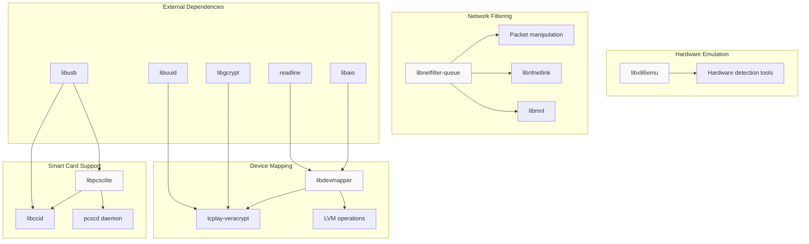
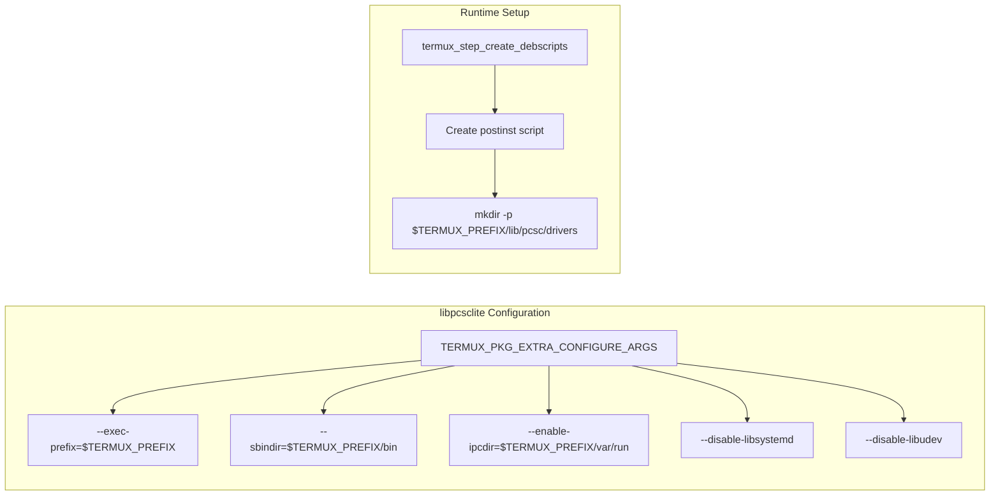
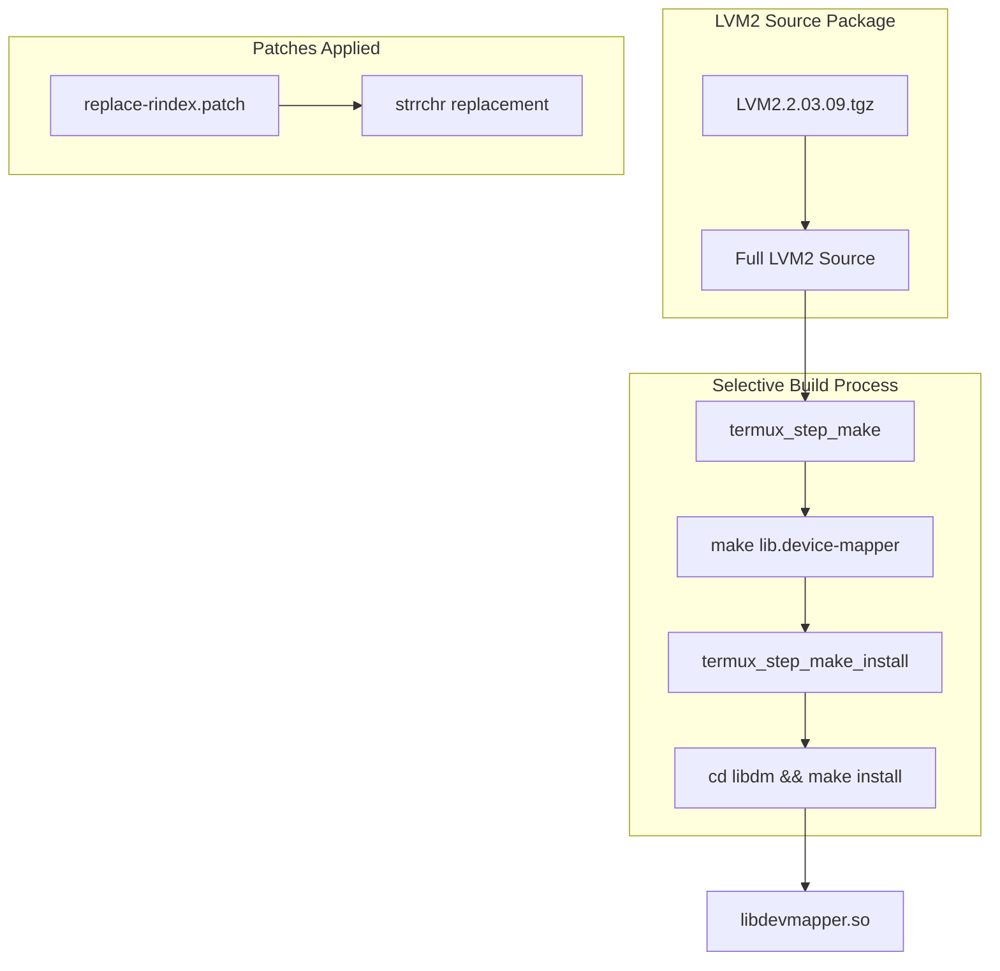
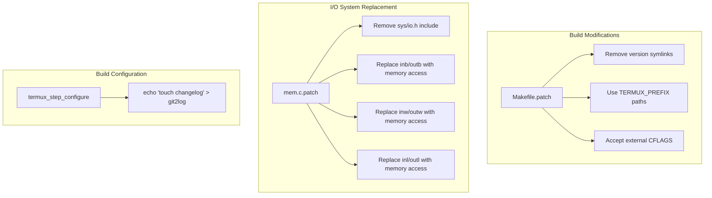
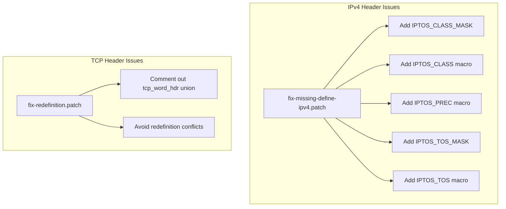
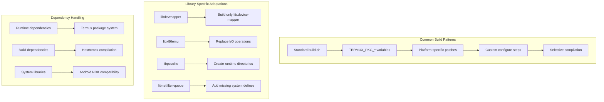

<!-- source: DeepWiki mcp.deepwiki.com · repo termux/termux-root-packages · page 4.6 Specialized Libraries · fetched 2026-10-26 -->

# Specialized Libraries

<details>
<summary>Relevant source files</summary>

The following files were used as context for generating this wiki page:

- [packages/libccid/build.sh](packages/libccid/build.sh)
- [packages/libdevmapper/build.sh](packages/libdevmapper/build.sh)
- [packages/libdevmapper/replace-rindex.patch](packages/libdevmapper/replace-rindex.patch)
- [packages/libnetfilter-queue/build.sh](packages/libnetfilter-queue/build.sh)
- [packages/libnetfilter-queue/fix-missing-define-ipv4.patch](packages/libnetfilter-queue/fix-missing-define-ipv4.patch)
- [packages/libnetfilter-queue/fix-redefinition.patch](packages/libnetfilter-queue/fix-redefinition.patch)
- [packages/libpcsclite/build.sh](packages/libpcsclite/build.sh)
- [packages/libpcsclite/pcscd.subpackage.sh](packages/libpcsclite/pcscd.subpackage.sh)
- [packages/libx86emu/Makefile.patch](packages/libx86emu/Makefile.patch)
- [packages/libx86emu/build.sh](packages/libx86emu/build.sh)
- [packages/libx86emu/mem.c.patch](packages/libx86emu/mem.c.patch)
- [packages/tcplay-veracrypt/build.sh](packages/tcplay-veracrypt/build.sh)
- [packages/tcplay-veracrypt/makedev.patch](packages/tcplay-veracrypt/makedev.patch)

</details>


This page documents the specialized system libraries provided in the termux-root-packages repository. These libraries provide low-level system functionality that typically requires root access, including device mapping, smart card interfaces, hardware emulation, and network packet filtering. Unlike the general system administration tools covered in [System Administration Tools](#4.4) or network infrastructure in [Network Infrastructure](#4.5), these libraries serve as foundational components that other packages depend on for specialized hardware and system access.

## Library Categories Overview

The specialized libraries fall into four main functional categories, each addressing specific system-level requirements:



**Library Dependency Architecture**

Sources: [packages/libpcsclite/build.sh:8](), [packages/libdevmapper/build.sh:9](), [packages/libx86emu/build.sh:1-18](), [packages/libnetfilter-queue/build.sh:9](), [packages/libccid/build.sh:9](), [packages/tcplay-veracrypt/build.sh:8]()

## Smart Card Support Libraries

### libpcsclite

The `libpcsclite` package provides middleware for accessing smart cards using the PC/SC (Personal Computer/Smart Card) API. This is the core library for smart card operations in Termux.

| Property | Value |
|----------|-------|
| **Homepage** | https://pcsclite.apdu.fr/ |
| **License** | BSD 3-Clause |
| **Version** | 1.9.5 |
| **Dependencies** | `libusb`, `python` |
| **Build Dependencies** | `flex` |

The package includes specific Termux adaptations in its configuration:



**libpcsclite Build Configuration**

The library creates a post-installation script to ensure the PC/SC drivers directory exists, which is required for the `pcscd` daemon to start properly [packages/libpcsclite/build.sh:20-24]().

### libccid

The `libccid` package provides a generic USB CCID (Chip/Smart Card Interface Devices) driver that works with `libpcsclite` to support USB smart card readers.

| Property | Value |
|----------|-------|
| **Homepage** | https://ccid.apdu.fr/ |
| **License** | LGPL-2.1 |
| **Version** | 1.4.31 |
| **Dependencies** | `libpcsclite`, `libusb`, `flex` |

The package requires special handling for the flex library during configuration [packages/libccid/build.sh:11-13]():

```bash
termux_step_pre_configure() {
    export LEXLIB=$TERMUX_PREFIX/lib/libfl.so
}
```

Sources: [packages/libpcsclite/build.sh:1-25](), [packages/libpcsclite/pcscd.subpackage.sh:1-3](), [packages/libccid/build.sh:1-14]()

## Device Mapping Libraries

### libdevmapper

The `libdevmapper` library provides device mapping functionality extracted from the LVM2 package. This library is essential for creating and managing virtual block devices.

| Property | Value |
|----------|-------|
| **Homepage** | https://sourceware.org/lvm2/ |
| **License** | GPL-2.0 |
| **Version** | 2.03.09 |
| **Dependencies** | `libandroid-support`, `libaio`, `readline` |

The build process only compiles the device-mapper component from the full LVM2 source:



**libdevmapper Build Process**

The library includes a patch to replace the deprecated `rindex` function with `strrchr` for Android compatibility [packages/libdevmapper/replace-rindex.patch:8-9]().

### tcplay-veracrypt

The `tcplay-veracrypt` package provides a TrueCrypt implementation based on `dm-crypt`, utilizing `libdevmapper` for device operations.

| Property | Value |
|----------|-------|
| **Homepage** | https://github.com/veracrypt/tc-play |
| **License** | BSD 2-Clause |
| **Version** | 2.0 |
| **Dependencies** | `libdevmapper`, `libuuid`, `libgcrypt` |

The package includes Android-specific patches for device creation [packages/tcplay-veracrypt/makedev.patch:7,15,24]():

```c
#define MKDEV(ma,mi)    (((dev_t)mi & 0xff) | ((dev_t)ma << 8) | (((dev_t)mi & ~0xff) << 12))
```

Sources: [packages/libdevmapper/build.sh:1-27](), [packages/libdevmapper/replace-rindex.patch:1-13](), [packages/tcplay-veracrypt/build.sh:1-9](), [packages/tcplay-veracrypt/makedev.patch:1-29]()

## Hardware Emulation Libraries

### libx86emu

The `libx86emu` library provides x86 processor emulation capabilities, primarily used by hardware detection tools that need to execute x86 BIOS code.

| Property | Value |
|----------|-------|
| **Homepage** | https://github.com/wfeldt/libx86emu |
| **License** | Custom (HPND) |
| **Version** | 3.1 |
| **Dependencies** | None |

The library requires extensive patching for Android compatibility:



**libx86emu Android Adaptations**

The most significant changes involve replacing direct port I/O operations with memory-mapped I/O [packages/libx86emu/mem.c.patch:33,42,51,60,69,78]():

```c
// Original: return inb(addr);
return *((volatile unsigned char *)(addr));

// Original: outb(val, addr);
*((volatile unsigned char *)(addr)) = val;
```

Sources: [packages/libx86emu/build.sh:1-18](), [packages/libx86emu/Makefile.patch:1-44](), [packages/libx86emu/mem.c.patch:1-82]()

## Network Filtering Libraries

### libnetfilter-queue

The `libnetfilter-queue` library provides userspace access to packets queued by the kernel packet filter, enabling custom packet processing applications.

| Property | Value |
|----------|-------|
| **Homepage** | https://www.netfilter.org/projects/libnetfilter_queue/ |
| **License** | GPL-2.0 |
| **Version** | 1.0.5 |
| **Dependencies** | `libnfnetlink`, `libmnl` |

The library requires patches to address Android NDK limitations:



**libnetfilter-queue Android Compatibility**

The patches address missing IPv4 constants that are available in standard Linux headers but not in the Android NDK [packages/libnetfilter-queue/fix-missing-define-ipv4.patch:12-18]():

```c
#define IPTOS_CLASS_MASK    0xe0
#define IPTOS_CLASS(class)  ((class) & IPTOS_CLASS_MASK)
#define IPTOS_PREC(tos)     IPTOS_CLASS(tos)
#define IPTOS_TOS_MASK      0x1E
#define IPTOS_TOS(tos)      ((tos) & IPTOS_TOS_MASK)
```

Sources: [packages/libnetfilter-queue/build.sh:1-10](), [packages/libnetfilter-queue/fix-missing-define-ipv4.patch:1-23](), [packages/libnetfilter-queue/fix-redefinition.patch:1-18]()

## Build System Integration

These specialized libraries integrate with the termux-packages build system through standard `build.sh` scripts, but often require additional complexity due to their system-level nature:



**Specialized Build Requirements**

The complexity of these libraries stems from their need to interface with low-level system functionality that differs significantly between standard Linux distributions and Android. This requires careful patching and configuration to maintain functionality while working within Android's constraints.

Sources: [packages/libpcsclite/build.sh:12-17](), [packages/libdevmapper/build.sh:18-25](), [packages/libx86emu/build.sh:15-17](), [packages/libccid/build.sh:11-13]()

---

