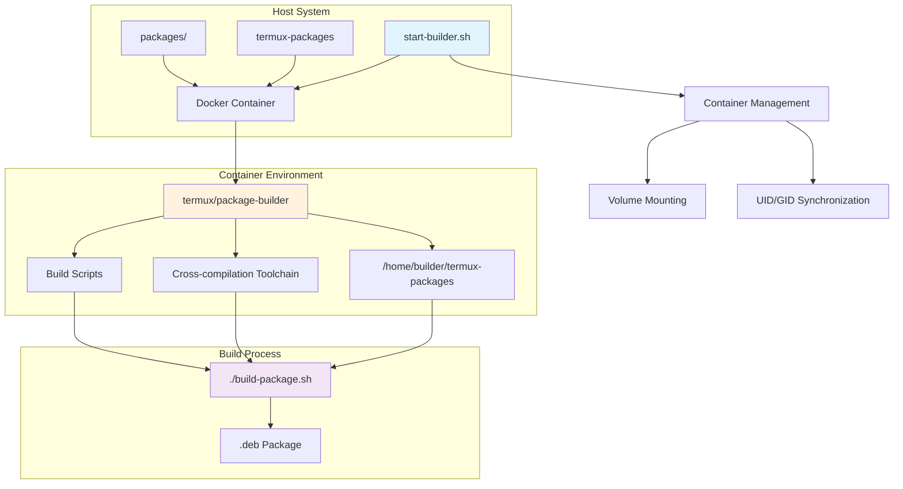
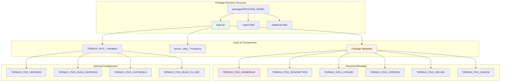
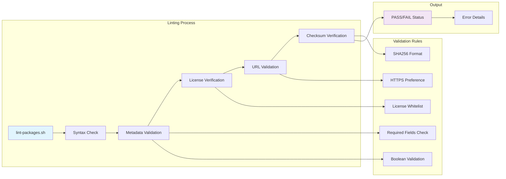
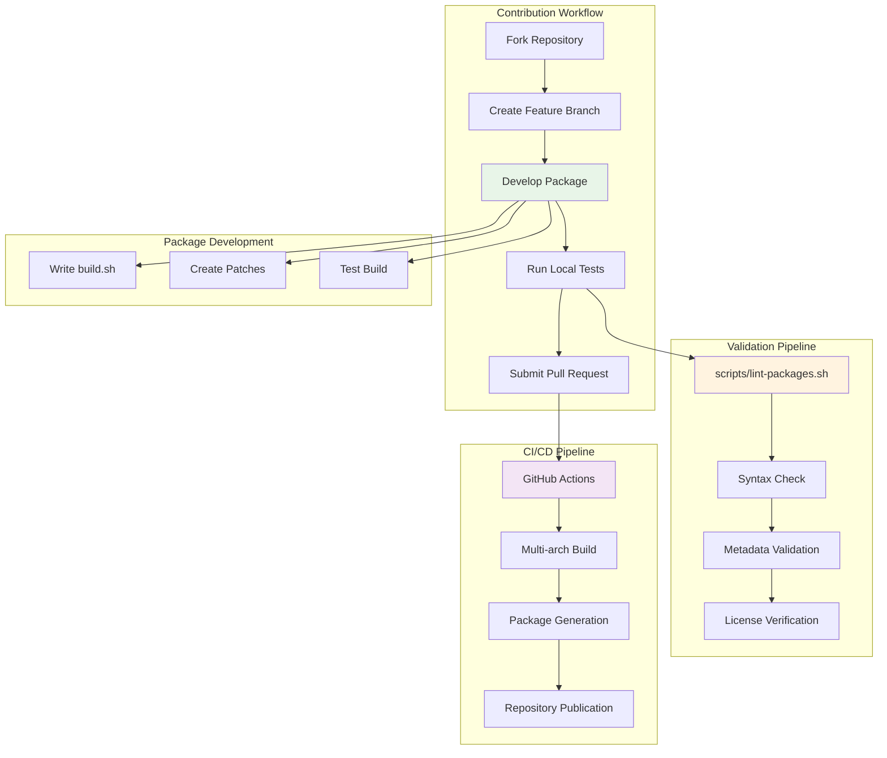

<!-- source: DeepWiki mcp.deepwiki.com · repo termux/termux-root-packages · page 5 Development and Contribution Guide · fetched 2026-10-26 -->

# Development and Contribution Guide

<details>
<summary>Relevant source files</summary>

The following files were used as context for generating this wiki page:

- [.gitmodules](.gitmodules)
- [packages/libnfnetlink/build.sh](packages/libnfnetlink/build.sh)
- [packages/libnfnetlink/fix-libnetfilter-queue.patch](packages/libnfnetlink/fix-libnetfilter-queue.patch)
- [scripts/lint-packages.sh](scripts/lint-packages.sh)
- [start-builder.sh](start-builder.sh)

</details>


This guide covers the complete development workflow for contributing packages to the termux-root-packages repository. It explains how to set up the build environment, create and test packages, and submit contributions following project standards.

For information about the overall build system architecture, see [Build System Architecture](#2). For details about specific package categories and their requirements, see [Package Categories](#4).

## Development Environment Setup

The termux-root-packages repository uses a containerized build environment based on Docker to ensure consistent builds across different development machines. The primary entry point is the `start-builder.sh` script.

### Build Environment Architecture



**Development Environment Flow**

Sources: [start-builder.sh:1-99]()

### Setting Up the Environment

The build environment setup follows this process:

1. **Initialize Submodules**: The script ensures the `termux-packages` submodule is properly initialized
2. **Container Management**: Creates or starts the `termux-package-builder` container
3. **Package Synchronization**: Copies packages from `./packages` to the build environment
4. **Permission Handling**: Adjusts container user permissions to match host user

Key configuration variables in `start-builder.sh`:

- `IMAGE_NAME="termux/package-builder"` - Docker image for builds
- `CONTAINER_NAME="termux-package-builder"` - Container instance name  
- `BUILD_ENVIRONMENT="termux-packages"` - Submodule directory
- `BUILDER_HOME="/home/builder"` - Container user home directory

Sources: [start-builder.sh:25-31]()

## Package Development Workflow

### Package Structure Overview



**Package Development Structure**

Sources: [packages/libnfnetlink/build.sh:1-10]()

### Essential Package Variables

Every package requires these core variables in its `build.sh`:

| Variable | Purpose | Example |
|----------|---------|---------|
| `TERMUX_PKG_HOMEPAGE` | Official project website | `https://www.netfilter.org/projects/libnfnetlink/` |
| `TERMUX_PKG_DESCRIPTION` | Brief package description (≤100 chars) | `"libnfnetlink is the low-level library for netfilter"` |
| `TERMUX_PKG_LICENSE` | Software license identifier | `"GPL-2.0"` |
| `TERMUX_PKG_VERSION` | Package version | `1.0.1` |
| `TERMUX_PKG_SRCURL` | Source download URL | `http://ftp.netfilter.org/pub/...` |
| `TERMUX_PKG_SHA256` | Source archive checksum | `f270e19de9127642d2a11589ef2ec97ef90a649a...` |

Sources: [packages/libnfnetlink/build.sh:1-9]()

### Creating a New Package

1. **Create Package Directory**: Create `packages/PACKAGE_NAME/`
2. **Write build.sh**: Define package metadata and build instructions
3. **Add Patches**: Include any necessary source modifications
4. **Test Build**: Use the containerized build environment
5. **Validate**: Run linting and verification tools

### Patch Management

Patches are applied automatically during the build process. The patch system handles source code modifications required for Termux compatibility:

```bash
# Example patch structure
packages/PACKAGE_NAME/
├── build.sh
├── fix-header-conflict.patch
└── android-compatibility.patch
```

Sources: [packages/libnfnetlink/fix-libnetfilter-queue.patch:1-13]()

## Testing and Validation

### Package Linting System

The repository includes a comprehensive linting system to validate package definitions:



**Package Linting Architecture**

Sources: [scripts/lint-packages.sh:1-434]()

### Linting Functions

The linter performs these key validations:

- **Syntax Validation**: Bash syntax checking using `bash -n`
- **Required Fields**: Ensures all mandatory variables are set
- **License Compliance**: Validates against approved license list
- **URL Security**: Prefers HTTPS URLs where possible
- **Checksum Integrity**: Validates SHA256 format and array length matching

Key linting functions:

- `check_package_license()` - Validates license against whitelist
- `lint_package()` - Main package validation routine
- `linter_main()` - Orchestrates linting across multiple packages

Sources: [scripts/lint-packages.sh:8-51](), [scripts/lint-packages.sh:53-392](), [scripts/lint-packages.sh:394-427]()

### Running Tests

```bash
# Lint all packages
./scripts/lint-packages.sh

# Lint specific package
./scripts/lint-packages.sh packages/PACKAGE_NAME/build.sh

# Build package in container
./start-builder.sh ./build-package.sh PACKAGE_NAME
```

## Contribution Process

### Development Workflow



**Complete Contribution Flow**

Sources: [start-builder.sh:1-99](), [scripts/lint-packages.sh:1-434]()

### Build Environment Commands

The `start-builder.sh` script supports several execution modes:

```bash
# Interactive shell in container
./start-builder.sh

# Execute specific command
./start-builder.sh ./build-package.sh PACKAGE_NAME

# Custom build script
./start-builder.sh ./scripts/custom-build.sh
```

Container management features:

- **Lock File Management**: Uses `/tmp/.termux-root-builder.lck` for coordination
- **Submodule Synchronization**: Automatically updates `termux-packages` submodule
- **Package Copying**: Syncs local packages to container environment
- **Permission Mapping**: Matches host and container user permissions

Sources: [start-builder.sh:27-28](), [start-builder.sh:35-59](), [start-builder.sh:82-91](), [start-builder.sh:73-79]()

### Development Best Practices

1. **Package Naming**: Follow upstream project naming conventions
2. **Version Management**: Use upstream version numbers with revision increments
3. **License Compliance**: Only use approved licenses from the whitelist
4. **Patch Minimization**: Keep patches focused and well-documented
5. **Dependencies**: Minimize runtime dependencies, specify build dependencies
6. **Testing**: Verify builds across supported architectures

### Supported Architectures

All packages must support the standard Termux architectures:

- `aarch64` - ARM 64-bit (primary Android architecture)
- `arm` - ARM 32-bit (legacy Android devices)
- `x86_64` - Intel 64-bit (emulators, Chromebooks)
- `i686` - Intel 32-bit (legacy support)

Sources: [.gitmodules:1-4]()

---

