<!-- source: DeepWiki mcp.deepwiki.com · repo termux/termux-root-packages · page 6 Advanced Build Patterns · fetched 2026-10-26 -->

# Advanced Build Patterns

Relevant source files

The following files were used as context for generating this wiki page:

- [packages/encfs/build.sh](packages/encfs/build.sh)
- [packages/frida-server/Makefile.linux.mk.patch](packages/frida-server/Makefile.linux.mk.patch)
- [packages/frida-server/build.sh](packages/frida-server/build.sh)
- [packages/frida-server/frida-version.patch](packages/frida-server/frida-version.patch)
- [packages/frida-server/ndk_version.patch](packages/frida-server/ndk_version.patch)
- [packages/frida-server/setup-env.sh.patch](packages/frida-server/setup-env.sh.patch)
- [packages/hwinfo/Makefile.patch](packages/hwinfo/Makefile.patch)
- [packages/hwinfo/build.sh](packages/hwinfo/build.sh)
- [packages/hwinfo/src-hd-bios.c.patch](packages/hwinfo/src-hd-bios.c.patch)
- [packages/hwinfo/src-hd-mdt.c.patch](packages/hwinfo/src-hd-mdt.c.patch)
- [packages/hwinfo/src-hd-sys.c.patch](packages/hwinfo/src-hd-sys.c.patch)
- [packages/hwinfo/src-ids-Makefile.patch](packages/hwinfo/src-ids-Makefile.patch)
- [packages/hwinfo/src-isdn-cdb-Makefile.patch](packages/hwinfo/src-isdn-cdb-Makefile.patch)
- [packages/hwinfo/src-isdn-isa-probe.c.patch](packages/hwinfo/src-isdn-isa-probe.c.patch)
- [packages/open-zwave/Makefile.patch](packages/open-zwave/Makefile.patch)
- [packages/open-zwave/build.sh](packages/open-zwave/build.sh)
- [packages/open-zwave/support.mk.patch](packages/open-zwave/support.mk.patch)

This document covers complex build scenarios in the termux-root-packages repository that go beyond standard package compilation. These patterns include multi-stage builds, host tool generation, architecture-specific compilation strategies, and sophisticated patching techniques required for packages with intricate upstream build systems.

For basic package definition and standard build processes, see [Package Definition System](#2.1). For cross-compilation fundamentals, see [Cross-Compilation and Host Builds](#2.2).

## Host Build Infrastructure

The most sophisticated build pattern involves packages that require host-side tool generation before target compilation can proceed. This is implemented through the `TERMUX_PKG_HOSTBUILD` mechanism.

### Host Build Workflow

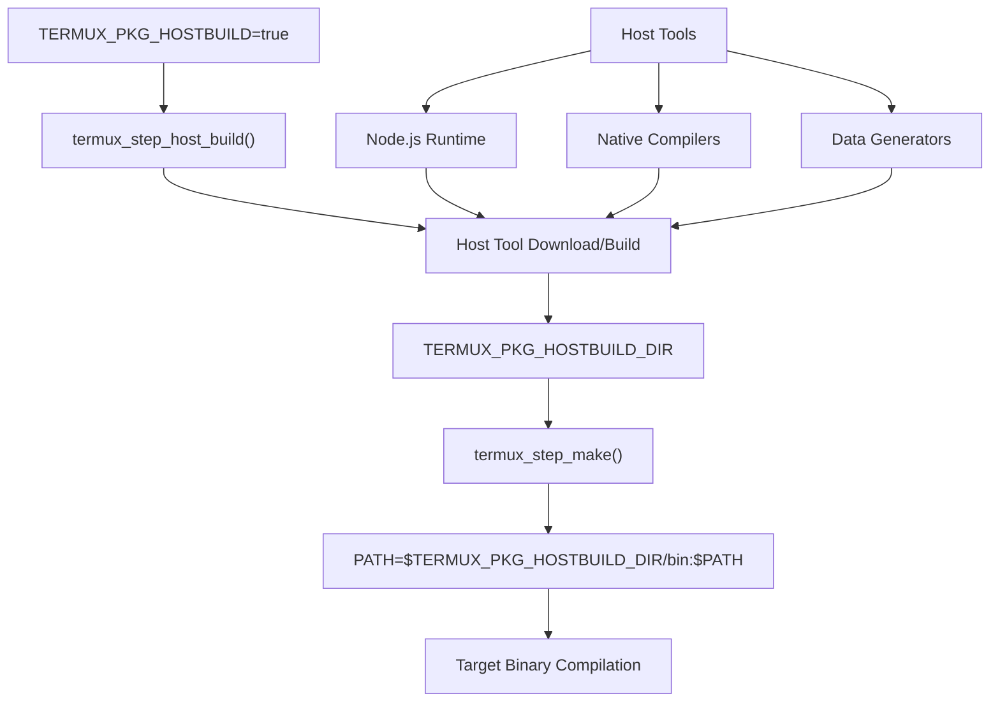

**Host Build Tool Integration Pattern**

The `frida-server` package demonstrates the most complex host build pattern, downloading and integrating Node.js as a host tool:

Sources: [packages/frida-server/build.sh:27-33]()

### Host Build Directory Structure

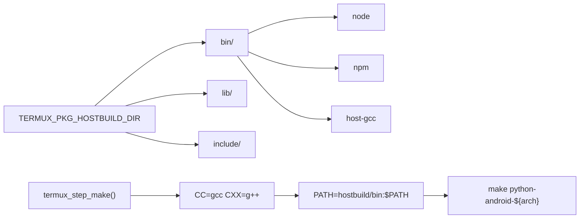

**Architecture-Specific Host Build Integration**

Sources: [packages/frida-server/build.sh:43-55]()

## Architecture Mapping and Cross-Compilation

Advanced packages require architecture-specific compilation with custom mapping between Termux architecture names and upstream build system expectations.

### Architecture Translation Pattern

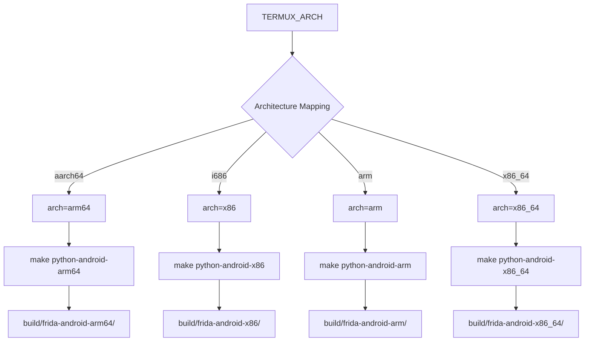

**Frida Server Architecture Mapping Implementation**

Sources: [packages/frida-server/build.sh:44-50]()

### Cross-Compilation Toolchain Override

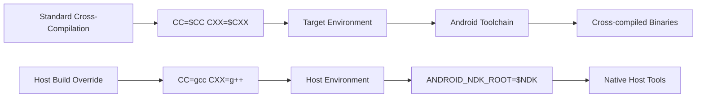

**Host Compiler Override Pattern**

Sources: [packages/frida-server/build.sh:51-54]()

## Multi-Stage Build Processes

Complex packages implement multi-stage builds where host tools generate intermediate artifacts used in target compilation.

### Data Generation Stage Pattern

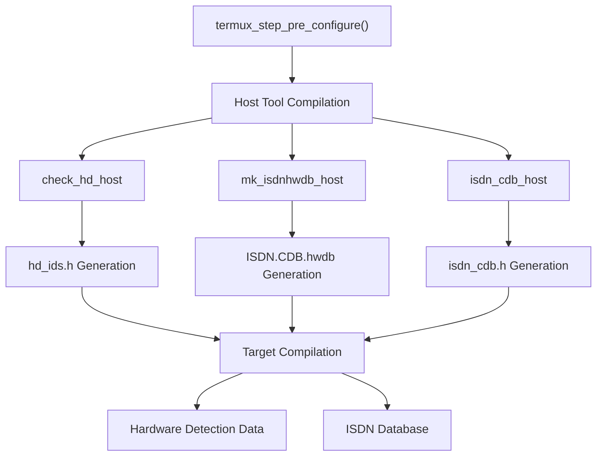

**Hardware Info Multi-Stage Build Pattern**

Sources: [packages/hwinfo/src-ids-Makefile.patch:8-16](), [packages/hwinfo/src-isdn-cdb-Makefile.patch:18-21]()

### Version Header Generation

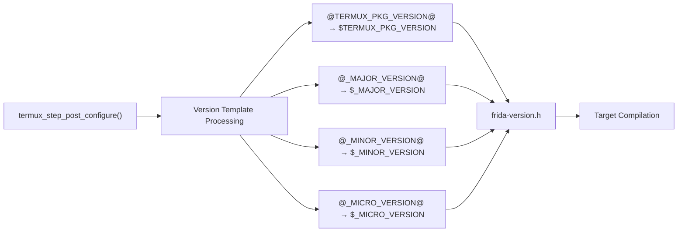

**Template-Based Version Header Generation**

Sources: [packages/frida-server/build.sh:35-41](), [packages/frida-server/frida-version.patch:5-16]()

## Build System Patching Strategies

Advanced packages require extensive patching of upstream build systems to integrate with Termux cross-compilation infrastructure.

### Makefile Target Extension Pattern

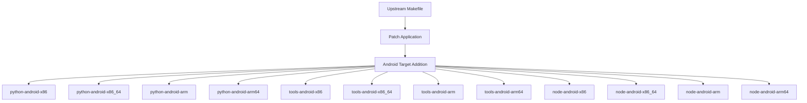

**Frida Makefile Android Target Integration**

Sources: [packages/frida-server/Makefile.linux.mk.patch:7-11](), [packages/frida-server/Makefile.linux.mk.patch:67-71]()

### API Level Standardization

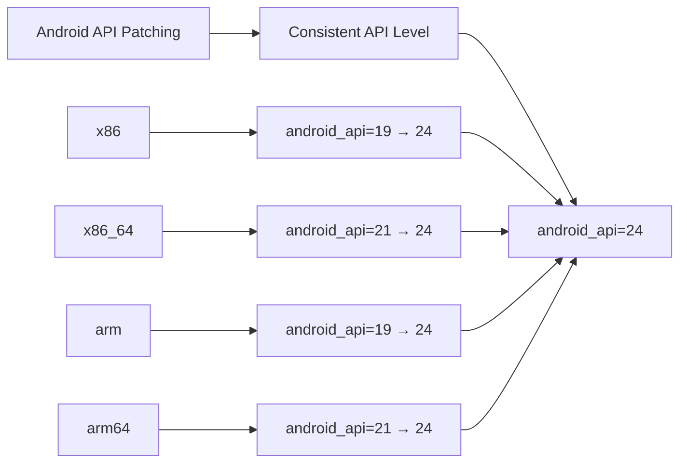

**Android API Level Unification Pattern**

Sources: [packages/frida-server/setup-env.sh.patch:7-35]()

## Complex Dependency Handling

Advanced build patterns handle complex dependencies between host tools, build stages, and target compilation.

### Build Dependency Chain

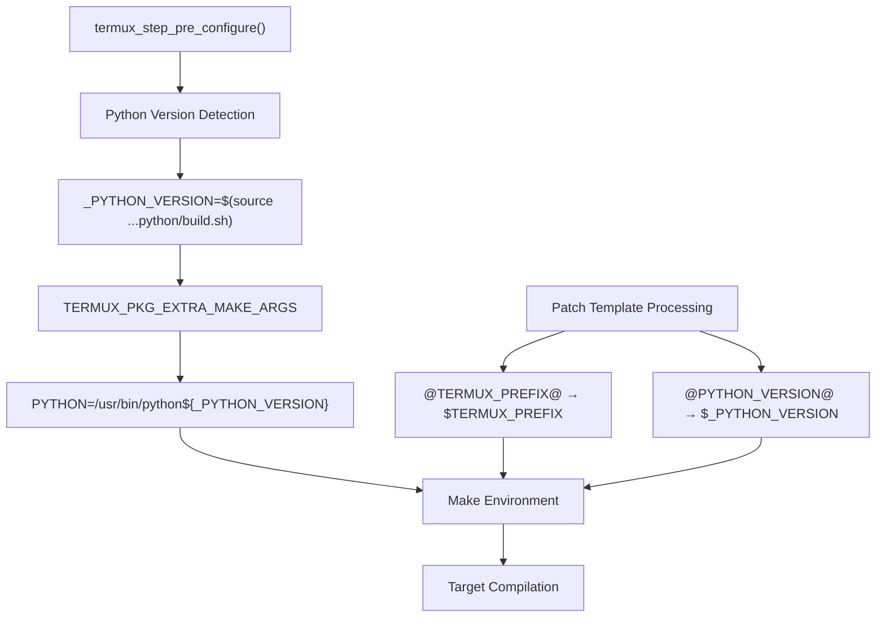

**Dynamic Dependency Resolution Pattern**

Sources: [packages/frida-server/build.sh:19-25]()

### Service Integration Pattern

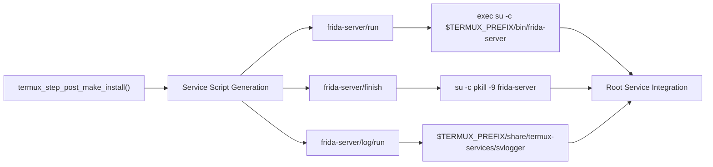

**Advanced Service Integration with Root Requirements**

Sources: [packages/frida-server/build.sh:73-93]()

### Custom Installation Patterns

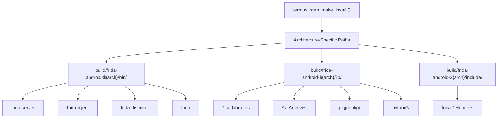

**Multi-Component Installation Pattern**

Sources: [packages/frida-server/build.sh:57-71]()