# Page: Overview

# Overview

<details>
<summary>Relevant source files</summary>

The following files were used as context for generating this wiki page:

- [.github/static/powered-by-fosshost.png](.github/static/powered-by-fosshost.png)
- [.github/workflows/packages.yml](.github/workflows/packages.yml)
- [.gitmodules](.gitmodules)
- [CONTRIBUTING.md](CONTRIBUTING.md)
- [README.md](README.md)
- [packages/libnfnetlink/build.sh](packages/libnfnetlink/build.sh)
- [packages/libnfnetlink/fix-libnetfilter-queue.patch](packages/libnfnetlink/fix-libnetfilter-queue.patch)

</details>


This document provides an overview of the `termux-root-packages` repository, which serves as a specialized collection of packages requiring root access for the Termux Android terminal environment. The repository implements a sophisticated build system, automated CI/CD pipeline, and package distribution mechanism for security tools, network analysis utilities, and system administration software.

For information about the core build system infrastructure shared with this repository, see [Build System Architecture](#2). For details about specific package categories and their implementations, see [Package Categories](#4).

## Repository Status and Migration

The `termux-root-packages` repository is currently archived, with active development migrated to a monorepo structure within the main `termux-packages` repository. This transition consolidates package management while maintaining the specialized nature of root-level tools.

**Current Repository Architecture**

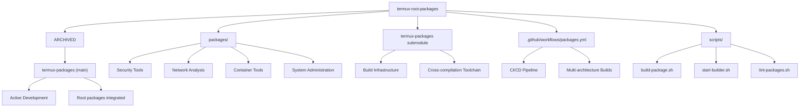

Sources: [README.md:1-3](), [.gitmodules:1-3](), [.github/workflows/packages.yml:1-40]()

## Package Categories and Scope

The repository contains specialized packages organized into distinct functional categories, each requiring elevated privileges for proper operation on Android systems.

**Package Category Distribution**

```mermaid
graph TD
    A["termux-root-packages"] --> B["Security Tools"]
    A --> C["Network Analysis"]
    A --> D["Container/Virtualization"]
    A --> E["System Administration"]
    A --> F["Network Infrastructure"]
    A --> G["Specialized Libraries"]
    
    B --> B1["aircrack-ng"]
    B --> B2["bettercap"]
    B --> B3["ettercap"]
    B --> B4["cryptsetup"]
    
    C --> C1["tshark"]
    C --> C2["tcpdump"]
    C --> C3["nethogs"]
    C --> C4["termshark"]
    
    D --> D1["docker"]
    D --> D2["lxc"]
    D --> D3["runc"]
    D --> D4["containerd"]
    
    E --> E1["hwinfo"]
    E --> E2["pciutils"]
    E --> E3["openvpn"]
    
    F --> F1["ethtool"]
    F --> F2["iw"]
    F --> F3["dnsmasq"]
    
    G --> G1["libdevmapper"]
    G --> G2["libseccomp"]
    G --> G3["libfuse3"]
    G --> G4["libnfnetlink"]
```

Sources: Based on repository structure analysis and package directory contents

## Build System Integration

The repository leverages the `termux-packages` infrastructure through a git submodule, providing access to cross-compilation toolchains, build utilities, and package management functions.

**Build System Architecture**

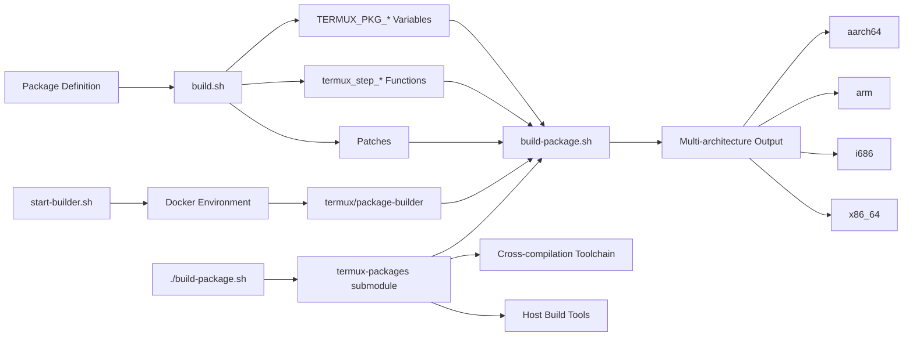

Sources: [.gitmodules:1-3](), [README.md:25-36](), [packages/libnfnetlink/build.sh:1-10]()

## CI/CD Pipeline Implementation

The automated build system uses GitHub Actions to detect changes, build packages across architectures, and distribute them to APT repositories.

**GitHub Actions Workflow**

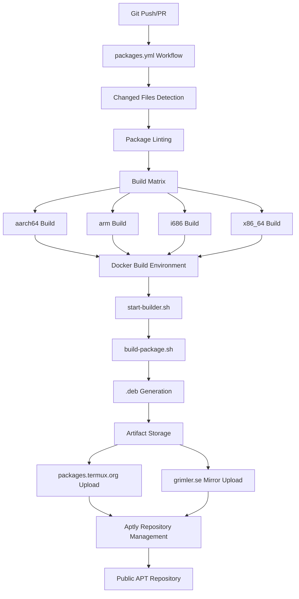

Sources: [.github/workflows/packages.yml:18-142](), [.github/workflows/packages.yml:154-236]()

## Package Definition System

Each package is defined through a `build.sh` script containing metadata, dependencies, and custom build steps using the `termux-packages` infrastructure.

**Package Definition Structure**

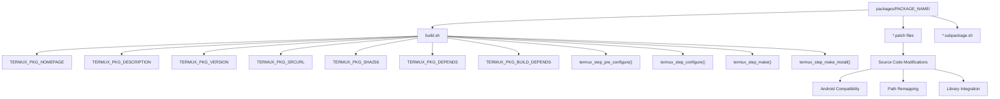

Sources: [packages/libnfnetlink/build.sh:1-10](), [packages/libnfnetlink/fix-libnetfilter-queue.patch:1-13]()

## Distribution and Installation

Built packages are distributed through APT repositories, with users accessing them via the `root-repo` package installation mechanism.

**Distribution Flow**

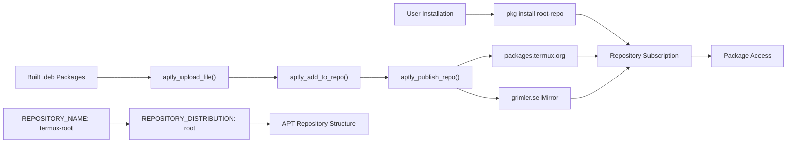

Sources: [.github/workflows/packages.yml:156-196](), [README.md:40-43]()

This overview establishes the foundation for understanding the specialized nature of root-level package management within the Termux ecosystem, the sophisticated build automation, and the integration patterns that enable cross-compilation and distribution of security and system administration tools for Android environments.

---

# Page: Build System Architecture

# Build System Architecture

<details>
<summary>Relevant source files</summary>

The following files were used as context for generating this wiki page:

- [.gitmodules](.gitmodules)
- [packages/libnfnetlink/build.sh](packages/libnfnetlink/build.sh)
- [packages/libnfnetlink/fix-libnetfilter-queue.patch](packages/libnfnetlink/fix-libnetfilter-queue.patch)
- [scripts/lint-packages.sh](scripts/lint-packages.sh)
- [start-builder.sh](start-builder.sh)

</details>


This document covers the core build infrastructure of termux-root-packages, including the termux-packages submodule integration, Docker-based build environment, and overall build orchestration process. For information about specific package definition patterns, see [Package Definition System](#2.1). For details about cross-compilation strategies, see [Cross-Compilation and Host Builds](#2.2).

## Overview

The termux-root-packages build system is built on top of the termux-packages infrastructure through Git submodule integration. The system uses a containerized approach with Docker to provide consistent build environments across different host systems, supporting cross-compilation for four Android architectures (aarch64, arm, i686, x86_64).

## Core Architecture Components

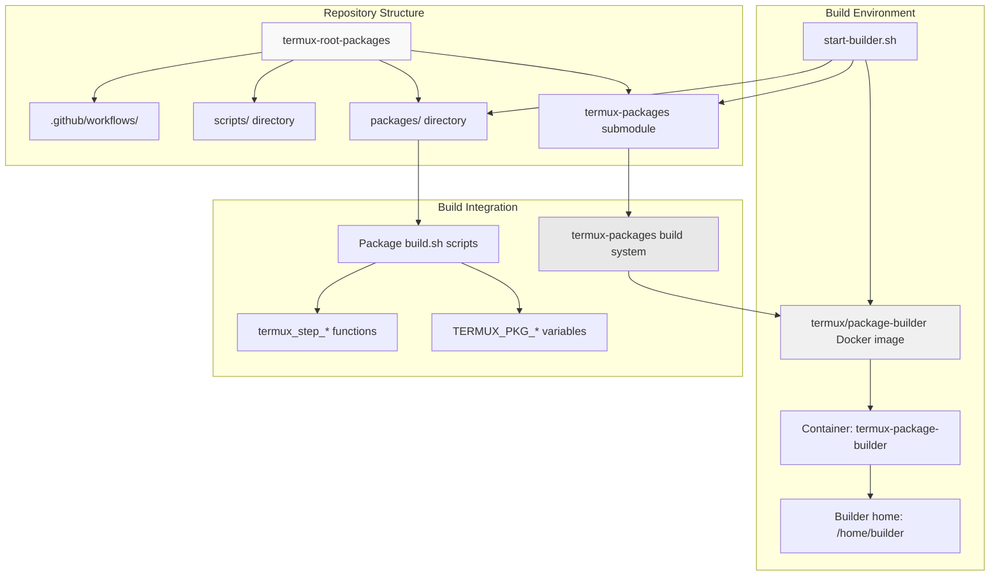

**Build Environment Setup Flow**

The build system orchestrates package compilation through a Docker-based environment that isolates build dependencies and provides consistent toolchain access.

Sources: [start-builder.sh:1-99](), [.gitmodules:1-4]()

## Build Environment Initialization

The `start-builder.sh` script serves as the primary entry point for setting up the build environment. It manages Docker container lifecycle, submodule synchronization, and package directory mounting.

```mermaid
graph TD
    subgraph "Environment Setup"
        A["start-builder.sh execution") --> B["Lock file creation: /tmp/.termux-root-builder.lck"]
        B --> C["Git submodule operations"]
        C --> D["Docker container management"]
    end
    
    subgraph "Container Operations"
        D --> E["Stop existing termux-package-builder container"]
        E --> F["Create/start termux/package-builder image"]
        F --> G["UID/GID synchronization"]
    end
    
    subgraph "Volume Mounting"
        G --> H["Mount termux-packages: /home/builder/termux-packages"]
        H --> I["Copy packages from ./packages to container"]
        I --> J["Execute build commands or bash shell"]
    end
    
    style A fill:#f9f9f9
    style F fill:#f0f0f0
    style H fill:#e8e8e8
```

**Container Lifecycle Management**

The system uses file locking (`flock`) to prevent concurrent build operations and ensures proper container state management.

Sources: [start-builder.sh:23-28](), [start-builder.sh:35-58](), [start-builder.sh:63-98]()

## Package Integration Process

The build system copies packages from the host repository into the containerized termux-packages environment, where they integrate with the existing build infrastructure.

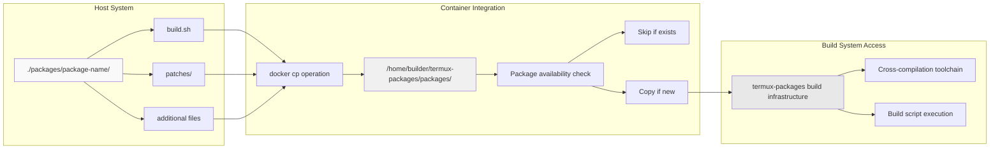

**Package Directory Synchronization**

The system performs selective copying to avoid overwriting existing packages in the build environment.

Sources: [start-builder.sh:82-91]()

## Build Orchestration Variables

Package definitions use standardized `TERMUX_PKG_*` variables that interface with the termux-packages build system. These variables control various aspects of the build process.

| Variable Category | Key Variables | Purpose |
|------------------|---------------|---------|
| **Package Metadata** | `TERMUX_PKG_HOMEPAGE`, `TERMUX_PKG_DESCRIPTION`, `TERMUX_PKG_LICENSE` | Package identification and licensing |
| **Source Management** | `TERMUX_PKG_VERSION`, `TERMUX_PKG_SRCURL`, `TERMUX_PKG_SHA256` | Source code retrieval and verification |
| **Build Configuration** | `TERMUX_PKG_BUILD_IN_SRC`, `TERMUX_PKG_HOSTBUILD`, `TERMUX_PKG_FORCE_CMAKE` | Build behavior control |
| **Dependencies** | `TERMUX_PKG_DEPENDS`, `TERMUX_PKG_BUILD_DEPENDS` | Runtime and build-time dependencies |
| **Package Properties** | `TERMUX_PKG_ESSENTIAL`, `TERMUX_PKG_METAPACKAGE` | Package classification |

Sources: [packages/libnfnetlink/build.sh:1-10]()

## Quality Assurance System

The build system includes comprehensive linting capabilities through `lint-packages.sh` that validates package definitions before build execution.

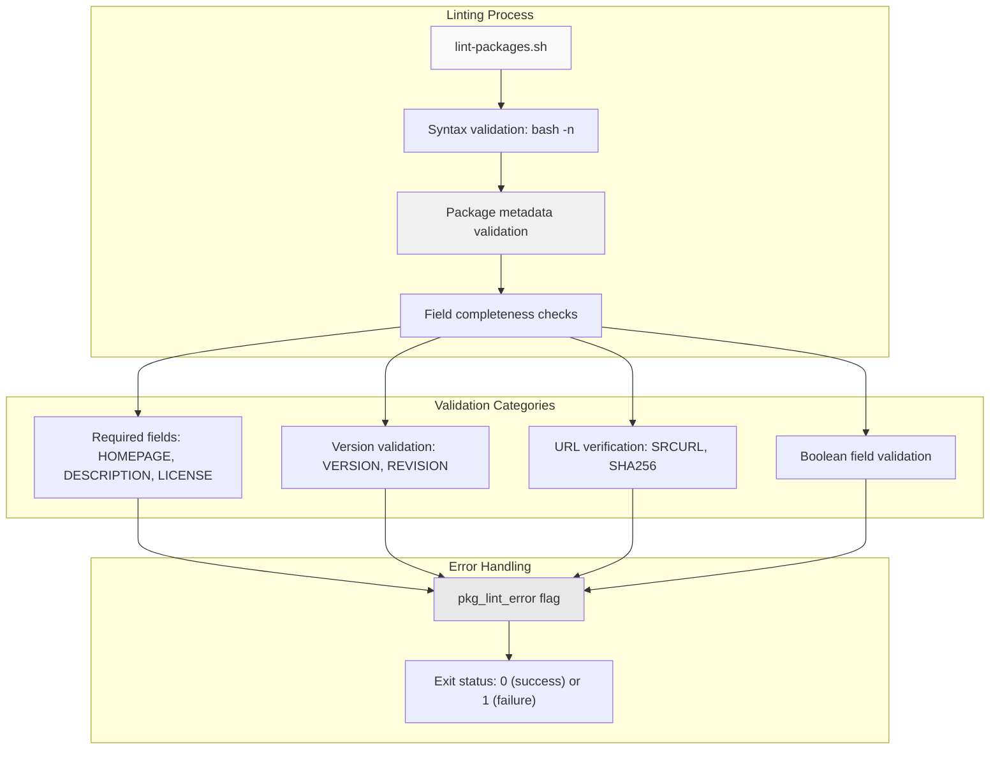

**Package Validation Pipeline**

The linting system sources each package's `build.sh` script in a controlled environment to validate field values and detect common configuration errors.

Sources: [scripts/lint-packages.sh:53-392](), [scripts/lint-packages.sh:394-433]()

## Build System Integration Points

The termux-root-packages system leverages key integration points with the termux-packages infrastructure:

```mermaid
graph LR
    subgraph "termux-root-packages"
        A["Package definitions"] --> B["start-builder.sh"]
        B --> C["Container environment"]
    end
    
    subgraph "termux-packages Integration"
        D["Build scripts infrastructure"] --> E["Cross-compilation toolchain"]
        E --> F["termux_step_* functions"]
        F --> G["Package compilation"]
    end
    
    subgraph "Output Generation"
        G --> H[".deb package files"]
        H --> I["Repository distribution"]
    end
    
    C --> D
    
    style A fill:#f9f9f9
    style D fill:#f0f0f0
    style H fill:#e8e8e8
```

**Submodule-Based Architecture**

The `.gitmodules` configuration establishes termux-packages as the foundation build system, providing proven cross-compilation capabilities and package management infrastructure.

Sources: [.gitmodules:1-4](), [start-builder.sh:29](), [start-builder.sh:69-70]()

---

# Page: Package Definition System

# Package Definition System

<details>
<summary>Relevant source files</summary>

The following files were used as context for generating this wiki page:

- [.gitmodules](.gitmodules)
- [packages/libnfnetlink/build.sh](packages/libnfnetlink/build.sh)
- [packages/libnfnetlink/fix-libnetfilter-queue.patch](packages/libnfnetlink/fix-libnetfilter-queue.patch)
- [packages/nethogs/build.sh](packages/nethogs/build.sh)
- [packages/pciutils/build.sh](packages/pciutils/build.sh)

</details>


This document covers the package definition system used in termux-root-packages, which defines how individual packages are configured, built, and integrated into the build infrastructure. The system uses `build.sh` scripts with standardized variables and functions to specify package metadata, dependencies, build configuration, and custom build logic.

For information about the broader build system architecture and cross-compilation details, see [Build System Architecture](#2). For specific patching mechanisms, see [Patching System](#2.3).

## Package Definition Structure

Each package in termux-root-packages is defined by a `build.sh` script located in `packages/<package-name>/build.sh`. These scripts declare package metadata through `TERMUX_PKG_*` variables and optionally define custom build logic through `termux_step_*` functions.

### Package Definition Diagram

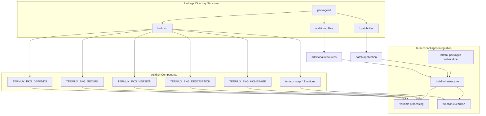

**Sources:** [packages/nethogs/build.sh:1-12](), [packages/pciutils/build.sh:1-22](), [packages/libnfnetlink/build.sh:1-10]()

## Core Package Variables

The package definition system uses a standardized set of `TERMUX_PKG_*` variables to declare package metadata, dependencies, and build configuration. These variables are processed by the termux-packages build infrastructure.

### Essential Metadata Variables

| Variable | Purpose | Example |
|----------|---------|---------|
| `TERMUX_PKG_HOMEPAGE` | Upstream project URL | `https://github.com/raboof/nethogs` |
| `TERMUX_PKG_DESCRIPTION` | Package description | `"Net top tool grouping bandwidth per process"` |
| `TERMUX_PKG_LICENSE` | License identifier | `"GPL-2.0"` |
| `TERMUX_PKG_MAINTAINER` | Package maintainer | `"@termux"` |
| `TERMUX_PKG_VERSION` | Package version | `0.8.6` |
| `TERMUX_PKG_REVISION` | Termux-specific revision | `1` |

**Sources:** [packages/nethogs/build.sh:1-6](), [packages/pciutils/build.sh:1-6](), [packages/libnfnetlink/build.sh:1-7]()

### Source and Build Configuration

| Variable | Purpose | Example |
|----------|---------|---------|
| `TERMUX_PKG_SRCURL` | Source download URL | `https://github.com/raboof/nethogs/archive/v${TERMUX_PKG_VERSION}.tar.gz` |
| `TERMUX_PKG_SHA256` | Source archive checksum | `317c1d5235d4be677e494e931c41d063a783ac0ac51e35e345e621d261c2e5a0` |
| `TERMUX_PKG_BUILD_IN_SRC` | Build in source directory | `true` |
| `TERMUX_PKG_EXTRA_MAKE_ARGS` | Additional make arguments | `"nethogs"` |

**Sources:** [packages/nethogs/build.sh:7-11](), [packages/pciutils/build.sh:7-10]()

### Dependency Management Variables

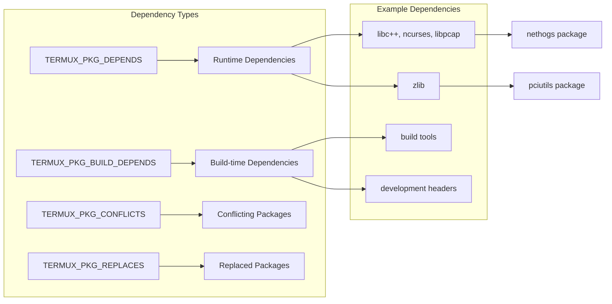

**Sources:** [packages/nethogs/build.sh:9](), [packages/pciutils/build.sh:9]()

## Custom Build Steps

The package definition system allows packages to override default build behavior through `termux_step_*` functions. These functions are called at specific points during the build process.

### Build Step Flow

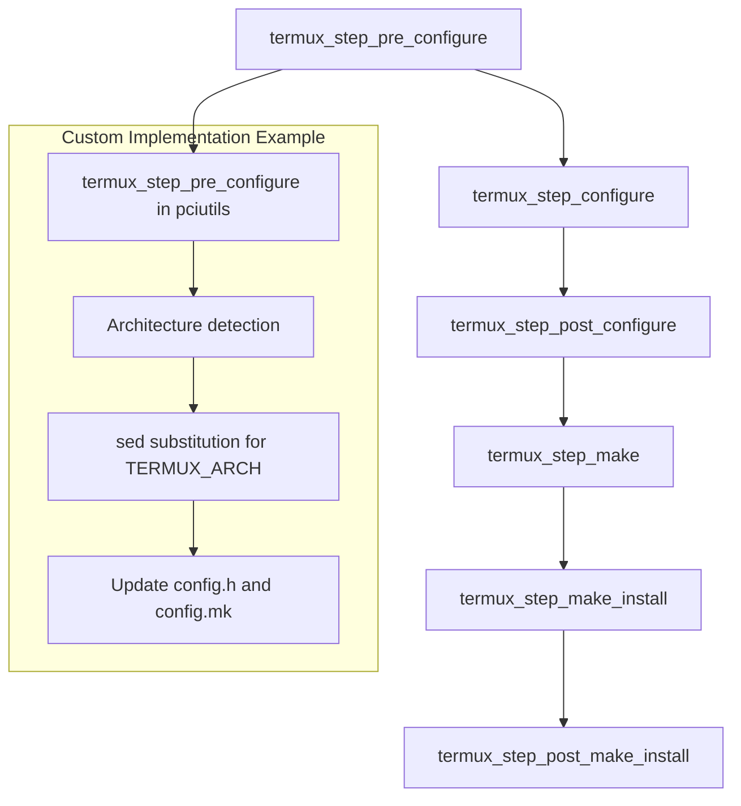

### Custom Build Step Implementation

The `pciutils` package demonstrates custom build logic through `termux_step_pre_configure`:

```bash
termux_step_pre_configure () {
    local ARCH=${TERMUX_ARCH}
    if [[ ${ARCH} == "arm" ]]; then
        ARCH="armv7l"
    fi
    
    sed -i "s%\@TERMUX_ARCH\@%${ARCH^^}%g" ./lib/config.h
    sed -i "s%\@TERMUX_ARCH\@%${ARCH^^}%g" ./lib/config.mk
}
```

This function:
1. Maps `TERMUX_ARCH` to appropriate architecture strings
2. Performs in-place substitution in configuration files
3. Uses bash string manipulation (`${ARCH^^}` for uppercase conversion)

**Sources:** [packages/pciutils/build.sh:12-21]()

### Available Build Step Functions

| Function | Purpose | When Called |
|----------|---------|-------------|
| `termux_step_pre_configure` | Pre-configuration setup | Before configure step |
| `termux_step_configure` | Custom configure logic | Instead of default configure |
| `termux_step_post_configure` | Post-configuration modifications | After configure step |
| `termux_step_make` | Custom build logic | Instead of default make |
| `termux_step_make_install` | Custom install logic | Instead of default install |
| `termux_step_post_make_install` | Post-install modifications | After installation |

**Sources:** [packages/pciutils/build.sh:12-21]()

## Integration with termux-packages Infrastructure

The package definition system is built on top of the termux-packages build infrastructure, accessed through a git submodule. This integration provides the core build system functionality while allowing termux-root-packages to maintain its own package definitions.

### Infrastructure Integration Diagram

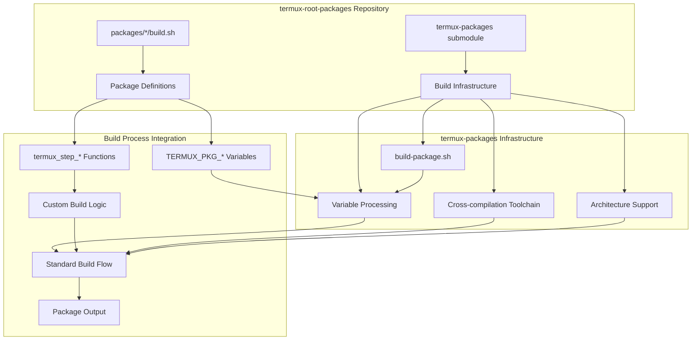

### Submodule Configuration

The termux-packages infrastructure is integrated as a git submodule:

```
[submodule "termux-packages"]
    path = termux-packages
    url = https://github.com/termux/termux-packages
```

This allows termux-root-packages to:
- Use the same build system as the main termux-packages repository
- Inherit cross-compilation capabilities
- Maintain compatibility with termux package management tools
- Leverage existing build infrastructure without duplication

**Sources:** [.gitmodules:1-4]()

## Patch Integration

Package definitions can include patch files that modify upstream source code. Patches are automatically applied during the build process when present in the package directory.

### Patch File Structure

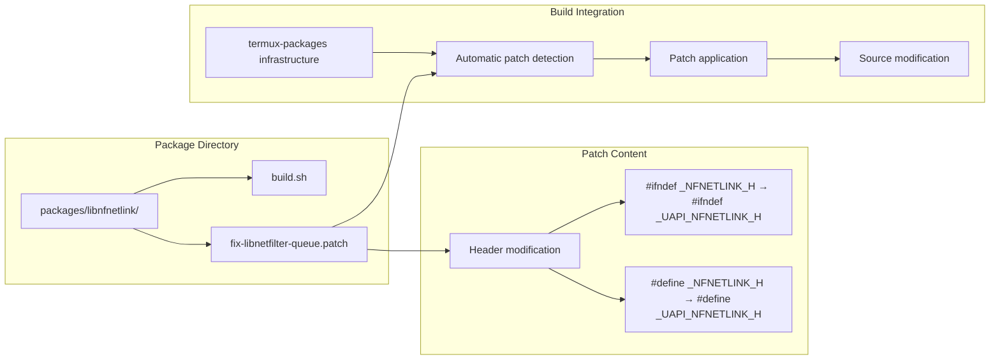

The patch system allows packages to:
- Fix compilation issues specific to the Termux environment
- Adapt upstream code for Android compatibility
- Apply security patches or bug fixes
- Modify build systems for cross-compilation

**Sources:** [packages/libnfnetlink/fix-libnetfilter-queue.patch:1-13]()

---

# Page: Cross-Compilation and Host Builds

# Cross-Compilation and Host Builds

<details>
<summary>Relevant source files</summary>

The following files were used as context for generating this wiki page:

- [packages/frida-server/Makefile.linux.mk.patch](packages/frida-server/Makefile.linux.mk.patch)
- [packages/frida-server/build.sh](packages/frida-server/build.sh)
- [packages/frida-server/frida-version.patch](packages/frida-server/frida-version.patch)
- [packages/frida-server/ndk_version.patch](packages/frida-server/ndk_version.patch)
- [packages/frida-server/setup-env.sh.patch](packages/frida-server/setup-env.sh.patch)
- [packages/hwinfo/Makefile.patch](packages/hwinfo/Makefile.patch)
- [packages/hwinfo/build.sh](packages/hwinfo/build.sh)
- [packages/hwinfo/src-hd-bios.c.patch](packages/hwinfo/src-hd-bios.c.patch)
- [packages/hwinfo/src-hd-mdt.c.patch](packages/hwinfo/src-hd-mdt.c.patch)
- [packages/hwinfo/src-hd-sys.c.patch](packages/hwinfo/src-hd-sys.c.patch)
- [packages/hwinfo/src-ids-Makefile.patch](packages/hwinfo/src-ids-Makefile.patch)
- [packages/hwinfo/src-isdn-cdb-Makefile.patch](packages/hwinfo/src-isdn-cdb-Makefile.patch)
- [packages/hwinfo/src-isdn-isa-probe.c.patch](packages/hwinfo/src-isdn-isa-probe.c.patch)
- [packages/tshark/build.sh](packages/tshark/build.sh)
- [packages/tshark/caputils-ws80211.c.patch](packages/tshark/caputils-ws80211.c.patch)
- [packages/tshark/paths.patch](packages/tshark/paths.patch)

</details>


This document explains the cross-compilation infrastructure and host build system used in termux-root-packages to build Android-compatible packages from x86_64 host systems. It covers the mechanisms for building both host tools and target binaries within the same package build process.

For information about the overall build system architecture, see [Build System Architecture](#2). For details about package definition syntax, see [Package Definition System](#2.1).

## Cross-Compilation Architecture

The termux-root-packages repository employs a sophisticated cross-compilation system that builds packages for Android target architectures from GitHub Actions runners. The system handles both simple cross-compilation scenarios and complex builds requiring host-side tool generation.

### Cross-Compilation Flow

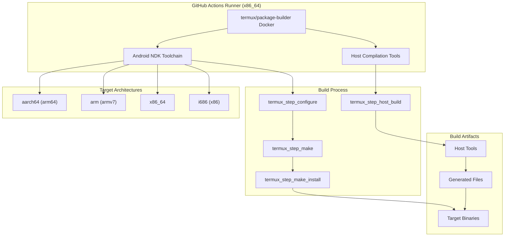

**Sources:** [packages/frida-server/build.sh:1-94](), [packages/tshark/build.sh:1-26](), [packages/hwinfo/build.sh:1-28]()

## Host Build System

The host build system allows packages to compile tools that run on the build host (x86_64 Linux) during the package build process. This is essential for packages that need to generate data files, parse configuration, or build code generators before creating the final Android binaries.

### Host Build Configuration

Packages enable host builds by setting `TERMUX_PKG_HOSTBUILD=true` and implementing the `termux_step_host_build()` function:

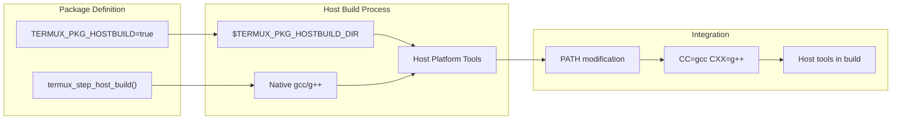

**Sources:** [packages/frida-server/build.sh:14](), [packages/tshark/build.sh:17](), [packages/frida-server/build.sh:27-33](), [packages/tshark/build.sh:19-21]()

### Host Build Examples

#### Tshark Lemon Parser

The tshark package demonstrates a simple host build pattern where a parser generator is compiled for the host system:

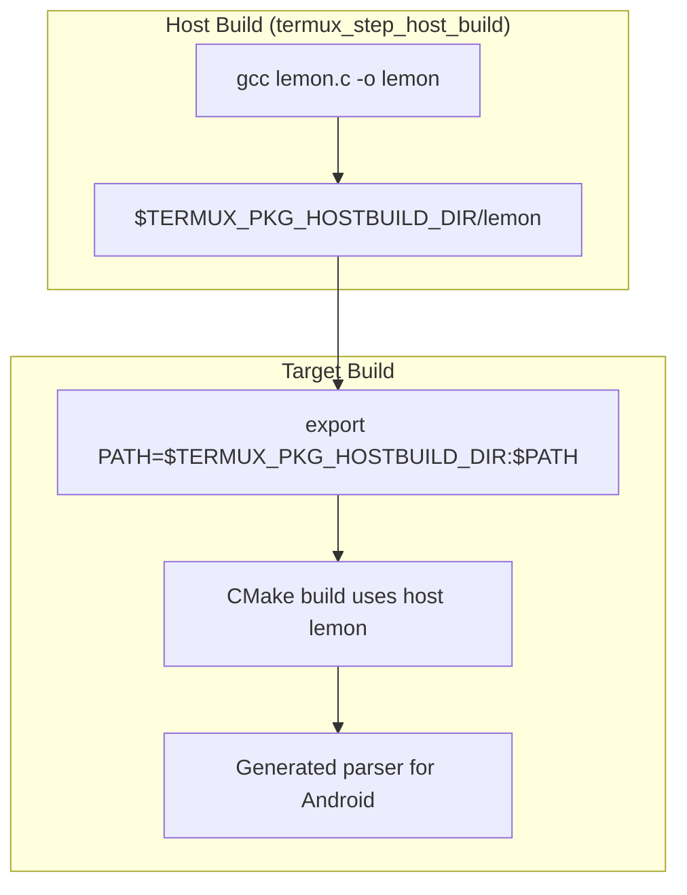

**Sources:** [packages/tshark/build.sh:19-25]()

#### Frida Node.js Integration

The frida-server package shows a complex host build that downloads and integrates Node.js:

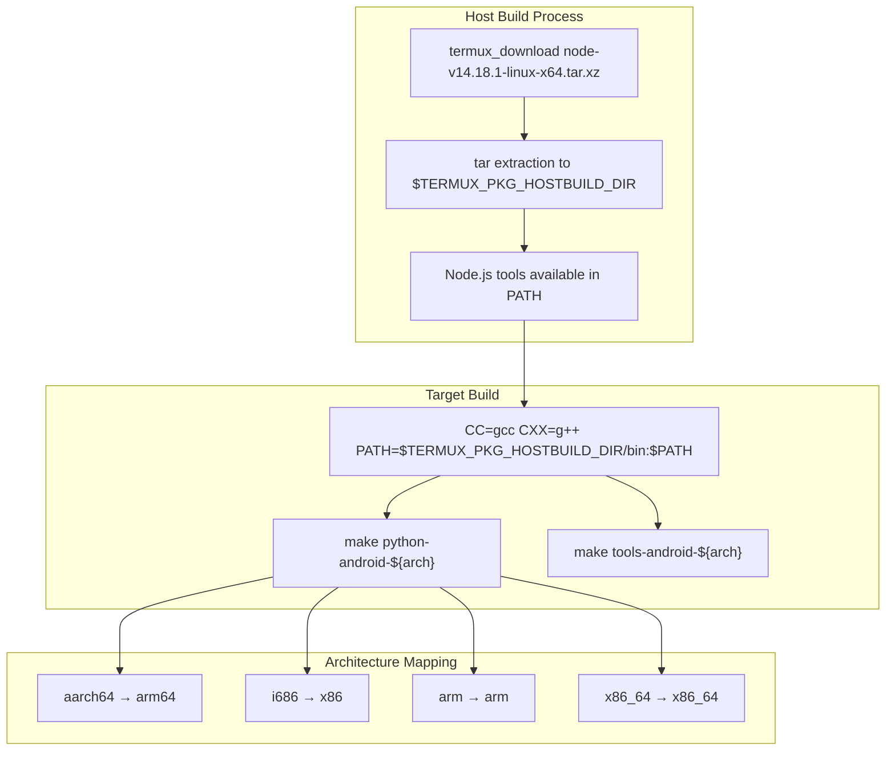

**Sources:** [packages/frida-server/build.sh:27-33](), [packages/frida-server/build.sh:44-55]()

## Hardware Info Data Generation

The hwinfo package demonstrates host-based data generation where specialized tools create platform-specific data files:

```mermaid
graph TD
    subgraph "Host Tools Generation"
        A["check_hd_host: check_hd.c"]
        B["mk_isdnhwdb_host: mk_isdnhwdb.c"]
        C["isdn_cdb_host: isdn_cdb.c"]
    end
    
    subgraph "Data Generation"
        D["./check_hd_host --check --sort --cfile hd_ids.h"]
        E["./mk_isdnhwdb_host ISDN.CDB.txt ISDN.CDB.hwdb"]
        F["./isdn_cdb_host ISDN.CDB.txt isdn_cdb.h"]
    end
    
    subgraph "Target Integration"
        G["hd_ids.h → Android build"]
        H["ISDN.CDB.hwdb → Target filesystem"]
    end
    
    A --> D
    B --> E
    C --> F
    
    D --> G
    E --> H
    F --> G
```

**Sources:** [packages/hwinfo/src-ids-Makefile.patch:8-21](), [packages/hwinfo/src-isdn-cdb-Makefile.patch:28-57]()

## Path Remapping and Environment Handling

Cross-compilation requires extensive path remapping to ensure that hardcoded paths in source code point to the correct Termux filesystem locations rather than standard Linux paths.

### Path Substitution System

```mermaid
graph LR
    subgraph "Source Code Paths"
        A["/usr/sbin/NetworkManager"]
        B["/usr/share/GeoIP"]
        C["/etc/snort/snort.conf"]
        D["/bin:/usr/bin"]
    end
    
    subgraph "Patch Substitution"
        E["@TERMUX_PREFIX@/bin/NetworkManager"]
        F["@TERMUX_PREFIX@/share/GeoIP"]
        G["@TERMUX_PREFIX@/etc/snort/snort.conf"]
        H["@TERMUX_PREFIX@/bin:@TERMUX_PREFIX@/bin/applets"]
    end
    
    subgraph "Runtime Resolution"
        I["/data/data/com.termux/files/usr/bin/NetworkManager"]
        J["/data/data/com.termux/files/usr/share/GeoIP"]
        K["/data/data/com.termux/files/usr/etc/snort/snort.conf"]
        L["/data/data/com.termux/files/usr/bin:/data/data/com.termux/files/usr/bin/applets"]
    end
    
    A --> E
    B --> F
    C --> G
    D --> H
    
    E --> I
    F --> J
    G --> K
    H --> L
```

**Sources:** [packages/tshark/paths.patch:8-76](), [packages/frida-server/build.sh:22-24]()

## Architecture-Specific Build Handling

The cross-compilation system maps Termux architecture names to target-specific build configurations:

### Architecture Mapping

| Termux Architecture | Target Name | Android ABI | NDK Target |
|-------------------|-------------|-------------|------------|
| `aarch64` | `arm64` | `arm64-v8a` | `aarch64-none-linux-android24` |
| `arm` | `arm` | `armeabi-v7a` | `armv7-none-linux-androideabi24` |
| `x86_64` | `x86_64` | `x86_64` | `x86_64-none-linux-android24` |
| `i686` | `x86` | `x86` | `i686-none-linux-android24` |

**Sources:** [packages/frida-server/build.sh:44-50](), [packages/frida-server/setup-env.sh.patch:1-39]()

### Android API Level Management

Cross-compilation patches ensure consistent Android API level targeting across all architectures, typically standardizing on API level 24 for compatibility:

```mermaid
graph TD
    subgraph "API Level Patches"
        A["android_api=19 → android_api=24"]
        B["android_api=21 → android_api=24"]
    end
    
    subgraph "Architecture Application"
        C["x86: API 24"]
        D["x86_64: API 24"]
        E["arm: API 24"]
        F["arm64: API 24"]
    end
    
    A --> C
    A --> E
    B --> D
    B --> F
```

**Sources:** [packages/frida-server/setup-env.sh.patch:7-35]()

## Version and Build Metadata Handling

Complex packages require build-time generation of version headers and metadata files that embed package version information:

```mermaid
graph LR
    subgraph "Template Files"
        A["frida-version.h template"]
        B["@TERMUX_PKG_VERSION@ placeholders"]
    end
    
    subgraph "Build-Time Substitution"
        C["sed substitution in termux_step_post_configure"]
        D["Version variables from build.sh"]
    end
    
    subgraph "Generated Headers"
        E["#define FRIDA_VERSION \"15.1.12\""]
        F["#define FRIDA_MAJOR_VERSION 15"]
    end
    
    A --> C
    B --> C
    D --> C
    C --> E
    C --> F
```

**Sources:** [packages/frida-server/build.sh:35-41](), [packages/frida-server/frida-version.patch:1-16]()

---

# Page: Patching System

# Patching System

<details>
<summary>Relevant source files</summary>

The following files were used as context for generating this wiki page:

- [packages/aircrack-ng/build.sh](packages/aircrack-ng/build.sh)
- [packages/aircrack-ng/osdep-find-lib-fix.patch](packages/aircrack-ng/osdep-find-lib-fix.patch)
- [packages/bettercap/build.sh](packages/bettercap/build.sh)
- [packages/bettercap/fix-home-path.patch](packages/bettercap/fix-home-path.patch)
- [packages/bettercap/fix-paths.patch](packages/bettercap/fix-paths.patch)
- [packages/mtr/build.sh](packages/mtr/build.sh)
- [packages/mtr/hsearch.patch](packages/mtr/hsearch.patch)
- [packages/mtr/hsearch/README.md](packages/mtr/hsearch/README.md)
- [packages/mtr/hsearch/hcreate.c](packages/mtr/hsearch/hcreate.c)
- [packages/mtr/hsearch/hcreate_r.c](packages/mtr/hsearch/hcreate_r.c)
- [packages/mtr/hsearch/hdestroy_r.c](packages/mtr/hsearch/hdestroy_r.c)
- [packages/mtr/hsearch/hsearch.h](packages/mtr/hsearch/hsearch.h)
- [packages/mtr/hsearch/hsearch_r.c](packages/mtr/hsearch/hsearch_r.c)
- [packages/mtr/hsearch/search.h](packages/mtr/hsearch/search.h)
- [packages/mtr/index_to_strchr.patch](packages/mtr/index_to_strchr.patch)
- [packages/mtr/packet.c.patch](packages/mtr/packet.c.patch)

</details>


The Patching System modifies upstream source code to work correctly in the Termux environment. This system handles path adaptations, build system modifications, compatibility fixes, and security adjustments required for packages that need root access on Android.

For information about the overall build process that applies these patches, see [Build System Architecture](#2). For details about package definitions that reference patches, see [Package Definition System](#2.1).

## Patch Types and Application

The patching system supports several categories of modifications to upstream source code:

```mermaid
graph TB
    subgraph "Patch Categories"
        A["Path Replacement Patches"] --> B["@TERMUX_PREFIX@ substitution"]
        A --> C["@TERMUX_HOME@ substitution"]
        
        D["Build System Patches"] --> E["Makefile modifications"]
        D --> F["Configure script fixes"]
        
        G["Compatibility Patches"] --> H["Function replacements"]
        G --> I["Header inclusions"]
        
        J["Security Patches"] --> K["Permission removals"]
        J --> L["Capability handling"]
        
        M["Library Implementation"] --> N["Missing system functions"]
        M --> O["Complete subsystem replacements"]
    end
    
    subgraph "Application Process"
        P["termux_step_patch"] --> Q["Apply .patch files"]
        Q --> R["Process template variables"]
        R --> S["Modified source tree"]
    end
    
    A --> P
    D --> P
    G --> P
    J --> P
    M --> P
```

**Patch Application Workflow**

Sources: [packages/bettercap/fix-paths.patch:1-27](), [packages/mtr/packet.c.patch:1-19](), [packages/aircrack-ng/osdep-find-lib-fix.patch:1-12]()

## Path Templating System

The most common patch type replaces hardcoded Unix paths with Termux-specific template variables that are processed during the build:

| Template Variable | Purpose | Example Replacement |
|------------------|---------|-------------------|
| `@TERMUX_PREFIX@` | System installation prefix | `/data/data/com.termux/files/usr` |
| `@TERMUX_HOME@` | User home directory | `/data/data/com.termux/files/home` |

### Path Replacement Examples

**System Data Directories**
```diff
-	return "/usr/local/share/bettercap/"
+	return "@TERMUX_PREFIX@/share/bettercap/"
```

**User Configuration Files**
```diff
-		"~/.bettercap-ca.cert.pem",
+		"@TERMUX_HOME@/.bettercap-ca.cert.pem",
```

Sources: [packages/bettercap/fix-paths.patch:9-10](), [packages/bettercap/fix-home-path.patch:9-10]()

## Build System Modifications

Build system patches modify compilation flags, library linking, and configuration options to work with the Termux cross-compilation environment:

```mermaid
graph LR
    subgraph "Build System Patches"
        A["Makefile.inc"] --> B["libaircrack_osdep_la_LDFLAGS"]
        B --> C["Remove -release $(LT_VER)"]
        C --> D["Retain -no-undefined"]
        
        E["Configure flags"] --> F["TERMUX_PKG_EXTRA_CONFIGURE_ARGS"]
        F --> G["--disable-static"]
        
        H["Library paths"] --> I["$TERMUX_PREFIX/lib"]
        I --> J["Symlink creation"]
    end
```

**Library Linking Modifications**
The `libaircrack-osdep` library linking is modified to remove version-specific flags while maintaining undefined symbol checking:

```diff
-libaircrack_osdep_la_LDFLAGS = -release $(LT_VER) -no-undefined
+libaircrack_osdep_la_LDFLAGS = -no-undefined
```

Sources: [packages/aircrack-ng/osdep-find-lib-fix.patch:7-8](), [packages/aircrack-ng/build.sh:14]()

## Compatibility and Security Patches

### Function Compatibility

Legacy function calls are replaced with modern equivalents for Android compatibility:

```diff
-    if (index(format, 'N')) {
+    if (strchr(format, 'N')) {
```

```diff
-        end_of_reply = index(reply_start, '\n');
+        end_of_reply = strchr(reply_start, '\n');
```

### Security Modifications

Patches remove problematic privilege operations that don't work correctly in the Android environment:

```diff
-    /*  Drop any suid permissions granted  */
-    if (setgid(getgid()) || setuid(getuid())) {
-        return -1;
-    }
-
-    if (geteuid() != getuid() || getegid() != getgid()) {
-        return -1;
-    }
```

Sources: [packages/mtr/index_to_strchr.patch:7-8](), [packages/mtr/packet.c.patch:7-15]()

## Complete Library Implementations

For packages missing required system libraries, the patching system can include complete implementations:

```mermaid
graph TD
    subgraph "hsearch Implementation for mtr"
        A["Missing hsearch(3) functions"] --> B["FreeBSD-based implementation"]
        B --> C["hcreate.c"]
        B --> D["hcreate_r.c"] 
        B --> E["hsearch_r.c"]
        B --> F["hdestroy_r.c"]
        B --> G["hsearch.h"]
        B --> H["search.h"]
        
        I["Source Modifications"] --> J["#include path changes"]
        J --> K["Makefile.am updates"]
        
        C --> L["Global hash table interface"]
        D --> M["Reentrant hash table creation"]
        E --> N["Hash table search/insert"]
        F --> O["Hash table cleanup"]
    end
```

**Integration Process**

The `mtr` package demonstrates complex patching where an entire subsystem is replaced:

1. **Source file integration**: Hash table implementation files are copied from the package's `hsearch/` directory
2. **Header path modification**: `#include <search.h>` becomes `#include "portability/search.h"`
3. **Build system updates**: `Makefile.am` is modified to include the new source files

```diff
+mtr_SOURCES += \
+	portability/hcreate.c \
+	portability/hcreate_r.c \
+	portability/hsearch_r.c \
+	portability/hdestroy_r.c
```

Sources: [packages/mtr/hsearch.patch:7-8](), [packages/mtr/hsearch.patch:18-23](), [packages/mtr/build.sh:13]()

## Patch Organization and Naming

Patches are stored alongside package definitions and follow consistent naming patterns:

```mermaid
graph TB
    subgraph "Package Directory Structure"
        A["packages/PACKAGE_NAME/"] --> B["build.sh"]
        A --> C["*.patch files"]
        A --> D["Additional source files"]
        
        E["Patch Naming Conventions"] --> F["fix-paths.patch"]
        E --> G["fix-home-path.patch"]
        E --> H["function-name.patch"]
        E --> I["filename.patch"]
    end
    
    subgraph "Patch Application"
        J["termux_step_pre_configure"] --> K["Copy additional files"]
        L["termux_step_post_configure"] --> M["Apply patches automatically"]
        M --> N["Process template variables"]
    end
    
    C --> M
    D --> K
```

**Automatic Patch Detection**

The build system automatically applies all `.patch` files found in the package directory. Complex packages may also copy additional source files during the pre-configure step:

```bash
termux_step_pre_configure() {
    cp ${TERMUX_PKG_BUILDER_DIR}/hsearch/* ${TERMUX_PKG_SRCDIR}/portability
}
```

Sources: [packages/mtr/build.sh:13](), [packages/bettercap/fix-paths.patch:1](), [packages/bettercap/fix-home-path.patch:1]()

---

# Page: CI/CD Pipeline

# CI/CD Pipeline

<details>
<summary>Relevant source files</summary>

The following files were used as context for generating this wiki page:

- [.github/static/powered-by-fosshost.png](.github/static/powered-by-fosshost.png)
- [.github/workflows/packages.yml](.github/workflows/packages.yml)
- [CONTRIBUTING.md](CONTRIBUTING.md)
- [README.md](README.md)
- [scripts/lint-packages.sh](scripts/lint-packages.sh)
- [start-builder.sh](start-builder.sh)

</details>


This document describes the automated build and distribution system for the termux-root-packages repository. The CI/CD pipeline handles building packages across multiple Android architectures, validates package definitions, and distributes compiled packages to APT repositories.

For information about package definition and build system architecture, see [Build System Architecture](#2). For details about individual package categories, see [Package Categories](#4).

## Pipeline Architecture Overview

The CI/CD system uses GitHub Actions to orchestrate a multi-stage pipeline that detects changes, builds packages, and distributes them to public repositories.

### High-Level Pipeline Flow

```mermaid
graph TD
    subgraph "Triggers"
        A[push_to_master] --> D[GitHub_Actions]
        B[pull_request] --> D
        C[workflow_dispatch] --> D
    end
    
    subgraph "Build Stage"
        D --> E[changed_files_detection]
        E --> F[lint_packages_sh]
        F --> G[build_matrix]
        G --> H[aarch64_build]
        G --> I[arm_build]
        G --> J[i686_build]
        G --> K[x86_64_build]
    end
    
    subgraph "Docker Environment"
        L[termux_package_builder] --> H
        L --> I
        L --> J
        L --> K
    end
    
    subgraph "Upload Stage"
        H --> M[artifact_collection]
        I --> M
        J --> M
        K --> M
        M --> N[aptly_upload_file]
        N --> O[aptly_add_to_repo]
        O --> P[aptly_publish_repo]
    end
    
    subgraph "Distribution"
        P --> Q[packages_termux_org]
        P --> R[grimler_se_mirror]
    end
```

Sources: [.github/workflows/packages.yml:1-237]()

### Build Trigger System

The pipeline activates under three conditions with different file change detection strategies:

| Trigger Type | Condition | File Detection |
|--------------|-----------|----------------|
| `push` | Push to master branch with changes in `packages/**` | Git diff-tree analysis |
| `pull_request` | PR with changes in `packages/**` | Base commit to HEAD comparison |
| `workflow_dispatch` | Manual trigger with package list | User-specified packages |

The change detection logic implements sophisticated git analysis to identify modified, added, and deleted packages:

```mermaid
graph LR
    subgraph "Change Detection Logic"
        A[git_diff_tree] --> B[package_regex_matching]
        B --> C{package_or_subpackage}
        C -->|package| D[check_directory_exists]
        C -->|subpackage| E[check_subpackage_file_exists]
        D -->|exists| F[built_packages_txt]
        D -->|deleted| G[deleted_packages_txt]
        E -->|exists| H[built_subpackages_txt]
        E -->|deleted| G
    end
```

Sources: [.github/workflows/packages.yml:35-103]()

## Build Process Flow

### Package Linting System

Before compilation, all modified packages undergo validation through the `lint-packages.sh` script:

```mermaid
graph TD
    subgraph "Linting Process"
        A[lint_packages_sh] --> B[syntax_check]
        B --> C[termux_pkg_homepage_validation]
        C --> D[termux_pkg_description_length]
        D --> E[termux_pkg_license_validation]
        E --> F[termux_pkg_version_check]
        F --> G[termux_pkg_srcurl_https_validation]
        G --> H[termux_pkg_sha256_validation]
    end
    
    subgraph "License Validation"
        I[check_package_license] --> J[valid_license_list]
        J --> K{license_match}
        K -->|valid| L[pass]
        K -->|invalid| M[fail]
    end
    
    E --> I
```

The linting system validates over 20 different package metadata fields including required fields like `TERMUX_PKG_HOMEPAGE`, `TERMUX_PKG_DESCRIPTION`, and `TERMUX_PKG_LICENSE`.

Sources: [scripts/lint-packages.sh:53-433]()

### Docker Build Environment

The build process utilizes a containerized environment managed by `start-builder.sh`:

```mermaid
graph TD
    subgraph "Docker Build Setup"
        A[start_builder_sh] --> B[termux_package_builder_image]
        B --> C[container_uid_gid_adjustment]
        C --> D[termux_packages_submodule_mount]
        D --> E[package_directory_copy]
        E --> F[build_package_sh_execution]
    end
    
    subgraph "Container Configuration"
        G[CONTAINER_NAME] --> H["termux-package-builder"]
        I[IMAGE_NAME] --> J["termux/package-builder"]
        K[BUILDER_HOME] --> L["/home/builder"]
    end
    
    B --> G
    B --> I
    D --> K
```

The container setup includes automatic UID/GID mapping to prevent permission issues and mounts the termux-packages submodule for build infrastructure access.

Sources: [start-builder.sh:20-98]()

## Architecture Matrix Build System

### Multi-Architecture Support

The pipeline builds packages simultaneously across four Android architectures:

```mermaid
graph TD
    subgraph "Build Matrix Strategy"
        A[strategy_matrix] --> B[aarch64_job]
        A --> C[arm_job]
        A --> D[i686_job]
        A --> E[x86_64_job]
    end
    
    subgraph "Build Environment Variables"
        F[ANDROID_HOME] --> G["/opt/termux/android-sdk"]
        H[NDK] --> I["/opt/termux/android-ndk"]
    end
    
    subgraph "Build Execution"
        J[build_package_sh] --> K[architecture_specific_compilation]
        K --> L[deb_file_generation]
        L --> M[sha256sum_verification]
    end
    
    B --> F
    C --> F
    D --> F
    E --> F
    
    B --> J
    C --> J
    D --> J
    E --> J
```

Each architecture job runs independently with `fail-fast: false` to ensure all architectures attempt building even if one fails.

Sources: [.github/workflows/packages.yml:24-27](), [.github/workflows/packages.yml:119-122]()

## Package Distribution System

### Aptly Repository Management

The upload process uses the Aptly API to manage package repositories:

```mermaid
graph LR
    subgraph "Repository Upload Flow"
        A[artifact_download] --> B[aptly_upload_file]
        B --> C[aptly_add_to_repo]
        C --> D[aptly_delete_dir]
        D --> E[aptly_publish_repo]
    end
    
    subgraph "Repository Configuration"
        F[REPOSITORY_NAME] --> G["termux-root"]
        H[REPOSITORY_DISTRIBUTION] --> I["root"]
        J[packages_termux_org] --> K["https://packages-cf.termux.org/aptly-api"]
        L[grimler_se_mirror] --> M["https://aptly-api.grimler.se"]
    end
    
    B --> F
    C --> H
    E --> J
    E --> L
```

The system uploads to two repository endpoints: the primary `packages.termux.org` and the `grimler.se` mirror, with the primary repository supporting automatic GPG signing.

Sources: [.github/workflows/packages.yml:154-236]()

### Upload Process Implementation

The upload job implements robust error handling and artifact processing:

| Step | Function | Purpose |
|------|----------|---------|
| Artifact Download | `actions/download-artifact@v2` | Collect build artifacts from all architectures |
| File Extraction | `tar xf "$archive"` | Extract .deb files from compressed archives |
| Batch Upload | `aptly_upload_file` | Upload files to temporary directory |
| Repository Integration | `aptly_add_to_repo` | Add packages to repository |
| Publication | `aptly_publish_repo` | Make changes visible in web root |

The process handles both regular packages and static variants using glob patterns: `debs/${package}_*.deb` and `debs/${package}-static_*.deb`.

Sources: [.github/workflows/packages.yml:167-195]()

## Build Optimization Features

### Conditional Build Logic

The pipeline includes several optimization mechanisms:

- **No-build tag**: Commits with `%ci:no-build` in the message skip building
- **Duplicate detection**: Package lists are deduplicated using `uniq`
- **Incremental builds**: Only changed packages are rebuilt
- **Parallel execution**: Architecture builds run concurrently

```mermaid
graph TD
    subgraph "Build Optimization"
        A[commit_message_check] --> B{contains_ci_no_build}
        B -->|yes| C[skip_build_exit_0]
        B -->|no| D[package_change_detection]
        D --> E[duplicate_removal_uniq]
        E --> F[parallel_architecture_builds]
    end
```

Sources: [.github/workflows/packages.yml:59-65](), [.github/workflows/packages.yml:105-117]()

### Artifact Management

Built packages are archived and stored using GitHub Actions artifacts with architecture-specific naming:

- Artifact name pattern: `termux-root-packages-${arch}-${github.sha}`
- Archive format: `debs-${arch}-${github.sha}.tar`
- Checksum generation: SHA256 verification for all `.deb` files

Sources: [.github/workflows/packages.yml:133-141]()

---

# Page: Package Categories

# Package Categories

<details>
<summary>Relevant source files</summary>

The following files were used as context for generating this wiki page:

- [packages/cryptsetup/build.sh](packages/cryptsetup/build.sh)
- [packages/dnsmasq/Makefile.patch](packages/dnsmasq/Makefile.patch)
- [packages/dnsmasq/build.sh](packages/dnsmasq/build.sh)
- [packages/dnsmasq/dnsmasq.h.patch](packages/dnsmasq/dnsmasq.h.patch)
- [packages/docker/build.sh](packages/docker/build.sh)
- [packages/docker/config.go.patch](packages/docker/config.go.patch)
- [packages/docker/daemon.json](packages/docker/daemon.json)
- [packages/docker/database.go.patch](packages/docker/database.go.patch)
- [packages/docker/generate-man.sh.patch](packages/docker/generate-man.sh.patch)
- [packages/docker/md2man-all.sh.patch](packages/docker/md2man-all.sh.patch)
- [packages/ethtool/build.sh](packages/ethtool/build.sh)
- [packages/ettercap/build.sh](packages/ettercap/build.sh)
- [packages/hping3/build.sh](packages/hping3/build.sh)
- [packages/iw/build.sh](packages/iw/build.sh)
- [packages/libfuse3/build.sh](packages/libfuse3/build.sh)
- [packages/tcpdump/build.sh](packages/tcpdump/build.sh)
- [packages/tcpdump/configure.patch](packages/tcpdump/configure.patch)
- [packages/tinc/build.sh](packages/tinc/build.sh)
- [packages/tinc/fix-tun-device-path.patch](packages/tinc/fix-tun-device-path.patch)
- [packages/wpa-supplicant/build.sh](packages/wpa-supplicant/build.sh)

</details>


This document provides an overview of the different types of packages available in the termux-root-packages repository, organized by functional area. These packages require root access to function properly and are designed to provide system-level tools, network security utilities, and container/virtualization capabilities for Android devices running Termux.

For detailed information about building and contributing packages, see [Development and Contribution Guide](#5). For advanced build patterns and custom compilation scenarios, see [Advanced Build Patterns](#6).

## Package Category Overview

The termux-root-packages repository contains specialized packages organized into six main functional categories, each serving distinct system administration and security purposes.

### Category Classification Diagram

```mermaid
graph TB
    subgraph "Network Security Tools"
        A1["ettercap<br/>MITM Attacks"]
        A2["hping3<br/>Packet Assembly"]
        A3["aircrack-ng<br/>WiFi Security"]
        A4["bettercap<br/>Network Attacks"]
    end
    
    subgraph "Network Analysis"
        B1["tcpdump<br/>Packet Capture"]
        B2["tshark<br/>Protocol Analysis"]
        B3["nethogs<br/>Bandwidth Monitor"]
        B4["termshark<br/>Terminal UI"]
    end
    
    subgraph "Container/Virtualization"
        C1["docker<br/>Container Platform"]
        C2["runc<br/>Container Runtime"]
        C3["lxc<br/>System Containers"]
        C4["containerd<br/>Container Daemon"]
    end
    
    subgraph "System Administration"
        D1["cryptsetup<br/>Disk Encryption"]
        D2["hwinfo<br/>Hardware Detection"]
        D3["libdevmapper<br/>Device Mapping"]
    end
    
    subgraph "Network Infrastructure"
        E1["ethtool<br/>Ethernet Control"]
        E2["iw<br/>Wireless Control"]
        E3["dnsmasq<br/>DNS/DHCP Server"]
        E4["wpa-supplicant<br/>WiFi Auth"]
        E5["tinc<br/>VPN Daemon"]
        E6["openvpn<br/>VPN Client"]
    end
    
    subgraph "Specialized Libraries"
        F1["libfuse3<br/>Filesystem Interface"]
        F2["libseccomp<br/>Security Policies"]
        F3["libmnl<br/>Netlink Interface"]
    end
    
    style A1 fill:#f9f9f9
    style B1 fill:#f9f9f9
    style C1 fill:#f9f9f9
    style D1 fill:#f9f9f9
    style E1 fill:#f9f9f9
    style F1 fill:#f9f9f9
```

Sources: [packages/ettercap/build.sh:1-15](), [packages/hping3/build.sh:1-12](), [packages/tcpdump/build.sh:1-12](), [packages/docker/build.sh:1-18](), [packages/cryptsetup/build.sh:1-15](), [packages/ethtool/build.sh:1-9](), [packages/iw/build.sh:1-10](), [packages/dnsmasq/build.sh:1-9](), [packages/wpa-supplicant/build.sh:1-12](), [packages/tinc/build.sh:1-14](), [packages/libfuse3/build.sh:1-18]()

## Package Dependency Relationships

The packages within termux-root-packages have complex interdependencies, with specialized libraries providing core functionality for higher-level tools.

### Dependency Graph

```mermaid
graph TD
    subgraph "Core Libraries"
        libpcap["libpcap<br/>Packet Capture"]
        libdevmapper["libdevmapper<br/>Device Mapping"]
        libfuse3["libfuse3<br/>Filesystem Interface"]
        libmnl["libmnl<br/>Netlink Library"]
        openssl["openssl<br/>Cryptography"]
    end
    
    subgraph "Network Analysis Tools"
        tcpdump["TERMUX_PKG_DEPENDS<br/>tcpdump"]
        ettercap["TERMUX_PKG_DEPENDS<br/>ettercap"]
        hping3["TERMUX_PKG_DEPENDS<br/>hping3"]
    end
    
    subgraph "Container Tools"
        docker["TERMUX_PKG_DEPENDS<br/>docker"]
        containerd["containerd<br/>Container Runtime"]
    end
    
    subgraph "System Tools"
        cryptsetup["TERMUX_PKG_DEPENDS<br/>cryptsetup"]
        ethtool["TERMUX_PKG_DEPENDS<br/>ethtool"]
        iw["TERMUX_PKG_DEPENDS<br/>iw"]
    end
    
    subgraph "Network Infrastructure"
        tinc["TERMUX_PKG_DEPENDS<br/>tinc"]
        wpasupplicant["TERMUX_PKG_DEPENDS<br/>wpa-supplicant"]
    end
    
    libpcap --> tcpdump
    libpcap --> ettercap
    libpcap --> hping3
    libdevmapper --> docker
    libdevmapper --> cryptsetup
    libmnl --> ethtool
    libmnl --> iw
    openssl --> tcpdump
    openssl --> ettercap
    openssl --> cryptsetup
    openssl --> tinc
    openssl --> wpasupplicant
    containerd --> docker
    
    style libpcap fill:#f0f0f0
    style libdevmapper fill:#f0f0f0
    style openssl fill:#f0f0f0
```

Sources: [packages/tcpdump/build.sh:11](), [packages/ettercap/build.sh:9](), [packages/hping3/build.sh:10](), [packages/docker/build.sh:14](), [packages/cryptsetup/build.sh:9](), [packages/ethtool/build.sh:8](), [packages/iw/build.sh:8](), [packages/tinc/build.sh:9](), [packages/wpa-supplicant/build.sh:8]()

## Build Configuration Patterns

Each package category follows specific build configuration patterns defined through `TERMUX_PKG_*` variables and custom build functions.

### Build Configuration Structure

| Package Category | Common Dependencies | Build Patterns | Configuration Args |
|------------------|-------------------|-----------------|-------------------|
| Network Security | `libpcap`, `openssl`, `ncurses` | Custom patches, complex compilation | Security-focused builds |
| Network Analysis | `libpcap`, `openssl` | Protocol support, cross-compilation | Linux kernel version handling |
| Container/Virtualization | `libdevmapper`, `golang` | Multi-stage builds, path remapping | Android-specific adaptations |
| System Administration | `libdevmapper`, `util-linux` | Hardware detection, encryption | Secure configuration |
| Network Infrastructure | `libnl`, `openssl` | Wireless/ethernet support | Device path adaptations |
| Specialized Libraries | Various system libs | Core functionality | Minimal configuration |

Sources: [packages/ettercap/build.sh:9-14](), [packages/tcpdump/build.sh:9-11](), [packages/docker/build.sh:14-17](), [packages/cryptsetup/build.sh:9-14](), [packages/ethtool/build.sh:8](), [packages/libfuse3/build.sh:10-17]()

### TERMUX_PKG Variables Usage

```mermaid
graph LR
    subgraph "Package Definition"
        A["TERMUX_PKG_HOMEPAGE"]
        B["TERMUX_PKG_DESCRIPTION"]
        C["TERMUX_PKG_LICENSE"]
        D["TERMUX_PKG_VERSION"]
        E["TERMUX_PKG_SRCURL"]
        F["TERMUX_PKG_SHA256"]
    end
    
    subgraph "Dependencies"
        G["TERMUX_PKG_DEPENDS"]
        H["TERMUX_PKG_BUILD_DEPENDS"]
        I["TERMUX_PKG_BREAKS"]
        J["TERMUX_PKG_REPLACES"]
    end
    
    subgraph "Build Configuration"
        K["TERMUX_PKG_EXTRA_CONFIGURE_ARGS"]
        L["TERMUX_PKG_BUILD_IN_SRC"]
        M["TERMUX_PKG_CONFFILES"]
        N["TERMUX_PKG_REVISION"]
    end
    
    subgraph "Custom Functions"
        O["termux_step_pre_configure"]
        P["termux_step_make"]
        Q["termux_step_make_install"]
        R["termux_step_get_source"]
    end
    
    A --> G
    B --> G
    C --> G
    D --> G
    E --> G
    F --> G
    G --> K
    H --> K
    I --> K
    J --> K
    K --> O
    L --> O
    M --> O
    N --> O
    O --> P
    P --> Q
    Q --> R
```

Sources: [packages/cryptsetup/build.sh:1-18](), [packages/docker/build.sh:1-17](), [packages/ethtool/build.sh:1-9](), [packages/dnsmasq/build.sh:1-9](), [packages/libfuse3/build.sh:1-17]()

## Category-Specific Details

### Network Security Tools

These packages focus on network security testing, penetration testing, and security analysis capabilities.

**Key Packages:**
- `ettercap`: MITM attack suite with content filtering
- `hping3`: TCP/IP packet assembler/analyzer 
- `aircrack-ng`: WiFi security auditing
- `bettercap`: Network reconnaissance and attacks

**Common Dependencies:** `libpcap`, `openssl`, `ncurses`, `libnet`

Sources: [packages/ettercap/build.sh:1-15](), [packages/hping3/build.sh:1-17]()

### Network Analysis and Monitoring

Packages for network traffic analysis, packet capture, and network diagnostics.

**Key Packages:**
- `tcpdump`: Command-line packet analyzer
- `tshark`: Wireshark command-line interface
- `nethogs`: Per-process bandwidth monitoring
- `termshark`: Terminal UI for packet analysis

**Build Characteristics:** Require Linux kernel version detection and protocol support

Sources: [packages/tcpdump/build.sh:1-12]()

### Container and Virtualization

Container runtime and virtualization tools requiring complex build processes.

**Key Packages:**
- `docker`: Complete container platform with daemon and CLI
- `runc`: Container runtime specification implementation
- `lxc`: System container management
- `containerd`: Container runtime daemon

**Build Complexity:** Multi-stage builds, Go compilation, path remapping

Sources: [packages/docker/build.sh:1-145]()

### System Administration Tools

Low-level system administration utilities for hardware and storage management.

**Key Packages:**
- `cryptsetup`: LUKS disk encryption management
- `hwinfo`: Hardware detection and information
- `libdevmapper`: Device mapper library for LVM/RAID

**Configuration Focus:** Secure defaults and Android-specific adaptations

Sources: [packages/cryptsetup/build.sh:1-18]()

### Network Infrastructure

Network interface management and infrastructure services.

**Key Packages:**
- `ethtool`: Ethernet interface control
- `iw`: Wireless interface configuration
- `dnsmasq`: Lightweight DNS/DHCP server
- `wpa-supplicant`: WPA wireless authentication
- `tinc`: Mesh VPN daemon
- `openvpn`: OpenVPN client/server

**Device Adaptations:** Android-specific device paths and interface handling

Sources: [packages/ethtool/build.sh:1-9](), [packages/iw/build.sh:1-10](), [packages/dnsmasq/build.sh:1-9](), [packages/wpa-supplicant/build.sh:1-22](), [packages/tinc/build.sh:1-14]()

### Specialized Libraries

Core system libraries providing fundamental functionality for other packages.

**Key Packages:**
- `libfuse3`: FUSE filesystem interface
- `libseccomp`: Security policy enforcement
- `libmnl`: Netlink socket library
- `libdevmapper`: Device mapping interface

**Role:** Foundation libraries with minimal configuration requirements

Sources: [packages/libfuse3/build.sh:1-18]()

---

# Page: Network Security Tools

# Network Security Tools

<details>
<summary>Relevant source files</summary>

The following files were used as context for generating this wiki page:

- [packages/aircrack-ng/build.sh](packages/aircrack-ng/build.sh)
- [packages/aircrack-ng/osdep-find-lib-fix.patch](packages/aircrack-ng/osdep-find-lib-fix.patch)
- [packages/bettercap/build.sh](packages/bettercap/build.sh)
- [packages/bettercap/fix-home-path.patch](packages/bettercap/fix-home-path.patch)
- [packages/bettercap/fix-paths.patch](packages/bettercap/fix-paths.patch)
- [packages/cryptsetup/build.sh](packages/cryptsetup/build.sh)
- [packages/ettercap/build.sh](packages/ettercap/build.sh)
- [packages/tcpdump/build.sh](packages/tcpdump/build.sh)
- [packages/tcpdump/configure.patch](packages/tcpdump/configure.patch)
- [packages/tinc/build.sh](packages/tinc/build.sh)
- [packages/tinc/fix-tun-device-path.patch](packages/tinc/fix-tun-device-path.patch)
- [packages/wpa-supplicant/build.sh](packages/wpa-supplicant/build.sh)

</details>


This document covers network security tools available in the termux-root-packages repository that require root privileges for network interface manipulation, packet injection, and low-level network operations. These tools are primarily focused on wireless security auditing, man-in-the-middle (MITM) attacks, and network reconnaissance.

For network monitoring and analysis tools like packet capture utilities, see [Network Analysis and Monitoring](#4.2). For VPN and network infrastructure tools, see [Network Infrastructure](#4.5).

## Tool Categories and Architecture

The network security tools in this repository fall into several functional categories, each with specific dependency requirements and build patterns:

```mermaid
graph TB
    subgraph "Wireless Security Auditing"
        A["aircrack-ng<br/>WiFi Security Suite"] --> B["libpcap<br/>Packet Capture"]
        A --> C["openssl<br/>Cryptography"]
        A --> D["libnl<br/>Netlink Interface"]
        
        E["wpa-supplicant<br/>WPA Key Negotiation"] --> C
        E --> F["readline<br/>CLI Interface"]
        E --> D
    end
    
    subgraph "MITM Attack Tools"
        G["bettercap<br/>Network Reconnaissance"] --> B
        G --> H["libusb<br/>USB Device Access"]
        G --> I["libnetfilter-queue<br/>Packet Filtering"]
        
        J["ettercap<br/>MITM Attack Suite"] --> B
        J --> C
        J --> K["libnet<br/>Packet Construction"]
        J --> L["pcre<br/>Pattern Matching"]
        J --> M["ethtool<br/>Interface Control"]
    end
    
    subgraph "Encryption and VPN"
        N["cryptsetup<br/>Disk Encryption"] --> O["libdevmapper<br/>Device Mapping"]
        N --> P["libgcrypt<br/>Cryptography"]
        N --> C
        
        Q["tinc<br/>VPN Daemon"] --> C
        Q --> R["liblzo<br/>Compression"]
    end
    
    style A fill:#ffebee
    style G fill:#e8f5e8
    style N fill:#e3f2fd
```

**Tool Dependencies and Build Architecture**

Sources: [packages/aircrack-ng/build.sh:10](), [packages/bettercap/build.sh:9](), [packages/ettercap/build.sh:9](), [packages/cryptsetup/build.sh:9](), [packages/wpa-supplicant/build.sh:8](), [packages/tinc/build.sh:9]()

## Wireless Security Tools

### aircrack-ng

The `aircrack-ng` package provides a comprehensive WiFi security auditing toolkit. The build configuration uses a git snapshot rather than a release version:

```mermaid
graph LR
    subgraph "aircrack-ng Build Process"
        A["TERMUX_PKG_SRCURL<br/>GitHub Archive"] --> B["autogen.sh<br/>Generate Configure"]
        B --> C["configure<br/>--disable-static"]
        C --> D["make<br/>Build Suite"]
        D --> E["libaircrack-ce-wpa.so<br/>Symlink Creation"]
    end
    
    subgraph "Dependencies"
        F["libc++<br/>C++ Runtime"]
        G["libnl<br/>Netlink Library"]
        H["openssl<br/>Crypto Functions"]
        I["libpcap<br/>Packet Capture"]
    end
    
    C --> F
    C --> G
    C --> H
    C --> I
```

The build process includes a custom post-install step that creates a symbolic link for the WPA crypto engine library, addressing library naming compatibility issues in the Termux environment.

Sources: [packages/aircrack-ng/build.sh:1-23](), [packages/aircrack-ng/osdep-find-lib-fix.patch:1-12]()

### wpa-supplicant

The `wpa_supplicant` utility provides WPA/WPA2 key negotiation for wireless networks. The build uses a custom configuration approach:

| Build Parameter | Value | Purpose |
|----------------|-------|---------|
| `TERMUX_PKG_EXTRA_MAKE_ARGS` | `-C wpa_supplicant` | Build only supplicant component |
| `TERMUX_PKG_BUILD_IN_SRC` | true | Build within source directory |
| Configuration File | `defconfig` → `.config` | Use default feature set |

The build process copies the default configuration and sets custom compilation flags through the `EXTRA_CFLAGS` environment variable.

Sources: [packages/wpa-supplicant/build.sh:10-16]()

## MITM Attack and Reconnaissance Tools

### bettercap

The `bettercap` tool is implemented in Go and provides network reconnaissance and MITM attack capabilities. The build process demonstrates complex Go module handling:

```mermaid
graph TD
    subgraph "Go Build Environment"
        A["termux_setup_golang"] --> B["GOPATH Setup"]
        B --> C["CGO_CFLAGS Configuration"]
        C --> D["Source Directory Mapping"]
    end
    
    subgraph "Build Process"
        D --> E["go get Dependencies"]
        E --> F["make build"]
        F --> G["make install"]
    end
    
    subgraph "Path Configuration"
        H["@TERMUX_PREFIX@/share/bettercap/"]
        I["@TERMUX_HOME@/.bettercap-ca.cert.pem"]
        J["@TERMUX_HOME@/.bettercap-httpd.key.pem"]
    end
    
    G --> H
    G --> I
    G --> J
```

Path remapping is critical for `bettercap` functionality, with patches modifying hardcoded paths to use Termux environment variables.

Sources: [packages/bettercap/build.sh:11-29](), [packages/bettercap/fix-paths.patch:9-23](), [packages/bettercap/fix-home-path.patch:9-35]()

### ettercap

The `ettercap` package provides comprehensive MITM attack capabilities with extensive library dependencies:

| Dependency Category | Libraries | Purpose |
|-------------------|-----------|---------|
| Network | `libpcap`, `libnet` | Packet capture and injection |
| Crypto | `openssl` | SSL/TLS operations |
| Pattern Matching | `pcre` | Traffic filtering |
| Interface Control | `ethtool` | Network interface manipulation |
| System | `ncurses`, `zlib`, `curl` | UI and data handling |

The CMake configuration explicitly disables GUI components (`-DENABLE_GTK=off`) and GeoIP functionality for the headless Termux environment.

Sources: [packages/ettercap/build.sh:9-14]()

## Encryption and VPN Security

### cryptsetup

The `cryptsetup` package enables LUKS disk encryption with device mapper integration:

```mermaid
graph LR
    subgraph "cryptsetup Architecture"
        A["cryptsetup<br/>CLI Interface"] --> B["libdevmapper<br/>Device Mapping"]
        A --> C["libgcrypt<br/>Cryptographic Operations"]
        A --> D["json-c<br/>LUKS2 Metadata"]
        
        E["LUKS2 Lock Path<br/>$TERMUX_PREFIX/var/run"] --> A
        F["libiconv<br/>Character Conversion"] --> A
    end
```

The configuration includes Termux-specific paths for LUKS2 lock files and requires explicit iconv linking for character encoding support.

Sources: [packages/cryptsetup/build.sh:12-18]()

### tinc

The `tinc` VPN daemon provides mesh networking capabilities with minimal dependencies:

| Component | Dependency | Purpose |
|-----------|------------|---------|
| Compression | `liblzo` | Packet compression |
| Cryptography | `openssl` | Tunnel encryption |
| Compression | `zlib` | Additional compression |
| Logging | Android `liblog` | System logging integration |

The build includes Android-specific logging integration through the `LIBS="-llog"` configuration.

Sources: [packages/tinc/build.sh:9-13](), [packages/tinc/fix-tun-device-path.patch:128-129]()

## Build System Integration

Network security tools require specialized build handling due to their complex dependencies and cross-compilation requirements:

```mermaid
graph TB
    subgraph "Build Complexity Levels"
        A["Simple<br/>cryptsetup, tinc"] --> B["Standard autotools/cmake"]
        C["Complex<br/>aircrack-ng, ettercap"] --> D["Custom patches + deps"]
        E["Go-based<br/>bettercap"] --> F["Go toolchain + CGO"]
    end
    
    subgraph "Common Patterns"
        G["Path Remapping<br/>@TERMUX_PREFIX@"] 
        H["Library Linking<br/>-liconv, -llog"]
        I["Feature Disabling<br/>GUI, GeoIP"]
    end
    
    B --> G
    D --> G
    F --> G
    
    B --> H
    D --> H
    
    D --> I
    F --> I
```

All network security tools require path remapping to function correctly in the Termux environment, with many requiring additional patches for Android-specific functionality.

Sources: [packages/bettercap/fix-paths.patch:1-27](), [packages/tcpdump/configure.patch:8-86](), [packages/tinc/fix-tun-device-path.patch:128-129](), [packages/cryptsetup/build.sh:16-18]()

---

# Page: Network Analysis and Monitoring

# Network Analysis and Monitoring

<details>
<summary>Relevant source files</summary>

The following files were used as context for generating this wiki page:

- [packages/nethogs/build.sh](packages/nethogs/build.sh)
- [packages/termshark/build.sh](packages/termshark/build.sh)
- [packages/tshark/build.sh](packages/tshark/build.sh)
- [packages/tshark/caputils-ws80211.c.patch](packages/tshark/caputils-ws80211.c.patch)
- [packages/tshark/paths.patch](packages/tshark/paths.patch)

</details>


This document covers the network analysis and monitoring tools available in the termux-root-packages repository. These tools focus on packet capture, protocol analysis, traffic monitoring, and network diagnostics for security research and system administration.

For network security and penetration testing tools, see [Network Security Tools](#4.1). For network infrastructure management tools like DNS/DHCP services, see [Network Infrastructure](#4.5).

## Tool Overview

The network analysis and monitoring category includes three primary tools that work together to provide comprehensive network visibility:

| Tool | Purpose | Key Dependencies | Build Type |
|------|---------|------------------|------------|
| `tshark` | Protocol analyzer and packet sniffer | libpcap, libgnutls, c-ares | Native with host build |
| `termshark` | Terminal UI for tshark analysis | tshark, Go runtime | Go application |
| `nethogs` | Per-process bandwidth monitoring | libpcap, ncurses | Native C++ |

Sources: [packages/tshark/build.sh:1-26](), [packages/termshark/build.sh:1-23](), [packages/nethogs/build.sh:1-12]()

## Network Analysis Tool Architecture

```mermaid
graph TD
    subgraph "Packet Capture Layer"
        A[libpcap] --> B["tshark"]
        A --> C["nethogs"]
    end
    
    subgraph "Protocol Analysis"
        B --> D["Protocol Dissectors"]
        B --> E["lemon Parser"]
        D --> F["Network Protocols"]
        E --> G["Grammar Parsing"]
    end
    
    subgraph "User Interface Layer"
        B --> H["termshark"]
        C --> I["ncurses Display"]
        H --> J["Terminal UI"]
    end
    
    subgraph "Monitoring Output"
        F --> K["Packet Analysis"]
        G --> L["Protocol Decoding"]
        I --> M["Bandwidth Stats"]
        J --> N["Interactive Analysis"]
    end
```

Sources: [packages/tshark/build.sh:9](), [packages/termshark/build.sh:8](), [packages/nethogs/build.sh:9]()

## Core Packet Analysis: tshark

The `tshark` package provides the command-line version of Wireshark for network protocol analysis. It requires a complex build process due to its extensive protocol support and cross-compilation requirements.

### Build Configuration

The tshark build uses several key configuration parameters:

```
TERMUX_PKG_EXTRA_CONFIGURE_ARGS="
-DBUILD_wireshark=OFF
-DENABLE_LUA=OFF
-DHAVE_LINUX_IF_BONDING_H=1
"
```

Key dependencies include:
- `libpcap` for packet capture
- `libgnutls` and `openssl` for TLS/SSL analysis
- `c-ares` for DNS resolution
- `libnl` for netlink communication

Sources: [packages/tshark/build.sh:12-16](), [packages/tshark/build.sh:9]()

### Host Build Requirements

tshark requires a host build step to compile the `lemon` parser generator:

```mermaid
graph LR
    subgraph "Host Build Process"
        A["lemon.c"] --> B["gcc compilation"]
        B --> C["lemon executable"]
    end
    
    subgraph "Target Build Process"
        C --> D["Grammar parsing"]
        D --> E["tshark binary"]
    end
    
    subgraph "termux_step Functions"
        F["termux_step_host_build()"] --> B
        G["termux_step_pre_configure()"] --> D
    end
```

The host build function compiles the lemon parser tool:
```bash
termux_step_host_build() {
    gcc $TERMUX_PKG_SRCDIR/tools/lemon/lemon.c -o lemon
}
```

Sources: [packages/tshark/build.sh:17-25]()

### Path Remapping for Termux Environment

tshark requires extensive path patches to work in the Termux environment. The patches replace hardcoded Unix paths with Termux-appropriate paths:

| Original Path | Termux Path | Context |
|---------------|-------------|---------|
| `/usr/sbin/NetworkManager` | `@TERMUX_PREFIX@/bin/NetworkManager` | WiFi utilities |
| `/usr/sbin/snort` | `@TERMUX_PREFIX@/sbin/snort` | Snort integration |
| `/etc/snort/snort.conf` | `@TERMUX_PREFIX@/etc/snort/snort.conf` | Snort config |
| `/usr/share/GeoIP` | `@TERMUX_PREFIX@/share/GeoIP` | GeoIP databases |
| `/usr/share/snmp/mibs` | `@TERMUX_PREFIX@/share/snmp/mibs` | SNMP MIBs |

Sources: [packages/tshark/paths.patch:8-73]()

## Terminal User Interface: termshark

The `termshark` package provides an interactive terminal interface for tshark, built using Go. It demonstrates the Go package build pattern used in termux-root-packages.

### Go Build Process

```mermaid
graph TD
    subgraph "Go Build Environment"
        A["termux_setup_golang"] --> B["GOPATH setup"]
        B --> C["GO111MODULE=on"]
    end
    
    subgraph "Build Steps"
        C --> D["go install ./..."]
        D --> E["bin/android_${GOARCH}/termshark"]
    end
    
    subgraph "Installation"
        E --> F["TERMUX_PREFIX/bin/termshark"]
        G["install -Dm700"] --> F
    end
```

The build process uses Go modules and cross-compilation:
```bash
termux_step_make() {
    termux_setup_golang
    export GOPATH=$TERMUX_PKG_BUILDDIR
    export GO111MODULE=on
    cd $TERMUX_PKG_SRCDIR
    go install ./...
}
```

Sources: [packages/termshark/build.sh:10-22]()

## Process-Level Network Monitoring: nethogs

The `nethogs` package provides bandwidth monitoring grouped by process, essential for identifying network usage patterns on Android devices.

### Build Configuration

nethogs uses a straightforward C++ build with specific make targets:

```
TERMUX_PKG_EXTRA_MAKE_ARGS="nethogs"
TERMUX_PKG_BUILD_IN_SRC=true
```

Dependencies focus on user interface and packet capture:
- `libc++` for C++ standard library
- `ncurses` for terminal display
- `libpcap` for packet capture

Sources: [packages/nethogs/build.sh:9-11]()

## Tool Integration Patterns

```mermaid
graph TB
    subgraph "Data Flow"
        A["Network Traffic"] --> B["libpcap"]
        B --> C["tshark capture"]
        B --> D["nethogs monitor"]
    end
    
    subgraph "Analysis Workflow"
        C --> E["Protocol Analysis"]
        E --> F["termshark UI"]
        D --> G["Process Bandwidth"]
    end
    
    subgraph "Use Cases"
        F --> H["Interactive Debugging"]
        G --> I["Resource Monitoring"]
        E --> J["Security Analysis"]
    end
```

The tools complement each other in network analysis workflows:
- `tshark` provides deep packet inspection and protocol analysis
- `termshark` offers interactive browsing of tshark captures
- `nethogs` identifies which processes are consuming bandwidth

Sources: [packages/tshark/build.sh:1-2](), [packages/termshark/build.sh:1-2](), [packages/nethogs/build.sh:1-2]()

## Cross-Platform Compatibility

All network analysis tools must handle Android-specific networking constraints and the Termux environment. Common adaptations include:

- Path remapping for configuration files and helper utilities
- Library compatibility patches for Android's networking stack
- Permission handling for packet capture operations
- Integration with Android's network namespace restrictions

The tools require root access due to their need for raw socket access and network interface monitoring capabilities.

Sources: [packages/tshark/paths.patch:1-77](), [packages/tshark/caputils-ws80211.c.patch:1-12]()

---

# Page: Container and Virtualization

# Container and Virtualization

<details>
<summary>Relevant source files</summary>

The following files were used as context for generating this wiki page:

- [packages/docker/build.sh](packages/docker/build.sh)
- [packages/docker/config.go.patch](packages/docker/config.go.patch)
- [packages/docker/daemon.json](packages/docker/daemon.json)
- [packages/docker/database.go.patch](packages/docker/database.go.patch)
- [packages/docker/generate-man.sh.patch](packages/docker/generate-man.sh.patch)
- [packages/docker/md2man-all.sh.patch](packages/docker/md2man-all.sh.patch)
- [packages/lxc/build.sh](packages/lxc/build.sh)
- [packages/lxc/lxc-setup-cgroups.sh](packages/lxc/lxc-setup-cgroups.sh)
- [packages/lxc/src-lxc-cgroups-cgfsng.c.patch](packages/lxc/src-lxc-cgroups-cgfsng.c.patch)
- [packages/lxc/src-lxc-pam-pam_cgfs.c.patch](packages/lxc/src-lxc-pam-pam_cgfs.c.patch)
- [packages/runc/build.sh](packages/runc/build.sh)
- [packages/runc/cg-cpuset-noprefix-compat.patch](packages/runc/cg-cpuset-noprefix-compat.patch)
- [packages/runc/libcontainer-nsenter-cloned_binary.c.patch](packages/runc/libcontainer-nsenter-cloned_binary.c.patch)
- [packages/runc/root-dir-path.patch](packages/runc/root-dir-path.patch)

</details>


This section documents the container and virtualization tools available in termux-root-packages. These packages provide containerization capabilities, system-level virtualization, and container runtime environments that require root access to function properly on Android systems.

The tools covered include Docker for application containerization, LXC for system containers, and runc as the low-level container runtime. For network infrastructure tools that support containerized environments, see [Network Infrastructure](#4.5).

## Overview

Container and virtualization tools in termux-root-packages enable running isolated environments and containerized applications on rooted Android devices. These tools require extensive kernel support and root privileges to manage cgroups, namespaces, and other kernel-level container features.

### Container Stack Architecture

```mermaid
graph TB
    subgraph "User Interface Layer"
        A["docker cli"]
        B["lxc-*"]
    end
    
    subgraph "Container Management"
        C["dockerd"]
        D["containerd"]
        E["lxc daemon"]
    end
    
    subgraph "Runtime Layer"
        F["runc"]
        G["docker-proxy"]
    end
    
    subgraph "System Dependencies"
        H["libseccomp"]
        I["libdevmapper"]
        J["libcap"]
        K["libfuse3"]
    end
    
    subgraph "Kernel Features"
        L["cgroups"]
        M["namespaces"]
        N["capabilities"]
        O["seccomp"]
    end
    
    A --> C
    B --> E
    C --> D
    D --> F
    E --> F
    C --> G
    
    F --> H
    C --> I
    E --> J
    F --> K
    
    H --> O
    I --> L
    J --> N
    F --> M
```

Sources: [packages/docker/build.sh:14](), [packages/lxc/build.sh:11](), [packages/runc/build.sh:8]()

## Docker

Docker provides a complete containerization platform with application-level containers. The implementation includes the Docker daemon (`dockerd`), command-line interface (`docker`), and networking proxy (`docker-proxy`).

### Docker Components

| Component | Purpose | Location |
|-----------|---------|----------|
| `dockerd` | Container daemon | `$TERMUX_PREFIX/libexec/dockerd` |
| `docker` | CLI client | `$TERMUX_PREFIX/bin/docker` |
| `docker-proxy` | Network proxy | `$TERMUX_PREFIX/bin/docker-proxy` |

### Build Process

The Docker build process involves compiling three separate Go modules:

```mermaid
graph TD
    subgraph "Source Components"
        A["moby/moby"]
        B["docker/cli"] 
        C["moby/libnetwork"]
    end
    
    subgraph "Build Targets"
        D["dockerd binary"]
        E["docker client"]
        F["docker-proxy"]
    end
    
    subgraph "Configuration"
        G["daemon.json"]
        H["dockerd.sh wrapper"]
    end
    
    A --> D
    B --> E
    C --> F
    
    D --> G
    D --> H
    
    style A fill:#f9f9f9
    style B fill:#f9f9f9
    style C fill:#f9f9f9
```

Sources: [packages/docker/build.sh:8-10](), [packages/docker/build.sh:52-118]()

### Android-Specific Modifications

Docker requires several patches for Android compatibility:

- **Path Remapping**: `/etc/docker` → `$TERMUX_PREFIX/etc/docker`
- **Socket Location**: `/var/run/docker.sock` → `/data/docker/run/docker.sock`
- **Platform Detection**: Adding Android as a Linux variant
- **Home Directory**: Using `@TERMUX_HOME@/.docker` for configuration

Sources: [packages/docker/build.sh:59-61](), [packages/docker/config.go.patch:16](), [packages/docker/database.go.patch:9-14]()

### Configuration

Docker uses a custom configuration file at `$TERMUX_PREFIX/etc/docker/daemon.json`:

```json
{
    "data-root": "/data/docker/lib/docker",
    "exec-root": "/data/docker/run/docker",
    "pidfile": "/data/docker/run/docker.pid",
    "hosts": ["unix:///data/docker/run/docker.sock"],
    "storage-driver": "overlay2"
}
```

Sources: [packages/docker/daemon.json:1-9]()

## LXC (Linux Containers)

LXC provides system-level containerization with full Linux system containers. The package is maintained at version 3.1.0 due to compatibility requirements with Android kernels.

### LXC Configuration

LXC is configured specifically for the Termux environment:

| Setting | Value | Purpose |
|---------|-------|---------|
| `--with-distro` | `termux` | Termux-specific adaptations |
| `--with-runtime-path` | `$TERMUX_PREFIX/var/run` | Runtime directory |
| `--enable-seccomp` | enabled | Security filtering |
| `--enable-capabilities` | enabled | Privilege management |
| `--disable-apparmor` | disabled | Not available on Android |

Sources: [packages/lxc/build.sh:15-24]()

### Cgroups Compatibility

LXC includes patches for Android cgroups compatibility, specifically changing cgroup file names:

- `cpuset.cpus` → `cpus`
- `cpuset.mems` → `mems`

These changes accommodate Android's non-standard cgroup implementation.

Sources: [packages/lxc/src-lxc-cgroups-cgfsng.c.patch:8-9](), [packages/lxc/src-lxc-pam-pam_cgfs.c.patch:8-9]()

### Cgroups Setup Helper

The `lxc-setup-cgroups` script automates cgroup mounting:

```mermaid
graph TD
    A["lxc-setup-cgroups"] --> B["Mount /sys/fs/cgroup"]
    B --> C["Create cgroup directories"]
    C --> D["Mount individual cgroups"]
    
    subgraph "Cgroup Types"
        E["blkio"]
        F["cpu"]
        G["cpuacct"] 
        H["cpuset"]
        I["devices"]
        J["freezer"]
        K["memory"]
    end
    
    D --> E
    D --> F
    D --> G
    D --> H
    D --> I
    D --> J
    D --> K
```

Sources: [packages/lxc/lxc-setup-cgroups.sh:6-18](), [packages/lxc/build.sh:26-31]()

## runc

runc is the low-level container runtime that executes containers according to the OCI (Open Container Initiative) specification. It serves as the runtime backend for both Docker and other container platforms.

### Build Configuration

runc uses a simple Go build process with GOPATH setup:

```mermaid
graph LR
    A["termux_setup_golang"] --> B["GOPATH setup"]
    B --> C["Symbolic link to source"]
    C --> D["make build"]
    D --> E["Install runc binary"]
```

Sources: [packages/runc/build.sh:10-24]()

### Android Compatibility Patches

runc includes several patches for Android compatibility:

#### Cgroups Compatibility
Similar to LXC, runc patches cgroup file references:
- `cpuset.cpus` → `cpus` 
- `cpuset.mems` → `mems`

#### Path Configuration
- Default root directory: `/run/runc` → `@TERMUX_PREFIX@/tmp/runc`

#### fexecve Implementation
Custom `musl_fexecve` implementation for systems without native fexecve support.

Sources: [packages/runc/cg-cpuset-noprefix-compat.patch:7-14](), [packages/runc/root-dir-path.patch:8-9](), [packages/runc/libcontainer-nsenter-cloned_binary.c.patch:8-30]()

## Dependencies and Requirements

### System Dependencies

```mermaid
graph TB
    subgraph "Core Libraries"
        A["libseccomp"]
        B["libdevmapper"]
        C["libcap"]
        D["libfuse3"]
    end
    
    subgraph "Container Tools"
        E["docker"]
        F["lxc"]
        G["runc"]
        H["containerd"]
    end
    
    subgraph "Supporting Tools"
        I["gnupg"]
        J["rsync"]
        K["wget"]
    end
    
    A --> E
    A --> F
    A --> G
    B --> E
    C --> F
    
    E --> H
    F --> I
    F --> J
    F --> K
```

Sources: [packages/docker/build.sh:14](), [packages/lxc/build.sh:11](), [packages/runc/build.sh:8]()

### Kernel Requirements

All container tools require specific kernel features:

| Feature | Docker | LXC | runc | Purpose |
|---------|--------|-----|------|---------|
| `CONFIG_CGROUP_DEVICE` | ✓ | ✓ | ✓ | Device access control |
| `CONFIG_NAMESPACES` | ✓ | ✓ | ✓ | Process isolation |
| `CONFIG_VETH` | ✓ | ✓ | - | Virtual networking |
| `CONFIG_BRIDGE` | ✓ | ✓ | - | Network bridging |
| `CONFIG_SECCOMP` | ✓ | ✓ | ✓ | System call filtering |

Sources: [packages/docker/build.sh:138-142](), [packages/runc/build.sh:30-41]()

## Usage and Installation Notes

### Post-Installation Setup

Each container tool provides specific setup instructions:

**Docker**: Requires kernel feature verification using the upstream check-config.sh script.

**LXC**: Provides the `lxc-setup-cgroups` helper script for automated cgroup mounting.

**runc**: Requires manual cgroup mounting if `CONFIG_CGROUP_DEVICE` is available.

### Runtime Considerations

- All tools require root access for cgroup and namespace management
- Container data is stored in `/data/docker/` for Docker to persist across reboots
- LXC containers use standard Linux filesystem hierarchy
- runc operates as a low-level runtime, typically managed by higher-level tools

Sources: [packages/docker/build.sh:135-143](), [packages/runc/build.sh:32-38](), [packages/lxc/build.sh:27-29]()

---

# Page: System Administration Tools

# System Administration Tools

<details>
<summary>Relevant source files</summary>

The following files were used as context for generating this wiki page:

- [packages/cryptsetup/build.sh](packages/cryptsetup/build.sh)
- [packages/ettercap/build.sh](packages/ettercap/build.sh)
- [packages/gptfdisk/build.sh](packages/gptfdisk/build.sh)
- [packages/hw-probe/build.sh](packages/hw-probe/build.sh)
- [packages/hw-probe/hw-probe.pl.patch](packages/hw-probe/hw-probe.pl.patch)
- [packages/hwinfo/Makefile.patch](packages/hwinfo/Makefile.patch)
- [packages/hwinfo/build.sh](packages/hwinfo/build.sh)
- [packages/hwinfo/src-hd-bios.c.patch](packages/hwinfo/src-hd-bios.c.patch)
- [packages/hwinfo/src-hd-mdt.c.patch](packages/hwinfo/src-hd-mdt.c.patch)
- [packages/hwinfo/src-hd-sys.c.patch](packages/hwinfo/src-hd-sys.c.patch)
- [packages/hwinfo/src-ids-Makefile.patch](packages/hwinfo/src-ids-Makefile.patch)
- [packages/hwinfo/src-isdn-cdb-Makefile.patch](packages/hwinfo/src-isdn-cdb-Makefile.patch)
- [packages/hwinfo/src-isdn-isa-probe.c.patch](packages/hwinfo/src-isdn-isa-probe.c.patch)
- [packages/tcpdump/build.sh](packages/tcpdump/build.sh)
- [packages/tcpdump/configure.patch](packages/tcpdump/configure.patch)
- [packages/testdisk/build.sh](packages/testdisk/build.sh)
- [packages/tinc/build.sh](packages/tinc/build.sh)
- [packages/tinc/fix-tun-device-path.patch](packages/tinc/fix-tun-device-path.patch)
- [packages/wpa-supplicant/build.sh](packages/wpa-supplicant/build.sh)

</details>


This document covers system administration utilities in the termux-root-packages repository that provide low-level system management capabilities requiring root access. These tools enable hardware detection, disk management, network configuration, and system diagnostics on Android devices.

For network security tools like aircrack-ng and bettercap, see [Network Security Tools](#4.1). For network analysis tools like tshark and tcpdump, see [Network Analysis and Monitoring](#4.2). For containerization tools, see [Container and Virtualization](#4.3).

## Hardware Detection and Diagnostics

The repository provides comprehensive hardware detection capabilities through specialized tools that interface directly with system hardware and kernel interfaces.

### Hardware Information Tools

The `hwinfo` package serves as the primary hardware detection tool, providing detailed system hardware enumeration capabilities. The tool originates from openSUSE and has been adapted for the Android environment through extensive patching.

**hwinfo Architecture and Dependencies**
```mermaid
graph TD
    A["hwinfo"] --> B["libandroid-shmem"]
    A --> C["libuuid"] 
    A --> D["libx86emu"]
    
    E["hw-probe.pl"] --> A
    E --> F["curl"]
    E --> G["net-tools"]
    E --> H["perl"]
    
    I["termux_step_pre_configure()"] --> J["Makefile modifications"]
    I --> K["LIBHD shared library"]
    
    L["Host build tools"] --> M["check_hd_host"]
    L --> N["mk_isdnhwdb_host"]
    
    O["TERMUX_PREFIX path remapping"] --> P["@TERMUX_PREFIX@ substitution"]
```

Sources: [packages/hwinfo/build.sh:1-28](), [packages/hw-probe/build.sh:1-19](), [packages/hwinfo/Makefile.patch:1-58]()

The `hwinfo` build process involves complex cross-compilation patterns where host tools must be built to generate data files for the target system. The [packages/hwinfo/src-ids-Makefile.patch:8-21]() demonstrates this pattern by creating separate `check_hd_host` and `mk_isdnhwdb_host` executables.

### Hardware Probing Integration

The `hw-probe` tool provides automated hardware testing and database submission capabilities, building on top of `hwinfo` for core detection functionality.

**Hardware Probing Data Flow**
```mermaid
graph LR
    A["hw-probe.pl"] --> B["hwinfo detection"]
    B --> C["Hardware database"]
    
    D["@TERMUX_PREFIX@ paths"] --> E["/share/hwdata/pci.ids"]
    D --> F["/var/log/Xorg.0.log"]
    D --> G["/var/log/cups/error_log"]
    
    H["curl"] --> I["Upload to hw-probe.org"]
    
    J["TERMUX_HOME/HW_PROBE"] --> K["Local probe storage"]
```

Sources: [packages/hw-probe/hw-probe.pl.patch:1-80](), [packages/hw-probe/build.sh:8-18]()

The `hw-probe` tool requires extensive path remapping through [packages/hw-probe/hw-probe.pl.patch:8-76]() to adapt hardcoded Linux paths to the Termux environment, replacing `/usr/share/hwdata` with `@TERMUX_PREFIX@/share/hwdata` and similar transformations.

## Disk and Filesystem Management

System administration tools for disk encryption, partition recovery, and filesystem management provide essential low-level storage capabilities.

### Disk Encryption with cryptsetup

The `cryptsetup` package implements LUKS disk encryption through the Linux device mapper infrastructure.

**cryptsetup Dependencies and Configuration**
```mermaid
graph TD
    A["cryptsetup"] --> B["libdevmapper"]
    A --> C["libgcrypt"]
    A --> D["json-c"]
    A --> E["libpopt"]
    A --> F["util-linux"]
    A --> G["openssl"]
    A --> H["libiconv"]
    
    I["termux_step_pre_configure()"] --> J["LDFLAGS += -liconv"]
    
    K["TERMUX_PKG_EXTRA_CONFIGURE_ARGS"] --> L["--with-luks2-lock-path=$TERMUX_PREFIX/var/run"]
    
    M["dm-crypt kernel module"] --> N["Block device encryption"]
```

Sources: [packages/cryptsetup/build.sh:1-19]()

The cryptsetup configuration requires specific adaptations for Termux, including custom lock file paths at `$TERMUX_PREFIX/var/run` as specified in [packages/cryptsetup/build.sh:13]() and additional linker flags for iconv support in [packages/cryptsetup/build.sh:17]().

### Partition Management Tools

Disk partitioning and recovery tools provide essential filesystem maintenance capabilities.

**Disk Management Tool Relationships**
```mermaid
graph TD
    A["testdisk"] --> B["Partition recovery"]
    A --> C["File undelete"]
    A --> D["libuuid"]
    A --> E["libandroid-glob"]
    
    F["gptfdisk"] --> G["GPT partition tables"]
    F --> H["libpopt"]
    F --> I["ncurses"]
    
    J["{,c,s}gdisk binaries"] --> K["Interactive partitioning"]
    L["fixparts"] --> M["MBR repair"]
    
    N["termux_step_make()"] --> O["make -j2 static"]
```

Sources: [packages/testdisk/build.sh:1-28](), [packages/gptfdisk/build.sh:1-17]()

The `gptfdisk` package produces multiple specialized binaries through its install process: `gdisk`, `cgdisk`, `sgdisk`, and `fixparts`, each targeting different partitioning scenarios as shown in [packages/gptfdisk/build.sh:14]().

## Network Administration

Network administration tools provide essential connectivity and VPN capabilities for system management.

### Wireless Network Management

The `wpa-supplicant` package enables WPA/WPA2 wireless authentication and key management.

**wpa-supplicant Build Configuration**
```mermaid
graph TD
    A["wpa_supplicant"] --> B["openssl"]
    A --> C["readline"] 
    A --> D["libnl"]
    
    E["wpa_supplicant/defconfig"] --> F[".config"]
    
    G["termux_step_post_configure()"] --> H["EXTRA_CFLAGS=$CPPFLAGS"]
    
    I["TERMUX_PKG_EXTRA_MAKE_ARGS"] --> J["-C wpa_supplicant"]
    
    K["Manual pages"] --> L["man5/wpa_supplicant.conf.5"]
    K --> M["man8/wpa_cli.8"]
    K --> N["man8/wpa_supplicant.8"]
```

Sources: [packages/wpa-supplicant/build.sh:1-23]()

### VPN Infrastructure

The `tinc` VPN daemon provides mesh networking capabilities with extensive path adaptations for Android.

**tinc VPN Configuration**
```mermaid
graph TD
    A["tinc daemon"] --> B["liblzo compression"]
    A --> C["openssl encryption"]
    A --> D["zlib"]
    
    E["Device path adaptation"] --> F["/dev/tun"]
    E --> G["DEFAULT_DEVICE modification"]
    
    H["termux_step_pre_configure()"] --> I["LIBS=-llog"]
    
    J["Configuration paths"] --> K["@sysconfdir@/tinc/"]
    J --> L["rsa_key.priv"]
```

Sources: [packages/tinc/build.sh:1-14](), [packages/tinc/fix-tun-device-path.patch:1-133]()

The tinc VPN requires extensive patching to adapt Linux-specific device paths, changing `/dev/net/tun` to `/dev/tun` throughout the codebase as demonstrated in [packages/tinc/fix-tun-device-path.patch:128-129]().

## Cross-Compilation Patterns

System administration tools exhibit complex build patterns requiring both host and target compilation phases.

### Host Tool Generation Pattern

Many system administration packages require host-side tools to generate data files or configuration for the target system.

**Host/Target Build Architecture**
```mermaid
graph TD
    A["Host build environment"] --> B["check_hd_host"]
    A --> C["mk_isdnhwdb_host"]
    A --> D["isdn_cdb_host"]
    
    B --> E["hd_ids.h generation"]
    C --> F["ISDN.CDB.hwdb generation"]
    D --> G["isdn_cdb.h generation"]
    
    H["Target build"] --> I["hwinfo binary"]
    H --> J["libhd.so"]
    
    E --> I
    F --> I
    G --> I
    
    K["Cross-compilation toolchain"] --> L["Android ARM64/ARM/x86"]
    
    M["Path remapping"] --> N["@TERMUX_PREFIX@ substitution"]
    M --> O["@TERMUX_HOME@ substitution"]
```

Sources: [packages/hwinfo/src-isdn-cdb-Makefile.patch:1-58](), [packages/hwinfo/src-ids-Makefile.patch:1-22]()

### Platform-Specific Adaptations

System administration tools require extensive patching to work within Android's constrained environment.

**Android Environment Adaptations**
```mermaid
graph TD
    A["Linux sys/io.h removal"] --> B["Android compatibility"]
    C["Path prefix adaptation"] --> D["TERMUX_PREFIX integration"]
    E["Library dependency resolution"] --> F["libandroid-shmem"]
    E --> G["libandroid-glob"]
    
    H["Device file adaptations"] --> I["/dev/tun vs /dev/net/tun"]
    J["Configuration path mapping"] --> K["Termux-specific directories"]
    
    L["Static linking requirements"] --> M["make static target"]
    N["Manual page installation"] --> O["Custom install procedures"]
```

Sources: [packages/hwinfo/src-hd-sys.c.patch:1-14](), [packages/hwinfo/src-hd-bios.c.patch:1-14](), [packages/testdisk/build.sh:26](), [packages/tinc/fix-tun-device-path.patch:128-129]()

The Android environment requires removal of direct hardware access through `sys/io.h` as shown in the hwinfo patches, and adaptation of device paths and library dependencies to work within Android's security model.

---

# Page: Network Infrastructure

# Network Infrastructure

<details>
<summary>Relevant source files</summary>

The following files were used as context for generating this wiki page:

- [packages/dnsmasq/Makefile.patch](packages/dnsmasq/Makefile.patch)
- [packages/dnsmasq/build.sh](packages/dnsmasq/build.sh)
- [packages/dnsmasq/dnsmasq.h.patch](packages/dnsmasq/dnsmasq.h.patch)
- [packages/ethtool/build.sh](packages/ethtool/build.sh)
- [packages/hping3/build.sh](packages/hping3/build.sh)
- [packages/iw/build.sh](packages/iw/build.sh)
- [packages/libfuse3/build.sh](packages/libfuse3/build.sh)
- [packages/openvpn/build.sh](packages/openvpn/build.sh)
- [packages/openvpn/src-openvpn-console_builtin.c.patch](packages/openvpn/src-openvpn-console_builtin.c.patch)
- [packages/openvpn/src-openvpn-options.c.patch](packages/openvpn/src-openvpn-options.c.patch)
- [packages/openvpn/src-openvpn-tun.c.patch](packages/openvpn/src-openvpn-tun.c.patch)

</details>


This page documents the network infrastructure tools available in termux-root-packages. These packages provide low-level network interface management, network services like DNS/DHCP and VPN, and supporting infrastructure for network-based operations. 

For network security and penetration testing tools, see [Network Security Tools](#4.1). For network monitoring and packet analysis tools, see [Network Analysis and Monitoring](#4.2).

## Package Overview

The network infrastructure category includes tools for managing network interfaces, providing network services, and supporting network-based operations that require root privileges.

### Network Infrastructure Tool Architecture

```mermaid
graph TB
    subgraph "Interface Management"
        A[ethtool] --> B["libmnl"]
        C[iw] --> D["libnl"]
    end
    
    subgraph "Network Services"
        E[dnsmasq] --> F["DNS/DHCP Server"]
        G[openvpn] --> H["openssl-1.1"]
        G --> I["liblz4"]
        G --> J["liblzo"] 
        G --> K["net-tools"]
    end
    
    subgraph "Network Testing"
        L[hping3] --> M["libpcap"]
        L --> N["tcl"]
        L --> O["libandroid-shmem"]
    end
    
    subgraph "Filesystem Infrastructure"
        P[libfuse3] --> Q["Userspace Filesystems"]
    end
    
    subgraph "Android Adaptations"
        R["Device Path Mapping"] --> S["/dev/tun"]
        T["Termux Path Integration"] --> U["@TERMUX_PREFIX@"]
        V["Build System Patches"] --> W["Makefile modifications"]
    end
    
    A --> R
    C --> R
    E --> T
    G --> R
    G --> T
    E --> V
    G --> V
```

Sources: [packages/ethtool/build.sh:1-9](), [packages/iw/build.sh:1-10](), [packages/dnsmasq/build.sh:1-9](), [packages/openvpn/build.sh:1-37](), [packages/hping3/build.sh:1-18](), [packages/libfuse3/build.sh:1-18]()

## Network Interface Management

### Ethernet Interface Control

The `ethtool` package provides comprehensive control over Ethernet network interfaces and hardware settings.

| Package | Version | Dependencies | Purpose |
|---------|---------|--------------|---------|
| ethtool | 5.16 | libmnl | Control network drivers and hardware |

Key features:
- Network driver configuration and status querying
- Hardware feature control (offloading, checksumming)
- Network interface statistics and diagnostics
- Wake-on-LAN configuration

Sources: [packages/ethtool/build.sh:1-9]()

### Wireless Interface Control

The `iw` package provides command-line configuration for wireless network devices.

| Package | Version | Dependencies | Purpose |
|---------|---------|--------------|---------|
| iw | 5.16 | libnl | CLI configuration utility for wireless devices |

Key capabilities:
- Wireless interface configuration and monitoring
- Access point and station mode management
- Frequency and channel configuration
- Wireless scanning and connection management

Sources: [packages/iw/build.sh:1-10]()

## Network Services

### DNS and DHCP Services

The `dnsmasq` package provides lightweight DNS and DHCP services for small networks.

```mermaid
graph TD
    subgraph "dnsmasq_service"
        A[dnsmasq] --> B["DNS Resolution"]
        A --> C["DHCP Server"]
        A --> D["Network Boot Services"]
    end
    
    subgraph "android_adaptations"
        E["Makefile.patch"] --> F["PREFIX override"]
        E --> G["BINDIR to bin/"]
        E --> H["LIBS += -llog"]
        I["dnsmasq.h.patch"] --> J["Remove Android ethernet header"]
    end
    
    subgraph "configuration"
        K["Network Infrastructure"] --> L["Small Network Support"]
        K --> M["Router/Gateway Functions"]
    end
    
    A --> E
    A --> I
    B --> K
    C --> K
    D --> K
```

Sources: [packages/dnsmasq/build.sh:1-9](), [packages/dnsmasq/Makefile.patch:1-26](), [packages/dnsmasq/dnsmasq.h.patch:1-12]()

### VPN Services

The `openvpn` package provides secure VPN connectivity with extensive Android-specific adaptations.

#### OpenVPN Configuration and Dependencies

| Component | Value | Purpose |
|-----------|-------|---------|
| `TERMUX_PKG_VERSION` | 2.4.12 | OpenVPN version |
| `TERMUX_PKG_DEPENDS` | liblz4, liblzo, net-tools, openssl-1.1 | Runtime dependencies |
| `IFCONFIG` | `$TERMUX_PREFIX/bin/ifconfig` | Network interface configuration |
| `ROUTE` | `$TERMUX_PREFIX/bin/route` | Routing table management |
| `IPROUTE` | `$TERMUX_PREFIX/bin/ip` | Advanced routing configuration |

#### Android Path Adaptations

The OpenVPN package includes several patches for Android compatibility:

```mermaid
graph LR
    subgraph "openvpn_patches"
        A["options.c.patch"] --> B["tmp_dir: /tmp → @TERMUX_PREFIX@/tmp"]
        C["tun.c.patch"] --> D["tun device: /dev/net/tun → /dev/tun"]
        E["console_builtin.c.patch"] --> F["Remove HAVE_GETPASS dependency"]
    end
    
    subgraph "build_configuration"
        G["termux_step_pre_configure"] --> H["OpenSSL 1.1 headers"]
        G --> I["OpenSSL 1.1 libraries"]
        G --> J["RPATH configuration"]
    end
    
    subgraph "runtime_integration"
        K["TERMUX_PKG_EXTRA_CONFIGURE_ARGS"] --> L["--enable-iproute2"]
        K --> M["Network tool paths"]
        K --> N["ac_cv_func_getpwnam=yes"]
    end
```

Sources: [packages/openvpn/build.sh:11-37](), [packages/openvpn/src-openvpn-options.c.patch:1-13](), [packages/openvpn/src-openvpn-tun.c.patch:1-12](), [packages/openvpn/src-openvpn-console_builtin.c.patch:1-51]()

## Network Testing and Analysis

### Packet Assembly and Analysis

The `hping3` package provides low-level packet crafting and network testing capabilities.

| Component | Configuration | Purpose |
|-----------|---------------|---------|
| `TERMUX_PKG_DEPENDS` | libandroid-shmem, libpcap, tcl | Core dependencies |
| `LDFLAGS` | `-Wl,-z,muldefs -landroid-shmem` | Android-specific linking |
| `TERMUX_PKG_BUILD_IN_SRC` | true | In-source build requirement |

The package includes custom post-configuration steps:
- Android shared memory library integration
- Manual page directory creation
- Multiple definition resolution for Android compatibility

Sources: [packages/hping3/build.sh:1-18]()

## Filesystem Infrastructure

### FUSE Support

The `libfuse3` package enables userspace filesystem implementations, often used for network filesystems.

#### FUSE Configuration

```mermaid
graph TD
    subgraph "libfuse3_config"
        A["TERMUX_PKG_EXTRA_CONFIGURE_ARGS"] --> B["-Ddisable-mtab=true"]
        A --> C["-Dexamples=false"]
        A --> D["-Dsbindir=bin"]
        A --> E["-Dudevrulesdir=$TERMUX_PREFIX/etc/udev/rules.d"]
        A --> F["-Duseroot=false"]
    end
    
    subgraph "filesystem_capabilities"
        G["Userspace Filesystems"] --> H["Network File Systems"]
        G --> I["Virtual Filesystems"]  
        G --> J["Custom File System Implementations"]
    end
    
    subgraph "android_integration"
        K["No Root Requirement"] --> L["-Duseroot=false"]
        M["Termux Path Integration"] --> N["udev rules location"]
        O["Binary Location"] --> P["sbin → bin"]
    end
```

Sources: [packages/libfuse3/build.sh:10-17]()

## Build System Integration

### Android-Specific Adaptations

Network infrastructure packages require several Android-specific modifications:

#### Path Remapping Patterns

| Original Path | Termux Path | Package | Purpose |
|---------------|-------------|---------|---------|
| `/tmp` | `@TERMUX_PREFIX@/tmp` | openvpn | Temporary directory |
| `/dev/net/tun` | `/dev/tun` | openvpn | TUN device access |
| `/usr/local` | `$PREFIX` | dnsmasq | Installation prefix |
| `/sbin` | `bin` | dnsmasq, libfuse3 | Binary location |

#### Library Integration

Network packages integrate with Android-specific libraries:

```mermaid
graph LR
    subgraph "android_libraries"
        A["libandroid-shmem"] --> B["hping3"]
        C["liblog"] --> D["dnsmasq"]
    end
    
    subgraph "network_libraries"
        E["libmnl"] --> F["ethtool"]
        G["libnl"] --> H["iw"]
        I["libpcap"] --> J["hping3"]
    end
    
    subgraph "crypto_libraries"
        K["openssl-1.1"] --> L["openvpn"]
        M["liblz4, liblzo"] --> N["openvpn"]
    end
    
    subgraph "build_adaptations"
        O["LDFLAGS modifications"] --> P["Android linking"]
        Q["CFLAGS adjustments"] --> R["Header path fixes"]
        S["Configure overrides"] --> T["Feature detection"]
    end
```

Sources: [packages/hping3/build.sh:14-16](), [packages/dnsmasq/Makefile.patch:22-23](), [packages/openvpn/build.sh:25-30]()

---

# Page: Specialized Libraries

# Specialized Libraries

<details>
<summary>Relevant source files</summary>

The following files were used as context for generating this wiki page:

- [packages/libccid/build.sh](packages/libccid/build.sh)
- [packages/libdevmapper/build.sh](packages/libdevmapper/build.sh)
- [packages/libdevmapper/replace-rindex.patch](packages/libdevmapper/replace-rindex.patch)
- [packages/libnetfilter-queue/build.sh](packages/libnetfilter-queue/build.sh)
- [packages/libnetfilter-queue/fix-missing-define-ipv4.patch](packages/libnetfilter-queue/fix-missing-define-ipv4.patch)
- [packages/libnetfilter-queue/fix-redefinition.patch](packages/libnetfilter-queue/fix-redefinition.patch)
- [packages/libpcsclite/build.sh](packages/libpcsclite/build.sh)
- [packages/libpcsclite/pcscd.subpackage.sh](packages/libpcsclite/pcscd.subpackage.sh)
- [packages/libx86emu/Makefile.patch](packages/libx86emu/Makefile.patch)
- [packages/libx86emu/build.sh](packages/libx86emu/build.sh)
- [packages/libx86emu/mem.c.patch](packages/libx86emu/mem.c.patch)
- [packages/tcplay-veracrypt/build.sh](packages/tcplay-veracrypt/build.sh)
- [packages/tcplay-veracrypt/makedev.patch](packages/tcplay-veracrypt/makedev.patch)

</details>


This page documents the specialized system libraries provided in the termux-root-packages repository. These libraries provide low-level system functionality that typically requires root access, including device mapping, smart card interfaces, hardware emulation, and network packet filtering. Unlike the general system administration tools covered in [System Administration Tools](#4.4) or network infrastructure in [Network Infrastructure](#4.5), these libraries serve as foundational components that other packages depend on for specialized hardware and system access.

## Library Categories Overview

The specialized libraries fall into four main functional categories, each addressing specific system-level requirements:

```mermaid
graph TB
    subgraph "Smart Card Support"
        A[libpcsclite] --> B[libccid]
        A --> C["pcscd daemon"]
    end
    
    subgraph "Device Mapping"
        D[libdevmapper] --> E[tcplay-veracrypt]
        D --> F["LVM operations"]
    end
    
    subgraph "Hardware Emulation"
        G[libx86emu] --> H["Hardware detection tools"]
    end
    
    subgraph "Network Filtering"
        I[libnetfilter-queue] --> J["Packet manipulation"]
        I --> K["libnfnetlink"]
        I --> L["libmnl"]
    end
    
    subgraph "External Dependencies"
        M[libusb] --> A
        M --> B
        N[libgcrypt] --> E
        O[libuuid] --> E
        P[libaio] --> D
        Q[readline] --> D
    end
    
    style A fill:#f9f9f9
    style D fill:#f9f9f9
    style G fill:#f9f9f9
    style I fill:#f9f9f9
```

**Library Dependency Architecture**

Sources: [packages/libpcsclite/build.sh:8](), [packages/libdevmapper/build.sh:9](), [packages/libx86emu/build.sh:1-18](), [packages/libnetfilter-queue/build.sh:9](), [packages/libccid/build.sh:9](), [packages/tcplay-veracrypt/build.sh:8]()

## Smart Card Support Libraries

### libpcsclite

The `libpcsclite` package provides middleware for accessing smart cards using the PC/SC (Personal Computer/Smart Card) API. This is the core library for smart card operations in Termux.

| Property | Value |
|----------|-------|
| **Homepage** | https://pcsclite.apdu.fr/ |
| **License** | BSD 3-Clause |
| **Version** | 1.9.5 |
| **Dependencies** | `libusb`, `python` |
| **Build Dependencies** | `flex` |

The package includes specific Termux adaptations in its configuration:

```mermaid
graph LR
    subgraph "libpcsclite Configuration"
        A["TERMUX_PKG_EXTRA_CONFIGURE_ARGS"] --> B["--exec-prefix=$TERMUX_PREFIX"]
        A --> C["--sbindir=$TERMUX_PREFIX/bin"]
        A --> D["--enable-ipcdir=$TERMUX_PREFIX/var/run"]
        A --> E["--disable-libsystemd"]
        A --> F["--disable-libudev"]
    end
    
    subgraph "Runtime Setup"
        G["termux_step_create_debscripts"] --> H["Create postinst script"]
        H --> I["mkdir -p $TERMUX_PREFIX/lib/pcsc/drivers"]
    end
```

**libpcsclite Build Configuration**

The library creates a post-installation script to ensure the PC/SC drivers directory exists, which is required for the `pcscd` daemon to start properly [packages/libpcsclite/build.sh:20-24]().

### libccid

The `libccid` package provides a generic USB CCID (Chip/Smart Card Interface Devices) driver that works with `libpcsclite` to support USB smart card readers.

| Property | Value |
|----------|-------|
| **Homepage** | https://ccid.apdu.fr/ |
| **License** | LGPL-2.1 |
| **Version** | 1.4.31 |
| **Dependencies** | `libpcsclite`, `libusb`, `flex` |

The package requires special handling for the flex library during configuration [packages/libccid/build.sh:11-13]():

```bash
termux_step_pre_configure() {
    export LEXLIB=$TERMUX_PREFIX/lib/libfl.so
}
```

Sources: [packages/libpcsclite/build.sh:1-25](), [packages/libpcsclite/pcscd.subpackage.sh:1-3](), [packages/libccid/build.sh:1-14]()

## Device Mapping Libraries

### libdevmapper

The `libdevmapper` library provides device mapping functionality extracted from the LVM2 package. This library is essential for creating and managing virtual block devices.

| Property | Value |
|----------|-------|
| **Homepage** | https://sourceware.org/lvm2/ |
| **License** | GPL-2.0 |
| **Version** | 2.03.09 |
| **Dependencies** | `libandroid-support`, `libaio`, `readline` |

The build process only compiles the device-mapper component from the full LVM2 source:

```mermaid
graph TD
    subgraph "LVM2 Source Package"
        A["LVM2.2.03.09.tgz"] --> B["Full LVM2 Source"]
    end
    
    subgraph "Selective Build Process"
        B --> C["termux_step_make"]
        C --> D["make lib.device-mapper"]
        D --> E["termux_step_make_install"]
        E --> F["cd libdm && make install"]
    end
    
    subgraph "Patches Applied"
        G["replace-rindex.patch"] --> H["strrchr replacement"]
    end
    
    F --> I["libdevmapper.so"]
```

**libdevmapper Build Process**

The library includes a patch to replace the deprecated `rindex` function with `strrchr` for Android compatibility [packages/libdevmapper/replace-rindex.patch:8-9]().

### tcplay-veracrypt

The `tcplay-veracrypt` package provides a TrueCrypt implementation based on `dm-crypt`, utilizing `libdevmapper` for device operations.

| Property | Value |
|----------|-------|
| **Homepage** | https://github.com/veracrypt/tc-play |
| **License** | BSD 2-Clause |
| **Version** | 2.0 |
| **Dependencies** | `libdevmapper`, `libuuid`, `libgcrypt` |

The package includes Android-specific patches for device creation [packages/tcplay-veracrypt/makedev.patch:7,15,24]():

```c
#define MKDEV(ma,mi)    (((dev_t)mi & 0xff) | ((dev_t)ma << 8) | (((dev_t)mi & ~0xff) << 12))
```

Sources: [packages/libdevmapper/build.sh:1-27](), [packages/libdevmapper/replace-rindex.patch:1-13](), [packages/tcplay-veracrypt/build.sh:1-9](), [packages/tcplay-veracrypt/makedev.patch:1-29]()

## Hardware Emulation Libraries

### libx86emu

The `libx86emu` library provides x86 processor emulation capabilities, primarily used by hardware detection tools that need to execute x86 BIOS code.

| Property | Value |
|----------|-------|
| **Homepage** | https://github.com/wfeldt/libx86emu |
| **License** | Custom (HPND) |
| **Version** | 3.1 |
| **Dependencies** | None |

The library requires extensive patching for Android compatibility:

```mermaid
graph TD
    subgraph "Build Modifications"
        A["Makefile.patch"] --> B["Remove version symlinks"]
        A --> C["Use TERMUX_PREFIX paths"]
        A --> D["Accept external CFLAGS"]
    end
    
    subgraph "I/O System Replacement"
        E["mem.c.patch"] --> F["Remove sys/io.h include"]
        E --> G["Replace inb/outb with memory access"]
        E --> H["Replace inw/outw with memory access"]
        E --> I["Replace inl/outl with memory access"]
    end
    
    subgraph "Build Configuration"
        J["termux_step_configure"] --> K["echo 'touch changelog' > git2log"]
    end
```

**libx86emu Android Adaptations**

The most significant changes involve replacing direct port I/O operations with memory-mapped I/O [packages/libx86emu/mem.c.patch:33,42,51,60,69,78]():

```c
// Original: return inb(addr);
return *((volatile unsigned char *)(addr));

// Original: outb(val, addr);
*((volatile unsigned char *)(addr)) = val;
```

Sources: [packages/libx86emu/build.sh:1-18](), [packages/libx86emu/Makefile.patch:1-44](), [packages/libx86emu/mem.c.patch:1-82]()

## Network Filtering Libraries

### libnetfilter-queue

The `libnetfilter-queue` library provides userspace access to packets queued by the kernel packet filter, enabling custom packet processing applications.

| Property | Value |
|----------|-------|
| **Homepage** | https://www.netfilter.org/projects/libnetfilter_queue/ |
| **License** | GPL-2.0 |
| **Version** | 1.0.5 |
| **Dependencies** | `libnfnetlink`, `libmnl` |

The library requires patches to address Android NDK limitations:

```mermaid
graph TD
    subgraph "IPv4 Header Issues"
        A["fix-missing-define-ipv4.patch"] --> B["Add IPTOS_CLASS_MASK"]
        A --> C["Add IPTOS_CLASS macro"]
        A --> D["Add IPTOS_PREC macro"]
        A --> E["Add IPTOS_TOS_MASK"]
        A --> F["Add IPTOS_TOS macro"]
    end
    
    subgraph "TCP Header Issues"
        G["fix-redefinition.patch"] --> H["Comment out tcp_word_hdr union"]
        G --> I["Avoid redefinition conflicts"]
    end
```

**libnetfilter-queue Android Compatibility**

The patches address missing IPv4 constants that are available in standard Linux headers but not in the Android NDK [packages/libnetfilter-queue/fix-missing-define-ipv4.patch:12-18]():

```c
#define IPTOS_CLASS_MASK    0xe0
#define IPTOS_CLASS(class)  ((class) & IPTOS_CLASS_MASK)
#define IPTOS_PREC(tos)     IPTOS_CLASS(tos)
#define IPTOS_TOS_MASK      0x1E
#define IPTOS_TOS(tos)      ((tos) & IPTOS_TOS_MASK)
```

Sources: [packages/libnetfilter-queue/build.sh:1-10](), [packages/libnetfilter-queue/fix-missing-define-ipv4.patch:1-23](), [packages/libnetfilter-queue/fix-redefinition.patch:1-18]()

## Build System Integration

These specialized libraries integrate with the termux-packages build system through standard `build.sh` scripts, but often require additional complexity due to their system-level nature:

```mermaid
graph TD
    subgraph "Common Build Patterns"
        A["Standard build.sh"] --> B["TERMUX_PKG_* variables"]
        B --> C["Platform-specific patches"]
        C --> D["Custom configure steps"]
        D --> E["Selective compilation"]
    end
    
    subgraph "Library-Specific Adaptations"
        F["libdevmapper"] --> G["Build only lib.device-mapper"]
        H["libx86emu"] --> I["Replace I/O operations"]
        J["libpcsclite"] --> K["Create runtime directories"]
        L["libnetfilter-queue"] --> M["Add missing system defines"]
    end
    
    subgraph "Dependency Handling"
        N["Runtime dependencies"] --> O["Termux package system"]
        P["Build dependencies"] --> Q["Host/cross-compilation"]
        R["System libraries"] --> S["Android NDK compatibility"]
    end
```

**Specialized Build Requirements**

The complexity of these libraries stems from their need to interface with low-level system functionality that differs significantly between standard Linux distributions and Android. This requires careful patching and configuration to maintain functionality while working within Android's constraints.

Sources: [packages/libpcsclite/build.sh:12-17](), [packages/libdevmapper/build.sh:18-25](), [packages/libx86emu/build.sh:15-17](), [packages/libccid/build.sh:11-13]()

---

# Page: Development and Contribution Guide

# Development and Contribution Guide

<details>
<summary>Relevant source files</summary>

The following files were used as context for generating this wiki page:

- [.gitmodules](.gitmodules)
- [packages/libnfnetlink/build.sh](packages/libnfnetlink/build.sh)
- [packages/libnfnetlink/fix-libnetfilter-queue.patch](packages/libnfnetlink/fix-libnetfilter-queue.patch)
- [scripts/lint-packages.sh](scripts/lint-packages.sh)
- [start-builder.sh](start-builder.sh)

</details>


This guide covers the complete development workflow for contributing packages to the termux-root-packages repository. It explains how to set up the build environment, create and test packages, and submit contributions following project standards.

For information about the overall build system architecture, see [Build System Architecture](#2). For details about specific package categories and their requirements, see [Package Categories](#4).

## Development Environment Setup

The termux-root-packages repository uses a containerized build environment based on Docker to ensure consistent builds across different development machines. The primary entry point is the `start-builder.sh` script.

### Build Environment Architecture

```mermaid
graph TB
    subgraph "Host System"
        A[start-builder.sh] --> B["Docker Container"]
        C[termux-packages] --> B
        D["packages/"] --> B
    end
    
    subgraph "Container Environment"
        B --> E["termux/package-builder"]
        E --> F["/home/builder/termux-packages"]
        E --> G["Cross-compilation Toolchain"]
        E --> H["Build Scripts"]
    end
    
    subgraph "Build Process"
        F --> I["./build-package.sh"]
        G --> I
        H --> I
        I --> J[".deb Package"]
    end
    
    A --> K["Container Management"]
    K --> L["Volume Mounting"]
    K --> M["UID/GID Synchronization"]
    
    style A fill:#e1f5fe
    style E fill:#fff3e0
    style I fill:#f3e5f5
```

**Development Environment Flow**

Sources: [start-builder.sh:1-99]()

### Setting Up the Environment

The build environment setup follows this process:

1. **Initialize Submodules**: The script ensures the `termux-packages` submodule is properly initialized
2. **Container Management**: Creates or starts the `termux-package-builder` container
3. **Package Synchronization**: Copies packages from `./packages` to the build environment
4. **Permission Handling**: Adjusts container user permissions to match host user

Key configuration variables in `start-builder.sh`:

- `IMAGE_NAME="termux/package-builder"` - Docker image for builds
- `CONTAINER_NAME="termux-package-builder"` - Container instance name  
- `BUILD_ENVIRONMENT="termux-packages"` - Submodule directory
- `BUILDER_HOME="/home/builder"` - Container user home directory

Sources: [start-builder.sh:25-31]()

## Package Development Workflow

### Package Structure Overview

```mermaid
graph TD
    subgraph "Package Directory Structure"
        A["packages/PACKAGE_NAME/"] --> B["build.sh"]
        A --> C["*.patch files"]
        A --> D["Additional files"]
    end
    
    subgraph "build.sh Components"
        B --> E["TERMUX_PKG_* Variables"]
        B --> F["termux_step_* Functions"]
        B --> G["Package Metadata"]
    end
    
    subgraph "Required Metadata"
        G --> H["TERMUX_PKG_HOMEPAGE"]
        G --> I["TERMUX_PKG_DESCRIPTION"]
        G --> J["TERMUX_PKG_LICENSE"]
        G --> K["TERMUX_PKG_VERSION"]
        G --> L["TERMUX_PKG_SRCURL"]
        G --> M["TERMUX_PKG_SHA256"]
    end
    
    subgraph "Optional Configuration"
        E --> N["TERMUX_PKG_DEPENDS"]
        E --> O["TERMUX_PKG_BUILD_DEPENDS"]
        E --> P["TERMUX_PKG_HOSTBUILD"]
        E --> Q["TERMUX_PKG_BUILD_IN_SRC"]
    end
    
    style B fill:#e8f5e8
    style G fill:#fff3e0
    style H fill:#f3e5f5
```

**Package Development Structure**

Sources: [packages/libnfnetlink/build.sh:1-10]()

### Essential Package Variables

Every package requires these core variables in its `build.sh`:

| Variable | Purpose | Example |
|----------|---------|---------|
| `TERMUX_PKG_HOMEPAGE` | Official project website | `https://www.netfilter.org/projects/libnfnetlink/` |
| `TERMUX_PKG_DESCRIPTION` | Brief package description (≤100 chars) | `"libnfnetlink is the low-level library for netfilter"` |
| `TERMUX_PKG_LICENSE` | Software license identifier | `"GPL-2.0"` |
| `TERMUX_PKG_VERSION` | Package version | `1.0.1` |
| `TERMUX_PKG_SRCURL` | Source download URL | `http://ftp.netfilter.org/pub/...` |
| `TERMUX_PKG_SHA256` | Source archive checksum | `f270e19de9127642d2a11589ef2ec97ef90a649a...` |

Sources: [packages/libnfnetlink/build.sh:1-9]()

### Creating a New Package

1. **Create Package Directory**: Create `packages/PACKAGE_NAME/`
2. **Write build.sh**: Define package metadata and build instructions
3. **Add Patches**: Include any necessary source modifications
4. **Test Build**: Use the containerized build environment
5. **Validate**: Run linting and verification tools

### Patch Management

Patches are applied automatically during the build process. The patch system handles source code modifications required for Termux compatibility:

```bash
# Example patch structure
packages/PACKAGE_NAME/
├── build.sh
├── fix-header-conflict.patch
└── android-compatibility.patch
```

Sources: [packages/libnfnetlink/fix-libnetfilter-queue.patch:1-13]()

## Testing and Validation

### Package Linting System

The repository includes a comprehensive linting system to validate package definitions:

```mermaid
graph LR
    subgraph "Linting Process"
        A["lint-packages.sh"] --> B["Syntax Check"]
        B --> C["Metadata Validation"]
        C --> D["License Verification"]
        D --> E["URL Validation"]
        E --> F["Checksum Verification"]
    end
    
    subgraph "Validation Rules"
        G["Required Fields Check"]
        H["License Whitelist"]
        I["HTTPS Preference"]
        J["SHA256 Format"]
        K["Boolean Validation"]
    end
    
    C --> G
    D --> H
    E --> I
    F --> J
    C --> K
    
    subgraph "Output"
        F --> L["PASS/FAIL Status"]
        L --> M["Error Details"]
    end
    
    style A fill:#e1f5fe
    style L fill:#f3e5f5
```

**Package Linting Architecture**

Sources: [scripts/lint-packages.sh:1-434]()

### Linting Functions

The linter performs these key validations:

- **Syntax Validation**: Bash syntax checking using `bash -n`
- **Required Fields**: Ensures all mandatory variables are set
- **License Compliance**: Validates against approved license list
- **URL Security**: Prefers HTTPS URLs where possible
- **Checksum Integrity**: Validates SHA256 format and array length matching

Key linting functions:

- `check_package_license()` - Validates license against whitelist
- `lint_package()` - Main package validation routine
- `linter_main()` - Orchestrates linting across multiple packages

Sources: [scripts/lint-packages.sh:8-51](), [scripts/lint-packages.sh:53-392](), [scripts/lint-packages.sh:394-427]()

### Running Tests

```bash
# Lint all packages
./scripts/lint-packages.sh

# Lint specific package
./scripts/lint-packages.sh packages/PACKAGE_NAME/build.sh

# Build package in container
./start-builder.sh ./build-package.sh PACKAGE_NAME
```

## Contribution Process

### Development Workflow

```mermaid
graph TD
    subgraph "Contribution Workflow"
        A["Fork Repository"] --> B["Create Feature Branch"]
        B --> C["Develop Package"]
        C --> D["Run Local Tests"]
        D --> E["Submit Pull Request"]
    end
    
    subgraph "Package Development"
        C --> F["Write build.sh"]
        C --> G["Create Patches"]
        C --> H["Test Build"]
    end
    
    subgraph "Validation Pipeline"
        D --> I["scripts/lint-packages.sh"]
        I --> J["Syntax Check"]
        J --> K["Metadata Validation"]
        K --> L["License Verification"]
    end
    
    subgraph "CI/CD Pipeline"
        E --> M["GitHub Actions"]
        M --> N["Multi-arch Build"]
        N --> O["Package Generation"]
        O --> P["Repository Publication"]
    end
    
    style C fill:#e8f5e8
    style I fill:#fff3e0
    style M fill:#f3e5f5
```

**Complete Contribution Flow**

Sources: [start-builder.sh:1-99](), [scripts/lint-packages.sh:1-434]()

### Build Environment Commands

The `start-builder.sh` script supports several execution modes:

```bash
# Interactive shell in container
./start-builder.sh

# Execute specific command
./start-builder.sh ./build-package.sh PACKAGE_NAME

# Custom build script
./start-builder.sh ./scripts/custom-build.sh
```

Container management features:

- **Lock File Management**: Uses `/tmp/.termux-root-builder.lck` for coordination
- **Submodule Synchronization**: Automatically updates `termux-packages` submodule
- **Package Copying**: Syncs local packages to container environment
- **Permission Mapping**: Matches host and container user permissions

Sources: [start-builder.sh:27-28](), [start-builder.sh:35-59](), [start-builder.sh:82-91](), [start-builder.sh:73-79]()

### Development Best Practices

1. **Package Naming**: Follow upstream project naming conventions
2. **Version Management**: Use upstream version numbers with revision increments
3. **License Compliance**: Only use approved licenses from the whitelist
4. **Patch Minimization**: Keep patches focused and well-documented
5. **Dependencies**: Minimize runtime dependencies, specify build dependencies
6. **Testing**: Verify builds across supported architectures

### Supported Architectures

All packages must support the standard Termux architectures:

- `aarch64` - ARM 64-bit (primary Android architecture)
- `arm` - ARM 32-bit (legacy Android devices)
- `x86_64` - Intel 64-bit (emulators, Chromebooks)
- `i686` - Intel 32-bit (legacy support)

Sources: [.gitmodules:1-4]()

---

# Page: Advanced Build Patterns

# Advanced Build Patterns

<details>
<summary>Relevant source files</summary>

The following files were used as context for generating this wiki page:

- [packages/encfs/build.sh](packages/encfs/build.sh)
- [packages/frida-server/Makefile.linux.mk.patch](packages/frida-server/Makefile.linux.mk.patch)
- [packages/frida-server/build.sh](packages/frida-server/build.sh)
- [packages/frida-server/frida-version.patch](packages/frida-server/frida-version.patch)
- [packages/frida-server/ndk_version.patch](packages/frida-server/ndk_version.patch)
- [packages/frida-server/setup-env.sh.patch](packages/frida-server/setup-env.sh.patch)
- [packages/hwinfo/Makefile.patch](packages/hwinfo/Makefile.patch)
- [packages/hwinfo/build.sh](packages/hwinfo/build.sh)
- [packages/hwinfo/src-hd-bios.c.patch](packages/hwinfo/src-hd-bios.c.patch)
- [packages/hwinfo/src-hd-mdt.c.patch](packages/hwinfo/src-hd-mdt.c.patch)
- [packages/hwinfo/src-hd-sys.c.patch](packages/hwinfo/src-hd-sys.c.patch)
- [packages/hwinfo/src-ids-Makefile.patch](packages/hwinfo/src-ids-Makefile.patch)
- [packages/hwinfo/src-isdn-cdb-Makefile.patch](packages/hwinfo/src-isdn-cdb-Makefile.patch)
- [packages/hwinfo/src-isdn-isa-probe.c.patch](packages/hwinfo/src-isdn-isa-probe.c.patch)
- [packages/open-zwave/Makefile.patch](packages/open-zwave/Makefile.patch)
- [packages/open-zwave/build.sh](packages/open-zwave/build.sh)
- [packages/open-zwave/support.mk.patch](packages/open-zwave/support.mk.patch)

</details>


This document covers complex build scenarios in the termux-root-packages repository that go beyond standard package compilation. These patterns include multi-stage builds, host tool generation, architecture-specific compilation strategies, and sophisticated patching techniques required for packages with intricate upstream build systems.

For basic package definition and standard build processes, see [Package Definition System](#2.1). For cross-compilation fundamentals, see [Cross-Compilation and Host Builds](#2.2).

## Host Build Infrastructure

The most sophisticated build pattern involves packages that require host-side tool generation before target compilation can proceed. This is implemented through the `TERMUX_PKG_HOSTBUILD` mechanism.

### Host Build Workflow

```mermaid
graph TD
    A["TERMUX_PKG_HOSTBUILD=true"] --> B["termux_step_host_build()"]
    B --> C["Host Tool Download/Build"]
    C --> D["TERMUX_PKG_HOSTBUILD_DIR"]
    D --> E["termux_step_make()"]
    E --> F["PATH=$TERMUX_PKG_HOSTBUILD_DIR/bin:$PATH"]
    F --> G["Target Binary Compilation"]
    
    H["Host Tools"] --> I["Node.js Runtime"]
    H --> J["Native Compilers"]
    H --> K["Data Generators"]
    
    I --> C
    J --> C
    K --> C
```

**Host Build Tool Integration Pattern**

The `frida-server` package demonstrates the most complex host build pattern, downloading and integrating Node.js as a host tool:

Sources: [packages/frida-server/build.sh:27-33]()

### Host Build Directory Structure

```mermaid
graph LR
    A["TERMUX_PKG_HOSTBUILD_DIR"] --> B["bin/"]
    A --> C["lib/"]
    A --> D["include/"]
    
    B --> E["node"]
    B --> F["npm"]
    B --> G["host-gcc"]
    
    H["termux_step_make()"] --> I["CC=gcc CXX=g++"]
    I --> J["PATH=hostbuild/bin:$PATH"]
    J --> K["make python-android-${arch}"]
```

**Architecture-Specific Host Build Integration**

Sources: [packages/frida-server/build.sh:43-55]()

## Architecture Mapping and Cross-Compilation

Advanced packages require architecture-specific compilation with custom mapping between Termux architecture names and upstream build system expectations.

### Architecture Translation Pattern

```mermaid
graph TD
    A["TERMUX_ARCH"] --> B{"Architecture Mapping"}
    B -->|"aarch64"| C["arch=arm64"]
    B -->|"i686"| D["arch=x86"]
    B -->|"arm"| E["arch=arm"]
    B -->|"x86_64"| F["arch=x86_64"]
    
    C --> G["make python-android-arm64"]
    D --> H["make python-android-x86"]
    E --> I["make python-android-arm"]
    F --> J["make python-android-x86_64"]
    
    G --> K["build/frida-android-arm64/"]
    H --> L["build/frida-android-x86/"]
    I --> M["build/frida-android-arm/"]
    J --> N["build/frida-android-x86_64/"]
```

**Frida Server Architecture Mapping Implementation**

Sources: [packages/frida-server/build.sh:44-50]()

### Cross-Compilation Toolchain Override

```mermaid
graph LR
    A["Standard Cross-Compilation"] --> B["CC=$CC CXX=$CXX"]
    C["Host Build Override"] --> D["CC=gcc CXX=g++"]
    
    D --> E["Host Environment"]
    E --> F["ANDROID_NDK_ROOT=$NDK"]
    F --> G["Native Host Tools"]
    
    B --> H["Target Environment"] 
    H --> I["Android Toolchain"]
    I --> J["Cross-compiled Binaries"]
```

**Host Compiler Override Pattern**

Sources: [packages/frida-server/build.sh:51-54]()

## Multi-Stage Build Processes

Complex packages implement multi-stage builds where host tools generate intermediate artifacts used in target compilation.

### Data Generation Stage Pattern

```mermaid
graph TD
    A["termux_step_pre_configure()"] --> B["Host Tool Compilation"]
    B --> C["check_hd_host"]
    B --> D["mk_isdnhwdb_host"]
    B --> E["isdn_cdb_host"]
    
    C --> F["hd_ids.h Generation"]
    D --> G["ISDN.CDB.hwdb Generation"]
    E --> H["isdn_cdb.h Generation"]
    
    F --> I["Target Compilation"]
    G --> I
    H --> I
    
    I --> J["Hardware Detection Data"]
    I --> K["ISDN Database"]
```

**Hardware Info Multi-Stage Build Pattern**

Sources: [packages/hwinfo/src-ids-Makefile.patch:8-16](), [packages/hwinfo/src-isdn-cdb-Makefile.patch:18-21]()

### Version Header Generation

```mermaid
graph LR
    A["termux_step_post_configure()"] --> B["Version Template Processing"]
    B --> C["@TERMUX_PKG_VERSION@ → $TERMUX_PKG_VERSION"]
    B --> D["@_MAJOR_VERSION@ → $_MAJOR_VERSION"]
    B --> E["@_MINOR_VERSION@ → $_MINOR_VERSION"]
    B --> F["@_MICRO_VERSION@ → $_MICRO_VERSION"]
    
    C --> G["frida-version.h"]
    D --> G
    E --> G
    F --> G
    
    G --> H["Target Compilation"]
```

**Template-Based Version Header Generation**

Sources: [packages/frida-server/build.sh:35-41](), [packages/frida-server/frida-version.patch:5-16]()

## Build System Patching Strategies

Advanced packages require extensive patching of upstream build systems to integrate with Termux cross-compilation infrastructure.

### Makefile Target Extension Pattern

```mermaid
graph TD
    A["Upstream Makefile"] --> B["Patch Application"]
    B --> C["Android Target Addition"]
    
    C --> D["python-android-x86"]
    C --> E["python-android-x86_64"]
    C --> F["python-android-arm"]
    C --> G["python-android-arm64"]
    
    C --> H["tools-android-x86"]
    C --> I["tools-android-x86_64"]
    C --> J["tools-android-arm"]
    C --> K["tools-android-arm64"]
    
    C --> L["node-android-x86"]
    C --> M["node-android-x86_64"]
    C --> N["node-android-arm"]
    C --> O["node-android-arm64"]
```

**Frida Makefile Android Target Integration**

Sources: [packages/frida-server/Makefile.linux.mk.patch:7-11](), [packages/frida-server/Makefile.linux.mk.patch:67-71]()

### API Level Standardization

```mermaid
graph LR
    A["Android API Patching"] --> B["Consistent API Level"]
    B --> C["android_api=24"]
    
    D["x86"] --> E["android_api=19 → 24"]
    F["x86_64"] --> G["android_api=21 → 24"]
    H["arm"] --> I["android_api=19 → 24"]
    J["arm64"] --> K["android_api=21 → 24"]
    
    E --> C
    G --> C
    I --> C
    K --> C
```

**Android API Level Unification Pattern**

Sources: [packages/frida-server/setup-env.sh.patch:7-35]()

## Complex Dependency Handling

Advanced build patterns handle complex dependencies between host tools, build stages, and target compilation.

### Build Dependency Chain

```mermaid
graph TD
    A["termux_step_pre_configure()"] --> B["Python Version Detection"]
    B --> C["_PYTHON_VERSION=$(source ...python/build.sh)"]
    C --> D["TERMUX_PKG_EXTRA_MAKE_ARGS"]
    D --> E["PYTHON=/usr/bin/python${_PYTHON_VERSION}"]
    
    F["Patch Template Processing"] --> G["@TERMUX_PREFIX@ → $TERMUX_PREFIX"]
    F --> H["@PYTHON_VERSION@ → $_PYTHON_VERSION"]
    
    E --> I["Make Environment"]
    G --> I
    H --> I
    
    I --> J["Target Compilation"]
```

**Dynamic Dependency Resolution Pattern**

Sources: [packages/frida-server/build.sh:19-25]()

### Service Integration Pattern

```mermaid
graph LR
    A["termux_step_post_make_install()"] --> B["Service Script Generation"]
    B --> C["frida-server/run"]
    B --> D["frida-server/finish"]
    B --> E["frida-server/log/run"]
    
    C --> F["exec su -c $TERMUX_PREFIX/bin/frida-server"]
    D --> G["su -c pkill -9 frida-server"]
    E --> H["$TERMUX_PREFIX/share/termux-services/svlogger"]
    
    F --> I["Root Service Integration"]
    G --> I
    H --> I
```

**Advanced Service Integration with Root Requirements**

Sources: [packages/frida-server/build.sh:73-93]()

### Custom Installation Patterns

```mermaid
graph TD
    A["termux_step_make_install()"] --> B["Architecture-Specific Paths"]
    B --> C["build/frida-android-${arch}/bin/"]
    B --> D["build/frida-android-${arch}/lib/"]
    B --> E["build/frida-android-${arch}/include/"]
    
    C --> F["frida-server"]
    C --> G["frida-inject"]
    C --> H["frida-discover"]
    C --> I["frida"]
    
    D --> J["*.so Libraries"]
    D --> K["*.a Archives"]
    D --> L["pkgconfig/"]
    D --> M["python*/"]
    
    E --> N["frida-* Headers"]
```

**Multi-Component Installation Pattern**

Sources: [packages/frida-server/build.sh:57-71]()