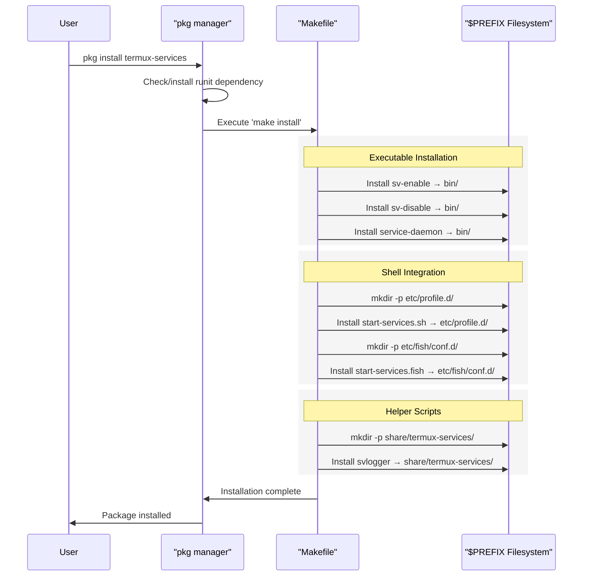
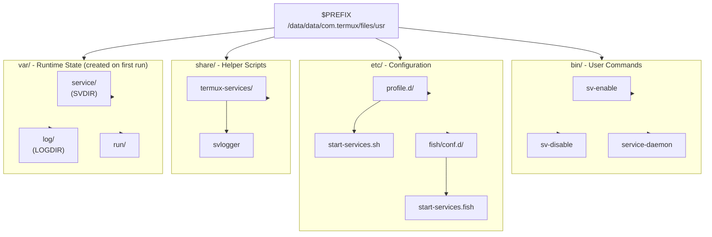
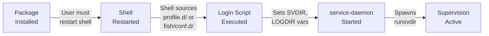

<!-- source: DeepWiki mcp.deepwiki.com · repo termux/termux-services · page 2 Installation · fetched 2026-10-26 -->

# Installation

<details>
<summary>Relevant source files</summary>

The following files were used as context for generating this wiki page:

- [Makefile](Makefile)
- [README.md](README.md)
- [start-services.fish](start-services.fish)
- [svlogger](svlogger)

</details>


This page provides step-by-step instructions for installing termux-services, describes what components get installed and where they are placed in the filesystem, and explains the initial setup requirements. For information about actually using termux-services to manage services after installation, see [Quick Start Guide](#3). For architectural details about how these components work together, see [Architecture](#5).

## Prerequisites

termux-services requires:
- A functioning Termux environment
- The `pkg` package manager (standard in Termux)
- The `runit` package (automatically installed as a dependency)

No manual configuration is required before installation. The package manager handles all dependency resolution.

## Installation Command

Execute the following command to install termux-services:

```bash
pkg install termux-services
```

This command:
1. Resolves and installs the `runit` package if not already present
2. Downloads the termux-services package
3. Executes the installation process defined in [Makefile:3-12]()

**Sources:** [README.md:3]()

## Installation Process

The package manager invokes the Makefile's `install` target, which deploys all components to their designated locations within the `$PREFIX` directory (typically `/data/data/com.termux/files/usr`).



**Sources:** [Makefile:3-12]()

## Installed Components

The installation process deploys seven components across four directory categories:

### Executables (`$PREFIX/bin/`)

| File | Purpose | Reference |
|------|---------|-----------|
| `sv-enable` | Enable service autostart by removing `down` file | [Command Reference](#6.1) |
| `sv-disable` | Disable service autostart by creating `down` file | [Command Reference](#6.2) |
| `service-daemon` | Lifecycle manager for `runsvdir` supervision | [Architecture](#5.2) |

These executables are installed via [Makefile:4-6]() and become immediately available in the user's `$PATH`.

### Shell Integration Scripts

| File | Shell | Purpose |
|------|-------|---------|
| `$PREFIX/etc/profile.d/start-services.sh` | bash, zsh, POSIX shells | Auto-start service daemon on login |
| `$PREFIX/etc/fish/conf.d/start-services.fish` | fish shell | Auto-start service daemon on login |

These scripts are sourced automatically by their respective shells during login sessions. They set environment variables (`SVDIR`, `LOGDIR`) and start `service-daemon` in the background. See [start-services.fish:1-6]() for the fish implementation.

Installation occurs via [Makefile:7-10](), with the Makefile creating parent directories as needed.

**Sources:** [Makefile:4-10](), [start-services.fish:1-6]()

### Helper Scripts (`$PREFIX/share/termux-services/`)

| File | Purpose |
|------|---------|
| `svlogger` | Logging wrapper that configures `svlogd` for each service |

The `svlogger` script extracts the service name from its working directory and configures `svlogd` to write logs to `$LOGDIR/sv/<service>/`. See [Logging Infrastructure](#5.4) for details.

Installation occurs via [Makefile:11-12]().

**Sources:** [Makefile:11-12](), [svlogger:1-9]()

## Filesystem Layout After Installation



**Sources:** [Makefile:4-12]()

The `var/` directory structure is not created during package installation. These directories are created at runtime:
- `var/service/` - Created when `service-daemon` starts [service-daemon]()
- `var/log/` - Created when services first generate log output [svlogger:7]()
- `var/run/` - Created when `service-daemon` stores its PID file [service-daemon]()

## Post-Installation Setup

After installation completes, the service supervision system is not yet active. Activation requires a shell restart to trigger the login scripts.

### Shell Restart Requirement



**Sources:** [README.md:4](), [start-services.fish:1-6]()

To activate termux-services after installation:

1. **Exit the current shell session:**
   ```bash
   exit
   ```

2. **Start a new shell session** by opening a new Termux terminal or reconnecting to your session

3. **Verify activation** by checking if `service-daemon` is running:
   ```bash
   pgrep -f service-daemon
   ```

If a PID is displayed, the service supervision system is active.

### What Happens During Shell Login

When a new login shell starts:

1. **For bash/zsh/POSIX shells:** The shell sources `$PREFIX/etc/profile.d/start-services.sh`
2. **For fish shell:** The shell sources `$PREFIX/etc/fish/conf.d/start-services.fish`
3. **Environment variables are set:**
   - `SVDIR=$PREFIX/var/service` - Service definition directory
   - `LOGDIR=$PREFIX/var/log` - Log output directory
4. **service-daemon starts in background:** `service-daemon start >/dev/null 2>&1 &`
5. **runsvdir begins monitoring:** The daemon spawns `runsvdir $SVDIR`

See [start-services.fish:1-6]() for the complete fish shell implementation.

**Sources:** [start-services.fish:1-6](), [README.md:4]()

## Verification

After restarting your shell, verify the installation:

### Check Service Daemon Status

```bash
service-daemon status
```

Expected output indicates that `runsvdir` is monitoring the service directory.

### Check Environment Variables

```bash
echo $SVDIR
echo $LOGDIR
```

Expected output:
```
/data/data/com.termux/files/usr/var/service
/data/data/com.termux/files/usr/var/log
```

### Check Process Tree

```bash
pstree -p $(pgrep -f service-daemon)
```

You should see `runsvdir` as a child process of `service-daemon`.

### List Available Commands

```bash
which sv-enable sv-disable service-daemon
```

All three commands should be found in `$PREFIX/bin/`.

## Uninstallation

To remove termux-services:

```bash
pkg uninstall termux-services
```

The package manager executes the Makefile's `uninstall` target [Makefile:14-20](), which removes:
- All executables from `bin/`
- Shell integration scripts from `etc/profile.d/` and `etc/fish/conf.d/`
- Helper scripts from `share/termux-services/`

The uninstall process does **not** remove:
- Service definitions in `$PREFIX/var/service/`
- Log files in `$PREFIX/var/log/`
- Runtime state in `$PREFIX/var/run/`

These directories contain user-created content and are intentionally preserved. To remove them manually after uninstallation:

```bash
rm -rf $PREFIX/var/service
rm -rf $PREFIX/var/log/sv
rm -rf $PREFIX/var/run/service-daemon.pid
```

**Sources:** [Makefile:14-20]()

## Next Steps

With termux-services installed and activated, you can:
- Follow the [Quick Start Guide](#3) to enable and manage your first service
- Read the [User Guide](#4) for comprehensive service management instructions
- Explore the [Architecture](#5) to understand how the components interact

---

