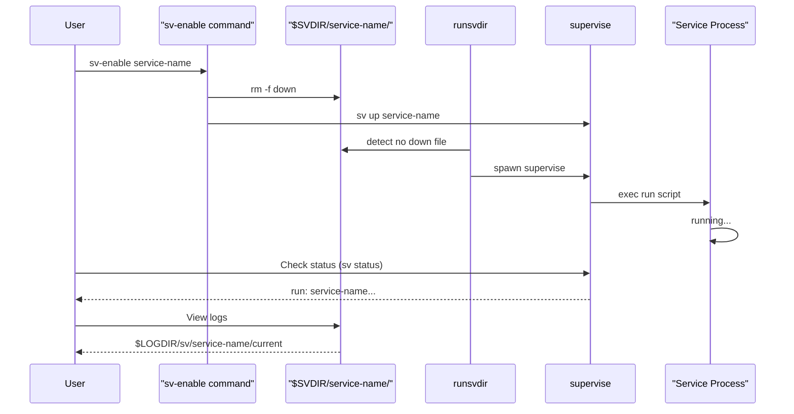
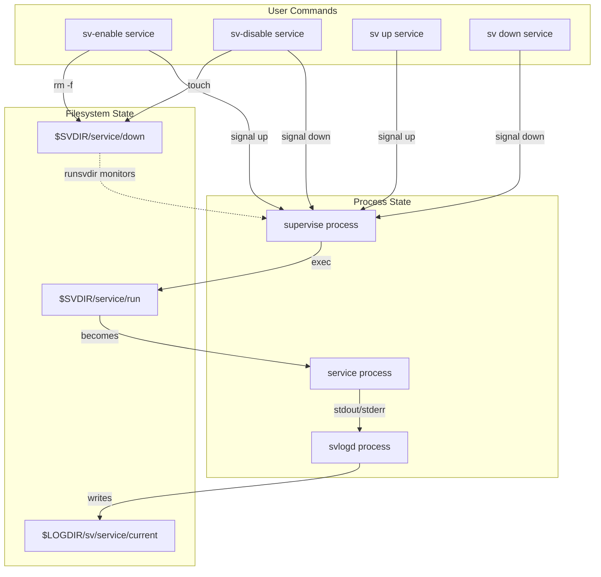
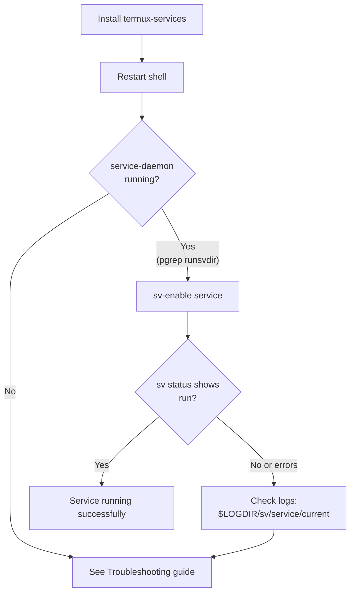

<!-- source: DeepWiki mcp.deepwiki.com · repo termux/termux-services · page 3 Quick Start Guide · fetched 2026-10-26 -->

# Quick Start Guide

<details>
<summary>Relevant source files</summary>

The following files were used as context for generating this wiki page:

- [README.md](README.md)
- [sv-disable](sv-disable)
- [sv-enable](sv-enable)

</details>


This guide provides a practical introduction to managing services with termux-services. It assumes you have already completed installation (see [Installation](#2)) and focuses on the essential operations needed to run your first service. For comprehensive documentation on service management concepts, see [User Guide](#4). For detailed command reference, see [Command Reference](#6).

**Sources:** [README.md:1-10]()

---

## Prerequisites

Before following this guide, ensure:

1. **termux-services is installed**: You have run `pkg install termux-services`
2. **Shell has been restarted**: The `service-daemon` process starts automatically on shell login
3. **runit is installed**: The `runit` package provides the underlying supervision system

To verify `service-daemon` is running:

```bash
pgrep -f runsvdir
```

If this returns a process ID, the service supervision system is active. If not, restart your shell or manually run `service-daemon start`.

**Sources:** [README.md:1-4]()

---

## Basic Workflow Overview



**Workflow Steps:**
1. **Enable service**: `sv-enable` removes the `down` file and signals service to start
2. **runsvdir detects**: The `runsvdir` process monitors `$SVDIR` and sees service is enabled
3. **supervise spawns**: A `supervise` process is created for the service
4. **Service runs**: The service's `run` script is executed
5. **Logs captured**: Output is written to `$LOGDIR/sv/service-name/current`

**Sources:** [README.md:3-9](), [sv-enable:1-21]()

---

## Working with Services

### Enable and Start a Service

To enable a service for autostart and start it immediately:

```bash
sv-enable <service-name>
```

**What this does:**
- Removes `$PREFIX/var/service/<service-name>/down` if it exists
- Sends the "up" signal to start the service immediately

Example:

```bash
sv-enable sshd
```

Alternatively, to start a service **without** enabling autostart:

```bash
sv up <service-name>
```

**Sources:** [README.md:5](), [sv-enable:1-21]()

---

### Check Service Status

Use the standard `sv` command to check service status:

```bash
sv status <service-name>
```

Example output:
```
run: sshd: (pid 12345) 30s
```

This shows:
- **run**: Service is currently running
- **pid 12345**: Process ID of the service
- **30s**: Service has been running for 30 seconds

**Sources:** [README.md:5-6]()

---

### View Service Logs

All service output (stdout and stderr) is captured in log files:

```bash
tail -f $PREFIX/var/log/sv/<service-name>/current
```

Or use environment variables set by the login scripts:

```bash
tail -f $LOGDIR/sv/<service-name>/current
```

The log file location pattern is `$PREFIX/var/log/sv/<service-name>/current`. The `svlogd` process automatically rotates logs when they reach a certain size.

**Sources:** [README.md:6]()

---

### Stop a Service

To stop a running service temporarily:

```bash
sv down <service-name>
```

This stops the service but does **not** disable autostart. The service will restart on next shell login if it was previously enabled.

**Sources:** [README.md:8]()

---

### Disable a Service

To disable autostart and stop the service:

```bash
sv-disable <service-name>
```

**What this does:**
- Creates the file `$PREFIX/var/service/<service-name>/down`
- Sends the "down" signal to stop the service immediately

The service will not automatically start on future shell logins until re-enabled with `sv-enable`.

**Sources:** [README.md:8-9](), [sv-disable:1-21]()

---

## Command-to-Filesystem Mapping



**Key Mappings:**

| User Command | Filesystem Effect | Process Effect |
|--------------|-------------------|----------------|
| `sv-enable` | Removes `$SVDIR/service/down` | Signals `supervise` to start service |
| `sv-disable` | Creates `$SVDIR/service/down` | Signals `supervise` to stop service |
| `sv up` | No filesystem change | Signals `supervise` to start service |
| `sv down` | No filesystem change | Signals `supervise` to stop service |

**Critical Distinction:**
- **Enable/Disable**: Persistent state stored in filesystem (`down` file)
- **Up/Down**: Transient runtime signals to running supervisor

**Sources:** [sv-enable:19-20](), [sv-disable:19-20](), [README.md:8-9]()

---

## Quick Reference

### Essential Commands

| Task | Command | Effect |
|------|---------|--------|
| Enable autostart + start now | `sv-enable <service>` | Persistent + immediate |
| Disable autostart + stop now | `sv-disable <service>` | Persistent + immediate |
| Start (no autostart) | `sv up <service>` | Transient only |
| Stop (keep autostart) | `sv down <service>` | Transient only |
| Check status | `sv status <service>` | Display process state |
| View live logs | `tail -f $LOGDIR/sv/<service>/current` | Stream log output |

**Sources:** [README.md:5-9](), [sv-enable:1-21](), [sv-disable:1-21]()

---

### Key Locations

| Purpose | Path | Environment Variable |
|---------|------|---------------------|
| Service definitions | `$PREFIX/var/service/` | `$SVDIR` |
| Service logs | `$PREFIX/var/log/sv/` | `$LOGDIR` |
| Disabled marker | `$SVDIR/<service>/down` | N/A |
| Service PID file | `$SVDIR/<service>/supervise/pid` | N/A |

**Sources:** [README.md:6,9](), [sv-enable:15-19](), [sv-disable:15-19]()

---

## Environment Variables in Use

The `service-daemon` and login scripts set these environment variables:

```bash
SVDIR=$PREFIX/var/service     # Service directory
LOGDIR=$PREFIX/var/log        # Log directory
```

These are automatically configured when your shell starts. The `sv-enable` and `sv-disable` commands depend on `$SVDIR` being set.

**Sources:** [sv-enable:15-18](), [sv-disable:15-18]()

---

## Verification Workflow



**Diagnostic Checklist:**

1. **Verify daemon**: `pgrep -f runsvdir` returns a PID
2. **Check service status**: `sv status <service>` shows "run"
3. **Inspect logs**: `tail $LOGDIR/sv/<service>/current` for errors
4. **Verify service directory**: `ls -la $SVDIR/<service>/` shows `run` script
5. **Check down file**: `test -e $SVDIR/<service>/down` should fail for enabled services

**Sources:** [README.md:1-9]()

---

## Next Steps

Now that you understand basic service management:

- **Learn comprehensive service operations**: See [User Guide](#4)
- **Enable/disable services in detail**: See [Enabling and Disabling Services](#4.1)
- **Start/stop services in detail**: See [Starting and Stopping Services](#4.2)
- **Master log management**: See [Viewing and Managing Logs](#4.3)
- **Understand the architecture**: See [Architecture](#5) and [System Overview](#5.1)
- **Full command reference**: See [Command Reference](#6)
- **Troubleshoot issues**: See [Troubleshooting](#4.4)

**Sources:** [README.md:1-10]()

---

