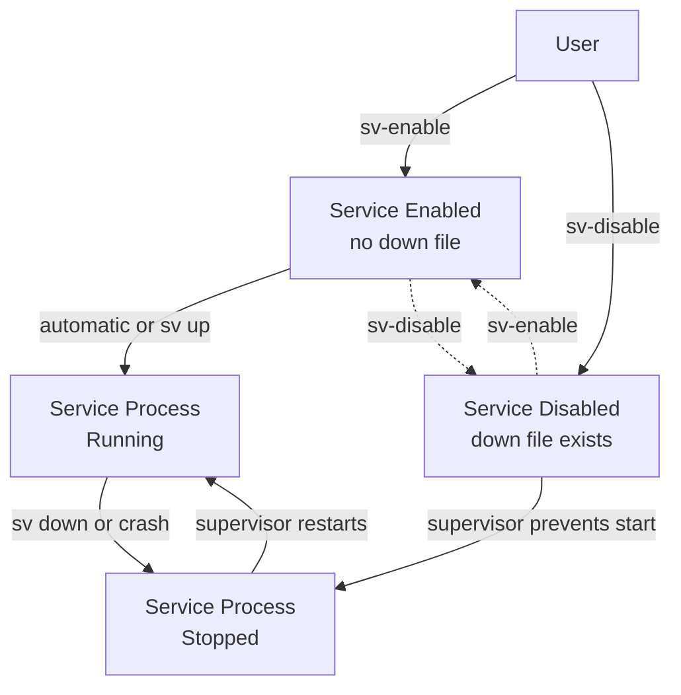
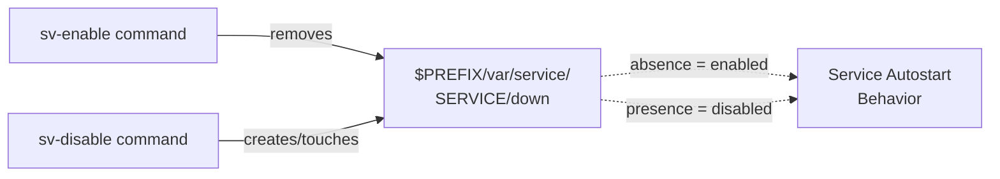
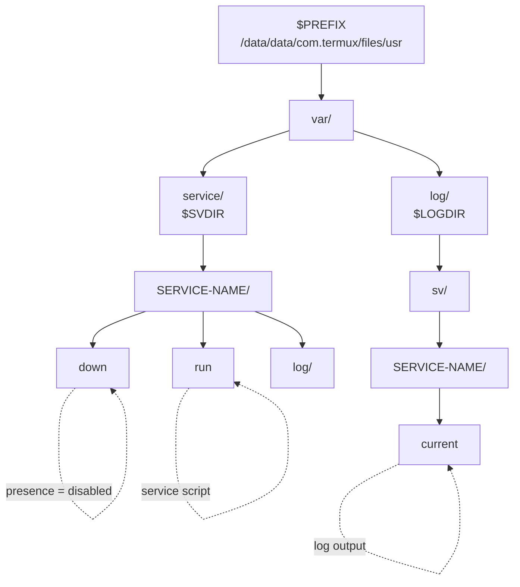
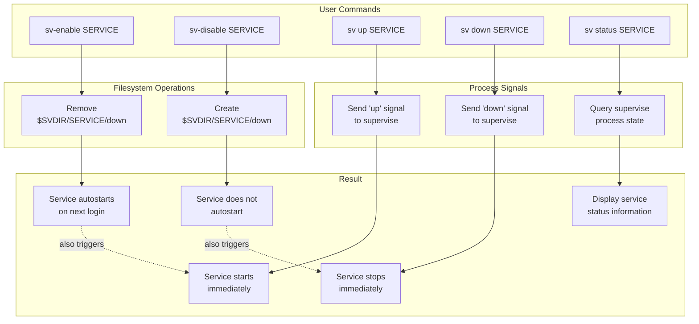

<!-- source: DeepWiki mcp.deepwiki.com · repo termux/termux-services · page 4 User Guide · fetched 2026-10-26 -->

# User Guide

<details>
<summary>Relevant source files</summary>

The following files were used as context for generating this wiki page:

- [Makefile](Makefile)
- [README.md](README.md)
- [start-services.fish](start-services.fish)
- [svlogger](svlogger)

</details>


This guide covers day-to-day usage of termux-services for managing background services. It explains core concepts, common workflows, and practical examples for typical service management tasks.

For installation procedures, see [Installation](#2). For detailed command syntax, see [Command Reference](#6). For troubleshooting specific problems, see [Troubleshooting](#4.4). For architectural details about how the system works internally, see [Architecture](#5).

## Purpose and Scope

This user guide assumes termux-services is already installed and your shell has been restarted. It focuses on practical service management: enabling services to start automatically, starting and stopping services manually, and understanding service state. The guide covers the mental model needed to work effectively with the runit-based supervision system that termux-services provides.

Sources: [README.md:1-10]()

## Core Concepts

### Service Supervision Model

Termux-services uses runit's supervision model where a background process (`runsvdir`) continuously monitors service directories and ensures services are running according to their configuration. This differs from traditional init systems—services are actively supervised, not just started once.



**Service Supervision State Machine**

The supervision system operates continuously in the background. When a service is enabled, the supervisor attempts to keep it running. When disabled, the supervisor prevents it from starting.

Sources: [README.md:9](), [start-services.fish:1-6]()

### Enabled vs. Disabled

A service's **enabled** state controls whether it starts automatically. This state persists across reboots and shell sessions.

- **Enabled**: No `down` file exists at `$PREFIX/var/service/<service>/down`
- **Disabled**: The `down` file exists at `$PREFIX/var/service/<service>/down`

The `sv-enable` and `sv-disable` commands manipulate this file:



**Enable/Disable Filesystem Operations**

Sources: [README.md:9](), [Makefile:4-5]()

### Started vs. Stopped

A service's **running** state is separate from its enabled state. A service can be:

- Enabled and running (normal operation)
- Enabled and stopped (temporarily down, will restart)
- Disabled and stopped (will not start)
- Disabled and running (being shut down)

The `sv` command manipulates the running state without affecting the enabled state.

## Directory Structure Users Interact With

Users primarily work with two directory trees:



**User-Facing Directory Structure**

| Directory | Purpose | User Interaction |
|-----------|---------|------------------|
| `$PREFIX/var/service/` | Service definitions | Enable/disable services, check configuration |
| `$PREFIX/var/service/<service>/down` | Disable flag | Created by `sv-disable`, removed by `sv-enable` |
| `$PREFIX/var/service/<service>/run` | Service script | Read to understand what service does |
| `$PREFIX/var/log/sv/<service>/` | Service logs | Read logs, especially `current` file |
| `$PREFIX/var/log/sv/<service>/current` | Latest log output | Primary troubleshooting resource |

Sources: [README.md:6](), [README.md:9](), [svlogger:7-9](), [start-services.fish:3-4]()

## Common Workflows

### Enabling a Service for Autostart

```bash
# Enable service to start automatically
sv-enable sshd

# Verify it's enabled (down file should not exist)
ls $PREFIX/var/service/sshd/down
# Expected: ls: cannot access ... : No such file or directory
```

The service will start immediately if not already running. On subsequent shell logins, the service-daemon will ensure it starts automatically.

See [Enabling and Disabling Services](#4.1) for details.

Sources: [README.md:5](), [Makefile:4]()

### Starting a Service Temporarily

```bash
# Start service without enabling autostart
sv up postgresql

# Check service status
sv status postgresql
```

This starts the service for the current session but does not modify the `down` file. If the service is disabled, it will not start automatically after a restart.

See [Starting and Stopping Services](#4.2) for details.

Sources: [README.md:5]()

### Stopping a Service

```bash
# Stop service immediately
sv down nginx

# Service remains enabled; supervisor will restart unless disabled
```

To permanently stop a service and prevent it from restarting:

```bash
# Disable and stop
sv-disable nginx
```

Sources: [README.md:8]()

### Checking Service Logs

```bash
# View latest log output
cat $PREFIX/var/log/sv/sshd/current

# Follow logs in real-time
tail -f $PREFIX/var/log/sv/sshd/current

# Check if log directory exists (indicates service has run)
ls -la $PREFIX/var/log/sv/
```

Logs are managed by `svlogd` through the `svlogger` wrapper, which automatically creates service-specific log directories.

See [Viewing and Managing Logs](#4.3) for log management details.

Sources: [README.md:6](), [svlogger:7-9]()

## User Command Mapping

This diagram shows how user commands map to actual system operations:



**User Command to System Operation Mapping**

Key points:
- `sv-enable` and `sv-disable` modify persistent filesystem state
- `sv up` and `sv down` send signals to the running supervision process
- Changes made by enable/disable persist; changes made by up/down are runtime only
- The `runsvdir` process detects filesystem changes and adjusts supervision accordingly

Sources: [README.md:5-9](), [Makefile:4-5]()

## Typical Usage Scenarios

### Scenario 1: Installing and Running a Database

```bash
# Install PostgreSQL
pkg install postgresql

# Initialize database (service-specific, not termux-services)
initdb $PREFIX/var/lib/postgresql

# Enable PostgreSQL to start on login
sv-enable postgresql

# Verify it's running
sv status postgresql
# Expected output: run: postgresql: (pid 12345) 5s

# Check logs if there are issues
tail -20 $PREFIX/var/log/sv/postgresql/current
```

### Scenario 2: Temporarily Stopping a Service

```bash
# Stop SSH server for maintenance
sv down sshd

# Perform maintenance...

# Restart SSH server
sv up sshd

# Service is still enabled for autostart
```

### Scenario 3: Disabling an Unwanted Service

```bash
# Stop and disable a service
sv-disable crond

# Verify down file was created
ls $PREFIX/var/service/crond/down
# Expected: $PREFIX/var/service/crond/down

# Service will not start on next login
```

Sources: [README.md:1-10]()

## Integration with Native sv Commands

Termux-services provides `sv-enable` and `sv-disable` as convenience wrappers. For runtime control, use the native `sv` command from the runit package directly. Common `sv` commands include:

| Command | Purpose |
|---------|---------|
| `sv status SERVICE` | Show service status |
| `sv up SERVICE` | Start service |
| `sv down SERVICE` | Stop service |
| `sv restart SERVICE` | Restart service |
| `sv reload SERVICE` | Send HUP signal |
| `sv check SERVICE` | Check if service is running |

The `sv` command communicates with the `supervise` process for each service. For more details on runit integration, see [Integration with runit](#8).

## Environment Variables in User Context

When working with termux-services, these environment variables are set by the login scripts:

| Variable | Value | Purpose |
|----------|-------|---------|
| `SVDIR` | `$PREFIX/var/service` | Service definition directory |
| `LOGDIR` | `$PREFIX/var/log` | Log storage directory |
| `PREFIX` | `/data/data/com.termux/files/usr` | Termux installation root |

These are set by [start-services.fish:3-4]() (and the bash equivalent). You can reference them in commands:

```bash
# List all service directories
ls $SVDIR

# List all service logs
ls $LOGDIR/sv/

# Check if a specific service is enabled
test -f $SVDIR/sshd/down && echo "disabled" || echo "enabled"
```

Sources: [start-services.fish:3-4]()

## Next Steps

For detailed information on specific tasks:

- **Enabling and Disabling Services**: See [Enabling and Disabling Services](#4.1) for complete details on `sv-enable` and `sv-disable` behavior
- **Starting and Stopping Services**: See [Starting and Stopping Services](#4.2) for comprehensive `sv` command usage
- **Log Management**: See [Viewing and Managing Logs](#4.3) for log rotation, retention, and advanced log filtering
- **Problems**: See [Troubleshooting](#4.4) for diagnostic procedures and common issues
- **Command Syntax**: See [Command Reference](#6) for complete command reference documentation

For understanding how the system works internally, see [Architecture](#5).

Sources: [README.md:1-10]()

---

