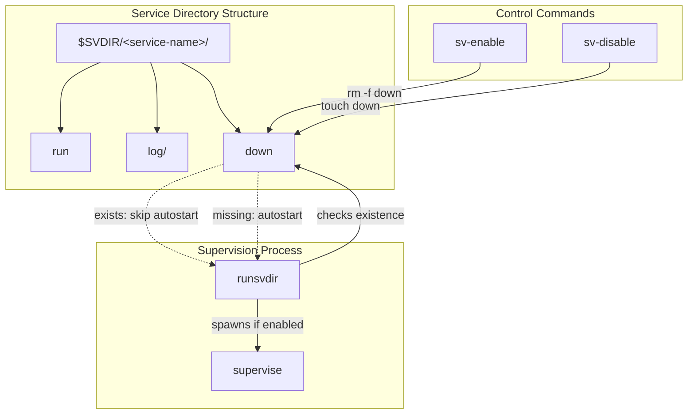
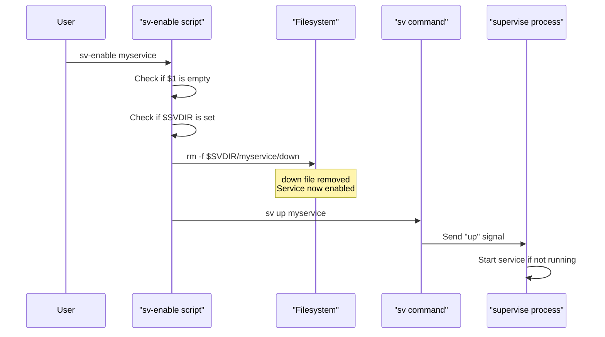
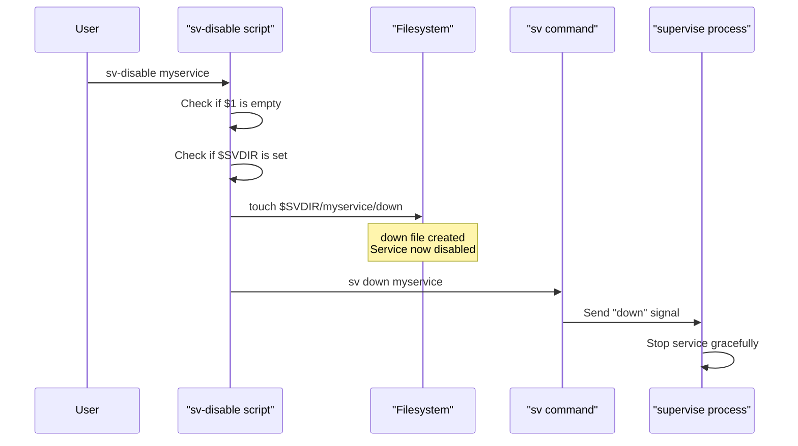
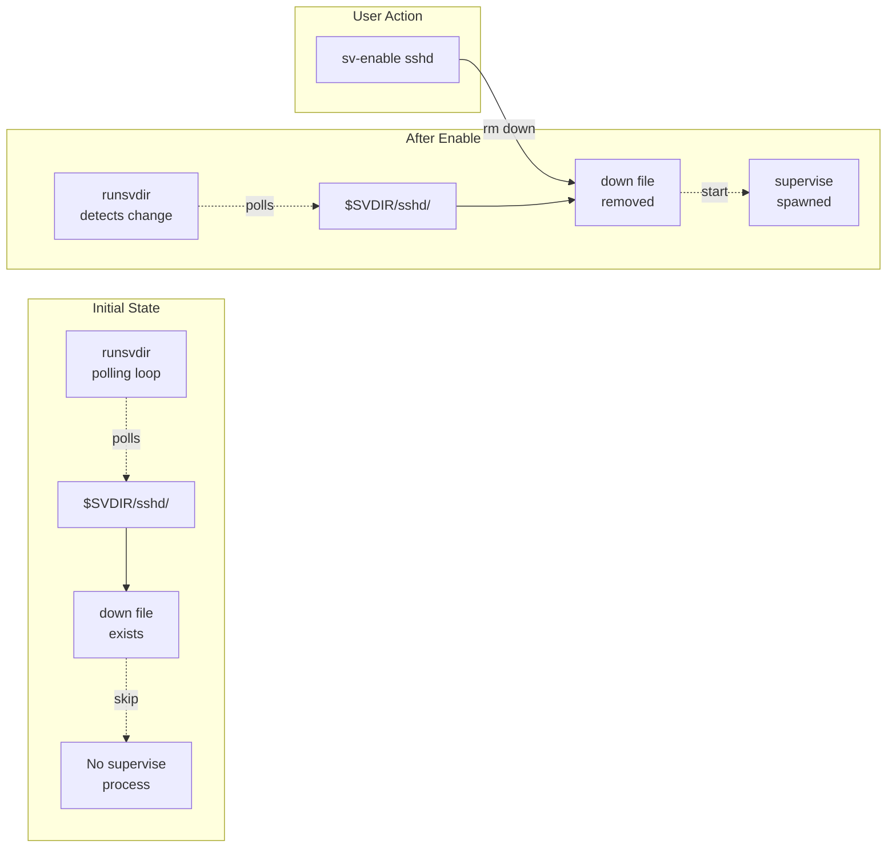

<!-- source: DeepWiki mcp.deepwiki.com · repo termux/termux-services · page 4.1 Enabling and Disabling Services · fetched 2026-10-26 -->

# Enabling and Disabling Services

<details>
<summary>Relevant source files</summary>

The following files were used as context for generating this wiki page:

- [README.md](README.md)
- [sv-disable](sv-disable)
- [sv-enable](sv-enable)

</details>


## Purpose and Scope

This page explains how to enable and disable services in termux-services, which controls whether services automatically start when the service daemon initializes. This covers the `sv-enable` and `sv-disable` commands, the `down` file mechanism, and how these commands interact with the supervision system.

For information about immediately starting and stopping services without changing autostart behavior, see [Starting and Stopping Services](#4.2). For complete command reference documentation, see [sv-enable](#6.1) and [sv-disable](#6.2).

## Overview: Autostart Control

Enabling and disabling services controls **autostart behavior**. When a service is enabled, it will automatically start when `runsvdir` begins monitoring the service directory. When a service is disabled, it will not autostart, though it can still be manually started.

The enable/disable state is persistent across shell restarts and system reboots. This state is stored in the filesystem using a marker file called `down`.

| State | down file exists? | Autostart behavior | Can be manually started? |
|-------|-------------------|-------------------|-------------------------|
| Enabled | No | Service autostarts | Yes |
| Disabled | Yes | Service does not autostart | Yes (using `sv up`) |

Sources: [README.md:9-9]()

## The down File Mechanism

The enable/disable mechanism relies on a filesystem-based state indicator: the `down` file located at `$SVDIR/<service-name>/down`.



**Diagram: The down file as a filesystem-based state flag**

The `down` file serves as a semaphore:
- **Presence** of `$SVDIR/<service-name>/down` → service is disabled (do not autostart)
- **Absence** of `$SVDIR/<service-name>/down` → service is enabled (autostart)

The `runsvdir` process continuously monitors service directories and checks for the `down` file to determine whether to supervise each service.

Sources: [README.md:9-9](), [sv-enable:19-19](), [sv-disable:19-19]()

## Using sv-enable

The `sv-enable` command enables a service for autostart and immediately starts it if it is not already running.

### Syntax

```
sv-enable <service-name>
```

### Behavior

When `sv-enable` is executed, it performs two operations:

1. **Removes the down file**: `rm -f "$SVDIR/$1/down"` [sv-enable:19]()
2. **Starts the service**: `sv up $1` [sv-enable:20]()



**Diagram: sv-enable command execution flow**

### Validation

The `sv-enable` script performs validation before proceeding:

1. **Service name required**: If no service name is provided, displays usage help and exits [sv-enable:11-13]()
2. **SVDIR must be set**: If the `$SVDIR` environment variable is not set, prints an error and exits [sv-enable:15-17]()

### Result

After successful execution:
- The `down` file is removed from the service directory
- The service is started (if not already running)
- On next shell login, the service will autostart when `runsvdir` initializes

Sources: [sv-enable:1-21](), [README.md:5-5]()

## Using sv-disable

The `sv-disable` command disables a service from autostarting and immediately stops it if it is currently running.

### Syntax

```
sv-disable <service-name>
```

### Behavior

When `sv-disable` is executed, it performs two operations:

1. **Creates the down file**: `touch "$SVDIR/$1/down"` [sv-disable:19]()
2. **Stops the service**: `sv down $1` [sv-disable:20]()



**Diagram: sv-disable command execution flow**

### Validation

The `sv-disable` script performs the same validation as `sv-enable`:

1. **Service name required**: If no service name is provided, displays usage help and exits [sv-disable:11-13]()
2. **SVDIR must be set**: If the `$SVDIR` environment variable is not set, prints an error and exits [sv-disable:15-17]()

### Result

After successful execution:
- The `down` file exists in the service directory
- The service is stopped (if it was running)
- On next shell login, the service will not autostart when `runsvdir` initializes

Sources: [sv-disable:1-21](), [README.md:8-8]()

## Enable vs. Start: Understanding the Difference

It is important to distinguish between **enabling/disabling** (autostart control) and **starting/stopping** (runtime control):

| Operation | Command | Effect | Persistence | Modifies |
|-----------|---------|--------|-------------|----------|
| Enable | `sv-enable` | Makes service autostart + starts it now | Persistent (survives restart) | `down` file (removes it) |
| Disable | `sv-disable` | Prevents autostart + stops it now | Persistent (survives restart) | `down` file (creates it) |
| Start | `sv up` | Starts service immediately | Temporary (until crash/manual stop) | Runtime state only |
| Stop | `sv down` | Stops service immediately | Temporary (can be restarted) | Runtime state only |

### Practical Examples

```bash
# Scenario 1: Enable and start a service
$ sv-enable sshd
# - Removes $SVDIR/sshd/down
# - Starts sshd immediately
# - sshd will autostart on next login

# Scenario 2: Temporarily stop an enabled service
$ sv down sshd
# - sshd stops immediately
# - $SVDIR/sshd/down still does NOT exist
# - sshd will still autostart on next login

# Scenario 3: Disable a service but keep it running (not possible with sv-disable)
# The sv-disable command always stops the service
# To disable without stopping, manually create the down file:
$ touch "$SVDIR/sshd/down"
# - sshd continues running
# - sshd will not autostart on next login

# Scenario 4: Start a disabled service temporarily
$ sv up sshd
# - sshd starts immediately
# - $SVDIR/sshd/down still exists
# - sshd will NOT autostart on next login
```

Sources: [README.md:5-9](), [sv-enable:19-20](), [sv-disable:19-20]()

## How runsvdir Responds to State Changes

The `runsvdir` process continuously monitors `$SVDIR` and detects changes to service directories, including the creation or removal of `down` files.



**Diagram: runsvdir detecting down file state changes**

### Detection Timing

The `runsvdir` process checks service directories periodically (typically every 5 seconds by default). This means:

- When you run `sv-enable`, the service starts immediately via the `sv up` command [sv-enable:20]()
- `runsvdir` will detect the removed `down` file on its next poll cycle
- When you run `sv-disable`, the service stops immediately via the `sv down` command [sv-disable:20]()
- `runsvdir` will detect the created `down` file on its next poll cycle

The immediate `sv up` or `sv down` commands ensure the state change takes effect without waiting for `runsvdir` to poll.

Sources: [sv-enable:19-20](), [sv-disable:19-20]()

## Environment Variables

Both `sv-enable` and `sv-disable` require the `$SVDIR` environment variable to be set. This variable is typically set by the login integration scripts.

| Variable | Purpose | Typical Value | Set By |
|----------|---------|---------------|--------|
| `$SVDIR` | Service directory location | `$PREFIX/var/service` | `start-services.sh` or `start-services.fish` |

If `$SVDIR` is not set, both commands will exit with an error:
```
Error: SVDIR not set
```

For more information about environment variables, see [Environment Variables](#7).

Sources: [sv-enable:15-17](), [sv-disable:15-17]()

## Summary

| Aspect | sv-enable | sv-disable |
|--------|-----------|------------|
| **Purpose** | Enable autostart and start service | Disable autostart and stop service |
| **File Operation** | `rm -f "$SVDIR/$1/down"` | `touch "$SVDIR/$1/down"` |
| **Runtime Operation** | `sv up $1` | `sv down $1` |
| **Result** | Service autostarts on next login | Service does not autostart on next login |
| **Immediate Effect** | Service starts (if not running) | Service stops (if running) |

The enable/disable mechanism provides persistent autostart control through a simple filesystem-based state indicator, making service configuration survive across shell restarts and system reboots.

Sources: [README.md:1-10](), [sv-enable:1-21](), [sv-disable:1-21]()

---

