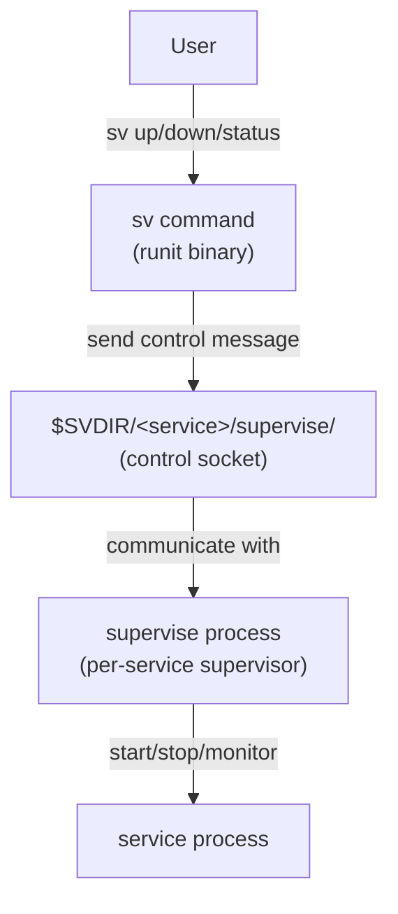
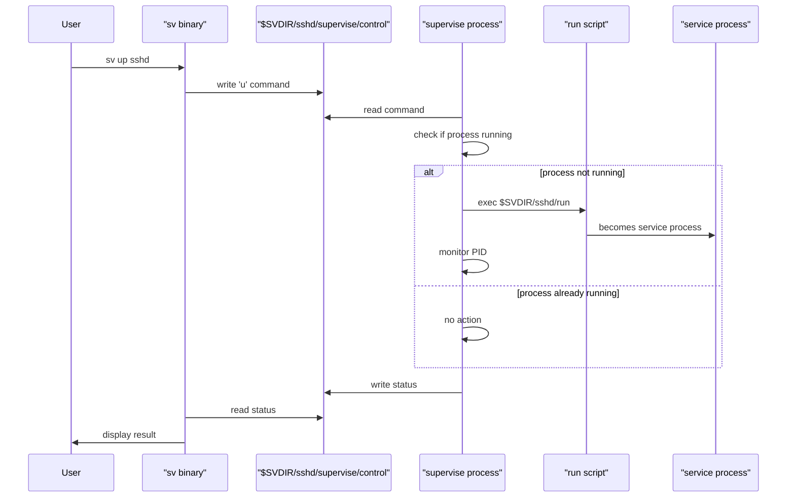

<!-- source: DeepWiki mcp.deepwiki.com · repo termux/termux-services · page 4.2 Starting and Stopping Services · fetched 2026-10-26 -->

# Starting and Stopping Services

<details>
<summary>Relevant source files</summary>

The following files were used as context for generating this wiki page:

- [README.md](README.md)
- [service-daemon](service-daemon)

</details>


## Purpose and Scope

This document covers immediate runtime control of services using the `sv` command. These operations start and stop service processes in real-time without changing their persistent configuration state.

For persistent service configuration (autostart behavior), see [Enabling and Disabling Services](#4.1). For viewing service output, see [Viewing and Managing Logs](#4.3).

**Sources:** [README.md:1-10]()

## Overview

The `sv` command is the primary tool for immediate service control. It is provided by the runit package and sends control signals to `supervise` processes that manage individual services. When you start or stop a service with `sv`, you are sending instructions to the supervision layer to change the service's runtime state immediately.

The `sv` command operates on services located in `$SVDIR` (typically `$PREFIX/var/service/`). Each service in this directory has an associated `supervise` process that receives and acts on `sv` commands.



**Sources:** [README.md:5-8](), Diagram 2 from high-level overview, Diagram 4 from high-level overview

## Starting Services

### Using sv up

To start a service immediately, use:

```bash
sv up <service>
```

This command instructs the `supervise` process to start the service if it is not already running. The service's `run` script (located at `$SVDIR/<service>/run`) is executed, and the resulting process is monitored.

**Example:**

```bash
sv up sshd
```

### Behavior

| Condition | Result |
|-----------|--------|
| Service is already running | No action taken; service continues running |
| Service is stopped | Service `run` script is executed; process starts |
| Service has `down` file | Service starts but will not autostart on next supervision restart |
| Service has no `down` file | Service starts and will autostart on supervision restart |

The presence of the `down` file (located at `$SVDIR/<service>/down`) does not prevent `sv up` from starting the service. However, if the service-daemon restarts, services with `down` files will not automatically start.

### When to Use sv up

- **Immediate need**: Start a service right now without enabling autostart
- **Testing**: Start a service temporarily to test configuration
- **Manual control**: Start a disabled service for a one-time operation
- **After sv down**: Restart a service that was manually stopped

**Sources:** [README.md:5](), Diagram 4 from high-level overview

## Stopping Services

### Using sv down

To stop a service immediately, use:

```bash
sv down <service>
```

This command instructs the `supervise` process to stop the service by sending a termination signal to the service process. The service will not be automatically restarted by the supervision system.

**Example:**

```bash
sv down sshd
```

### Behavior

| Condition | Result |
|-----------|--------|
| Service is running | Service receives TERM signal; process stops |
| Service is already stopped | No action taken |
| Service has `down` file | Service stops and remains stopped |
| Service has no `down` file | Service stops but will autostart if supervision restarts |

The `down` file state is not modified by `sv down`. If the service is enabled (no `down` file), it will automatically restart when the service-daemon restarts or when the shell is reopened.

### When to Use sv down

- **Temporary maintenance**: Stop a service briefly without disabling autostart
- **Resource management**: Stop a service to free resources temporarily
- **Configuration changes**: Stop a service before modifying its configuration
- **Troubleshooting**: Stop a misbehaving service for investigation

**Sources:** [README.md:8](), Diagram 4 from high-level overview

## Other Service Control Commands

The `sv` command provides additional operations for service management:

### Status Checking

```bash
sv status <service>
```

Displays the current state of the service, including:
- Whether the service is running or stopped
- Process ID (PID) if running
- How long the service has been in its current state
- Number of seconds the service has been running

**Example output:**
```
run: sshd: (pid 12345) 3600s
```

### Restarting Services

```bash
sv restart <service>
```

Stops and then starts the service. Equivalent to running `sv down <service>` followed by `sv up <service>`, but performed atomically.

### Running Once

```bash
sv once <service>
```

Starts the service to run once. If the service exits, it will not be restarted automatically, even if it is enabled. This is useful for one-shot tasks.

### Forced Termination

```bash
sv kill <service>
```

Sends SIGKILL to the service process, forcefully terminating it. Use this only when a service does not respond to normal termination.

### Process Information

```bash
sv check <service>
```

Checks if the service is running. Exits with status 0 if running, non-zero if stopped. Useful in scripts.

### Additional Commands

| Command | Purpose |
|---------|---------|
| `sv term <service>` | Send SIGTERM to service |
| `sv hup <service>` | Send SIGHUP to service (reload configuration) |
| `sv alarm <service>` | Send SIGALRM to service |
| `sv interrupt <service>` | Send SIGINT to service |
| `sv quit <service>` | Send SIGQUIT to service |
| `sv usr1 <service>` | Send SIGUSR1 to service |
| `sv usr2 <service>` | Send SIGUSR2 to service |

**Sources:** Integration with runit (page 8 reference)

## Difference from Enable/Disable

Understanding the distinction between start/stop and enable/disable is critical for effective service management:

| Aspect | Start/Stop (`sv up`/`sv down`) | Enable/Disable (`sv-enable`/`sv-disable`) |
|--------|-------------------------------|------------------------------------------|
| **Operation** | Immediate runtime control | Persistent configuration |
| **Command** | `sv up/down <service>` | `sv-enable/sv-disable <service>` |
| **Mechanism** | Sends signals to `supervise` process | Creates/removes `down` file |
| **Effect on current state** | Changes immediately | May require service restart to take effect |
| **Effect on autostart** | No change | Controls autostart behavior |
| **Persistence** | Temporary (until supervision restart) | Permanent (survives shell restart) |
| **Use case** | Temporary control, testing, maintenance | Configure which services run automatically |

### Example Scenarios

**Scenario 1: Temporarily stop an enabled service**
```bash
sv down sshd  # Service stops but remains enabled
# After shell restart, service will start automatically
```

**Scenario 2: Permanently disable a service**
```bash
sv-disable sshd  # Creates down file and stops service
# After shell restart, service will NOT start automatically
```

**Scenario 3: Test a disabled service**
```bash
sv up sshd  # Service starts but remains disabled
# After shell restart, service will NOT start automatically
```

**Sources:** [README.md:5-9](), Diagram 4 from high-level overview

## How Service Control Works

The `sv` command communicates with `supervise` processes through a control socket located in the `supervise/` directory of each service.



### Control Socket Protocol

The `supervise` process creates a control socket at `$SVDIR/<service>/supervise/control`. The `sv` command writes single-character commands to this socket:

| Character | Command | Action |
|-----------|---------|--------|
| `u` | up | Start the service |
| `d` | down | Stop the service |
| `o` | once | Start service once (no restart) |
| `p` | pause | Send SIGSTOP to service |
| `c` | cont | Send SIGCONT to service |
| `h` | hup | Send SIGHUP to service |
| `a` | alarm | Send SIGALRM to service |
| `i` | interrupt | Send SIGINT to service |
| `q` | quit | Send SIGQUIT to service |
| `k` | kill | Send SIGKILL to service |
| `t` | term | Send SIGTERM to service |

### Supervision Directory Structure

Each service has a `supervise/` directory created by the `supervise` process:

```
$SVDIR/sshd/
├── run              # Service execution script
├── down             # (optional) Disables autostart
├── log/
│   └── run          # Logging script
└── supervise/       # Runtime state (created by supervise)
    ├── control      # Control socket
    ├── ok           # Service readiness indicator
    ├── pid          # Current process ID
    ├── stat         # Current status
    └── status       # Extended status information
```

The `service-daemon` stop operation aggressively cleans up these directories:

[service-daemon:11-14]()

This cleanup ensures that stale supervision state does not persist when the service-daemon is restarted.

**Sources:** [service-daemon:11-14](), Diagram 2 from high-level overview, Diagram 4 from high-level overview

## Best Practices

### When to Start/Stop vs Enable/Disable

**Use `sv up`/`sv down` when:**
- Performing temporary maintenance
- Testing service configurations
- Troubleshooting issues
- Managing resources dynamically
- The service autostart configuration should not change

**Use `sv-enable`/`sv-disable` when:**
- Configuring which services should start automatically
- Permanently adding or removing services
- Setting up a new system
- The change should persist across shell restarts

### Working with Service States

To check if a service is enabled (will autostart):
```bash
test -f $SVDIR/sshd/down && echo "disabled" || echo "enabled"
```

To check if a service is currently running:
```bash
sv status sshd
```

To enable and start a service in one operation:
```bash
sv-enable sshd
sv up sshd
```

To disable and stop a service in one operation:
```bash
sv-disable sshd  # This also stops the service
```

**Note:** The `sv-disable` command both creates the `down` file and stops the service, while `sv-enable` only removes the `down` file without starting the service.

**Sources:** [README.md:9]()

## Service Startup After Login

When a new shell session starts, the login scripts ([start-services.sh]() for bash/POSIX shells, [start-services.fish]() for fish shell) launch the `service-daemon`, which in turn starts `runsvdir`. The `runsvdir` process scans `$SVDIR` and starts `supervise` processes for all services without a `down` file.

This means:
- **Enabled services** (no `down` file): Automatically started
- **Disabled services** (has `down` file): Not started, but can be started manually with `sv up`

**Sources:** Diagram 3 from high-level overview, [service-daemon:1-48]()

---

