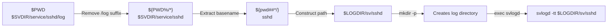
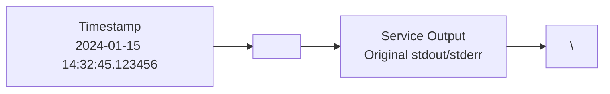
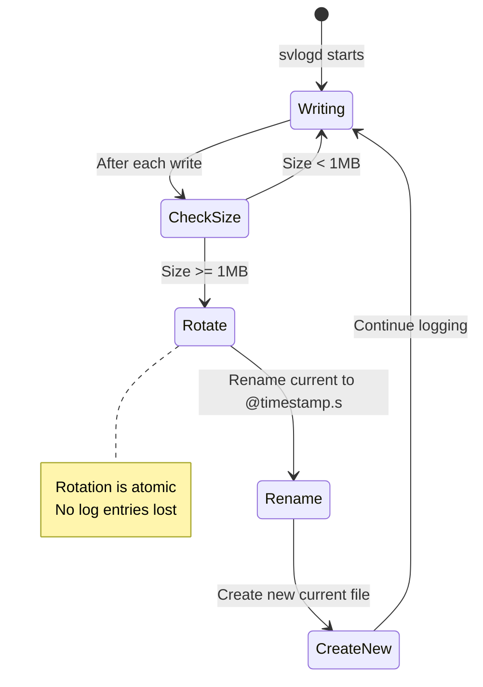
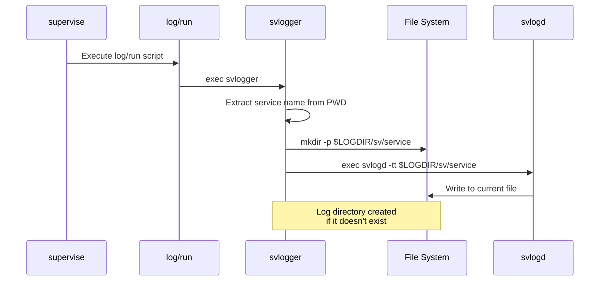

<!-- source: DeepWiki mcp.deepwiki.com · repo termux/termux-services · page 4.3 Viewing and Managing Logs · fetched 2026-10-26 -->

# Viewing and Managing Logs

<details>
<summary>Relevant source files</summary>

The following files were used as context for generating this wiki page:

- [Makefile](Makefile)
- [README.md](README.md)
- [start-services.fish](start-services.fish)
- [svlogger](svlogger)

</details>


This page explains how to access and manage service logs in termux-services. All service output (both stdout and stderr) is automatically captured and stored in structured log directories. This guide covers log locations, viewing methods, understanding log formats, and managing log storage.

For technical details about the logging infrastructure implementation, see [5.4 Logging Infrastructure](#5.4). For using logs to diagnose service problems, see [4.4 Troubleshooting](#4.4).

---

## Log Location and Structure

All service logs are stored under `$LOGDIR/sv/`, which defaults to `$PREFIX/var/log/sv/`. Each service has its own subdirectory named after the service.

### Directory Layout

```
$PREFIX/var/log/sv/
├── sshd/
│   ├── current      # Current active log file
│   ├── @*.s         # Rotated logs (timestamped)
│   └── lock         # svlogd lock file
├── crond/
│   ├── current
│   └── @*.s
└── <service-name>/
    └── current
```

The directory structure follows runit's `svlogd` conventions:
- **`current`**: The active log file being written to
- **`@timestamp.s`**: Rotated log files (when current reaches size limit)
- **`lock`**: Lock file used by svlogd for atomic operations

Sources: [README.md:6](), [svlogger:7-9]()

### Service Name Resolution

The `svlogger` script automatically determines the service name based on the directory structure. When a service's `log/run` script executes, the current working directory is `$SVDIR/<service>/log`, and svlogger extracts the service name:



Sources: [svlogger:2-5]()

---

## Viewing Logs

### Basic Log Viewing

Use standard Unix text tools to view service logs. The `current` file contains the most recent log entries:

```bash
# View entire log
cat $PREFIX/var/log/sv/sshd/current

# View last 50 lines
tail -n 50 $PREFIX/var/log/sv/sshd/current

# View with pagination
less $PREFIX/var/log/sv/sshd/current
```

### Real-Time Log Monitoring

Monitor logs in real-time as they are written:

```bash
# Follow log output
tail -f $PREFIX/var/log/sv/sshd/current

# Follow with last 20 lines of context
tail -n 20 -f $PREFIX/var/log/sv/sshd/current

# Follow multiple services
tail -f $PREFIX/var/log/sv/sshd/current $PREFIX/var/log/sv/crond/current
```

### Searching and Filtering

Use `grep` and other text processing tools to filter log content:

```bash
# Search for specific text
grep "error" $PREFIX/var/log/sv/sshd/current

# Search with context (3 lines before/after)
grep -C 3 "failed" $PREFIX/var/log/sv/sshd/current

# Search across all services
grep -r "connection" $PREFIX/var/log/sv/*/current

# Search rotated logs too
grep "error" $PREFIX/var/log/sv/sshd/@*
```

Sources: [README.md:6]()

---

## Understanding Log Format

### Timestamp Format

The `svlogger` script invokes `svlogd` with the `-tt` flag, which adds precise timestamps to each log line:

```
2024-01-15 14:32:45.123456 Server started on port 8080
2024-01-15 14:32:47.891234 Connection accepted from 192.168.1.100
2024-01-15 14:33:12.456789 Request processed successfully
```

The timestamp format is: `YYYY-MM-DD HH:MM:SS.microseconds`

### Log Entry Structure



Each log line consists of:
1. **Timestamp**: Added by `svlogd -tt`
2. **Space**: Single space separator
3. **Message**: Original output from the service (stdout or stderr)
4. **Newline**: Line terminator

Sources: [svlogger:9]()

### Distinguishing stdout vs stderr

The `svlogger` infrastructure merges stdout and stderr into a single log stream. Both output streams are captured identically by `svlogd`, and there is no built-in marker to distinguish them in the log file. If separation is needed, the service's `run` script must add explicit prefixes to stderr before it reaches svlogger.

---

## Log Rotation and Retention

### Automatic Rotation

The `svlogd` process automatically rotates log files based on size. When `current` reaches the size limit (default: 1MB), svlogd:

1. Renames `current` to `@<timestamp>.s` (e.g., `@4000000065a5c3d412ab2c3c.s`)
2. Creates a new empty `current` file
3. Continues writing to the new `current`



### Rotated Log Filenames

Rotated logs use TAI64N timestamps in their filenames:
- Format: `@<tai64n_timestamp>.s`
- Example: `@4000000065a5c3d412ab2c3c.s`
- The `.s` suffix indicates successful processing
- Timestamps are in TAI64N format (base-16 representation of seconds since epoch)

### Retention Policy

By default, `svlogd` keeps a limited number of rotated logs:
- **Default**: 10 rotated files
- **Oldest files**: Automatically deleted when limit is exceeded
- **Total storage**: Approximately 11MB per service (10 rotated + 1 current)

Sources: [svlogger:9]()

---

## Managing Log Storage

### Checking Log Disk Usage

Monitor total space used by service logs:

```bash
# Total size of all service logs
du -sh $PREFIX/var/log/sv/

# Size per service
du -sh $PREFIX/var/log/sv/*/

# Detailed breakdown
du -h $PREFIX/var/log/sv/* | sort -h

# Count log files per service
for dir in $PREFIX/var/log/sv/*/; do
  echo "$(basename $dir): $(ls -1 $dir/@* 2>/dev/null | wc -l) rotated files"
done
```

### Manual Log Cleanup

Remove old logs to free disk space:

```bash
# Remove all rotated logs for a service (keep current)
rm $PREFIX/var/log/sv/sshd/@*

# Remove specific old rotated logs
rm $PREFIX/var/log/sv/sshd/@4000000065a5c3d412ab2c3c.s

# Clear current log (truncate to zero)
: > $PREFIX/var/log/sv/sshd/current

# Remove entire log directory for disabled service
rm -rf $PREFIX/var/log/sv/old-service/
```

**Warning**: Do not delete the `current` file while the service is running. Either truncate it (`> file`) or let `svlogd` handle rotation naturally.

### Service Log Directory Creation

Log directories are created automatically by the `svlogger` script when a service starts. The script executes `mkdir -p "$LOGDIR/sv/$service"` before launching `svlogd`.



Sources: [svlogger:7-9]()

---

## Log Access Patterns

### Common Workflows

| Task | Command | Description |
|------|---------|-------------|
| Quick check | `tail $PREFIX/var/log/sv/<service>/current` | View recent log entries |
| Follow logs | `tail -f $PREFIX/var/log/sv/<service>/current` | Monitor in real-time |
| Search errors | `grep -i error $PREFIX/var/log/sv/<service>/*` | Find error messages |
| View rotated | `less $PREFIX/var/log/sv/<service>/@*` | Read old rotated logs |
| Check size | `du -sh $PREFIX/var/log/sv/<service>/` | Disk usage per service |
| Clear logs | `rm $PREFIX/var/log/sv/<service>/@*` | Remove rotated logs |

### Environment Variables

The log location is determined by the `LOGDIR` environment variable, which is set by the login scripts:

```bash
# Bash/POSIX shells (start-services.sh)
export LOGDIR=$PREFIX/var/log

# Fish shell (start-services.fish)
set -gx LOGDIR $PREFIX/var/log
```

To verify your log directory:
```bash
echo $LOGDIR
ls -la $LOGDIR/sv/
```

Sources: [start-services.fish:4](), [svlogger:7]()

---

## Integration with runit svlogd

The logging system uses runit's `svlogd` tool directly. All `svlogd` features are available, including:

- **Automatic rotation**: Based on file size
- **Pattern matching**: Filter log entries (requires custom config)
- **Network logging**: Forward logs to remote hosts (requires custom config)
- **Processor scripts**: Transform log entries (requires custom config)

For advanced `svlogd` configuration, create a `config` file in the service log directory (`$LOGDIR/sv/<service>/config`). See the runit documentation for `svlogd` configuration syntax.

### Default svlogd Configuration

The `svlogger` wrapper uses these default settings:
- **Timestamps**: Enabled (`-tt` flag)
- **Log directory**: `$LOGDIR/sv/$service`
- **Rotation size**: 1MB (svlogd default)
- **Retention**: 10 files (svlogd default)
- **Pattern matching**: None (accepts all log lines)

Sources: [svlogger:9]()

---

## Troubleshooting Log Issues

### Log Directory Not Created

If logs are missing, verify the log directory exists:
```bash
ls -la $PREFIX/var/log/sv/<service>/
```

If the directory is missing, check that:
1. The service has a `log/run` script that calls `svlogger`
2. The `LOGDIR` environment variable is set correctly
3. The service has been started at least once

### No Log Output

If the `current` file is empty or doesn't update:
1. Verify the service is actually running: `sv status <service>`
2. Check that the service produces output on stdout/stderr
3. Ensure the `log/run` script is executable
4. Verify `svlogd` is running: `ps aux | grep svlogd`

### Permission Errors

Log directories and files should be owned by the Termux user. If permission errors occur:
```bash
# Fix ownership
chmod -R u+w $PREFIX/var/log/sv/<service>/

# Check current permissions
ls -la $PREFIX/var/log/sv/<service>/
```

For more diagnostic procedures, see [4.4 Troubleshooting](#4.4).

Sources: [svlogger:7-9](), [README.md:6]()

---

