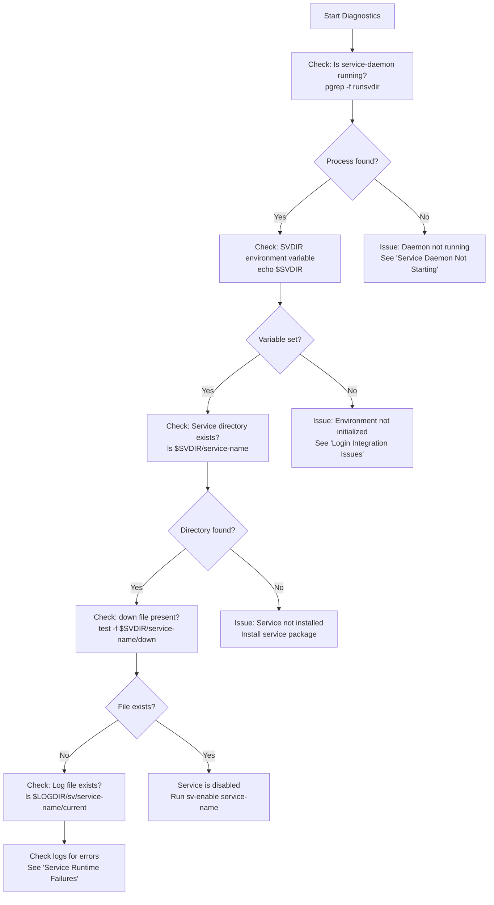
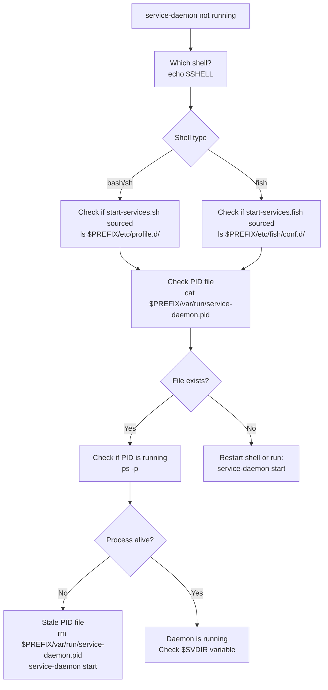
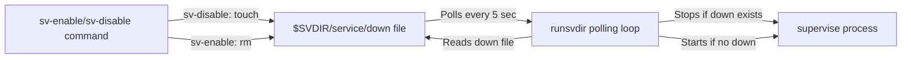
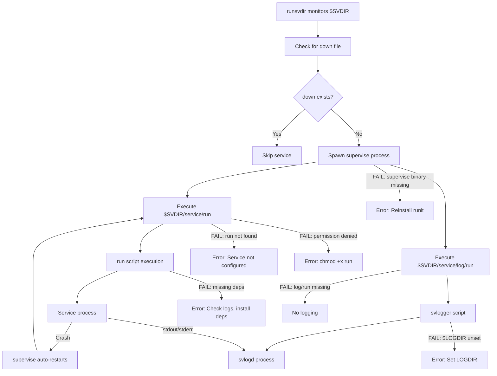
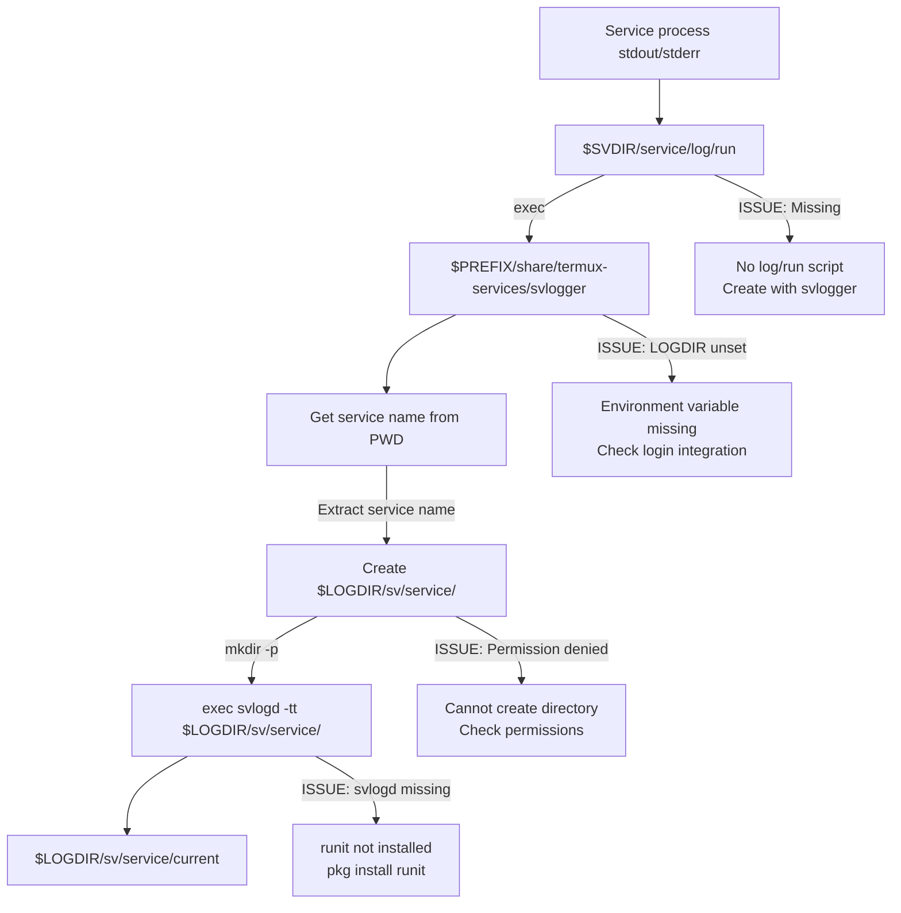

<!-- source: DeepWiki mcp.deepwiki.com · repo termux/termux-services · page 4.4 Troubleshooting · fetched 2026-10-26 -->

# Troubleshooting

<details>
<summary>Relevant source files</summary>

The following files were used as context for generating this wiki page:

- [Makefile](Makefile)
- [README.md](README.md)
- [service-daemon](service-daemon)
- [start-services.fish](start-services.fish)
- [svlogger](svlogger)

</details>


This page provides diagnostic procedures and solutions for common issues encountered when managing services with termux-services. It covers problems related to the service daemon, individual service failures, logging issues, and recovery procedures.

For basic usage instructions, see the [User Guide](#4). For details on the system architecture that may help understand these issues, see [Architecture](#5).

## Diagnostic Checklist

Before troubleshooting specific issues, verify the basic state of the system using this checklist:



**Sources:** [service-daemon:1-48](), [start-services.fish:1-7](), [README.md:1-10]()

### Quick Status Commands

| Check | Command | Expected Output |
|-------|---------|-----------------|
| Service daemon running | `pgrep -f runsvdir` | PID number |
| Environment variables set | `echo $SVDIR $LOGDIR` | Two paths |
| Service enabled | `test -f $SVDIR/<service>/down && echo disabled \|\| echo enabled` | `enabled` |
| Service running | `sv status <service>` | `run:` with PID |
| PID file exists | `cat $PREFIX/var/run/service-daemon.pid` | PID number |
| Supervise process active | `ps -p $(cat $SVDIR/<service>/supervise/pid)` | Process info |

**Sources:** [service-daemon:18-19](), [README.md:9]()

## Common Issues and Solutions

### Service Daemon Not Starting

**Symptom:** Services do not run automatically after login, `pgrep -f runsvdir` returns no results.

**Diagnostic Steps:**



**Sources:** [service-daemon:18-19](), [start-services.fish:1-7]()

**Solutions:**

1. **Login script not sourced:** Restart your shell. The login scripts at `$PREFIX/etc/profile.d/start-services.sh` (bash/sh) or `$PREFIX/etc/fish/conf.d/start-services.fish` (fish) are only executed during login.

2. **Manual start required:** Run `service-daemon start` manually. Check if `runsvdir` process starts:
   ```
   service-daemon start
   pgrep -f runsvdir
   ```

3. **PIDDIR missing:** The directory `$PREFIX/var/run` must exist. This is created by [service-daemon:5](), but if deleted:
   ```
   mkdir -p $PREFIX/var/run
   service-daemon start
   ```

4. **Stale PID file:** If `$PREFIX/var/run/service-daemon.pid` exists but the process is dead:
   ```
   rm $PREFIX/var/run/service-daemon.pid
   service-daemon start
   ```

5. **start-stop-daemon failure:** Check if `start-stop-daemon` is available:
   ```
   which start-stop-daemon
   ```
   If missing, reinstall `termux-tools`.

**Sources:** [service-daemon:4-7](), [service-daemon:18-19](), [start-services.fish:5]()

### Login Integration Issues

**Symptom:** `$SVDIR` or `$LOGDIR` environment variables are not set, even after restarting shell.

**Root Cause Analysis:**

The environment variables are set by login scripts [start-services.fish:3-4]() which only execute on interactive login shells.

**Verification:**

```bash
# Check if login scripts are installed
ls $PREFIX/etc/profile.d/start-services.sh      # For bash/sh
ls $PREFIX/etc/fish/conf.d/start-services.fish  # For fish

# Check if script is being sourced (fish)
status --is-login && echo "Login shell" || echo "Not login shell"

# Manually set variables (temporary fix)
export SVDIR=$PREFIX/var/service
export LOGDIR=$PREFIX/var/log
```

**Solutions:**

1. **Ensure login shell:** Some terminal emulators don't start login shells. Start a new Termux session completely.

2. **Reinstall termux-services:**
   ```
   pkg reinstall termux-services
   ```
   This will restore [start-services.sh]() and [start-services.fish]() via [Makefile:7-10]().

3. **Manual initialization:** Add to `~/.bashrc` or `~/.profile`:
   ```bash
   export SVDIR=$PREFIX/var/service
   export LOGDIR=$PREFIX/var/log
   [ -z "$(pgrep -f runsvdir)" ] && service-daemon start
   ```

**Sources:** [start-services.fish:1-6](), [Makefile:7-10]()

### Service Not Enabling or Disabling

**Symptom:** Running `sv-enable <service>` or `sv-disable <service>` has no effect, or service state doesn't change.

**Diagnostic Flow:**



**Sources:** [README.md:9]()

**Common Issues:**

1. **Permission denied:** The `down` file at `$SVDIR/<service>/down` cannot be created or removed.
   ```bash
   # Check permissions
   ls -ld $SVDIR/<service>
   
   # Fix if needed
   chmod 755 $SVDIR/<service>
   ```

2. **Wrong service name:** Verify service directory exists:
   ```bash
   ls $SVDIR/
   ```

3. **runsvdir not polling:** The `runsvdir` process polls `$SVDIR` periodically. Wait 5 seconds after enable/disable, then check:
   ```bash
   sv status <service>
   ```

4. **Service explicitly stopped:** Even if enabled (no `down` file), service may be explicitly stopped. Start it:
   ```bash
   sv up <service>
   ```

**Sources:** [README.md:9]()

### Service Runtime Failures

**Symptom:** Service starts but immediately exits, or crashes repeatedly.

**Log Inspection:**

Service logs are the primary diagnostic tool. They are located at `$LOGDIR/sv/<service>/current` [README.md:6]().

```bash
# View current log
cat $LOGDIR/sv/<service>/current

# Follow log in real-time
tail -f $LOGDIR/sv/<service>/current

# View with timestamps (svlogd adds them automatically)
less $LOGDIR/sv/<service>/current
```

**Common Failure Patterns:**

| Log Pattern | Likely Cause | Solution |
|-------------|--------------|----------|
| `exec: <command>: not found` | Missing dependency | Install required package |
| `Permission denied` | Execute permission on `run` script | `chmod +x $SVDIR/<service>/run` |
| `Address already in use` | Port conflict | Stop conflicting service or change port |
| Immediate exit, no error | Script exits without blocking | Modify `run` script to use `exec` |
| `Cannot create directory` | Missing directory | Create parent directories |
| No log file created | svlogger not working | Check `$SVDIR/<service>/log/run` |

**Service Lifecycle with Failure Points:**



**Sources:** [service-daemon:21-22](), [svlogger:1-10](), [README.md:6]()

**Detailed Diagnostics:**

1. **Check supervise status:**
   ```bash
   sv status <service>
   ```
   Output interpretation:
   - `run: <service>: (pid <n>)` - Running normally
   - `down: <service>:` - Service stopped
   - `fail: <service>:` - Service failing to start
   - `timeout:` - Service not responding to signals

2. **Check supervise directory:**
   ```bash
   ls -la $SVDIR/<service>/supervise/
   cat $SVDIR/<service>/supervise/status
   cat $SVDIR/<service>/supervise/stat
   ```

3. **Test run script manually:**
   ```bash
   cd $SVDIR/<service>
   ./run
   ```
   This executes the service directly to see errors.

**Sources:** [service-daemon:11-14]()

### Logging Issues

**Symptom:** No logs appear in `$LOGDIR/sv/<service>/current`, or logs stop updating.

**Logging Infrastructure Check:**



**Sources:** [svlogger:1-10]()

**Common Solutions:**

1. **Missing log/run script:** Most services need a `log/run` script to enable logging:
   ```bash
   mkdir -p $SVDIR/<service>/log
   cat > $SVDIR/<service>/log/run << 'EOF'
   #!/data/data/com.termux/files/usr/bin/sh
   exec $PREFIX/share/termux-services/svlogger
   EOF
   chmod +x $SVDIR/<service>/log/run
   ```

2. **LOGDIR not set:** The [svlogger:7]() script requires `$LOGDIR`:
   ```bash
   echo $LOGDIR
   # If empty, restart shell or manually export
   export LOGDIR=$PREFIX/var/log
   ```

3. **Log directory doesn't exist:** The [svlogger:7]() script creates it, but parent must exist:
   ```bash
   mkdir -p $PREFIX/var/log
   ```

4. **svlogd not running:** Check if the log supervise process is active:
   ```bash
   ls $SVDIR/<service>/log/supervise/
   cat $SVDIR/<service>/log/supervise/pid
   ps -p $(cat $SVDIR/<service>/log/supervise/pid)
   ```

5. **Log rotation issues:** `svlogd` automatically rotates logs. If disk full:
   ```bash
   # Check log directory size
   du -sh $LOGDIR/sv/<service>/
   
   # Remove old logs
   rm $LOGDIR/sv/<service>/@*
   ```

**Sources:** [svlogger:1-10](), [Makefile:11-12]()

### Zombie Supervise Processes

**Symptom:** `supervise` processes remain after stopping service-daemon, consuming resources.

**Identification:**

```bash
# Find supervise processes
ps aux | grep supervise

# Check supervise directories
ls $SVDIR/*/supervise/pid
ls $SVDIR/*/log/supervise/pid
```

**Root Cause:**

When [service-daemon:8-14]() stop function executes, it kills `runsvdir` and then attempts to kill all `supervise` processes. However, if PIDs are invalid or processes are hung, they may persist.

**Cleanup Procedure:**

The stop function in [service-daemon:8-15]() implements aggressive cleanup:

```bash
# Manual cleanup if service-daemon stop fails
for f in $SVDIR/*/supervise $SVDIR/*/log/supervise; do
    if [ -f "$f/pid" ]; then
        kill -9 $(cat "$f/pid") 2>/dev/null || true
        rm -rf "$f"
    fi
done

# Remove PID file
rm -f $PREFIX/var/run/service-daemon.pid

# Restart cleanly
service-daemon start
```

**Sources:** [service-daemon:8-15]()

### Service Stuck in "Want Down" State

**Symptom:** `sv status <service>` shows `want down` but service continues running.

**Cause:** The service process is not responding to SIGTERM. The `supervise` process sends SIGTERM, waits, then sends SIGKILL.

**Solution:**

```bash
# Force immediate termination
sv force-stop <service>

# Or kill directly
kill -9 $(cat $SVDIR/<service>/supervise/pid)

# If that fails, kill the supervised process
kill -9 $(sv status <service> | grep -oP 'pid \K[0-9]+')
```

## Advanced Diagnostics

### Tracing Service Startup

To debug service startup issues, manually step through the process:

```bash
# 1. Verify environment
echo "SVDIR=$SVDIR"
echo "LOGDIR=$LOGDIR"
echo "PREFIX=$PREFIX"

# 2. Check service definition
ls -la $SVDIR/<service>/
cat $SVDIR/<service>/run
cat $SVDIR/<service>/log/run

# 3. Manually start supervise (debugging only)
cd $SVDIR/<service>
supervise . &

# 4. Check what happened
sv status <service>
cat $LOGDIR/sv/<service>/current

# 5. Kill the supervise process when done
kill $(cat supervise/pid)
rm -rf supervise
```

### Monitoring runsvdir

The `runsvdir` process is spawned by [service-daemon:6]() and should continuously run:

```bash
# Check if runsvdir is alive
ps aux | grep runsvdir

# See which directory it's monitoring
ps -p $(cat $PREFIX/var/run/service-daemon.pid) -o args=

# Manually run runsvdir (debugging only)
runsvdir $SVDIR
```

### Inspecting File System State

Key state locations and their purposes:

| Location | Purpose | Contents |
|----------|---------|----------|
| `$PREFIX/var/run/service-daemon.pid` | Daemon PID tracking | PID of runsvdir [service-daemon:19]() |
| `$SVDIR/<service>/down` | Enable/disable state | Empty file, presence = disabled [README.md:9]() |
| `$SVDIR/<service>/supervise/` | Runtime state | `pid`, `status`, `stat`, `lock`, etc. |
| `$SVDIR/<service>/supervise/control` | Command pipe | Write commands (u, d, t, k, etc.) |
| `$LOGDIR/sv/<service>/current` | Current log | Recent log entries [README.md:6]() |
| `$LOGDIR/sv/<service>/@*` | Rotated logs | Old log files with timestamps |

**Sources:** [service-daemon:18-19](), [README.md:6-9](), [svlogger:7]()

## Recovery Procedures

### Complete Service Reset

If services are in an inconsistent state:

```bash
# 1. Stop all supervision
service-daemon stop

# 2. Clean supervision state
rm -rf $SVDIR/*/supervise
rm -rf $SVDIR/*/log/supervise

# 3. Remove PID file
rm -f $PREFIX/var/run/service-daemon.pid

# 4. Restart daemon
service-daemon start

# 5. Re-enable services as needed
sv-enable <service>
sv up <service>
```

**Warning:** This clears all runtime state. Services will start from scratch.

**Sources:** [service-daemon:8-15]()

### Rebuilding Service Directory Structure

If `$SVDIR` is corrupted or missing:

```bash
# 1. Create base directory
mkdir -p $PREFIX/var/service

# 2. For each service package installed, symlink its service definition
# Example for service 'foo':
ln -s $PREFIX/share/foo/sv $PREFIX/var/service/foo

# 3. Create log directories
mkdir -p $PREFIX/var/log

# 4. Restart service-daemon
service-daemon restart
```

### Emergency Stop All Services

If services are consuming excessive resources:

```bash
# Nuclear option: kill all supervision
killall -9 runsvdir supervise svlogd 2>/dev/null

# Clean up state
rm -f $PREFIX/var/run/service-daemon.pid
rm -rf $SVDIR/*/supervise $SVDIR/*/log/supervise

# Optionally disable all services
for service in $SVDIR/*; do
    touch "$service/down"
done
```

**Sources:** [service-daemon:11-14]()

## Debugging Service-Daemon Script

The [service-daemon]() script is a POSIX shell script. To debug it:

```bash
# Run with tracing
sh -x $(which service-daemon) start

# Check key variables
sh -c 'PREFIX=/data/data/com.termux/files/usr; SVDIR=$PREFIX/var/service; echo "DAEMON=$PREFIX/bin/runsvdir"; echo "DAEMON_OPTS=$SVDIR"'
```

Common script failures:

1. **PREFIX not set:** The script assumes `$PREFIX` is set by Termux environment. If running outside Termux:
   ```bash
   PREFIX=/data/data/com.termux/files/usr service-daemon start
   ```

2. **start-stop-daemon missing:** The script depends on `start-stop-daemon` [service-daemon:6]():
   ```bash
   pkg install termux-tools
   ```

3. **runsvdir not found:** Requires `runit` package [service-daemon:21]():
   ```bash
   pkg install runit
   ```

**Sources:** [service-daemon:1-48]()

## When to Reinstall

If multiple issues persist, consider reinstalling:

```bash
# Reinstall termux-services
pkg reinstall termux-services

# Reinstall runit
pkg reinstall runit

# Verify installation
which service-daemon sv-enable sv-disable runsvdir svlogd
ls $PREFIX/etc/profile.d/start-services.sh
ls $PREFIX/share/termux-services/svlogger
```

This re-runs [Makefile:3-12](), ensuring all components are correctly installed.

**Sources:** [Makefile:1-23]()

---

