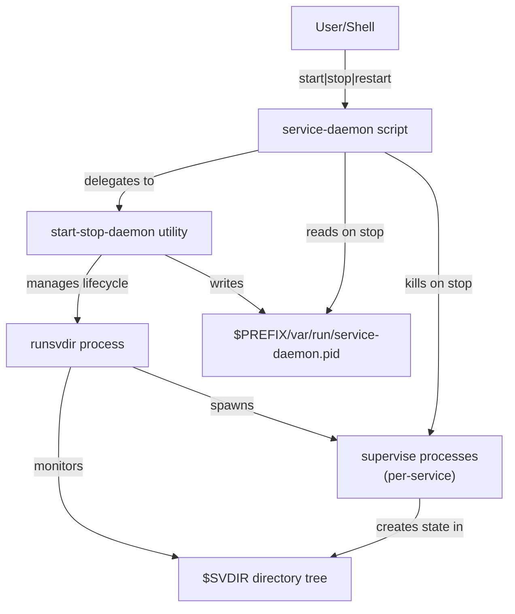
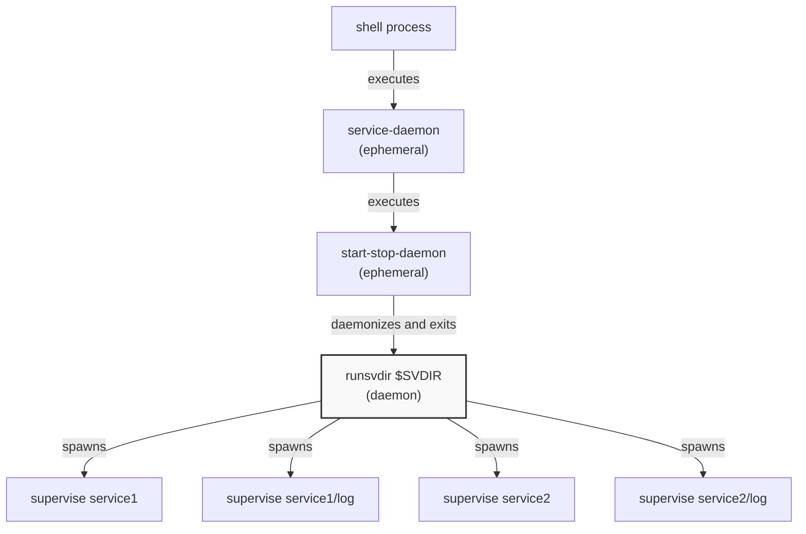
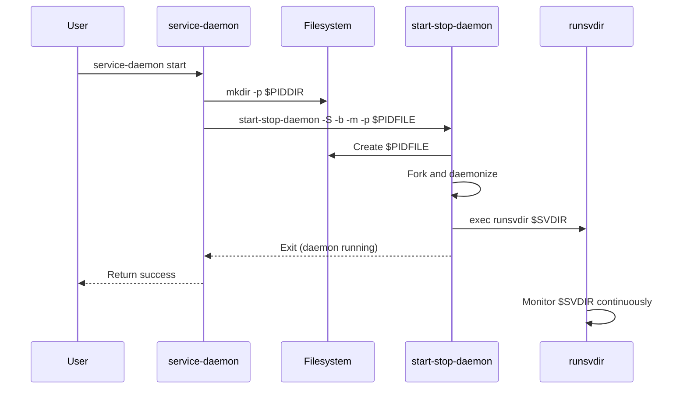
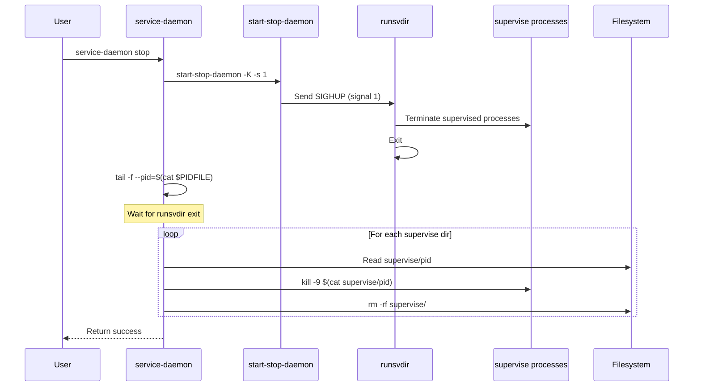
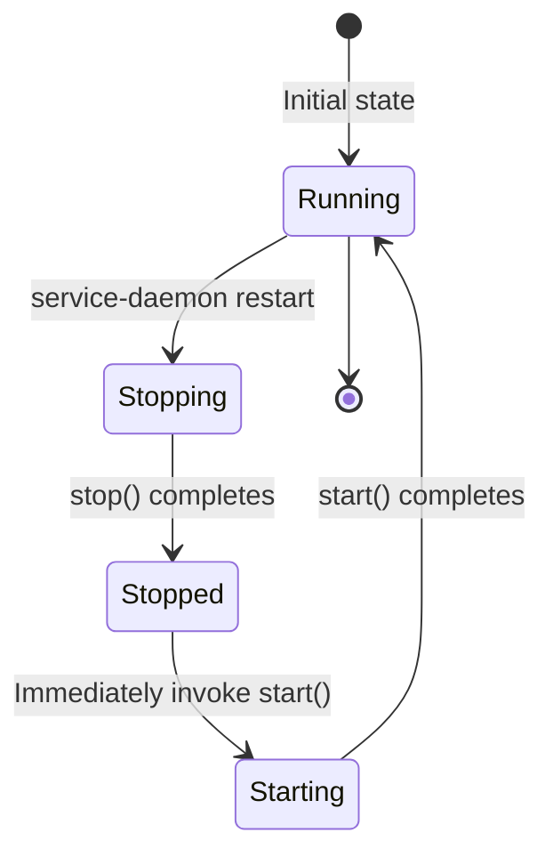
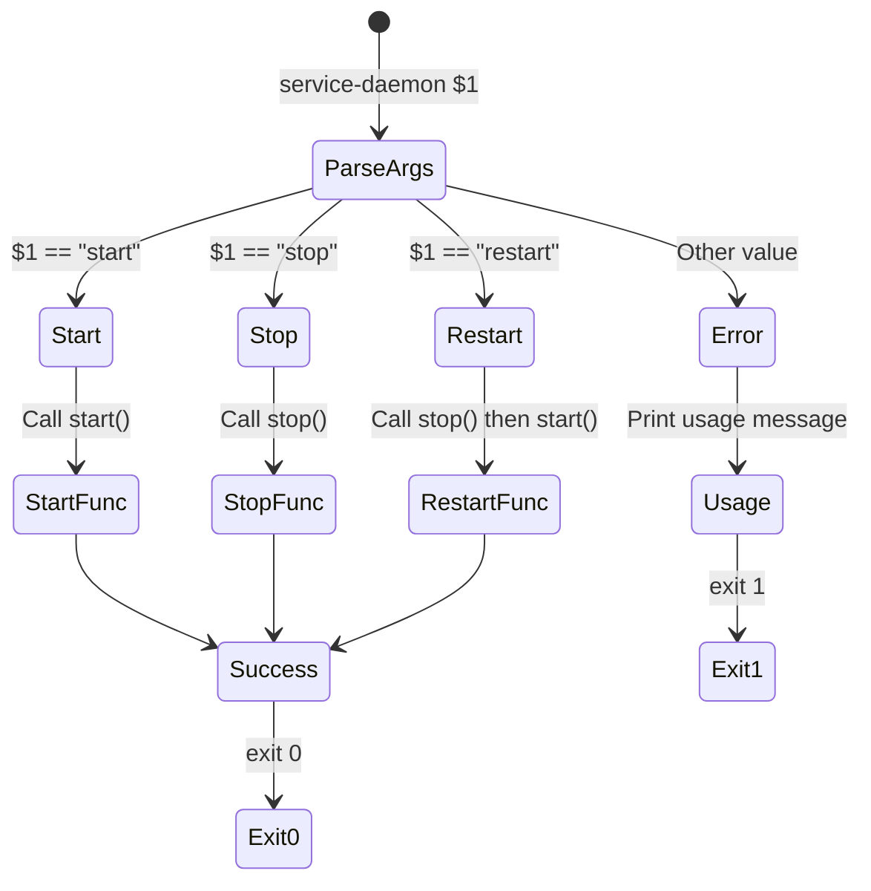
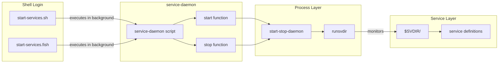

<!-- source: DeepWiki mcp.deepwiki.com · repo termux/termux-services · page 5.2 Service Daemon · fetched 2026-10-26 -->

# Service Daemon

<details>
<summary>Relevant source files</summary>

The following files were used as context for generating this wiki page:

- [Makefile](Makefile)
- [service-daemon](service-daemon)
- [start-services.fish](start-services.fish)
- [start-services.sh](start-services.sh)
- [svlogger](svlogger)

</details>


## Purpose and Scope

This document provides a technical deep dive into the `service-daemon` component, which serves as the lifecycle manager for the runit supervision system within Termux. It covers the daemon's architecture, how it manages the `runsvdir` process, PID file handling, and cleanup operations.

For high-level system architecture context, see [System Overview](#5.1). For information about how `service-daemon` is automatically started during shell login, see [Login Integration](#5.3). For user-facing command documentation, see [service-daemon command reference](#6.3).

## Overview

The `service-daemon` is a shell script that manages the lifecycle of the `runsvdir` process, which is the core supervisor from the runit package. It acts as a thin wrapper that:

- Daemonizes `runsvdir` using `start-stop-daemon`
- Manages a PID file for tracking the daemon process
- Provides start/stop/restart commands
- Performs aggressive cleanup of supervision state on shutdown

The daemon is automatically started by shell login scripts ([start-services.sh:3]() and [start-services.fish:5]()) and remains running for the duration of the user's session.

**Key Technical Characteristics:**

| Characteristic | Value |
|---------------|-------|
| Language | POSIX shell script |
| Installation Path | `$PREFIX/bin/service-daemon` |
| PID File Location | `$PREFIX/var/run/service-daemon.pid` |
| Managed Process | `runsvdir` |
| Daemonization Tool | `start-stop-daemon` |

Sources: [service-daemon:1-48](), [Makefile:6]()

## Architecture

The `service-daemon` operates as a process lifecycle manager, sitting between the user/shell environment and the runit `runsvdir` supervisor.

### Component Relationships



Sources: [service-daemon:4-14](), [service-daemon:21-22]()

### Process Hierarchy

When running, the process tree appears as:



The `service-daemon` script itself is ephemeral—it executes and exits immediately after invoking `start-stop-daemon`. The `start-stop-daemon` utility then daemonizes `runsvdir`, which remains running until explicitly stopped.

Sources: [service-daemon:4-7](), [start-services.sh:3]()

## Lifecycle Management

The daemon supports three operations: `start`, `stop`, and `restart`.

### Start Operation

The `start` function performs the following operations:



Implementation details from [service-daemon:4-7]():

| Line | Operation | Purpose |
|------|-----------|---------|
| 5 | `mkdir -p $PIDDIR` | Ensure PID directory exists |
| 6 | `start-stop-daemon -S` | Start daemon (`-S` flag) |
| 6 | `-b` | Run in background (daemonize) |
| 6 | `-m -p $PIDFILE` | Manage PID file |
| 6 | `-x $DAEMON` | Execute `$PREFIX/bin/runsvdir` |
| 6 | `-d $PREFIX` | Set working directory |
| 6 | `-- $DAEMON_OPTS` | Pass `$SVDIR` as argument to runsvdir |

**Critical Environment Variables:**

- `PIDDIR`: Set to `$PREFIX/var/run` ([service-daemon:18]())
- `PIDFILE`: Set to `$PIDDIR/$NAME.pid` ([service-daemon:19]())
- `DAEMON`: Set to `$PREFIX/bin/runsvdir` ([service-daemon:21]())
- `DAEMON_OPTS`: Set to `$SVDIR` ([service-daemon:22]())

Sources: [service-daemon:4-7](), [service-daemon:16-22]()

### Stop Operation

The `stop` function performs a multi-stage shutdown with aggressive cleanup:



Implementation details from [service-daemon:8-15]():

**Phase 1: Graceful Shutdown**
- Line 9: Send `SIGHUP` (signal 1) to `runsvdir` via `start-stop-daemon -K`
- Line 10: Wait for process to exit using `tail -f --pid=`

**Phase 2: Aggressive Cleanup**
- Line 11: Iterate over all `supervise` directories: `$SVDIR/*/supervise` and `$SVDIR/*/log/supervise`
- Line 12: Force-kill any remaining `supervise` processes with `kill -9`
- Line 13: Remove the entire `supervise/` directory to clear stale state

**Rationale for Aggressive Cleanup:**

The aggressive cleanup (lines 11-14) is necessary because:

1. `supervise` processes may not immediately exit when `runsvdir` terminates
2. Stale `supervise/` directories contain state files (PID, control pipes, status) that can cause issues on restart
3. The `-o` flag (line 9) allows operation even if the PID file is stale

Sources: [service-daemon:8-15]()

### Restart Operation

The `restart` operation is implemented as a simple stop-then-start sequence ([service-daemon:35-39]()):



This ensures complete cleanup before reinitialization.

Sources: [service-daemon:35-40]()

## Implementation Details

### start-stop-daemon Integration

The `service-daemon` script delegates all process management to the `start-stop-daemon` utility, which is part of the dpkg package. This utility provides:

**Start Mode (`-S`)** - [service-daemon:6]()
- `-b`: Daemonize (background) the process
- `-m`: Create and manage PID file
- `-p $PIDFILE`: Specify PID file location
- `-x $DAEMON`: Executable to run
- `-d $PREFIX`: Working directory for the daemon

**Stop Mode (`-K`)** - [service-daemon:9]()
- `-s 1`: Send signal 1 (SIGHUP) to process
- `-o`: Ignore stale PID files (don't fail if PID doesn't match)
- `-p $PIDFILE`: Read PID from file

### PID File Management

The PID file serves as the primary mechanism for tracking the daemon state:

| Variable | Value | Purpose |
|----------|-------|---------|
| `PIDDIR` | `$PREFIX/var/run` | Standard location for runtime state |
| `PIDFILE` | `$PREFIX/var/run/service-daemon.pid` | Contains PID of `runsvdir` |
| `NAME` | `service-daemon` | Daemon identifier |

The PID file is:
- Created by `start-stop-daemon` on startup ([service-daemon:6]())
- Read during stop to wait for process exit ([service-daemon:10]())
- Automatically removed by `start-stop-daemon` when process exits

Sources: [service-daemon:16-19]()

### Supervise Directory Cleanup

The cleanup loop ([service-daemon:11-14]()) targets two types of supervise directories:

```
$SVDIR/
├── service1/
│   ├── supervise/          # Cleaned up
│   │   ├── pid
│   │   ├── stat
│   │   ├── control
│   │   └── ok
│   └── log/
│       └── supervise/      # Cleaned up
│           ├── pid
│           └── ...
└── service2/
    ├── supervise/          # Cleaned up
    └── log/
        └── supervise/      # Cleaned up
```

The glob pattern `$SVDIR/*/supervise $SVDIR/*/log/supervise` matches all supervise directories for both main services and their log processes.

**Cleanup Operations:**
1. Extract PID from `supervise/pid` file
2. Send `SIGKILL` (signal 9) to the process
3. Remove entire `supervise/` directory tree
4. Ignore errors (`||:`) for already-terminated processes

Sources: [service-daemon:11-14]()

## Environment Dependencies

The `service-daemon` script depends on several environment variables that must be set before invocation:

| Variable | Set By | Expected Value | Usage |
|----------|--------|----------------|-------|
| `PREFIX` | Termux environment | `/data/data/com.termux/files/usr` | Base path for all operations |
| `SVDIR` | Login scripts | `$PREFIX/var/service` | Service directory passed to runsvdir |
| `LOGDIR` | Login scripts | `$PREFIX/var/log` | Not used by service-daemon directly |

The login integration scripts ensure these are set before invoking `service-daemon start`:

**Bash/POSIX shells** ([start-services.sh:1-2]()):
```bash
export SVDIR=$PREFIX/var/service
export LOGDIR=$PREFIX/var/log
```

**Fish shell** ([start-services.fish:3-4]()):
```fish
set -gx SVDIR $PREFIX/var/service
set -gx LOGDIR $PREFIX/var/log
```

Sources: [service-daemon:18-22](), [start-services.sh:1-2](), [start-services.fish:3-4]()

## Command Interface

The daemon accepts three commands via the first positional argument:



**Command Syntax:**
```bash
service-daemon {start|stop|restart}
```

**Implementation** ([service-daemon:24-47]()):
- Lines 24-28: `start` command
- Lines 30-33: `stop` command  
- Lines 35-39: `restart` command
- Lines 42-44: Invalid command handling

The script uses basic `echo` for user feedback:
- "Starting daemon: service-daemon" (line 26)
- "Stopping daemon: service-daemon" (line 31)
- "Restarting daemon: service-daemon" (line 36)

For comprehensive command reference documentation, see [service-daemon command reference](#6.3).

Sources: [service-daemon:24-47]()

## Error Handling

The script employs defensive error handling:

**Set -e** ([service-daemon:3]()): Exit immediately on any command failure

**Conditional Cleanup** ([service-daemon:12]()): Use `||:` to ignore errors during cleanup operations, preventing failures when:
- A supervise process has already terminated
- A PID file is missing or invalid
- Permission issues occur (though unlikely in Termux)

**start-stop-daemon Flags:**
- `-o` flag on stop ([service-daemon:9]()): Override stale PID file checks

This ensures robustness even when the system is in an inconsistent state.

Sources: [service-daemon:3](), [service-daemon:9](), [service-daemon:12]()

## Integration Points

The `service-daemon` integrates with other termux-services components:



**Upstream Integration:**
- Invoked by [start-services.sh:3]() for Bash/POSIX shells
- Invoked by [start-services.fish:5]() for Fish shell
- Both invoke as background process: `service-daemon start >/dev/null 2>&1 &`

**Downstream Integration:**
- Manages `runsvdir` which monitors `$SVDIR` (see [System Overview](#5.1))
- Cleanup operations affect service supervision state (see [File System Layout](#5.5))

Sources: [service-daemon:1-48](), [start-services.sh:3](), [start-services.fish:5]()

---

