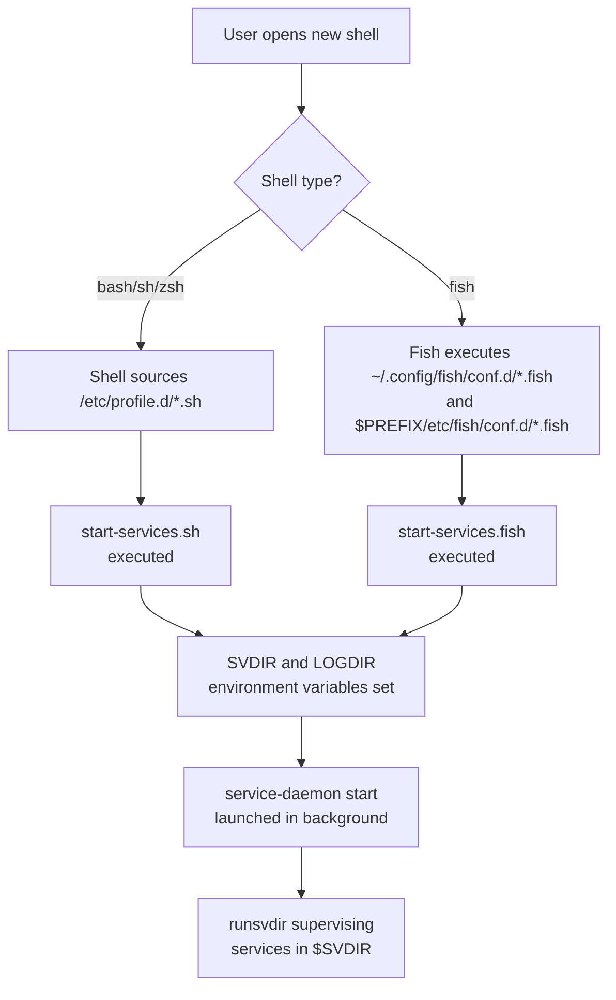
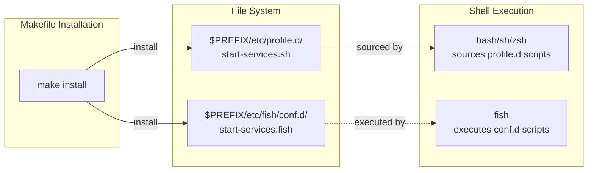
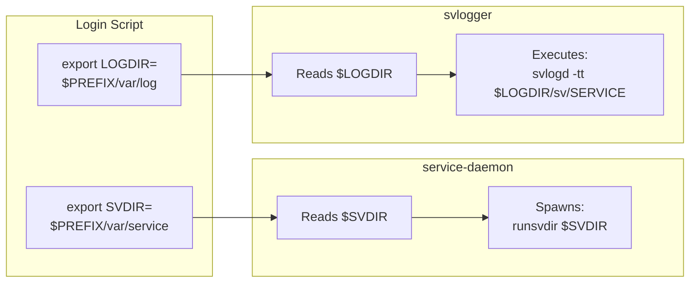
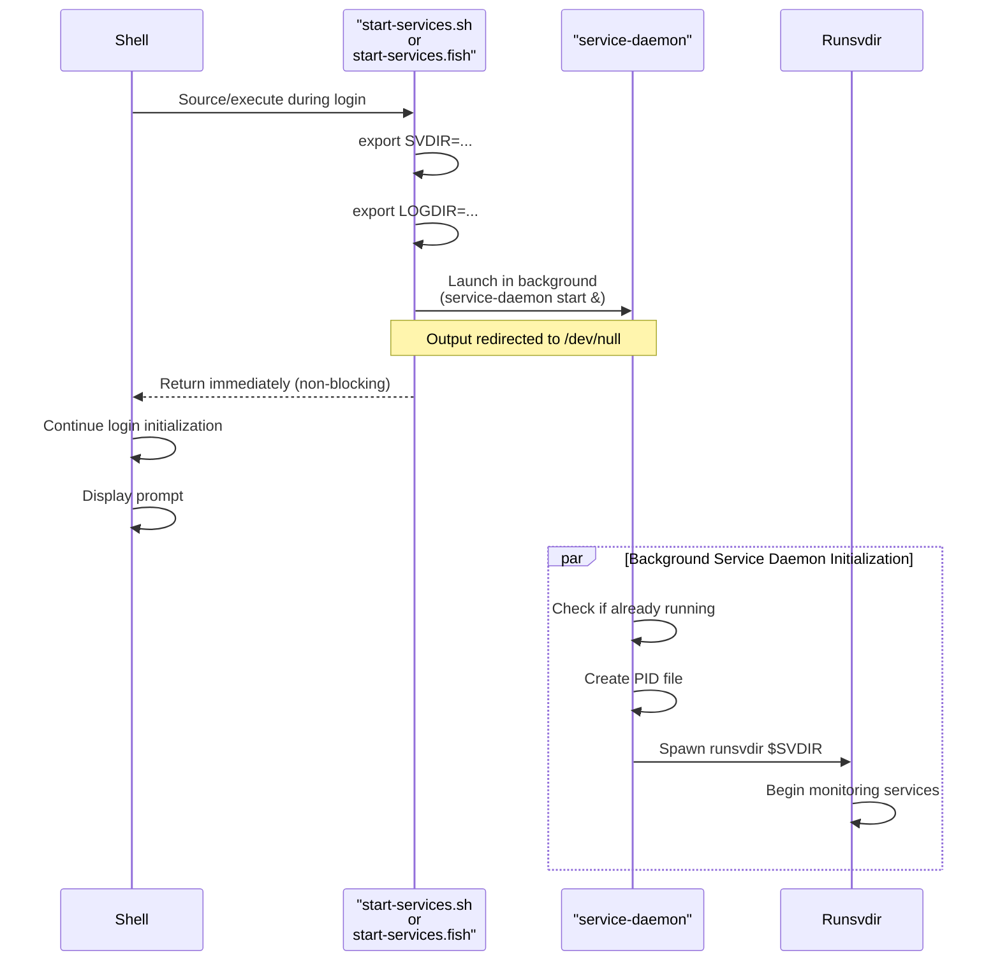
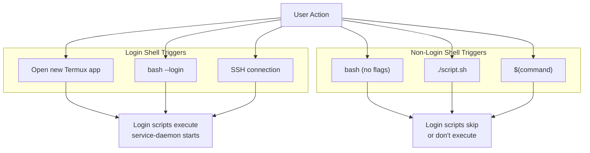
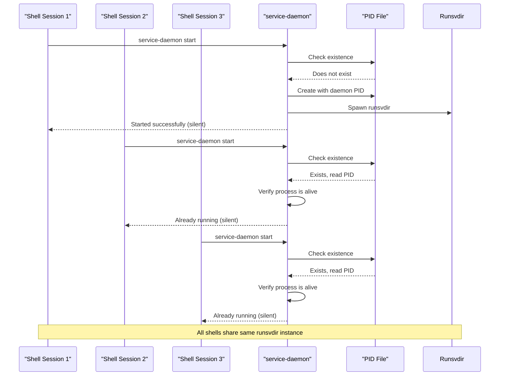
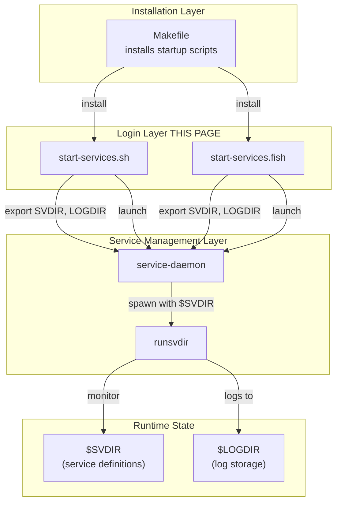

<!-- source: DeepWiki mcp.deepwiki.com · repo termux/termux-services · page 5.3 Login Integration · fetched 2026-10-26 -->

# Login Integration

<details>
<summary>Relevant source files</summary>

The following files were used as context for generating this wiki page:

- [Makefile](Makefile)
- [start-services.fish](start-services.fish)
- [start-services.sh](start-services.sh)
- [svlogger](svlogger)

</details>


## Purpose and Scope

This document describes how termux-services integrates with shell login mechanisms to automatically start service supervision when a user opens a new shell session. The login integration scripts set required environment variables and launch the service-daemon in the background.

For details on what service-daemon does after being launched, see [Service Daemon](#5.2). For information on the directory structure and environment variables used, see [File System Layout](#5.5) and [Environment Variables](#7).

## Overview

Login integration is implemented through shell-specific startup scripts that execute during the shell initialization phase. These scripts perform two critical functions:

1. Set environment variables (`SVDIR` and `LOGDIR`) required by the service supervision system
2. Launch `service-daemon` in the background to begin service supervision

The system provides separate implementations for POSIX-compatible shells (bash, sh, zsh) and Fish shell, accommodating their different configuration mechanisms.



**Diagram: Shell Login to Service Supervision Flow**

Sources: [start-services.sh:1-3](), [start-services.fish:1-6](), [Makefile:7-10]()

## Installation and File Locations

The Makefile installs login integration scripts to shell-specific configuration directories:

| Shell Type | Script File | Installation Path | Auto-sourced By |
|------------|-------------|-------------------|-----------------|
| POSIX (bash/sh/zsh) | `start-services.sh` | `$PREFIX/etc/profile.d/` | Shell profile system |
| Fish | `start-services.fish` | `$PREFIX/etc/fish/conf.d/` | Fish configuration system |

The installation process creates the necessary directories if they don't exist:

[Makefile:7-10]() shows the installation commands:
- Line 7: Creates `$(PREFIX)/etc/profile.d/` directory
- Line 8: Installs `start-services.sh` to the profile.d directory
- Line 9: Creates `$(PREFIX)/etc/fish/conf.d/` directory  
- Line 10: Installs `start-services.fish` to the fish conf.d directory



**Diagram: Installation to Execution Mapping**

Sources: [Makefile:7-10]()

## POSIX Shell Integration (start-services.sh)

The `start-services.sh` script provides login integration for POSIX-compatible shells including bash, sh, and zsh. These shells automatically source all files in `$PREFIX/etc/profile.d/` during login shell initialization.

### Script Implementation

[start-services.sh:1-3]() contains the complete implementation:

```
Line 1: export SVDIR=$PREFIX/var/service
Line 2: export LOGDIR=$PREFIX/var/log
Line 3: (service-daemon start >/dev/null 2>&1 & )
```

### Component Breakdown

| Line | Component | Purpose |
|------|-----------|---------|
| 1 | `export SVDIR=$PREFIX/var/service` | Sets the runit service directory path where `runsvdir` monitors for service definitions |
| 2 | `export LOGDIR=$PREFIX/var/log` | Sets the base directory where `svlogd` writes service logs |
| 3 | `(service-daemon start >/dev/null 2>&1 & )` | Launches service-daemon in background subshell with output suppression |

### Background Execution Details

Line 3 uses a subshell construct `(command &)` to launch service-daemon. This design ensures:

1. **Non-blocking login**: The `&` backgrounds the process so shell initialization completes immediately
2. **Output suppression**: `>/dev/null 2>&1` redirects both stdout and stderr to prevent terminal clutter
3. **Process isolation**: The subshell `( )` prevents job control messages from appearing in the parent shell

Without the subshell wrapper, users would see job control messages like `[1] 12345` when the background job starts.

Sources: [start-services.sh:1-3]()

## Fish Shell Integration (start-services.fish)

The `start-services.fish` script provides login integration specifically for Fish shell, which has its own configuration syntax and mechanisms.

### Script Implementation

[start-services.fish:1-6]() contains the complete implementation:

```
Line 1: if status --is-login
Line 2:     # For more details, see set(1)
Line 3:     set -gx SVDIR $PREFIX/var/service
Line 4:     set -gx LOGDIR $PREFIX/var/log
Line 5:     service-daemon start >/dev/null 2>&1 &
Line 6: end
```

### Component Breakdown

| Line | Component | Purpose |
|------|-----------|---------|
| 1 | `if status --is-login` | Guards execution to only run in login shells (not every subshell) |
| 3 | `set -gx SVDIR ...` | Sets global exported variable (`-gx` flags) for service directory |
| 4 | `set -gx LOGDIR ...` | Sets global exported variable for log directory |
| 5 | `service-daemon start ... &` | Launches service-daemon in background with output suppression |
| 6 | `end` | Closes the if statement |

### Fish-Specific Considerations

**Login Shell Guard**: The `status --is-login` check [start-services.fish:1]() is critical because Fish executes all scripts in `conf.d/` for every shell, including non-login shells and subshells. Without this guard:
- service-daemon would be started repeatedly in subshells
- Multiple instances would conflict over the same PID file
- Resource exhaustion could occur

**Variable Export Syntax**: Fish uses `set -gx` [start-services.fish:3-4]() instead of `export`:
- `-g`: Makes the variable global (accessible to all functions)
- `-x`: Exports the variable to child processes

**Background Job Handling**: Fish handles background jobs differently than POSIX shells, so the simpler `command &` syntax [start-services.fish:5]() is sufficient without needing a subshell wrapper.

Sources: [start-services.fish:1-6]()

## Environment Variables Set During Login

Both startup scripts establish the same environment variables required by the service supervision infrastructure:

### SVDIR

- **Value**: `$PREFIX/var/service`
- **Purpose**: Specifies the directory where `runsvdir` monitors for service definitions
- **Used By**: `runsvdir`, `sv-enable`, `sv-disable`, and all `sv` commands
- **Typical Expansion**: `/data/data/com.termux/files/usr/var/service`

### LOGDIR

- **Value**: `$PREFIX/var/log`
- **Purpose**: Specifies the base directory for service logs
- **Used By**: `svlogger` script when configuring `svlogd`
- **Typical Expansion**: `/data/data/com.termux/files/usr/var/log`

These variables must be set in the environment before service-daemon starts because:
1. service-daemon passes `$SVDIR` to `runsvdir` as its monitoring directory
2. `svlogger` reads `$LOGDIR` to determine where to write logs for each service



**Diagram: Environment Variable Flow from Login Scripts to Components**

Sources: [start-services.sh:1-2](), [start-services.fish:3-4]()

## service-daemon Launch Mechanism

Both startup scripts launch service-daemon using a background execution pattern to ensure non-blocking shell initialization.

### Execution Pattern

The command structure is:
```
service-daemon start >/dev/null 2>&1 &
```

Breaking down each component:

| Component | Purpose |
|-----------|---------|
| `service-daemon start` | The actual command to start the supervision daemon |
| `>/dev/null` | Redirects stdout to null device (suppresses normal output) |
| `2>&1` | Redirects stderr to stdout (which goes to null device) |
| `&` | Backgrounds the process so shell initialization continues |

### Why Output Suppression is Necessary

Without output redirection, service-daemon's startup messages would appear in the user's terminal:
- Creating directories messages
- PID file creation messages
- `runsvdir` startup notifications

This would clutter the login experience and confuse users who expect a clean prompt.

### Background Execution Guarantees

The background execution (`&`) ensures:

1. **Fast login**: Shell returns control immediately, doesn't wait for daemon initialization
2. **Independent process**: service-daemon continues running after shell initialization completes
3. **No blocking**: Even if daemon encounters issues, login completes successfully



**Diagram: Non-blocking Service Daemon Launch During Login**

Sources: [start-services.sh:3](), [start-services.fish:5]()

## Execution Timing and Lifecycle

### When Login Scripts Execute

| Shell Type | Execution Trigger | Frequency |
|------------|------------------|-----------|
| bash (login) | Shell reads `/etc/profile`, which sources `profile.d/*.sh` | Once per login shell |
| sh (login) | Shell reads `/etc/profile`, which sources `profile.d/*.sh` | Once per login shell |
| zsh (login) | Shell reads `/etc/zprofile`, which sources `profile.d/*.sh` | Once per login shell |
| fish | Executes `conf.d/*.fish` if `status --is-login` returns true | Once per login shell |

### What Constitutes a Login Shell

A login shell is created when:
- Starting a new Termux session
- Running `bash --login` or `bash -l`
- SSH into a Termux installation
- Running `su -` to become another user

A login shell is NOT created when:
- Opening a subshell with `bash` (no flags)
- Running scripts
- Command substitution `$(command)`
- Pipelines

This distinction is important because service-daemon should only be started once per user session, not in every subshell.



**Diagram: Login Shell Detection and Script Execution**

Sources: [start-services.fish:1]()

## Shell Compatibility Matrix

The following table summarizes which shells are supported and how they integrate with termux-services:

| Shell | Supported | Integration File | Configuration Mechanism | Notes |
|-------|-----------|------------------|-------------------------|-------|
| bash | ✓ Yes | start-services.sh | profile.d sourcing | Most common Termux shell |
| sh | ✓ Yes | start-services.sh | profile.d sourcing | Minimal POSIX shell |
| zsh | ✓ Yes | start-services.sh | profile.d sourcing | Via zprofile |
| fish | ✓ Yes | start-services.fish | conf.d execution | Requires login shell guard |
| dash | ✓ Yes | start-services.sh | profile.d sourcing | Fast POSIX shell |
| ksh | ✓ Yes | start-services.sh | profile.d sourcing | Korn shell |
| tcsh | ✗ No | N/A | Different mechanism | Uses .login file, not profile.d |
| csh | ✗ No | N/A | Different mechanism | Uses .login file, not profile.d |

For shells that don't support the profile.d mechanism, users must manually add the equivalent commands to their shell's RC file.

Sources: [Makefile:7-10](), [start-services.sh:1-3](), [start-services.fish:1-6]()

## Multiple Shell Sessions

When multiple login shells are opened, each attempts to execute the startup script. However, service-daemon includes protection against multiple instances:

1. **First shell session**: service-daemon starts successfully, creates PID file
2. **Subsequent shell sessions**: service-daemon detects existing PID file, skips startup
3. **All sessions**: Share the same `$SVDIR` and `$LOGDIR` environment variables

This design ensures:
- Only one service-daemon/runsvdir process runs regardless of how many shells are open
- All shells can use `sv` commands to interact with the same service supervision tree
- No resource conflicts or duplicate supervision



**Diagram: Multiple Shell Session Handling**

Sources: [start-services.sh:3](), [start-services.fish:5]()

## Manual Execution

While the login scripts automatically start service-daemon, users can also manually control it:

**Starting manually** (if not already running):
```bash
service-daemon start
```

**Stopping** (affects all shell sessions):
```bash
service-daemon stop
```

**Restarting**:
```bash
service-daemon restart
```

Manual execution is useful for:
- Troubleshooting service-daemon issues
- Stopping supervision temporarily without closing shells
- Restarting supervision after configuration changes

See [Service Daemon](#5.2) for complete details on service-daemon commands and behavior.

Sources: [start-services.sh:3](), [start-services.fish:5]()

## Relationship to Other Components

The login integration layer serves as the initialization bridge in the termux-services architecture:



**Diagram: Login Integration Position in Architecture**

**Upstream dependencies:**
- Requires Makefile to install scripts to correct locations
- Requires `$PREFIX` environment variable to be set by Termux

**Downstream effects:**
- Sets `SVDIR` and `LOGDIR` environment variables for all components
- Launches service-daemon which spawns runsvdir
- Enables all `sv` commands to function by establishing `$SVDIR`

Sources: [Makefile:7-10](), [start-services.sh:1-3](), [start-services.fish:1-6]()

---

