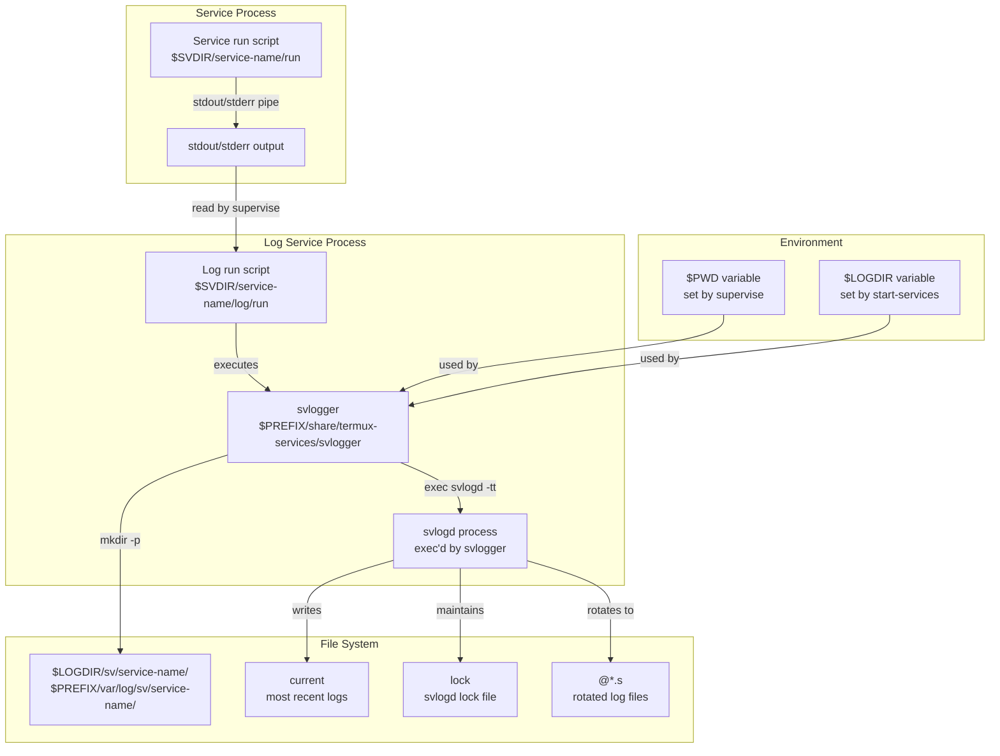
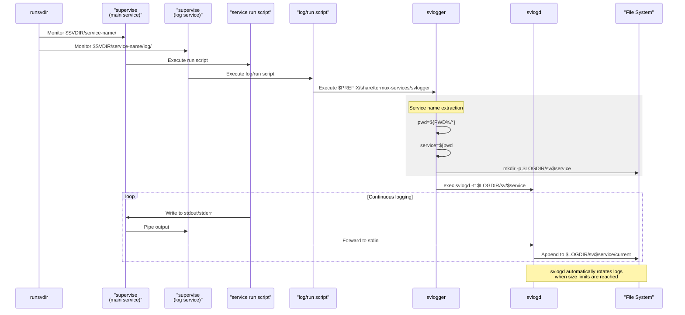
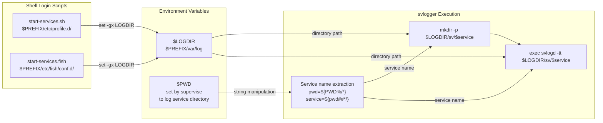
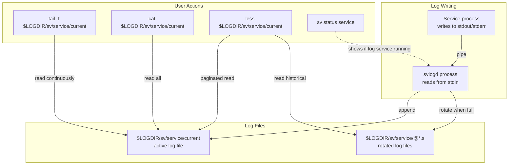
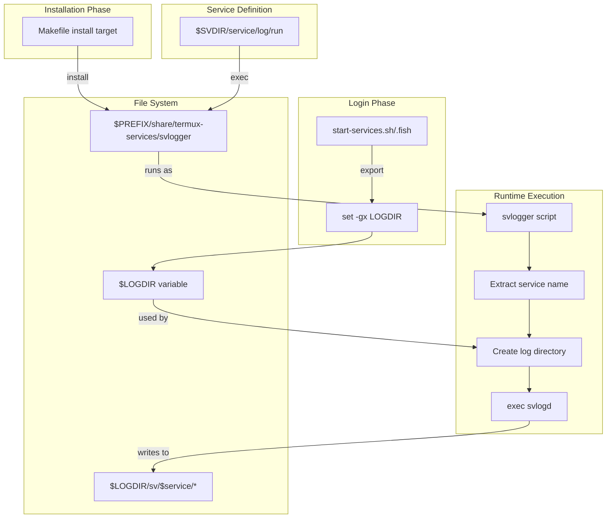

<!-- source: DeepWiki mcp.deepwiki.com · repo termux/termux-services · page 5.4 Logging Infrastructure · fetched 2026-10-26 -->

# Logging Infrastructure

<details>
<summary>Relevant source files</summary>

The following files were used as context for generating this wiki page:

- [Makefile](Makefile)
- [service-daemon](service-daemon)
- [start-services.fish](start-services.fish)
- [svlogger](svlogger)

</details>


## Purpose and Scope

This document describes the technical implementation of service logging in termux-services. It covers the `svlogger` wrapper script, its integration with runit's `svlogd` process supervisor logger, and the directory structure used for log storage. For information about viewing and managing logs as an end user, see [Viewing and Managing Logs](#4.3). For the broader service supervision architecture, see [System Overview](#5.1).

## Overview

The termux-services logging infrastructure provides automatic log capture for all supervised services. When a service runs under runit's supervision, its stdout and stderr streams are piped to a logging process. The logging infrastructure consists of:

- **svlogger**: A shell script wrapper that extracts service identity and configures svlogd
- **svlogd**: The runit-provided log daemon that performs actual log rotation and storage
- **$LOGDIR**: A centralized log directory structure at `$PREFIX/var/log`

The key design principle is that services do not need to implement their own logging logic. They simply write to stdout/stderr, and the supervision infrastructure automatically captures, timestamps, and persists their output.

Sources: [svlogger:1-10](), [Makefile:11-12]()

## Component Architecture



Sources: [svlogger:1-10](), [start-services.fish:4]()

## The svlogger Wrapper

The `svlogger` script serves as an adapter between runit's generic log supervision and termux-services' centralized logging structure. It is installed to `$PREFIX/share/termux-services/svlogger` and is typically invoked by a service's `log/run` script.

### Service Name Extraction

The script extracts the service name from the current working directory:

```
pwd=${PWD%/*}      # Removes /log suffix: $SVDIR/service-name/log -> $SVDIR/service-name
service=${pwd##*/} # Extracts final component: $SVDIR/service-name -> service-name
```

This logic assumes the standard runit directory structure where the log service runs in `$SVDIR/service-name/log/` and needs to determine that it's logging for `service-name`.

**PWD Variable Context**: When runit's `supervise` process executes the `log/run` script, it sets the working directory to the log service directory (`$SVDIR/service-name/log/`). The svlogger script relies on this behavior to extract service identity without requiring explicit configuration.

Sources: [svlogger:2-5]()

### Log Directory Creation

After extracting the service name, svlogger creates the service-specific log directory:

```sh
mkdir -p "$LOGDIR/sv/$service"
```

This creates a directory structure like `$PREFIX/var/log/sv/service-name/`. The `-p` flag ensures parent directories are created if they don't exist and prevents errors if the directory already exists.

Sources: [svlogger:7]()

### svlogd Execution

The script terminates by executing `svlogd`:

```sh
exec svlogd -tt "$LOGDIR/sv/$service"
```

Key aspects of this invocation:

| Element | Purpose |
|---------|---------|
| `exec` | Replaces the shell process with svlogd, eliminating wrapper overhead |
| `svlogd` | The runit log daemon that handles actual logging |
| `-tt` | Timestamp prefix option (human-readable format) |
| `"$LOGDIR/sv/$service"` | Target directory for log files |

The `exec` keyword is critical for proper process supervision. Without it, the shell process would remain as a parent, and signals sent by runit would reach the shell instead of svlogd.

Sources: [svlogger:9]()

## Integration with runit Supervision



Sources: [svlogger:1-10](), [service-daemon:11-14]()

## Directory Structure and File Layout

The logging infrastructure creates a hierarchical directory structure under `$LOGDIR`:

```
$PREFIX/var/log/                    # $LOGDIR set by start-services scripts
└── sv/                             # Service logs directory
    ├── service-one/                # Per-service directory (created by svlogger)
    │   ├── current                 # Current log file (svlogd maintains)
    │   ├── lock                    # svlogd lock file
    │   ├── @4000000064a8c9d61234abcd.s  # Rotated log (timestamped)
    │   └── @4000000064a8c9d61234abce.s  # Older rotated log
    ├── service-two/
    │   ├── current
    │   ├── lock
    │   └── ...
    └── service-three/
        └── ...
```

### File Descriptions

| File/Directory | Created By | Purpose |
|----------------|------------|---------|
| `$LOGDIR/sv/` | First svlogger invocation | Parent directory for all service logs |
| `$LOGDIR/sv/$service/` | svlogger (`mkdir -p`) | Service-specific log directory |
| `current` | svlogd | Active log file, continuously appended |
| `lock` | svlogd | Prevents multiple svlogd instances for same service |
| `@*.s` | svlogd | Rotated log files with TAI64N timestamp in filename |

Sources: [svlogger:7-9]()

## svlogd Configuration and Behavior

### Default Configuration

The svlogger invocation uses minimal configuration, relying on svlogd defaults:

```sh
exec svlogd -tt "$LOGDIR/sv/$service"
```

| Option | Effect |
|--------|--------|
| `-tt` | Prepend human-readable timestamps to each log line |
| No `-s` | Default log file size limit (1MB) |
| No `-n` | Default number of rotated logs (10) |
| No `-N` | Default maximum number of log files (follows `-n`) |

### Timestamp Format

The `-tt` option produces timestamps in human-readable format:

```
2024-01-15 14:23:45.123456789  Service started
2024-01-15 14:23:45.987654321  Processing request
```

This contrasts with the default TAI64N format, which would produce timestamps like:

```
@400000000000000000000000 Service started
```

### Log Rotation

svlogd automatically rotates logs when the `current` file reaches the size limit (default 1MB). Rotation behavior:

1. Rename `current` to `@[TAI64N-timestamp].s`
2. Create new empty `current` file
3. Continue appending to new `current`
4. Delete oldest rotated file if count exceeds limit (default 10)

The TAI64N timestamp in rotated filenames represents the time of rotation, not the log content timestamp.

Sources: [svlogger:9]()

## Environment Variable Dependencies



### $LOGDIR

Set by login integration scripts ([start-services.fish:4]()) to `$PREFIX/var/log`. This variable must be exported and available in the environment when svlogger executes. If undefined, svlogger will create directories under `/sv/$service`, which is likely incorrect.

### $PWD

Set by runit's `supervise` process to the log service's directory (`$SVDIR/service-name/log/`). This is a standard POSIX variable set by the shell or process launcher. The svlogger script depends on this specific directory structure to extract the service name.

Sources: [svlogger:2-9](), [start-services.fish:4]()

## Installation and Deployment

The svlogger script is installed during package installation by the Makefile:

```makefile
install svlogger $(DESTDIR)$(PREFIX)/share/termux-services
```

Installation location: `$PREFIX/share/termux-services/svlogger`

This location places svlogger in the `share/` directory rather than `bin/` because:
1. It is not intended for direct user invocation
2. It is a helper script used by service definitions
3. It follows FHS conventions for application-specific files

**Typical Usage**: Service package maintainers create a `log/run` script that invokes svlogger:

```sh
#!/data/data/com.termux/files/usr/bin/sh
exec $PREFIX/share/termux-services/svlogger
```

Sources: [Makefile:11-12]()

## Service Log Access Patterns



### Common Access Commands

| Command | Purpose | Example |
|---------|---------|---------|
| `tail -f` | Follow log in real-time | `tail -f $PREFIX/var/log/sv/sshd/current` |
| `cat` | View entire current log | `cat $PREFIX/var/log/sv/sshd/current` |
| `less` | Paginated viewing | `less $PREFIX/var/log/sv/sshd/current` |
| `grep` | Search log content | `grep ERROR $PREFIX/var/log/sv/sshd/current` |
| `ls -lt` | List rotated logs by time | `ls -lt $PREFIX/var/log/sv/sshd/` |

Sources: [svlogger:7-9]()

## Error Handling and Edge Cases

### Missing $LOGDIR Variable

If `$LOGDIR` is not set, svlogger will execute:

```sh
mkdir -p "/sv/$service"
exec svlogd -tt "/sv/$service"
```

This creates logs in the root filesystem at `/sv/$service`, which is incorrect. However, this scenario should not occur in normal operation because the login integration scripts ([start-services.fish:4]()) always export `$LOGDIR` before starting service-daemon.

### Invalid Service Directory Structure

If svlogger is executed from a directory that doesn't match the expected structure (`$SVDIR/service-name/log/`), the service name extraction may produce incorrect results:

- Executed from `/foo/bar/`: Service name becomes `bar`
- Executed from `/`: Service name becomes empty string
- Executed from `$HOME`: Service name becomes the home directory name

This is not validated by svlogger. The script assumes correct invocation context established by runit's supervise process.

### Concurrent mkdir Operations

Multiple services starting simultaneously may attempt to create `$LOGDIR/sv/` concurrently. The `mkdir -p` command handles this safely:
- First invocation creates the directory
- Subsequent invocations succeed (exit code 0) even if directory exists
- No race conditions or errors occur

Sources: [svlogger:7]()

## Relationship to runit's svlogd

termux-services does not implement its own logging daemon. It wraps runit's `svlogd` process, which provides:

| Feature | Implementation |
|---------|----------------|
| Log rotation | Built into svlogd |
| Timestamp formatting | `-tt` option |
| Size-based rotation | Default 1MB limit |
| Automatic old log deletion | Default 10 rotated files |
| Lock file management | Prevents multiple instances |
| Crash recovery | Resumes logging on restart |

The svlogger wrapper's sole responsibility is to bridge the gap between runit's generic logging and termux-services' opinionated directory structure. It provides:

1. Service name extraction from execution context
2. Centralized log directory under `$LOGDIR/sv/`
3. Automatic directory creation
4. Standardized svlogd invocation with timestamps

Without svlogger, each service would need to implement its own `log/run` script with custom logic for directory creation and service identification.

Sources: [svlogger:1-10]()

## Cleanup and Maintenance

### Log Rotation Configuration

To customize log rotation for a specific service, create a configuration file at `$LOGDIR/sv/$service/config`. For example, to limit logs to 500KB and keep only 5 rotated files:

```
s500000
n5
```

This file is read by svlogd automatically. Note that svlogger does not create this file; it must be created manually or by a service's post-installation script.

### Manual Log Deletion

To clear logs for a service:

```sh
rm -f $PREFIX/var/log/sv/service-name/current
rm -f $PREFIX/var/log/sv/service-name/@*.s
```

svlogd will automatically recreate the `current` file on next write. The lock file should not be deleted while svlogd is running.

### Log Directory Removal

During service removal or system cleanup, log directories can be removed:

```sh
rm -rf $PREFIX/var/log/sv/service-name/
```

This is safe to perform while the service is disabled or stopped. If performed while svlogd is running, it will fail with permission errors due to the lock file.

Sources: [svlogger:7]()

## Integration Points Summary



The logging infrastructure integrates with:

1. **Installation System**: Makefile deploys svlogger to its installation location
2. **Login Integration**: Shell scripts set the `$LOGDIR` environment variable
3. **Service Definitions**: Services create `log/run` scripts that invoke svlogger
4. **runit Supervision**: The supervise process executes log/run and pipes service output
5. **File System**: Log files accumulate in the centralized `$LOGDIR/sv/` hierarchy

Sources: [Makefile:11-12](), [start-services.fish:4](), [svlogger:1-10]()

---

