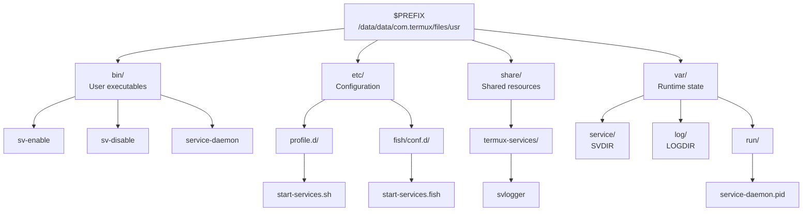
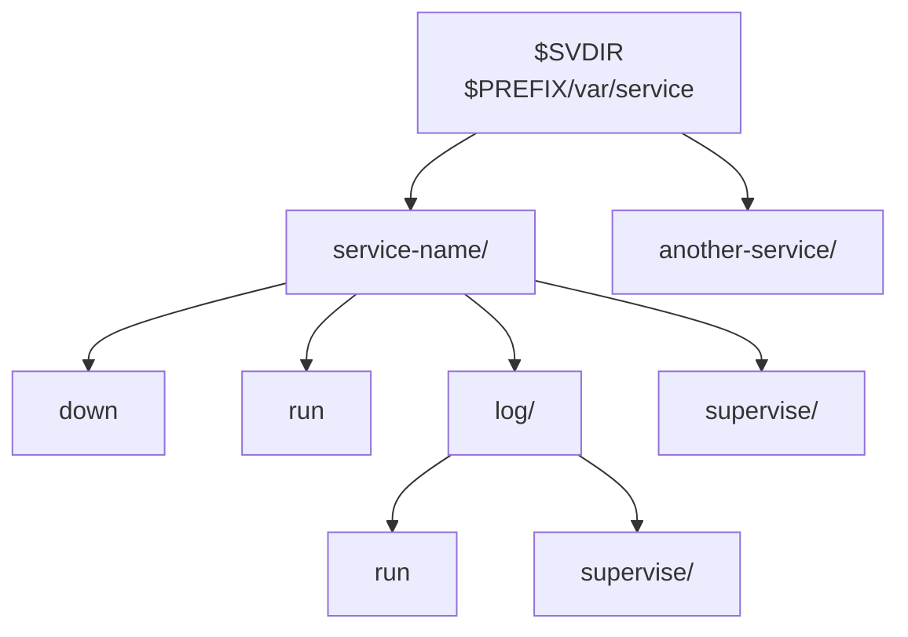
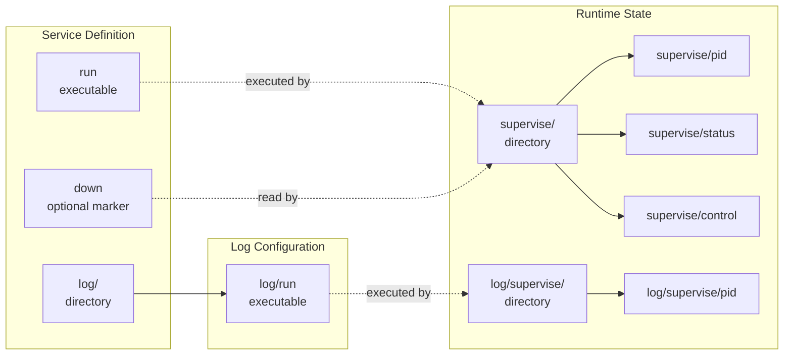
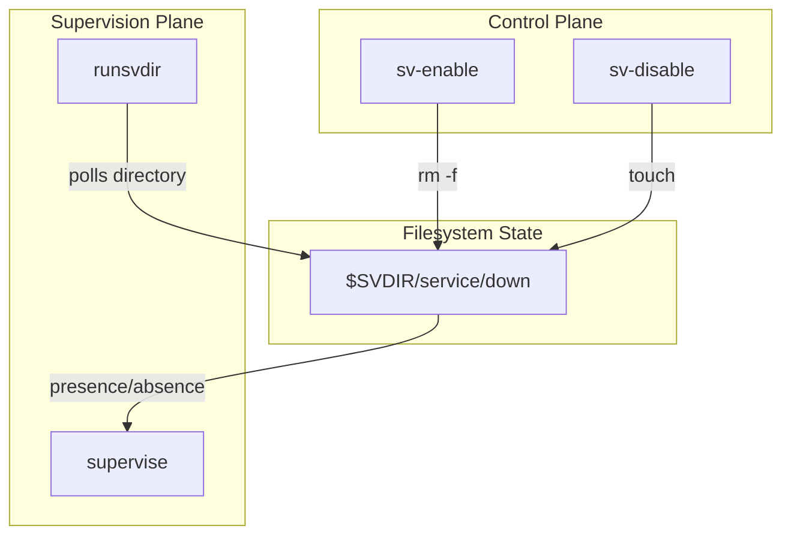

<!-- source: DeepWiki mcp.deepwiki.com · repo termux/termux-services · page 5.5 File System Layout · fetched 2026-10-26 -->

# File System Layout

<details>
<summary>Relevant source files</summary>

The following files were used as context for generating this wiki page:

- [Makefile](Makefile)
- [service-daemon](service-daemon)
- [start-services.fish](start-services.fish)
- [sv-disable](sv-disable)
- [sv-enable](sv-enable)
- [svlogger](svlogger)

</details>


This page documents the complete directory structure used by termux-services, including installation locations for executables and configuration files, runtime state directories, and the organization of service definitions and logs.

For information about how these directories are used during system operation, see [System Overview](#5.1). For details on the logging system that populates the log directories, see [Logging Infrastructure](#5.4).

## Directory Hierarchy Overview

termux-services organizes its files according to a standard FHS-like structure rooted at `$PREFIX`, which defaults to `/data/data/com.termux/files/usr` in Termux. The layout separates static installation files from dynamic runtime state.



**Sources**: [Makefile:1-23](), [service-daemon:18-22](), [start-services.fish:3-4]()

## Installation Directories

The Makefile installs static files to three primary locations during `make install`.

### bin/ - User Executables

User-facing commands are installed to `$PREFIX/bin/`:

| File | Purpose | Source |
|------|---------|--------|
| `sv-enable` | Enable services for autostart | [Makefile:4]() |
| `sv-disable` | Disable services from autostart | [Makefile:5]() |
| `service-daemon` | Service supervision daemon manager | [Makefile:6]() |

These executables are placed in the user's PATH and provide the primary interface for service management.

**Sources**: [Makefile:4-6]()

### etc/ - Shell Integration

Configuration files for automatic daemon startup are installed to `$PREFIX/etc/`:

```
etc/
├── profile.d/
│   └── start-services.sh      # Bash/POSIX shell integration
└── fish/
    └── conf.d/
        └── start-services.fish # Fish shell integration
```

The `profile.d/` directory contains [start-services.sh:1-6]() which is sourced by bash and POSIX-compatible shells during login. The `fish/conf.d/` directory contains [start-services.fish:1-6]() which is sourced by fish shells during login.

Both files set the `SVDIR` and `LOGDIR` environment variables and start `service-daemon` in the background.

**Sources**: [Makefile:7-10]()

### share/termux-services/ - Helper Scripts

Helper scripts that are not directly executed by users are installed to `$PREFIX/share/termux-services/`:

| File | Purpose | Invocation |
|------|---------|------------|
| `svlogger` | Log wrapper for service output | Executed by `log/run` scripts in service directories |

The `svlogger` script is not in the user's PATH. It is invoked by service log run scripts, as documented in [Logging Infrastructure](#5.4).

**Sources**: [Makefile:11-12](), [svlogger:1-10]()

## Runtime State Directories

Runtime state is stored under `$PREFIX/var/` and is created and managed by the system during operation.

### var/service/ - Service Directory (SVDIR)

The `$SVDIR` environment variable points to `$PREFIX/var/service/` and contains all service definitions. Each service has its own subdirectory:



Each service directory contains:

| Path | Type | Purpose | Created By |
|------|------|---------|------------|
| `run` | executable script | Main service process | Package maintainer |
| `down` | empty file | Prevents autostart when present | `sv-disable` |
| `log/` | directory | Logging configuration | Package maintainer |
| `log/run` | executable script | Log process (typically invokes `svlogger`) | Package maintainer |
| `supervise/` | directory | Runtime state for main process | `runsvdir` |
| `log/supervise/` | directory | Runtime state for log process | `runsvdir` |

The `supervise/` directories contain process state maintained by runit's `supervise` processes, including:
- `pid` - Process ID of the supervised service
- `status` - Current service status
- `control` - FIFO for control commands
- `ok` - FIFO for readiness notification
- `lock` - Lock file

**Sources**: [service-daemon:11-14](), [sv-enable:19](), [sv-disable:19](), [svlogger:4-5]()

### var/log/ - Log Directory (LOGDIR)

The `$LOGDIR` environment variable points to `$PREFIX/var/log/` and contains service logs organized by service name:

```
var/log/
└── sv/
    ├── service-name/
    │   ├── current          # Current log file
    │   ├── lock            # svlogd lock file
    │   └── config          # svlogd configuration (if present)
    └── another-service/
        └── current
```

The `svlogger` script creates `$LOGDIR/sv/$service` and invokes `svlogd -tt` to manage log rotation and timestamping. Log files are named `current` by default, with rotated logs receiving timestamps.

**Sources**: [start-services.fish:4](), [svlogger:7-9]()

### var/run/ - PID Files

The `$PREFIX/var/run/` directory stores process ID files for daemon management:

| File | Contents | Purpose |
|------|----------|---------|
| `service-daemon.pid` | PID of the `runsvdir` process | Used by `service-daemon` for lifecycle management |

The `service-daemon` script creates this directory via [service-daemon:5]() and uses the PID file for start/stop operations via `start-stop-daemon`.

**Sources**: [service-daemon:5,18-19]()

## Environment Variables

Two critical environment variables control directory locations:

| Variable | Default Value | Set By | Purpose |
|----------|---------------|--------|---------|
| `SVDIR` | `$PREFIX/var/service` | Login scripts | Service definition directory monitored by `runsvdir` |
| `LOGDIR` | `$PREFIX/var/log` | Login scripts | Root directory for service logs |
| `PREFIX` | `/data/data/com.termux/files/usr` | Termux environment | Installation root for all paths |

These variables are set by [start-services.fish:3-4]() (and the equivalent bash script) during shell login and are used by:
- `service-daemon` to pass `$SVDIR` to `runsvdir` [service-daemon:22]()
- `sv-enable`/`sv-disable` to locate service directories [sv-enable:19](), [sv-disable:19]()
- `svlogger` to determine log storage location [svlogger:7]()

**Sources**: [start-services.fish:3-4](), [service-daemon:22](), [sv-enable:15-19](), [sv-disable:15-19]()

## Service Directory Structure Detail



**Service Directory Lifecycle**:

1. Package maintainer creates `$SVDIR/service-name/run` and `$SVDIR/service-name/log/run`
2. `runsvdir` detects the new service directory
3. `runsvdir` spawns `supervise` processes which create `supervise/` directories
4. User controls autostart via presence/absence of `down` file using `sv-enable`/`sv-disable`
5. `supervise` processes maintain runtime state in `supervise/pid`, `supervise/status`, etc.

**Sources**: [service-daemon:11-14](), [svlogger:4-5]()

## Path Construction Examples

The following table shows how various paths are constructed from the base `$PREFIX`:

| Logical Name | Environment Variable | Full Path Example | Created By |
|--------------|---------------------|-------------------|------------|
| Service definition root | `$SVDIR` | `/data/data/com.termux/files/usr/var/service` | Login scripts |
| Specific service | `$SVDIR/$service` | `/data/data/com.termux/files/usr/var/service/sshd` | Package maintainer |
| Service run script | `$SVDIR/$service/run` | `/data/data/com.termux/files/usr/var/service/sshd/run` | Package maintainer |
| Service down marker | `$SVDIR/$service/down` | `/data/data/com.termux/files/usr/var/service/sshd/down` | `sv-disable` |
| Service supervise state | `$SVDIR/$service/supervise` | `/data/data/com.termux/files/usr/var/service/sshd/supervise` | `runsvdir` |
| Log directory root | `$LOGDIR` | `/data/data/com.termux/files/usr/var/log` | Login scripts |
| Service log directory | `$LOGDIR/sv/$service` | `/data/data/com.termux/files/usr/var/log/sv/sshd` | `svlogger` |
| Service current log | `$LOGDIR/sv/$service/current` | `/data/data/com.termux/files/usr/var/log/sv/sshd/current` | `svlogd` |
| Daemon PID file | `$PREFIX/var/run/service-daemon.pid` | `/data/data/com.termux/files/usr/var/run/service-daemon.pid` | `service-daemon` |

**Sources**: [start-services.fish:3-4](), [svlogger:7](), [service-daemon:18-19]()

## Filesystem-Based State Management

termux-services uses filesystem state as its primary API for control plane operations:



The `down` file serves as a persistent boolean flag:
- **Present**: Service will not autostart (disabled state) [sv-disable:19]()
- **Absent**: Service will autostart (enabled state) [sv-enable:19]()

The `runsvdir` process continuously monitors `$SVDIR` and detects changes to directory contents, including the creation or removal of `down` files, adjusting service supervision accordingly.

**Sources**: [sv-enable:19](), [sv-disable:19]()

## Installation and Cleanup

During installation, the Makefile creates only the installation directories:
- `$PREFIX/bin/` (usually already exists)
- `$PREFIX/etc/profile.d/` [Makefile:7]()
- `$PREFIX/etc/fish/conf.d/` [Makefile:9]()
- `$PREFIX/share/termux-services/` [Makefile:11]()

Runtime directories are created on-demand:
- `$PREFIX/var/run/` by `service-daemon start` [service-daemon:5]()
- `$PREFIX/var/service/` by package maintainers or users
- `$PREFIX/var/log/sv/$service/` by `svlogger` [svlogger:7]()

During uninstallation, the Makefile removes installation files but preserves runtime state:
- Removes `bin/` executables [Makefile:15-17]()
- Removes `etc/` configuration [Makefile:18-19]()
- Removes `share/termux-services/` [Makefile:20]()
- **Does not remove** `var/service/` or `var/log/` to preserve user data

The `service-daemon stop` command performs aggressive cleanup of supervision state by killing and removing `supervise/` directories [service-daemon:11-14]().

**Sources**: [Makefile:7-20](), [service-daemon:5,11-14](), [svlogger:7]()

---

