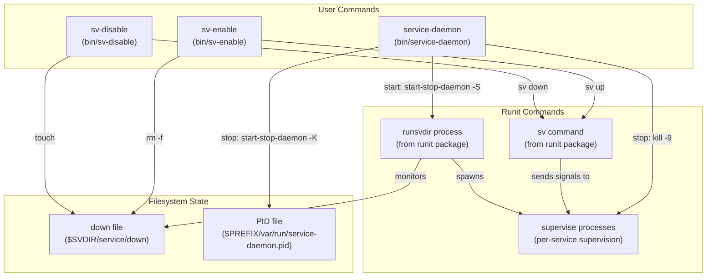
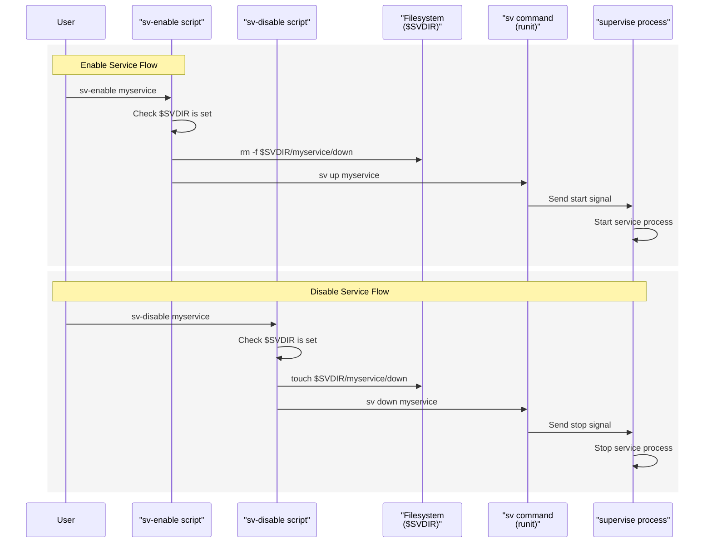
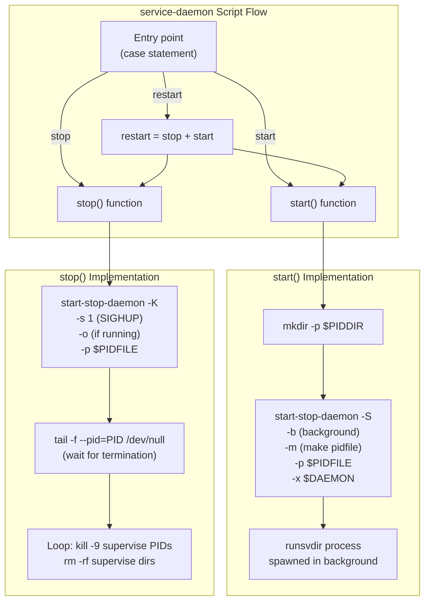
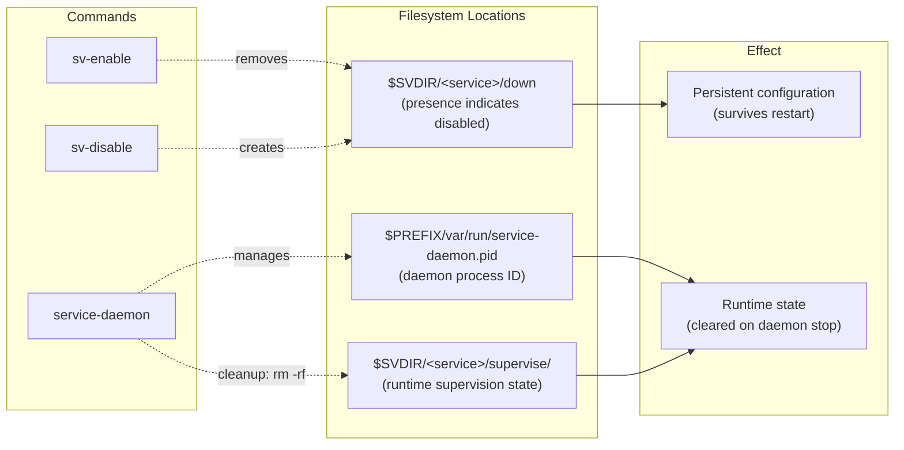

<!-- source: DeepWiki mcp.deepwiki.com · repo termux/termux-services · page 6 Command Reference · fetched 2026-10-26 -->

# Command Reference

<details>
<summary>Relevant source files</summary>

The following files were used as context for generating this wiki page:

- [service-daemon](service-daemon)
- [sv-disable](sv-disable)
- [sv-enable](sv-enable)

</details>


This page provides comprehensive reference documentation for all user-facing commands provided by termux-services. These commands enable users to manage the lifecycle of services, control the supervision daemon, and configure service autostart behavior.

For detailed information about individual commands, see:
- [sv-enable](#6.1) - Enable services for autostart
- [sv-disable](#6.2) - Disable services from autostart
- [service-daemon](#6.3) - Control the supervision daemon lifecycle

For information about native runit commands (`sv`, `runsvdir`, `svlogd`) that termux-services wraps, see [Integration with runit](#8).

## Command Overview

termux-services provides three primary user-facing commands:

| Command | Purpose | Persistence | Immediate Effect |
|---------|---------|-------------|------------------|
| `sv-enable` | Enable service autostart | Persistent (removes `down` file) | Starts service immediately |
| `sv-disable` | Disable service autostart | Persistent (creates `down` file) | Stops service immediately |
| `service-daemon` | Control supervision daemon | Session-based | Starts/stops all supervision |

All commands are installed to `$PREFIX/bin/` during package installation and operate on the service directory at `$SVDIR` (typically `$PREFIX/var/service/`).

Sources: [sv-enable:1-21](), [sv-disable:1-21](), [service-daemon:1-48]()

## Command Architecture



**Command Architecture Overview**

This diagram shows the relationship between user commands and the underlying supervision infrastructure. The commands fall into two categories: service-level control (`sv-enable`, `sv-disable`) and daemon-level control (`service-daemon`).

Sources: [sv-enable:19-20](), [sv-disable:19-20](), [service-daemon:4-14]()

## Command Categories

### Service Control Commands

Service control commands manipulate individual services within the supervision system. These commands require the `$SVDIR` environment variable to be set.

**sv-enable**
- **File**: `bin/sv-enable`
- **Function**: Removes the `down` file and starts the service
- **Persistence**: Service will autostart on next supervision daemon restart
- **Validation**: Checks if `$SVDIR` is set [sv-enable:15-18]()
- **Actions**: 
  1. Removes `$SVDIR/$1/down` [sv-enable:19]()
  2. Executes `sv up $1` [sv-enable:20]()

**sv-disable**
- **File**: `bin/sv-disable`
- **Function**: Creates the `down` file and stops the service
- **Persistence**: Service will not autostart on next supervision daemon restart
- **Validation**: Checks if `$SVDIR` is set [sv-disable:15-18]()
- **Actions**:
  1. Creates `$SVDIR/$1/down` [sv-disable:19]()
  2. Executes `sv down $1` [sv-disable:20]()

Sources: [sv-enable:1-21](), [sv-disable:1-21]()

### Daemon Control Commands

Daemon control commands manage the lifecycle of the entire supervision system.

**service-daemon**
- **File**: `bin/service-daemon`
- **Function**: Starts, stops, or restarts the `runsvdir` supervision daemon
- **Subcommands**: `start`, `stop`, `restart`
- **Daemon Binary**: `$PREFIX/bin/runsvdir` [service-daemon:21]()
- **PID File**: `$PREFIX/var/run/service-daemon.pid` [service-daemon:18-19]()

Sources: [service-daemon:1-48]()

## Command Invocation Flow



**Service Control Flow**

This diagram illustrates the execution flow when users invoke service control commands. Both commands follow a two-step pattern: first manipulate the persistent `down` file, then send an immediate signal via the `sv` command.

Sources: [sv-enable:15-20](), [sv-disable:15-20]()

## Environment Variable Dependencies

All commands depend on environment variables set by the login integration scripts:

| Variable | Set By | Purpose | Used By |
|----------|--------|---------|---------|
| `$SVDIR` | `start-services.sh` / `start-services.fish` | Service directory path | `sv-enable`, `sv-disable`, `service-daemon` |
| `$LOGDIR` | `start-services.sh` / `start-services.fish` | Log directory path | `svlogger` (indirect) |
| `$PREFIX` | Termux environment | Installation prefix | `service-daemon` |
| `$PIDDIR` | `service-daemon` (computed) | PID file directory | `service-daemon` |

For complete environment variable reference, see [Environment Variables](#7).

Sources: [sv-enable:15-18](), [sv-disable:15-18](), [service-daemon:18-22]()

## service-daemon Implementation Details



**service-daemon Execution Flow**

This diagram shows the internal implementation of `service-daemon`. The `start()` function uses `start-stop-daemon` to spawn `runsvdir` as a background daemon [service-daemon:4-7](). The `stop()` function performs aggressive cleanup, first signaling the main daemon, then forcibly terminating all `supervise` processes and removing their state directories [service-daemon:8-15]().

Sources: [service-daemon:1-48]()

## Command Output and Exit Codes

### sv-enable and sv-disable

Both commands produce minimal output and exit with standard Unix exit codes:

| Exit Code | Condition | Description |
|-----------|-----------|-------------|
| 0 | Success | Command completed successfully |
| 1 | Error | Missing service name argument or `$SVDIR` not set |

Error messages are written to stderr:
- `"Error: SVDIR not set"` - The `$SVDIR` environment variable is not configured [sv-enable:16-17](), [sv-disable:16-17]()

### service-daemon

The command prints status messages to stdout:

| Operation | Output Pattern |
|-----------|----------------|
| `start` | `"Starting daemon: service-daemon\n.\n"` [service-daemon:26-28]() |
| `stop` | `"Stopping daemon: service-daemon\n.\n"` [service-daemon:31-33]() |
| `restart` | `"Restarting daemon: service-daemon\n.\n"` [service-daemon:36-39]() |
| Invalid argument | `"Usage: {start\|stop\|restart}"` and exit 1 [service-daemon:43-44]() |

Sources: [sv-enable:11-18](), [sv-disable:11-18](), [service-daemon:24-44]()

## Command-to-Filesystem Mapping



**Command Filesystem Operations**

This diagram shows the filesystem operations performed by each command. Service control commands manipulate the `down` file for persistence [sv-enable:19](), [sv-disable:19](). The daemon control command manages its own PID file [service-daemon:19]() and performs aggressive cleanup of supervision state directories during shutdown [service-daemon:11-14]().

Sources: [sv-enable:19](), [sv-disable:19](), [service-daemon:11-19]()

## Common Usage Patterns

### Check Service Status Before Operations

Since the commands don't validate service existence, check status first:

```bash
# Check if service exists
ls "$SVDIR/myservice" 2>/dev/null

# Check current service status
sv status myservice
```

### Enable and Verify

```bash
# Enable service
sv-enable myservice

# Verify it's running
sv status myservice

# Check logs
tail "$LOGDIR/sv/myservice/current"
```

### Disable Without Immediate Stop

To mark a service as disabled but keep it running in the current session:

```bash
# Create down file manually (don't use sv down)
touch "$SVDIR/myservice/down"
```

### Restart Supervision Daemon

```bash
# Restart all services and supervision
service-daemon restart
```

Sources: [sv-enable:19-20](), [sv-disable:19-20](), [service-daemon:35-39]()

## Integration with Runit Commands

termux-services commands wrap and extend runit's native `sv` command:

| termux-services Command | Equivalent runit Commands | Persistence |
|-------------------------|---------------------------|-------------|
| `sv-enable myservice` | `rm $SVDIR/myservice/down && sv up myservice` | Yes |
| `sv-disable myservice` | `touch $SVDIR/myservice/down && sv down myservice` | Yes |
| (none - use `sv` directly) | `sv up/down/restart/status myservice` | No |

Users can directly invoke `sv` for immediate, non-persistent operations. For example:
- `sv restart myservice` - Restart without changing autostart configuration
- `sv status myservice` - Check service status
- `sv once myservice` - Run service once, do not restart

For complete runit command reference, see [Integration with runit](#8).

Sources: [sv-enable:19-20](), [sv-disable:19-20]()

## Error Conditions

### Missing SVDIR Environment Variable

All service control commands require `$SVDIR` to be set. If not set:

```bash
$ sv-enable myservice
Error: SVDIR not set
```

**Resolution**: Restart your shell to source the login integration scripts, or manually set `SVDIR`:
```bash
export SVDIR=$PREFIX/var/service
```

**Code Reference**: [sv-enable:15-18](), [sv-disable:15-18]()

### Service Does Not Exist

Commands do not validate service existence. If you specify a non-existent service:

```bash
$ sv-enable nonexistent
# Creates down file at nonexistent path, sv command may error
```

**Resolution**: Verify service directory exists before enabling/disabling:
```bash
ls "$SVDIR/myservice" || echo "Service not found"
```

### service-daemon Already Running

Starting the daemon when already running is handled by `start-stop-daemon`:

```bash
$ service-daemon start
Starting daemon: service-daemon
.
$ service-daemon start
Starting daemon: service-daemon
.  # No error, but daemon not restarted
```

**Code Reference**: [service-daemon:6]() - The `-o` flag to `start-stop-daemon` on stop prevents errors if not running, but start does not include this flag.

Sources: [sv-enable:15-18](), [sv-disable:15-18](), [service-daemon:4-9]()

## Command Synopsis

### sv-enable

```
sv-enable <service-name>
```

**Arguments**:
- `<service-name>` (required) - Name of service directory in `$SVDIR`

**Exit Codes**:
- `0` - Success
- `1` - Missing argument or `$SVDIR` not set

**Side Effects**:
- Removes `$SVDIR/<service-name>/down` file
- Starts the service immediately via `sv up`

**Dependencies**: Requires `$SVDIR` environment variable

Sources: [sv-enable:3-21]()

### sv-disable

```
sv-disable <service-name>
```

**Arguments**:
- `<service-name>` (required) - Name of service directory in `$SVDIR`

**Exit Codes**:
- `0` - Success
- `1` - Missing argument or `$SVDIR` not set

**Side Effects**:
- Creates `$SVDIR/<service-name>/down` file
- Stops the service immediately via `sv down`

**Dependencies**: Requires `$SVDIR` environment variable

Sources: [sv-disable:3-21]()

### service-daemon

```
service-daemon {start|stop|restart}
```

**Subcommands**:
- `start` - Start the supervision daemon if not running
- `stop` - Stop the supervision daemon and cleanup all supervise processes
- `restart` - Stop then start the supervision daemon

**Exit Codes**:
- `0` - Success
- `1` - Invalid subcommand

**Side Effects**:
- `start`: Creates `$PREFIX/var/run/service-daemon.pid`, spawns `runsvdir` background process
- `stop`: Sends SIGHUP to daemon, waits for termination, kills all supervise processes with SIGKILL, removes supervise directories
- `restart`: Performs stop then start operations

**Dependencies**: 
- Requires `$PREFIX` environment variable
- Requires `runsvdir` binary in `$PREFIX/bin/`
- Requires `start-stop-daemon` utility

Sources: [service-daemon:1-48]()

## Implementation Notes

### Shell Compatibility

All commands are implemented as POSIX-compliant shell scripts:
- Shebang: `#!/data/data/com.termux/files/usr/bin/sh` [service-daemon:1]()
- `sv-enable` and `sv-disable` use `#!/bin/sh` for portability [sv-enable:1](), [sv-disable:1]()

### Aggressive Cleanup in service-daemon stop

The `stop()` function performs aggressive cleanup to ensure all supervision state is removed:

1. Send SIGHUP (signal 1) to main daemon [service-daemon:9]()
2. Wait for daemon termination using `tail -f --pid=...` [service-daemon:10]()
3. Loop through all `supervise` directories in `$SVDIR/*/supervise` and `$SVDIR/*/log/supervise` [service-daemon:11]()
4. Send SIGKILL (signal 9) to each supervise process [service-daemon:12]()
5. Remove supervise directories [service-daemon:13]()

This ensures that even if supervise processes don't respond to normal signals, they are forcibly terminated and their state is cleaned up.

### Error Handling

The commands use different error handling approaches:

- **sv-enable / sv-disable**: Basic validation of required arguments and environment variables, but no validation that the service exists
- **service-daemon**: Uses `set -e` to exit on any command failure [service-daemon:3](), with selective error suppression using `||:` for cleanup operations [service-daemon:12]()

Sources: [service-daemon:3-14](), [sv-enable:11-18](), [sv-disable:11-18]()

---

