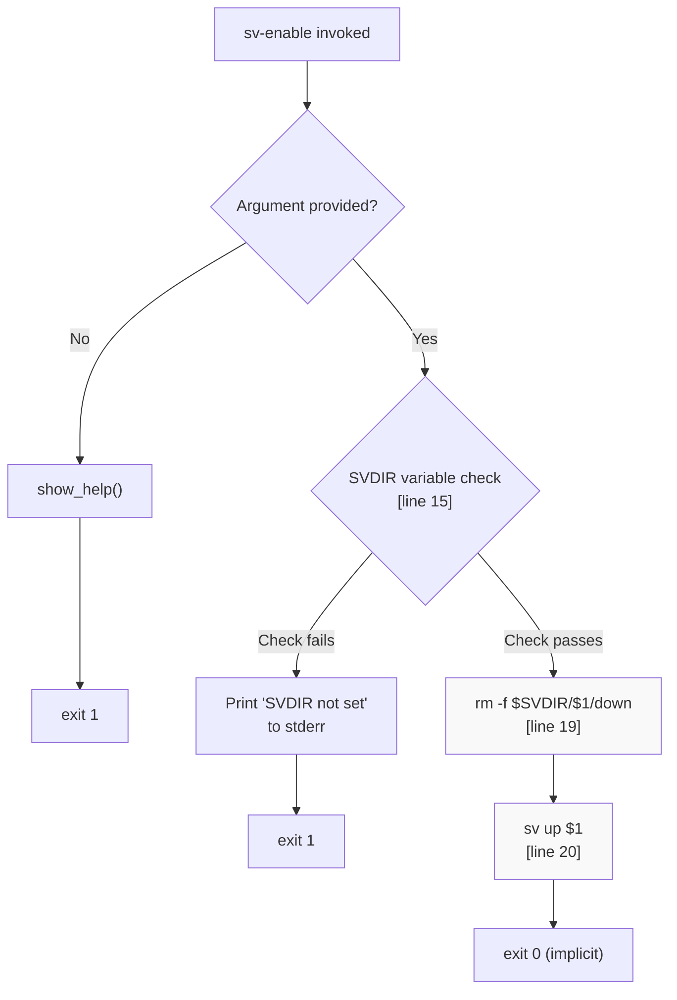
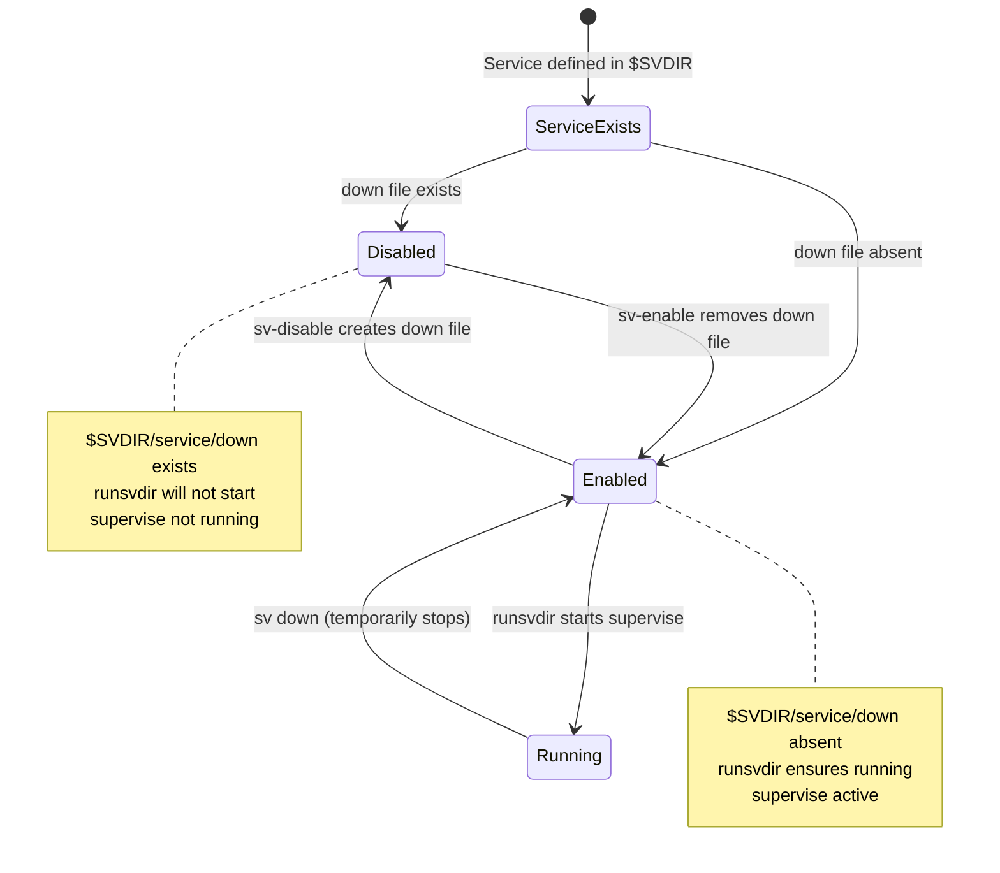
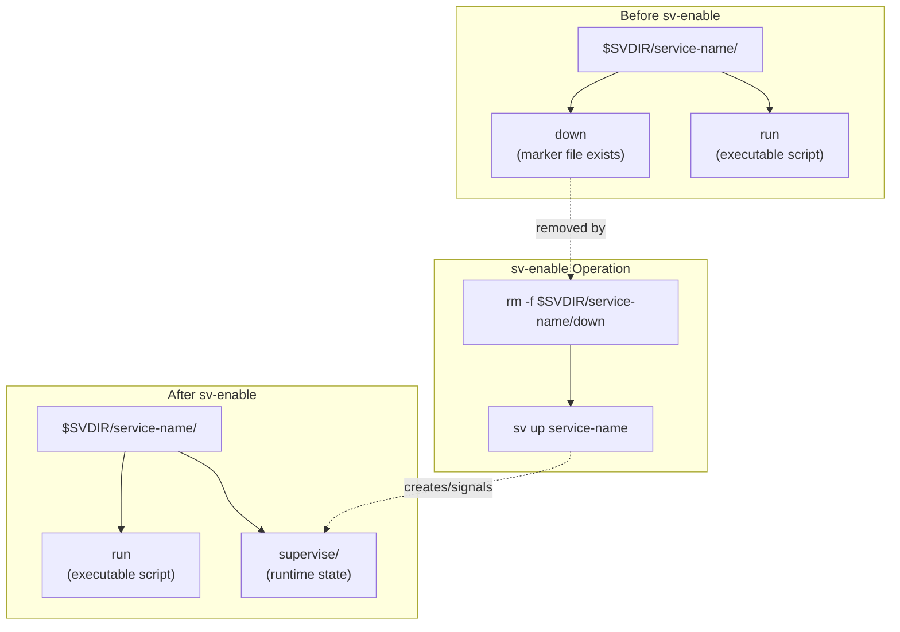
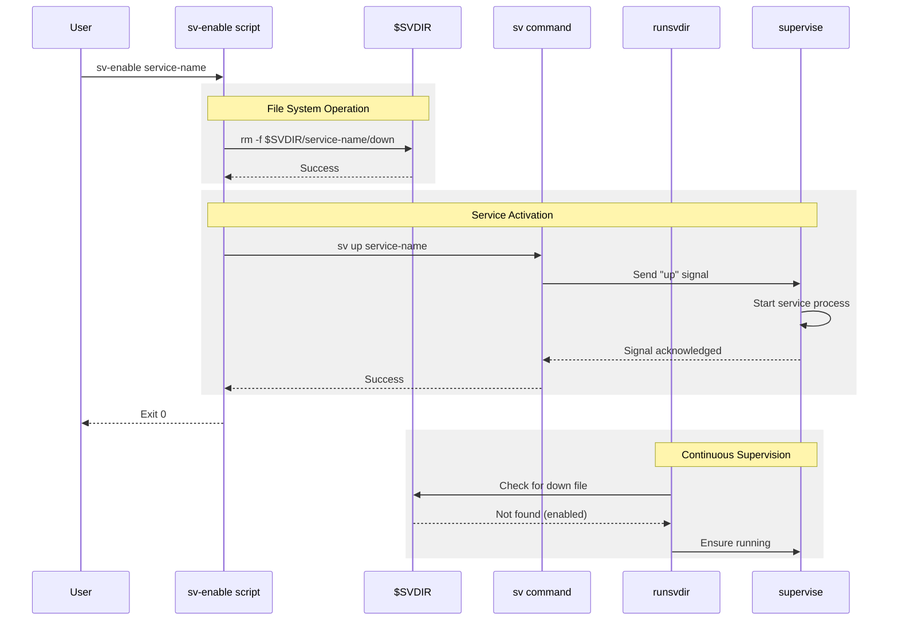

<!-- source: DeepWiki mcp.deepwiki.com · repo termux/termux-services · page 6.1 sv-enable · fetched 2026-10-26 -->

# sv-enable

<details>
<summary>Relevant source files</summary>

The following files were used as context for generating this wiki page:

- [README.md](README.md)
- [sv-enable](sv-enable)

</details>


## Purpose and Scope

This page provides complete reference documentation for the `sv-enable` command, which enables services for autostart in the termux-services system. When a service is enabled, it will automatically start when the service daemon initializes and will be supervised continuously.

For user-oriented guidance on enabling services, see [Enabling and Disabling Services](#4.1). For disabling services, see [sv-disable](#6.2). For information about the `sv` command used to control services at runtime, see [Integration with runit](#8).

**Sources:** [README.md:1-10](), [sv-enable:1-21]()

## Synopsis

```
sv-enable <service-name>
```

**Sources:** [sv-enable:5-6]()

## Description

The `sv-enable` command enables a service for autostart by removing the `down` file from the service directory and immediately starting the service. Once enabled, the service will:

1. Start automatically when `runsvdir` detects the absence of the `down` file
2. Remain supervised continuously until explicitly stopped or disabled
3. Restart automatically if it crashes (subject to the service's `run` script behavior)

The command performs two operations atomically:
1. **Removes** the disable marker: `$SVDIR/<service-name>/down`
2. **Starts** the service immediately: executes `sv up <service-name>`

**Sources:** [sv-enable:19-20](), [README.md:9]()

## Implementation

The `sv-enable` script is a shell script located at `$PREFIX/bin/sv-enable`. Its implementation follows this flow:



**Diagram: sv-enable execution flow**

**Sources:** [sv-enable:3-21]()

### Argument Validation

The script first validates that a service name was provided [sv-enable:11-14]():

```bash
if [ -z "$1" ];then
    show_help
    exit 1
fi
```

If no argument is provided, it displays usage information via `show_help()` [sv-enable:3-10]() and exits with status code 1.

**Sources:** [sv-enable:11-14](), [sv-enable:3-10]()

### Environment Validation

The script attempts to verify that the `SVDIR` environment variable is set [sv-enable:15-18]():

```bash
if [ -u "$SVDIR" ];then
    >&2 echo "Error: SVDIR not set"
    exit 1
fi
```

**Note:** The implementation uses the `-u` test operator, which checks for the setuid bit on a file, not whether a variable is empty. This check may not function as intended in all scenarios. The `SVDIR` variable is normally set by the login scripts to `$PREFIX/var/service`.

**Sources:** [sv-enable:15-18]()

### File System Operation

The core enabling operation removes the `down` file [sv-enable:19]():

```bash
rm -f "$SVDIR/$1/down"
```

The `-f` flag ensures the command succeeds even if the file doesn't exist (service already enabled).

**Sources:** [sv-enable:19]()

### Service Activation

After removing the disable marker, the script immediately starts the service [sv-enable:20]():

```bash
sv up $1
```

This delegates to the `sv` command from runit, which sends the "up" signal to the supervise process. The `runsvdir` process will detect the absence of the `down` file and ensure the service remains running.

**Sources:** [sv-enable:20]()

## State Transitions



**Diagram: Service state transitions affected by sv-enable**

**Sources:** [README.md:9](), [sv-enable:19-20]()

## File System Impact



**Diagram: Filesystem changes during sv-enable**

**Sources:** [sv-enable:19-20](), [README.md:9]()

## Exit Status

| Exit Code | Meaning |
|-----------|---------|
| 0 | Service enabled successfully |
| 1 | Missing service name argument OR SVDIR validation failed |
| Other | Exit code from `sv up` command (propagated) |

The script does not explicitly check if the service directory exists before attempting to remove the `down` file. If the service doesn't exist, the `rm -f` will succeed silently, but the subsequent `sv up` will fail.

**Sources:** [sv-enable:12-18]()

## Environment Variables

| Variable | Purpose | Typical Value |
|----------|---------|---------------|
| `SVDIR` | Service directory location | `$PREFIX/var/service` |

The `SVDIR` variable must be set for the command to function. This is normally configured by the login integration scripts [start-services.sh]() or [start-services.fish]().

**Sources:** [sv-enable:15-19]()

## Examples

### Enable a service

```bash
$ sv-enable sshd
```

This removes `$PREFIX/var/service/sshd/down` and executes `sv up sshd`.

### Enable multiple services

```bash
$ sv-enable crond
$ sv-enable nginx
$ sv-enable postgres
```

Each service must be enabled individually; the command does not accept multiple arguments.

### Check if a service is enabled

```bash
$ test -f "$SVDIR/sshd/down" && echo "disabled" || echo "enabled"
```

The presence of the `down` file indicates the service is disabled.

**Sources:** [sv-enable:5-6](), [README.md:5]()

## Files Modified

| Path | Operation | Purpose |
|------|-----------|---------|
| `$SVDIR/<service>/down` | Removed | Disable marker that prevents autostart |

The script does not modify any other files. The `sv up` command may trigger changes in the `$SVDIR/<service>/supervise/` directory as runit manages the service process.

**Sources:** [sv-enable:19](), [README.md:9]()

## Integration with Service Supervision



**Diagram: sv-enable interaction with service supervision components**

**Sources:** [sv-enable:19-20](), [README.md:9]()

## Related Commands

- **[sv-disable](#6.2)**: Disables a service by creating the `down` file
- **[service-daemon](#6.3)**: Manages the runsvdir process that supervises services
- **`sv up`**: Starts a service without changing its enabled/disabled state (see [Integration with runit](#8))
- **`sv down`**: Stops a service temporarily without disabling it
- **`sv status`**: Checks current service status

**Sources:** [README.md:5-8](), [sv-enable:20]()

## Technical Notes

### Idempotency

The command is idempotent. Running `sv-enable` on an already-enabled service will:
1. Attempt to remove a non-existent `down` file (succeeds due to `-f` flag)
2. Send an "up" signal to an already-running service (harmless)

### Race Conditions

There is a small window between removing the `down` file and executing `sv up` where `runsvdir` might detect the file change and start the service independently. This is harmless as the `sv up` command will simply ensure the service is running.

### Permissions

The script requires:
- Write access to `$SVDIR/<service>/` to remove the `down` file
- Ability to communicate with the supervise process via the `sv` command

**Sources:** [sv-enable:19-20]()

## Service Directory Requirements

For `sv-enable` to succeed, the service directory must exist at `$SVDIR/<service-name>/` with at least a `run` script. The typical structure is:

```
$SVDIR/<service-name>/
├── run              # Required: service executable
├── down             # Optional: disable marker (removed by sv-enable)
├── log/             # Optional: logging configuration
│   └── run          # Log process executable
└── supervise/       # Created by runit at runtime
```

**Sources:** [README.md:9]()

---

