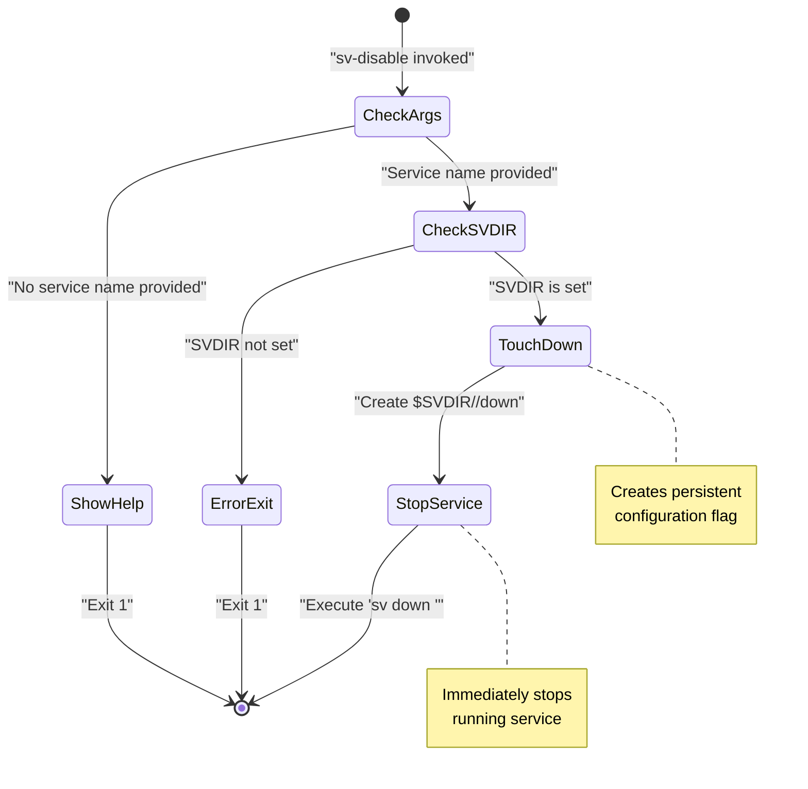
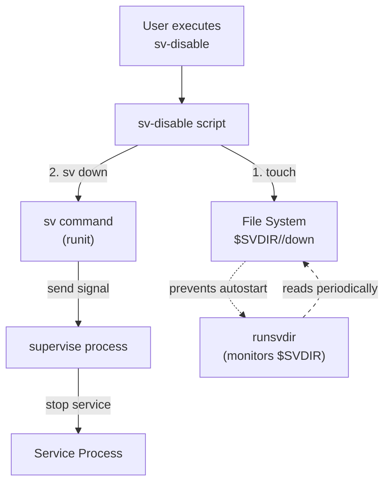
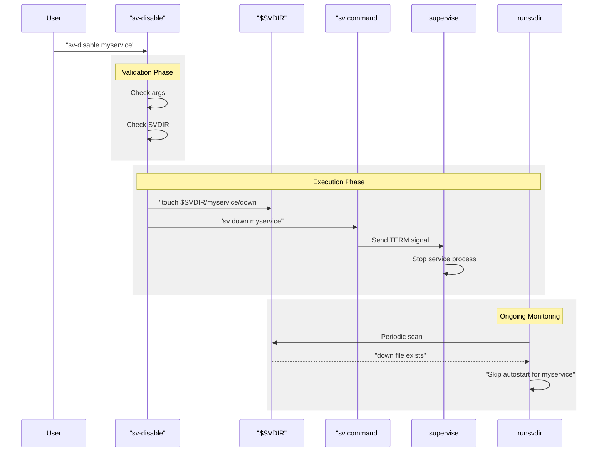

<!-- source: DeepWiki mcp.deepwiki.com · repo termux/termux-services · page 6.2 sv-disable · fetched 2026-10-26 -->

# sv-disable

<details>
<summary>Relevant source files</summary>

The following files were used as context for generating this wiki page:

- [README.md](README.md)
- [sv-disable](sv-disable)

</details>


## Purpose and Scope

This document provides complete reference documentation for the `sv-disable` command. The command disables a service from autostart by creating a `down` file in the service directory and stopping the service immediately if it is running.

For information about enabling services for autostart, see [sv-enable](#6.1). For information about immediately stopping a service without disabling autostart, see [Starting and Stopping Services](#4.2). For general information about enabling and disabling services, see [Enabling and Disabling Services](#4.1).

## Overview

The `sv-disable` command performs two operations:

1. Creates a `down` file at `$SVDIR/<service>/down` to prevent the service from autostarting
2. Stops the service immediately by executing `sv down <service>`

The `down` file serves as a persistent configuration flag that `runsvdir` monitors. When `runsvdir` detects a `down` file in a service directory, it will not automatically start that service, even after system restart.

**Sources:** [sv-disable:1-21](), [README.md:8-9]()

## Command Syntax

```
sv-disable <service-name>
```

### Parameters

| Parameter | Required | Description |
|-----------|----------|-------------|
| `<service-name>` | Yes | Name of the service to disable. Must correspond to a directory in `$SVDIR`. |

**Sources:** [sv-disable:5-6]()

## State Transitions



**Diagram: sv-disable Execution Flow**

**Sources:** [sv-disable:11-21]()

## Behavior Details

### Argument Validation

The command first validates that a service name argument was provided. If no argument is supplied, it displays help text and exits with code 1.

**Sources:** [sv-disable:11-14]()

### Environment Validation

After argument validation, `sv-disable` checks whether the `SVDIR` environment variable is set using the `-u` test. If `SVDIR` is not set, the command prints an error message to stderr and exits with code 1.

**Note:** There is a bug in the environment check at [sv-disable:15](). The condition `[ -u "$SVDIR" ]` tests if the variable is unset, but the `-u` flag is actually for checking setuid bit on files. The correct test should be `[ -z "$SVDIR" ]` to check if the variable is empty.

**Sources:** [sv-disable:15-18]()

### Creating the Down File

The command uses `touch` to create an empty file at `$SVDIR/<service-name>/down`. If the file already exists, `touch` updates its timestamp. The presence of this file signals to `runsvdir` that the service should not autostart.

**Sources:** [sv-disable:19]()

### Stopping the Service

After creating the `down` file, `sv-disable` executes `sv down <service-name>` to immediately stop the service if it is currently running. This is a native runit command that sends signals to the `supervise` process.

**Sources:** [sv-disable:20]()

## Component Interaction



**Diagram: sv-disable Component Interactions**

This diagram shows how `sv-disable` interacts with both the filesystem state layer and the runtime supervision layer. The `touch` operation creates persistent state, while the `sv down` operation affects the currently running process.

**Sources:** [sv-disable:19-20](), [README.md:8-9]()

## Exit Codes

| Exit Code | Condition |
|-----------|-----------|
| 0 | Success - down file created and service stop command issued |
| 1 | Failure - no service name provided or SVDIR not set |

The command does not check whether the service directory exists before attempting to create the down file. If the service directory does not exist, `touch` will fail with an error message, but the script will continue to execute `sv down`.

**Sources:** [sv-disable:13-14](), [sv-disable:17-18]()

## File System Operations

### Down File Location

The down file is created at the following path:

```
$SVDIR/<service-name>/down
```

Where:
- `$SVDIR` typically resolves to `$PREFIX/var/service`
- `<service-name>` is the directory name for the service
- `down` is the filename (no extension)

### File Contents

The down file created by `touch` is empty. Only the presence of the file matters; its contents are not used by `runsvdir`.

**Sources:** [sv-disable:19](), [README.md:9]()

## Command Execution Timeline



**Diagram: sv-disable Execution Timeline**

**Sources:** [sv-disable:11-21]()

## Usage Examples

### Basic Usage

Disable a service named `sshd`:

```
$ sv-disable sshd
```

This creates `$SVDIR/sshd/down` and executes `sv down sshd`.

### Error Cases

Attempting to disable without specifying a service:

```
$ sv-disable
Usage:
    sv-disable <service-name>

    Disabling a service will make it not autostart
```

Attempting to disable when SVDIR is not set:

```
$ unset SVDIR
$ sv-disable sshd
Error: SVDIR not set
```

**Sources:** [sv-disable:3-9](), [sv-disable:16]()

## Relationship to Other Commands

| Command | Purpose | Persistent | Immediate Effect |
|---------|---------|------------|------------------|
| `sv-disable` | Disable autostart and stop service | Yes (creates down file) | Yes (stops service) |
| `sv-enable` | Enable autostart (remove down file) | Yes (removes down file) | No (does not start) |
| `sv down` | Stop service temporarily | No | Yes (stops service) |
| `sv up` | Start service temporarily | No | Yes (starts service) |

The key distinction is that `sv-disable` combines persistent configuration (the down file) with immediate action (stopping the service).

**Sources:** [sv-disable:19-20](), [README.md:5-9]()

## Implementation Details

### Script Type

The `sv-disable` command is implemented as a POSIX shell script using `#!/bin/sh`. It relies on standard shell builtins and external commands.

**Sources:** [sv-disable:1]()

### Dependencies

The script depends on the following:

1. **Environment Variables:**
   - `SVDIR` - must be set to the service directory path

2. **External Commands:**
   - `touch` - for creating the down file
   - `sv` - the runit service control command

3. **File System:**
   - Service directory must exist at `$SVDIR/<service-name>/`

**Sources:** [sv-disable:15-20]()

### Help Function

The script defines a `show_help()` function that displays usage information. This function is invoked when no arguments are provided.

**Sources:** [sv-disable:3-10]()

## Common Usage Patterns

### Disabling at Boot

To prevent a service from starting automatically after the next shell restart:

```
$ sv-disable myservice
```

The service will remain disabled until explicitly re-enabled with `sv-enable`.

### Temporary vs Permanent Disable

- **Temporary stop:** Use `sv down myservice` to stop the service but allow it to restart on next boot
- **Permanent disable:** Use `sv-disable myservice` to stop the service and prevent autostart

### Verification

To verify a service is disabled, check for the down file:

```
$ test -f "$SVDIR/myservice/down" && echo "disabled" || echo "enabled"
```

**Sources:** [README.md:8-9]()

## Integration with Service Supervision

The down file mechanism integrates with `runsvdir`'s monitoring behavior. The `runsvdir` process periodically scans `$SVDIR` and checks for the presence of down files. When detected, `runsvdir` will not spawn a `supervise` process for that service, effectively preventing autostart.

For more information on how the supervision system works, see [Service Daemon](#5.2) and [Integration with runit](#8).

**Sources:** [README.md:9]()

---

