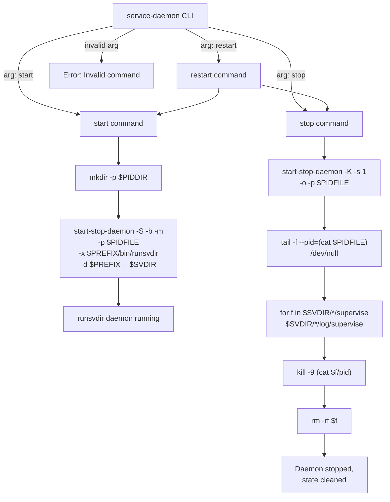
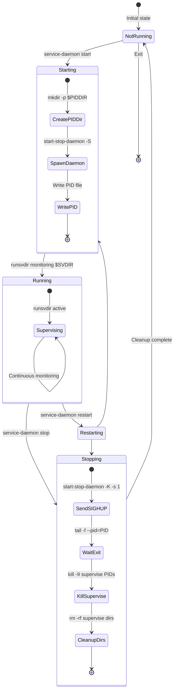
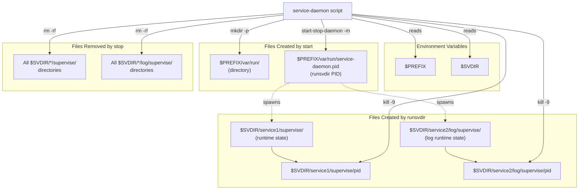

<!-- source: DeepWiki mcp.deepwiki.com · repo termux/termux-services · page 6.3 service-daemon · fetched 2026-10-26 -->

# service-daemon

<details>
<summary>Relevant source files</summary>

The following files were used as context for generating this wiki page:

- [README.md](README.md)
- [service-daemon](service-daemon)

</details>


## Purpose and Scope

This page provides a complete command reference for `service-daemon`, the lifecycle management script that controls the `runsvdir` supervision daemon. This covers command syntax, behavior, and implementation details.

For architectural information about how `service-daemon` fits into the overall system design, see [Architecture > Service Daemon](#5.2). For information about how `service-daemon` is automatically started during shell login, see [Architecture > Login Integration](#5.3).

Sources: [service-daemon:1-48]()

## Synopsis

```bash
service-daemon start
service-daemon stop
service-daemon restart
```

Sources: [service-daemon:24-45]()

## Description

`service-daemon` is a shell script that manages the lifecycle of the `runsvdir` process, which is the core supervision daemon for termux-services. The script provides standard daemon management operations (start, stop, restart) and uses the `start-stop-daemon` utility for robust process control.

When started, `service-daemon` spawns `runsvdir` as a background daemon that continuously monitors the `$SVDIR` directory for service definitions. When stopped, it performs aggressive cleanup of all supervision state to ensure a clean shutdown.

The script is typically invoked automatically by shell login scripts ([start-services.sh]() and [start-services.fish]()) rather than manually by users.

Sources: [service-daemon:1-48](), [README.md:4]()

## Commands

### start

Starts the `runsvdir` daemon in the background.

**Behavior:**
1. Creates the PID directory (`$PREFIX/var/run`) if it does not exist
2. Launches `runsvdir $SVDIR` as a background daemon using `start-stop-daemon`
3. Records the daemon's PID in `$PREFIX/var/run/service-daemon.pid`
4. Changes working directory to `$PREFIX` before execution

**Implementation:**
```
start-stop-daemon -S -b -m -p $PIDFILE -x $DAEMON -d $PREFIX -- $DAEMON_OPTS
```

| Flag | Description |
|------|-------------|
| `-S` | Start mode |
| `-b` | Background (daemonize) |
| `-m` | Make PID file |
| `-p $PIDFILE` | PID file path: `$PREFIX/var/run/service-daemon.pid` |
| `-x $DAEMON` | Executable: `$PREFIX/bin/runsvdir` |
| `-d $PREFIX` | Change directory to `$PREFIX` |
| `-- $DAEMON_OPTS` | Arguments: `$SVDIR` |

Sources: [service-daemon:4-7](), [service-daemon:16-22]()

### stop

Stops the `runsvdir` daemon and performs aggressive cleanup of all supervision state.

**Behavior:**
1. Sends SIGHUP (signal 1) to the `runsvdir` process identified by the PID file
2. Waits for the process to exit completely using `tail -f --pid=...`
3. For each service in `$SVDIR/*/supervise` and `$SVDIR/*/log/supervise`:
   - Sends SIGKILL (signal 9) to the supervise process
   - Removes the supervise directory entirely
4. Suppresses errors if supervise processes do not exist

**Implementation:**
```
start-stop-daemon -K -s 1 -o -p $PIDFILE
tail -f --pid=`cat $PIDFILE` /dev/null
for f in $SVDIR/*/supervise $SVDIR/*/log/supervise;do
    kill -9 `cat $f/pid` 2>/dev/null ||:
    rm -rf $f
done
```

| Flag | Description |
|------|-------------|
| `-K` | Kill mode |
| `-s 1` | Send signal 1 (SIGHUP) |
| `-o` | Override (succeed even if process not running) |
| `-p $PIDFILE` | PID file path |

**Cleanup rationale:** The aggressive SIGKILL and directory removal ensures that no stale supervision state persists after shutdown. This prevents issues when restarting the daemon.

Sources: [service-daemon:8-15]()

### restart

Stops the daemon, then starts it again. This is equivalent to running `stop` followed by `start`.

**Behavior:**
1. Executes the `stop` command (including all cleanup)
2. Executes the `start` command
3. Reports status messages for both operations

Sources: [service-daemon:35-40]()

## Command Flow



Sources: [service-daemon:4-40]()

## Process Lifecycle and State



Sources: [service-daemon:4-15](), [service-daemon:35-40]()

## File System Interaction



Sources: [service-daemon:5-6](), [service-daemon:11-14](), [service-daemon:18-22]()

## Environment Variables

`service-daemon` depends on the following environment variables, which are typically set by shell login scripts:

| Variable | Description | Typical Value |
|----------|-------------|---------------|
| `$PREFIX` | Termux installation prefix | `/data/data/com.termux/files/usr` |
| `$SVDIR` | Service directory monitored by runsvdir | `$PREFIX/var/service` |

The script also uses internally-defined variables:

| Variable | Definition | Purpose |
|----------|------------|---------|
| `NAME` | `service-daemon` | Daemon name for logging |
| `PIDDIR` | `$PREFIX/var/run` | Directory for PID files |
| `PIDFILE` | `$PIDDIR/$NAME.pid` | Full path to PID file |
| `DAEMON` | `$PREFIX/bin/runsvdir` | Path to runsvdir executable |
| `DAEMON_OPTS` | `$SVDIR` | Arguments passed to runsvdir |

Sources: [service-daemon:16-22]()

## Files

### Created Files

| Path | Created By | Purpose | Removed By |
|------|------------|---------|------------|
| `$PREFIX/var/run/` | `start` command | PID file directory | Manual deletion only |
| `$PREFIX/var/run/service-daemon.pid` | `start` command | Stores runsvdir PID | `stop` command (indirectly) |

### Accessed Files

| Path Pattern | Operation | Command |
|--------------|-----------|---------|
| `$SVDIR/*/supervise/pid` | Read and SIGKILL | `stop` |
| `$SVDIR/*/log/supervise/pid` | Read and SIGKILL | `stop` |
| `$SVDIR/*/supervise/` | Remove directory | `stop` |
| `$SVDIR/*/log/supervise/` | Remove directory | `stop` |

Sources: [service-daemon:5-6](), [service-daemon:11-14]()

## Exit Status

The script exits with the following status codes:

| Exit Code | Condition |
|-----------|-----------|
| 0 | Successful execution of start, stop, or restart |
| 1 | Invalid command argument (not start, stop, or restart) |

The script uses `set -e`, so it will exit immediately with non-zero status if any command in the `start` or `stop` functions fails.

Sources: [service-daemon:3](), [service-daemon:43-47]()

## Examples

### Starting the daemon manually

```bash
$ service-daemon start
Starting daemon: service-daemon.
```

This creates the PID file and spawns `runsvdir` in the background.

### Stopping the daemon

```bash
$ service-daemon stop
Stopping daemon: service-daemon.
```

This sends SIGHUP to runsvdir, waits for it to exit, then aggressively cleans up all supervise directories.

### Restarting the daemon

```bash
$ service-daemon restart
Restarting daemon: service-daemon.
```

This performs a full stop (with cleanup) followed by a fresh start.

### Checking if the daemon is running

```bash
$ test -f $PREFIX/var/run/service-daemon.pid && echo "Running" || echo "Not running"
```

The presence of the PID file indicates the daemon was started. To verify it's actually running:

```bash
$ kill -0 $(cat $PREFIX/var/run/service-daemon.pid) 2>/dev/null && echo "Running" || echo "Not running"
```

Sources: [service-daemon:25-40]()

## Implementation Details

### Use of start-stop-daemon

The script uses the `start-stop-daemon` utility, which provides robust daemon management:

- **Process tracking:** Uses PID files to track the daemon process
- **Idempotency:** Safe to call start/stop multiple times
- **Signal handling:** Properly sends signals and handles non-existent processes
- **Background execution:** Daemonizes the process automatically

Sources: [service-daemon:6](), [service-daemon:9]()

### Cleanup Strategy

The `stop` command implements a two-phase shutdown:

**Phase 1: Graceful shutdown**
- Sends SIGHUP to `runsvdir` [service-daemon:9]()
- Waits for the process to exit cleanly [service-daemon:10]()

**Phase 2: Aggressive cleanup**
- Sends SIGKILL to all supervise processes [service-daemon:12]()
- Removes all supervise directories [service-daemon:13]()
- Suppresses errors with `||:` to handle missing processes [service-daemon:12]()

This aggressive approach ensures no stale state remains, which could cause issues on restart. The `supervise` directories contain runtime state (PID files, lock files, control sockets) that should not persist across daemon restarts.

Sources: [service-daemon:8-15]()

### Working Directory

The daemon is started with `$PREFIX` as the working directory (`-d $PREFIX`). This ensures that relative paths in service run scripts are resolved correctly relative to the Termux prefix.

Sources: [service-daemon:6]()

## Integration with Shell Login

`service-daemon` is not typically invoked manually. Instead, it is automatically started by shell login scripts:

- **Bash/POSIX shells:** [etc/profile.d/start-services.sh]()
- **Fish shell:** [etc/fish/conf.d/start-services.fish]()

These scripts invoke `service-daemon start &` in the background during shell initialization, ensuring the supervision daemon is running whenever a new Termux session begins.

For details on this integration, see [Architecture > Login Integration](#5.3).

Sources: [README.md:4]()

---

